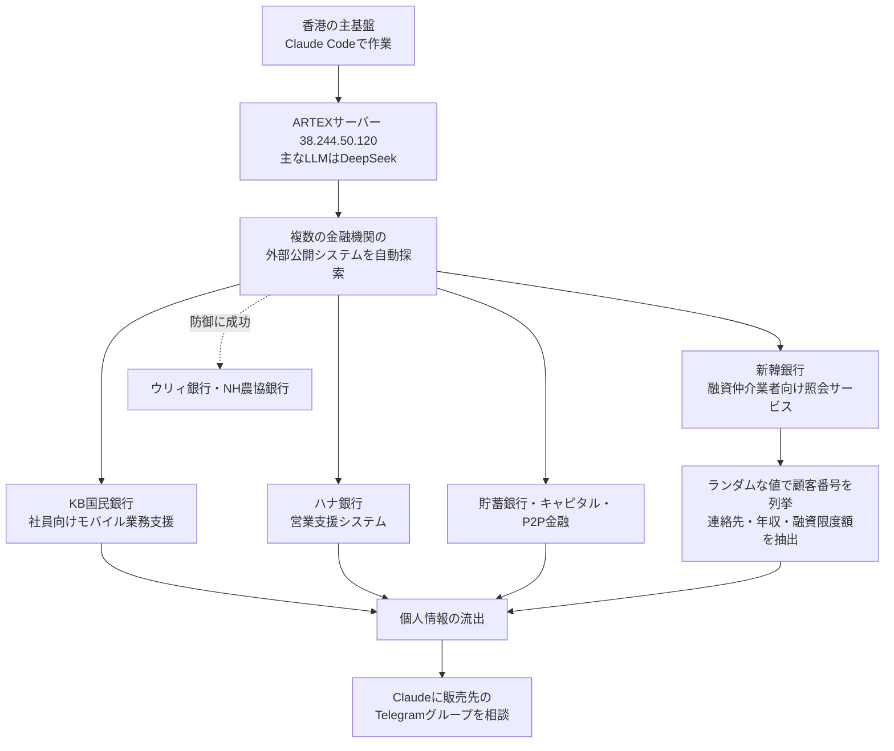

# 韓国の金融機関を襲った連続侵入 ― 中国製のAI自動ペネトレーションツール「ARTEX」とClaude Codeで、銀行の「周辺システム」が次々に破られた

## 要点

### 影響範囲

- 製品の脆弱性ではなく、LLMを使った自動ペネトレーションツールによる攻撃キャンペーン。2026年9月下旬〜10月初めに活動した（CrowdStrike）。
- 報道によれば、新韓銀行（約2万5000件、氏名・電話番号・年収・融資限度額など）、イェガラム貯蓄銀行（約4万件）、ウェルカム貯蓄銀行（法人顧客約2200件）、KB国民銀行、ハナ銀行、BNK釜山銀行、現代キャピタル、P2P金融2社で流出が確認された（京郷新聞、The Straits Times）。ウリィ銀行とNH農協銀行は侵入の試みを防いだ（The Straits Times）。
- 狙われたのは顧客向けのネットバンキングではなく、融資仲介業者向けの融資進捗照会サービス（新韓銀行）や社員向けのモバイル業務支援システム（KB国民銀行）など、守りの薄い周辺システムだった（京郷新聞、CrowdStrike）。

### 今すぐやること

- インターネットから届く業務システムを、顧客向けかどうかにかかわらず棚卸しし、業務上不要な外部公開をやめる（韓国金融委員会が金融機関に指示した内容）。
- 照会系のサービスで、ID・番号の総当たりや大量照会を検知・制限できているか確認する。新韓銀行の件では、ランダムな値を入れて有効な顧客番号を探し当てたとみられている（京郷新聞）。
- CrowdStrikeが公開したIPアドレス（後述）をファイアウォール・WAF・プロキシのログで照合する。

## 概要

- 9月30日に新韓銀行の流出が判明し、韓国の金融委員会（FSC）は10月4日に緊急会議を開いた。7社で同じ攻撃元IPアドレスが見つかり、当局は単一の攻撃者がAIツールで同時に侵入を試みたとみている。
- 攻撃に使われたサーバーのHTMLのタイトルに「ARTEX」の文字列があった。ARTEXは2026年7月にGitHubで公開された中国製のオープンソースのAI自動ペネトレーションツールで、情報収集から脆弱性の発見、攻撃経路の計画、検証までをエージェントが自動で進める。
- CrowdStrikeは攻撃者のサーバーの公開ディレクトリから、Claude Codeのセッション履歴、Claudeのメモリファイル、ARTEXの設定ファイルを見つけた。ARTEXはDeepSeekを主なLLMとして動いていた。攻撃者は中国語話者で金銭目的とみられる（確度は中程度）。開発者は悪用を受けてARTEXを非公開にした。

> この記事では、ベンダー・公的機関・研究者・報道で確認できた内容を「事実」、筆者の推測や意見を「考察」として分けて書いています。

## 何が起きたか（時系列）

| 日付 | 出来事 |
| --- | --- |
| 2026-07-26 | ARTEXがGitHubで公開される。開発者のGitHub IDは「Autumn-27」（京郷新聞） |
| 2026-09-03 | ARTEXが中国Baidu主催の攻防コンテストで約150チーム中の総合1位に（京郷新聞） |
| 2026-09-24 | ARTEXの最新版が公開される（京郷新聞） |
| 2026-09-27〜30 | KB国民銀行への攻撃が始まり、新韓・ハナ・BNK釜山・イェガラム貯蓄・現代キャピタルなどで外部からの侵入による流出（京郷新聞） |
| 2026-09-30 | 新韓銀行の流出が判明（The Straits Times） |
| 2026-10-02 | Genians Security Centerのムン・ジョンヒョン氏が、攻撃サーバーのHTMLタイトルに「ARTEX」と「自律ペネトレーションテストのコンソール」を意味する中国語の文字列があったと投稿（京郷新聞、BleepingComputer） |
| 2026-10-04 | FSCが金融業界の緊急点検会議。李在明大統領が徹底調査を指示（京郷新聞、The Straits Times） |
| 2026-10-06 | FSCと金融監督院が消費者警報（注意）を発令し、1か月の特別対応期間へ（FSC） |
| 2026-10-07 | CrowdStrikeが分析を公開（CrowdStrike） |
| 2026-10-08〜10 | ARTEXの開発者が非公開化と更新停止を表明。ただし既存のコードから英語・韓国語の派生版が作られている（The Hacker News、BleepingComputer） |

## 技術的な問題点（根本原因）

**事実（京郷新聞、The Straits Times、BleepingComputer）**

- 新韓銀行では、融資仲介業者が使う融資進捗照会サービスが破られた。攻撃者はランダムな値を入力して有効な顧客番号を探し当て、連絡先などを抜き出したとみられる。
- KB国民銀行では社員向けのモバイル業務支援システム、ハナ銀行では営業支援システムが侵害された。
- 京郷新聞が引用したセキュリティ企業Stealienの代表は、「金融の主要システムはID・パスワード以外の認証があるので無事だったが、今回は周辺システムだったためこうした攻撃が可能だった」と述べた。
- 当局は、特定の企業を狙い撃ちしたのではなく、AIが多数の金融機関を手当たり次第に攻め、守りの弱いところが破られたとみている（京郷新聞）。金融保安院の院長は、攻撃IPは銀行間でほぼ同じで、貯蓄銀行ではやや異なると述べた。攻撃には韓国・米国・日本・香港など8か国のIPが使われた。

**事実（CrowdStrike）**

- `38.244.50[.]120` がARTEXを動かしており、`:18899/.claude/CLAUDE.md` という公開ファイルに中国語のペネトレーション用の指示文が入っていた。そこに書かれていた香港のIPアドレスにも公開ディレクトリがあり、Claude Codeのセッション履歴、Claudeのメモリファイル、ARTEXの設定が見つかった。
- 構成は2台のサーバー。香港のIPが攻撃者の主な基盤で、`38.244.50[.]120` が韓国への攻撃を担ったとみられるARTEXを動かしていた。
- ARTEXの主なLLMはDeepSeek v4.1-flashで、GLM-5.3（Zhipu AI）とGrok 4.6も補助的に使われていた。DeepSeekにはLLMのAPI再販業者とみられる `xcai[.]pro` 経由で接続していた可能性が高い。
- 攻撃者はClaudeに、韓国の流出データがどこで売られているか、韓国向けのTelegramのデータ販売グループを探す手伝いを求めていた。盗んだデータの具体的な換金計画はなかった（BleepingComputer）。
- 攻撃者は同じAIツールで、今回の攻撃の成果を書き込んだ「セキュリティ研究者の履歴書」を作らせており、そこに個人情報が含まれていた。CrowdStrikeは、本人のものである可能性は高いが、現時点の情報では攻撃者と断定できないとしている。

**考察**

技術的な根本原因は、ツールの新しさではなく古典的なものに見える。外部から届く照会サービスで、番号を推測されても大量に照会できてしまう（列挙と総当たりへの対策が無い）こと、社員向けや取引先向けのシステムに顧客向けと同じ水準の認証がないこと。AIが変えたのは、そうした「どこか1つは弱い」場所を、多数の組織に対して短時間で探し回るコストだと考える。

## 攻撃・侵入経路

**事実（FSC、BleepingComputer）**

- FSCは10月4日の会議で、金融機関に次を指示した。顧客向けでないものも含めて外部からアクセスできるすべてのシステムを点検する、不要な情報の露出を減らし認証とアクセス制御の欠落を確認する、脅威情報を速やかに共有する、内部点検の結果を提出する（BleepingComputer）。
- FSCと金融監督院は10月6日、流出データを使ったフィッシングや融資詐欺への注意を呼びかけ、金融機関に相談窓口の設置、不正取引検知（FDS）の強化、補償の実施を指示した。10月6日時点で、流出データによる金銭被害は確認されていない（FSC）。

件数には報道で差がある。KB国民銀行は京郷新聞が119人、The Straits Timesが153人と報じている。

## なぜ防げなかったか・構造的要因の考察

ここからは筆者の考察である。

1. **守りの濃淡が攻撃者に読まれる**: 銀行は顧客向けのネットバンキングに追加認証を重ねている一方、仲介業者や社員向けの周辺システムは「利用者が限られる」ことを前提に軽い認証で済ませがちだ。人手の攻撃者なら後回しにする小さな入口も、自動化されたエージェントは全部試す。
2. **列挙できる識別子**: 顧客番号のような推測できる値だけで照会が通る設計は、レート制限や異常検知が無ければ、時間さえかければ全件取得につながる。AIによる自動化はその「時間」を縮める。
3. **ツールの公開と悪用の距離**: ARTEXは公開から約2か月、最新版の公開から3日で実攻撃に使われたと報じられている。開発者が非公開にしても、派生版はすでに出回っている。防御側は「ツールが消えたから終わり」とは考えられない。
4. **攻撃者の作業痕もAIに残る**: 今回、攻撃者を追えたのは公開ディレクトリに残ったClaude Codeの履歴とメモリファイルだった。AIエージェントを使う攻撃は、作業の記録が詳細に残りやすい。防御側・調査側にとっては新しい手がかりになる。

## 運用者向けの具体的な対策と検知ポイント

**対策（FSCの指示と報道で示された内容を要約）**

1. 外部からアクセスできる業務システムを、顧客向けかどうかにかかわらず洗い出し、業務上不要な公開をやめる。
2. 取引先・社員向けのシステムにも、顧客向けと同等の認証（多要素認証など）とアクセス制御を適用する。
3. 照会系のAPIや画面で、識別子の総当たり・大量照会を検知して止める（レート制限、失敗回数の監視、推測しにくい識別子への置き換え）。
4. 同業他社と脅威情報（攻撃元IP、手口）を速やかに共有する。
5. 流出した場合に備え、本人確認の強化や不正取引検知など、二次被害の対策を準備する。

**考察（追加でできること）**

- AIによる自動探索は、短時間に多数のパスやパラメータを試す。WAFやアプリのログで、同一送信元からの網羅的なアクセスや、存在しない番号への連続した照会を監視する。
- 自社でも、許可された範囲でAIを使った自動診断を周辺システムに当て、攻撃者より先に「どこか1つの弱い場所」を見つける。

**検知ポイント（CrowdStrike）**

- ARTEXを動かしていたIP：`38.244.50[.]120`
- 攻撃者が使ったプロキシIP：`101.53.80[.]20`、`205.214.59[.]31`、`124.155.252[.]63`、`154.201.79[.]246`、`23.248.249[.]90`、`23.158.220[.]98`、`103.248.148[.]84`、`203.160.133[.]172`、`209.209.85[.]38`
- 攻撃サーバーのHTMLタイトルに「ARTEX」と、自律ペネトレーションテストのコンソールを意味する中国語が含まれていた（京郷新聞）

## 参考リンク

- CrowdStrike: [Unknown Threat Actor Uses AI-Driven ARTEX to Target South Korean Finance](https://www.crowdstrike.com/en-us/blog/unknown-threat-actor-uses-artex-to-target-south-korean-finance/)
- Financial Services Commission: [FSC-FSS Issue Consumer Alert over Potential Phishing Scams Following Data Breaches in Financial Sector](https://www.fsc.go.kr/eng/pr010101/87887)
- 京郷新聞（英語版）: [Shinhan, KB, and Hana Bank hacked, and even second-tier lenders such as Yegaram Savings Bank and Hyundai Capital](https://www.khan.co.kr/en/article/202610042320007)
- The Straits Times: [South Korean banks on high alert after wave of cyberattacks](https://www.straitstimes.com/business/south-korean-banks-on-high-alert-after-wave-of-cyberattacks)
- BleepingComputer: [South Korea probes bank breaches amid suspected AI-powered attacks](https://www.bleepingcomputer.com/news/security/south-korea-probes-bank-breaches-amid-suspected-ai-powered-attacks/)
- BleepingComputer: [ARTEX AI, Claude agents used in cyberattacks on South Korean banks](https://www.bleepingcomputer.com/news/security/hacker-used-artex-ai-and-claude-agents-to-target-south-korean-banks/)
- The Hacker News: [ARTEX AI Pentesting Tool Used in Data Theft Attacks on South Korean Financial Firms](https://thehackernews.com/2026/10/artex-ai-pentesting-tool-used-in-data.html)
