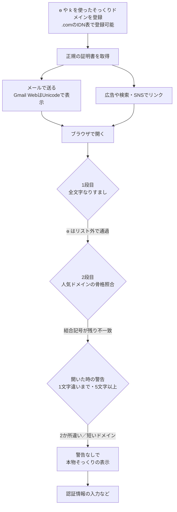

# Chromium ― 国際化ドメインの偽装が本物そっくりに表示される

## 要点

### 影響範囲

- Chrome・EdgeなどChromiumベースのブラウザのアドレスバー表示。研究者はChrome 154で、キリル文字だけで書いた `аррӏө.com`（`xn--80a6aa68c8d.com`）が有効な証明書つきでUnicodeのまま表示されることを確認した（Have I Been Squatted）。
- 抜け道は2種類。キリル文字の **ө**（U+04E9、カザフ語などの文字）と **ү**・**ї** は、Chromiumのなりすまし用文字リストに入っていない。ラテン文字の **ƙ**（フック付きk、ハウサ語などの文字）と ө は、比較用の「骨格」に印が残り、人気ドメインと一致しない（Have I Been Squatted、The Register）。
- メールでは、Gmail（Web）がテストした20のIDN送信元をすべてUnicodeで表示し、Outlook（Web）はすべてPunycodeで表示した（Have I Been Squatted）。

### 今すぐやること

- 自社ブランドについて、ө・ү・ƙ を使ったそっくりドメインを監視し、必要なら防衛的に登録する。4文字以下のブランドは、Chromeの「近い一致」の警告が働かないので特に注意する（研究者の推奨）。
- DNS・プロキシ・メールのログで `xn--` で始まるドメインを目印にする。業務でほとんど使わないなら、許可リスト外はタグ付け・警告・遮断する（研究者の推奨）。
- パスキー（FIDO2）など、接続先ドメインに結び付いた認証へ移行する。表示がどう見えても、`apple.com` 用のパスキーは `xn--80a6aa68c8d.com` には応答しない（研究者の推奨）。

## 概要

- 2017年、Xudong Zhengがキリル文字だけで書いた `аррӏе.com` を登録し、主要ブラウザが apple.com と見分けのつかない形で表示することを示した。Chromiumは以後、全文字がラテン文字のそっくりさんで構成されたラベルをPunycodeで表示する「全文字なりすまし」チェックを入れている。
- Have I Been SquattedのIan MuscatとLeanne Briffaは10月3日、最後の е を ө に替えるだけでこのチェックを外せること、さらに2段目の人気ドメイン照合もすり抜けることを公表した。apple・openai・skype・sharepoint・okta・nike など20の偽ドメインを実際に登録して確かめている。
- .comのゾーンを調べると、ASCIIのドメインに似たIDNの組が約16万2000あった。研究者は「似ている」だけで悪用の確認ではないとしている。The Registerが10月10日に報じた。

> この記事では、ベンダー・公的機関・研究者・報道で確認できた内容を「事実」、筆者の推測や意見を「考察」として分けて書いています。

## 何が起きたか（時系列）

| 日付 | 出来事 |
| --- | --- |
| 2003 | ドメイン名に英数字以外の文字が使えるようになる（Have I Been Squatted） |
| 2017-04 | Xudong Zhengが `аррӏе.com` を公表。Chromiumが全文字なりすましチェックを導入（Chrome 58）（Have I Been Squatted） |
| 2026-05 | Chrome 148がICU 78.2（Unicode 17）に移行し、ҏ と ӿ が使えなくなる（Have I Been Squatted） |
| 2026-09-11 | Chromiumのキリル文字なりすましリストに м が追加され、28文字から29文字に（Chrome 155には未反映）（Have I Been Squatted） |
| 2026-09-22 | Chrome 154が安定版に。この時点でも ө・ї・ү はリスト外（The Register） |
| 2026-10-03 | Have I Been Squattedが研究「Turning IDN edge cases into typosquats」を公表 |
| 2026-10-10 | The Registerが報道 |

公開情報の範囲では、Google（Chromium）がこの研究にどう対応するかは確認できなかった。

## 技術的な問題点（根本原因）

**事実（Have I Been Squatted）**

Chromiumは、ドメインの各ラベルをUnicodeで表示してよいかを2段階で判定し、どちらかで引っかかるとPunycode（`xn--`）で表示する。

- **1段目 `SafeToDisplayAsUnicode()`**：ラベルごとに7つのチェックを順に行う。代表的なのは、文字種（スクリプト）の混在チェック（認められる混在はラテン文字と中国語・日本語・韓国語の文字の組み合わせだけ）と、全文字なりすましチェック。後者は「キリル文字だけのラベルで、**全文字が**ラテン文字に似た29文字のリストに入っている」場合にPunycodeにする。
- **2段目 `GetSimilarTopDomain()`**：ホスト名全体を「骨格」（アクセントを外し、似た文字をASCIIに寄せた比較用の文字列）に変換し、Chromiumに同梱された8,462の人気ドメイン（うち上位836）の骨格と完全一致するか調べる。

抜け道は次のとおり。

- **全文字なりすましチェックは「全部か無か」**：リストに無い文字が1つでもあると、チェックそのものが働かない。研究者はこの文字を「ブレーカー」と呼ぶ。現行で条件を満たすのは ү（y に似る）、ө（o・e に似る）、ї（i に似る）。`аррӏе` はPunycodeになるが、`аррӏө` は「安全」と判定される。
- **骨格に印が残る**：アクセント（ó など）は骨格を作るときに外れ、`ókta.com` は `okta` と一致してPunycodeになる。一方、ƙ は1文字として格納されているため外す印がなく、その後の変換で「k＋結合記号」になって記号が残る。ө も「o＋横棒の結合記号」になる。結果として `oƙta.com` は okta と1文字、`аррӏө.com` は apple と2か所ずれて、照合をすり抜ける。
- **ページを開いた時の警告も届かない**：Chromiumには、よく訪れるサイトや人気ドメインに「1文字違い」「隣り合う2文字の入れ替え」で近い場合に出すSafety Tipがある。しかし `аррӏө.com` は2か所違いで対象外、`okta` のようにドットの前が5文字未満のドメインは近い一致の判定自体を行わない。研究者の検証では、どちらも本物の常用者でも警告なしで開いた。
- **登録もできる**：.comを管理するVerisignのキリル文字表には、カザフ語の文字として ө が含まれている。

**考察**

個々の判定はそれぞれ理屈が通っている。正規のキリル語ドメインを潰さないための「全部か無か」、ラテン文字の正当な表記（bücher.de など）を守るための人気ドメイン限定の照合、誤警告を避けるための「1文字違いまで」。ただ、研究者が指摘するとおり、各層は自分の判断だけをしていて、ほかの層が何を通したかを見ていない。抜け道は、層と層のあいだの「どちらの担当でもない領域」にできている。

## 攻撃・侵入経路

**事実（Have I Been Squatted）**

- メールでは、ブラウザのチェックは働かない。Webメールが送信元を自分でデコードして表示するため、ブラウザはただの文字として受け取る。Gmailは From 欄をUnicodeで表示し、Punycodeは別欄の「mailed-by」にだけ出た。Outlook Webは café.com のような無害なIDNも含めてすべてPunycodeで表示した。どちらもそっくりかどうかの判定はしていなかった。
- 攻撃者が自分で持つそっくりドメインなら、SPF・DKIM・DMARCはすべて正しく通る。
- .comのゾーン（約1億6722万件、うちIDN約73万件）を調べると、ASCIIのドメインに似たIDNの組が161,894あり、うち102,592組はChromiumがUnicodeで表示する完全一致だった。防衛目的の登録や多言語サイトも含まれ、悪用の確認ではない。

The Registerは見出しで攻撃者による悪用に触れているが、研究者が公表したドメインは研究用に登録したデモで、実際の攻撃での使用は記事中では示されていない。

## なぜ防げなかったか・構造的要因の考察

ここからは筆者の考察である。

1. **「アドレスバーを確認しろ」の限界**: 利用者向けの定番の助言は、表示された名前が正しく読めることを前提にしている。ブラウザ側のチェックが1文字ずつ穴を塞ぐ方式である以上、表示に頼る判断はいたちごっこになる。
2. **文字リスト方式の宿命**: なりすましリストは手作業で保守され、Unicodeやレジストリの文字表の更新とは別に動く。Chrome 148で ҏ・ӿ が、9月に м が塞がれたように、穴は見つかるたびに後追いで閉じられる。
3. **短いブランド名の不利**: 誤警告を減らすための「5文字以上」の条件が、okta・nike・sky・vk のような短く価値の高いブランドを守れない形になっている。
4. **メールが最大の入口**: Chromiumの対策はアドレスバーにしか効かない。Gmailがすべてデコードして見せる以上、送信元の見た目で判断させる運用は成り立たない。

## 運用者向けの具体的な対策と検知ポイント

**対策（Have I Been Squattedの推奨を要約）**

1. 守りたいドメインについて、骨格の比較をすり抜ける表記（ө・ү・ƙ など）を防衛的に登録する。アクセント付きの表記は、人気ドメインならChromeがすでに捕まえる。
2. 4文字以下のブランドは、フック付き・横棒付きの表記を直接押さえる。
3. 守りたいドメインから2文字以内のずれに収まる新規の `xn--` 登録を監視する。
4. メールゲートウェイのなりすまし保護を自社ドメインに対して有効にし、`xn--` の送信元ドメインにタグを付けるルールと、外部送信者バナーを維持する。
5. パスキーなどドメインに結び付いた認証に移行する。
6. DNS・プロキシのログで `xn--` の名前を目印にする。エンコードされた名前は、表示の仕方では隠せない。

**検知ポイント**

- DNS・プロキシ・メールゲートウェイのログに現れる `xn--` ドメイン（研究者が公表した例：`xn--80a6aa68c8d.com`＝аррӏө.com、`xn--ota-f6a.com`＝oƙta.com、`xn--nie-g6a.com`＝niƙe.com。いずれも研究用のデモ）
- 証明書透明性（CT）ログで、自社ブランドに似たIDNへの新規の証明書発行
- 送信元が `xn--` で、表示名が自社や取引先を名乗るメール

## 参考リンク

- Have I Been Squatted: [Turning IDN edge cases into typosquats](https://haveibeensquatted.com/blog/turning-idn-edge-cases-into-typosquats)
- The Register: [Two characters open up a world of typosquatting opportunities in Chromium browsers](https://www.theregister.com/security/2026/10/10/two-characters-open-up-a-world-of-typosquatting-opportunities-in-chromium-browsers/5302383)
- Chromium: [idn_spoof_checker.cc](https://chromium.googlesource.com/chromium/src/+/main/components/url_formatter/spoof_checks/idn_spoof_checker.cc)
- Unicode: [Unicode Technical Standard #39 (Unicode Security Mechanisms)](https://www.unicode.org/reports/tr39/)
