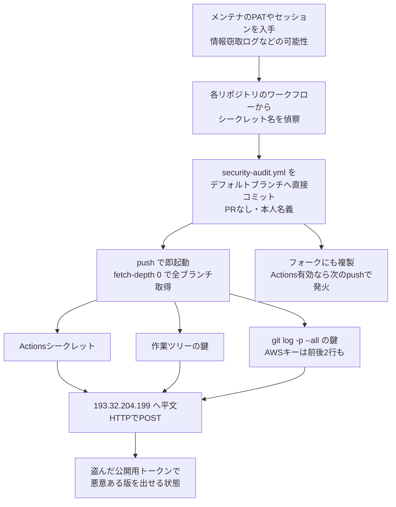

# GhostAction再来 ― 偽「Security Audit」ワークフローで鍵を窃取

## 要点

### 影響範囲

- GitHubの製品の脆弱性ではなく、**乗っ取られたメンテナのアカウント**を使って、悪意あるワークフローを書き込み権限のあるすべてのリポジトリに直接コミットする攻撃（StepSecurity、Socket）。
- 2026年8月31日以降に `security-audit.yml`（名前「Security Audit」）、`github_actions_security.yml`（名前「Github Actions Security」）、`security-check.yml` が追加・変更されたリポジトリが対象。送信先はハードコードされたIPアドレス `193.32.204[.]199`（StepSecurity、GitGuardian）。
- 10月8日の波では、ゲームエンジン pyxel（スター約1.8万）の作者 kitao と、uber/athenadriver の原作者 henrywoo のアカウントから計346リポジトリ（フォーク279を含む）に押し込まれた（Socket）。Socketは10月9日の更新で、10月7日以降に500超のアカウントから数万のリポジトリへ同じワークフローがコミットされたとしている。

### 今すぐやること

- 自分の組織で `org:<組織名> "193.32.204.199"`、`"AKIA_CTX_START"`、`"c=monami"` をGitHubのコード検索で調べる。ヒットしたら侵害済みとして扱う（StepSecurity）。
- 該当したら、Actionsのシークレットだけでなく、**過去に一度でもリポジトリにコミットされたすべての鍵**（どのブランチでも、削除済みでも）をローテーションする。あわせて、注入に使われたGitHubの認証情報（PATやセッション）を探して取り消す（StepSecurity、GitGuardian）。
- ワークフローは全ブランチ・フォークから削除する。きれいになるまでリリースを切らない（StepSecurity、Socket）。

## 概要

- GhostActionは2025年9月にGitGuardianが名付けたGitHub Actionsの認証情報窃取キャンペーンで、当時は327ユーザーの817リポジトリから3,325件のシークレットが盗まれた。GitGuardianは2026年8月31日〜9月30日にも373のユーザー・組織の772公開リポジトリに同じ手口が使われたと報告し、「止まっていなかった」と結論づけた。
- 10月8日の波は数分間の自動化された一斉コミットで、PRもレビューも経ずにデフォルトブランチへ入った。コミットは被害者本人の名義で、メッセージは「Add security audit workflow」だけだった。
- 新しいペイロードは `fetch-depth: 0` で全ブランチ・全タグを取得し、`git log -p --all` で履歴全体から13種類の鍵の形式を探す。AWSのアクセスキーIDの前後2行を一緒に送り、秘密アクセスキーと組み合わせられるようにしている。StepSecurityはuber/athenadriverで送信の完了を実行ログから確認した。

> この記事では、ベンダー・公的機関・研究者・報道で確認できた内容を「事実」、筆者の推測や意見を「考察」として分けて書いています。

## 何が起きたか（時系列）

| 日付（UTC） | 出来事 |
| --- | --- |
| 2025-09 | GitGuardianがGhostActionを公表。817リポジトリ・3,325件のシークレット。送信先は `bold-dhawan.45-139-104-115.plesk.page` などのドメイン（GitGuardian、StepSecurity） |
| 2025-10〜2026-04 | 送信先を `170.39.218.2` や Interactsh（`*.oast.fun`）に変えながら活動が続く（GitGuardian） |
| 2026-08-30 | 被害アカウントの1つで、kuafuai/DevOpsGPT のDockerイメージにXMRigを埋め込むコミット。GitGuardianはGhostActionとは別の攻撃者の可能性が高いとみている（GitGuardian） |
| 2026-08-31〜09-30 | 772の公開リポジトリに旧型ペイロード。送信先は `193.32.204[.]199`。3,669回の実行のうち実際に動いたのは32リポジトリの499回で、多くは承認待ちで止まった（GitGuardian） |
| 2026-10-07 | 既存の感染リポジトリで、空コミットとREADME編集でワークフローを再起動する試み。実行の承認を求める設定のリポジトリでは `action_required` で止まった（StepSecurity） |
| 2026-10-08 13:20〜13:44 | kitao のアカウントから27リポジトリへ。pyxelでは攻撃者が手動で2回再実行した（StepSecurity） |
| 2026-10-08 21:10〜21:26 | henrywoo のアカウントから318リポジトリ（ソース39、フォーク279）とuber/athenadriverへ。athenadriverでは開始4秒後にC2が受信を応答（StepSecurity、Socket） |
| 2026-10-09 | StepSecurity・Socketが分析を公開。コード検索で既定ブランチに悪意あるワークフローが残るリポジトリは378。Socketは500超のアカウント・数万リポジトリに拡大したと更新（StepSecurity、Socket） |

## 技術的な問題点（根本原因）

**事実（StepSecurity、Socket）**

- 攻撃の流れは4段階。（1）メンテナのGitHub認証情報を入手する（StepSecurityは情報窃取マルウェアのログや流出データ由来のPATの可能性が高いとみる。Socketは入手方法を確認できていない）。（2）リポジトリの既存ワークフローから `${{ secrets.名前 }}` の参照を探し、そのシークレット名をペイロードに埋め込む。（3）セキュリティ機能を装ったワークフローをデフォルトブランチへ直接コミットする。（4）値を `curl` で攻撃者のサーバーへPOSTする。
- 10月の新型「Security Audit」は、`workflow_dispatch` と、ブランチやタグの絞り込みのない `push` で起動する。注入のpush自体で即座に動く。
- 単一の「Audit」ステップで次の4つを行う。
  1. 偵察で見つけたActionsのシークレット名と値を付け足す（pyxelでは `CARGO_REGISTRY_TOKEN`、`PERSONAL_ACCESS_TOKEN`、`PYPI_PASSWORD`、`PYPI_USERNAME`。PyPIとcrates.ioへの公開に使う鍵）。
  2. 作業ツリーを13種類の鍵の形式で検索する。AWS（`AKIA`／`ASIA`、秘密キー、セッショントークン）、Anthropic（`sk-ant-`）、OpenAI（`sk-proj-`）、OpenRouter（`sk-or-`）、GitHubのPAT（`ghp_`、`github_pat_`）、GitLab（`glpat-`）、Google／Firebase（`AIza`）、Slack（`xox`）、SendGrid（`SG.`）。
  3. `git log -p --all` の出力（先頭20万行）に同じ検索をかける。2019年にコミットして翌日消した鍵でも拾われる。
  4. `AKIA`／`ASIA` の前後2行を `AKIA_CTX_START`〜`AKIA_CTX_END` で囲んで送る。キーIDだけでは認証できないため、近くにある秘密キーを一緒に回収する狙い。
- 送信は平文HTTPで、IPアドレスへ直接送る。DNS問い合わせが発生しないため、ドメインベースの防御は効かない。シークレットがあったリポジトリは `/?c=monami`、なかったものは `/?c=new` に送り、攻撃者は中身を開かずに収穫を仕分けられる。
- 何も見つからなくてもリポジトリ名（`REPO=`）は毎回送られる。Socketは、攻撃者が「どこでコードを実行できるか」の地図を手にしている点を指摘している。
- athenadriverの実行ログでは、`GITHUB_TOKEN` の権限は `contents: read` だった。ワークフロー自身はpushも公開もできず、被害の拡大は盗んだ鍵の使い道しだいになる（StepSecurity）。

**考察**

根本は「書き込み権限を持つ個人の認証情報が1つ漏れると、その人が書けるすべてのリポジトリで、本人名義の任意コードがCIの権限で走る」という構造にある。今回の新しさは、盗む対象を「いま設定されているシークレット」から「過去に一度でもコミットされた鍵」へ広げた点だ。多くの組織は、誤ってコミットした鍵を次のコミットで消して終わりにしている。履歴を書き換えても古いブランチやタグに残っていれば `fetch-depth: 0` で届く。「消した鍵は安全」という前提が、この攻撃の収穫源になっている。

## 攻撃・侵入経路

**事実（StepSecurity、Socket、GitGuardian）**

- uber/athenadriverには、原作者として書き込み権限を持ち続けていたhenrywooのアカウントから、Uberのレビューを経ずにmasterへ入った（StepSecurity）。
- pyxelでは5回実行され、うち2回は攻撃者が更新直後に `workflow_dispatch` で手動実行した（StepSecurity）。
- 10月9日時点で、盗まれた公開用の鍵を使った悪意あるパッケージの公開は確認されていない。pyxelの最終リリースは侵害前の2026年8月12日（StepSecurity、Socket）。両社とも「悪用がまだないことは安全の証拠ではない」としている。
- GitGuardianは、GhostActionの被害リポジトリのうち13件がActionsを使った別系統の暗号資産マイニングにも使われていたと報告した。同じ認証情報が複数の攻撃者に出回っている可能性が高い、としている。

## なぜ防げなかったか・構造的要因の考察

ここからは筆者の考察である。

1. **ワークフローの追加がコードの追加と同じ扱い**: `.github/workflows/` への1ファイル追加は、そのままCIで任意のシェルを動かす権限になる。ブランチ保護やCODEOWNERSでこのディレクトリを守っていなければ、書き込み権限＝CI実行権限になる。
2. **「元作者の書き込み権限」が残り続ける**: athenadriverのように、組織のリポジトリに個人が長年書き込み権限を持ち続ける例は多い。その個人のアカウントの安全性が、組織の安全性の上限になる。
3. **履歴は消えない**: 鍵の漏えい対応を「現行ツリーから消す」で終えると、履歴とフォークに残る。今回はそれを機械的に掘り起こす仕組みが実装された。
4. **見た目の正当性**: 「Security Audit」という名前、本人名義のコミット、短いメッセージ。監査ログ上は普段の操作と見分けがつかない。StepSecurityは、ワークフローの中身を読まない限り異常に見えないとしている。
5. **一つの設定が効いた**: StepSecurityとGitGuardianのデータでは、ワークフロー実行に承認を求める設定で止まった例が多い。「誰がワークフローを動かせるか」の一段の確認が、今回確認できた唯一の止め手になっている。

## 運用者向けの具体的な対策と検知ポイント

**対策（StepSecurity、Socket、GitGuardianの推奨を要約）**

1. 組織のリポジトリをコード検索で点検する（`org:<組織名> "AKIA_CTX_START"`、`"c=monami"`、`"193.32.204.199"`）。コード検索は既定ブランチのみ・フォーク除外なので、フォークとほかのブランチは別途確認する。
2. 該当したら、Actionsのシークレットと、履歴に一度でも現れた鍵をすべてローテーションする。注入したPATやセッションも特定して取り消す。
3. ワークフローを全ブランチから削除し、フォークも点検する。PyPI・npm・crates.io・コンテナレジストリの公開用鍵が設定されていたなら、攻撃者が公開できる前提で扱う。
4. `.github/workflows/*` をブランチ保護で守り、変更にPRレビューを必須にする。ワークフロー実行に承認を求める設定を、可能な範囲で有効にする。
5. ランナーの外向き通信を許可リスト方式にする。今回のようにIPへ直接送る通信は、ドメインのブロックリストでは止まらない。

**考察（追加でできること）**

- 組織のメンバー・外部コラボレーターの書き込み権限を棚卸しし、使っていない個人の権限を外す。
- 公開用の鍵はリポジトリのシークレットに置かず、PyPIやcrates.io、npmの信頼できる公開（OIDC）に切り替える。長期の鍵そのものを無くせば、今回の窃取対象から外れる。
- 秘密情報スキャンは現行ツリーだけでなく、全ブランチの履歴に対して実行する。

**検知ポイント（StepSecurity、Socket）**

- ワークフローファイル名：`security-audit.yml`、`github_actions_security.yml`、`security-check.yml`
- ジョブ・ステップ名：「Security Audit」／`audit`、「Github Actions Security」／`send-secrets`、「Prepare Cache Busting」
- コミットメッセージ：「Add security audit workflow」「Update security audit workflow」「Add/Update Github Actions Security workflow」「Add security check workflow」「Trigger security scan」
- 通信先：`193.32.204[.]199`（80番、3000番）、URL中の `/?c=monami`、`/?c=new`、`?inj=`。旧送信先 `45.139.104[.]115`、`170.39.218[.]2`、`*.oast[.]fun`
- POST本文の `REPO=`、`AKIA_CTX_START`、`AKIA_CTX_END`
- 監査ログ：短時間に多数のリポジトリへ未署名の直接コミット、新規ワークフローへの `workflow_dispatch`

## 参考リンク

- StepSecurity: [GhostAction Returns: Malicious "Security Audit" Workflows Now Mine Credentials from Entire Git Histories](https://www.stepsecurity.io/blog/ghostaction-returns)
- Socket: [New GhostAction Wave Hits Hundreds of Repos, Expanding Beyond CI/CD Secrets to Cloud Credentials](https://socket.dev/blog/ghostaction-cloud-credentials)
- GitGuardian: [GhostAction Returns: 772 Repos Hit in New GitHub Actions Wave](https://blog.gitguardian.com/ghostaction-github-actions-supply-chain-attack-returns/)
- The Hacker News: [Credential-Stealing GitHub Actions Workflows Planted in Tens of Thousands of Repositories](https://thehackernews.com/2026/10/credential-stealing-github-actions.html)
