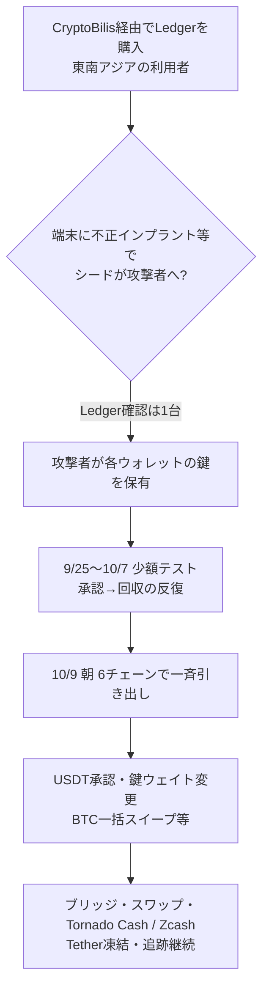

# Ledger × CryptoBilis ― 正規リセラー経由の端末に不正なハードウェアインプラント、オンチェーンで約9,320万ドル規模の一斉引き出し

## 要点

### 影響範囲

- **Ledgerが確認したこと**: 東南アジアでリセラー CryptoBilis（投稿によっては CryptoBillis 表記）経由で購入した利用者の資金消失を調査中。影響を受けた利用者の端末のうち **1台** に、不正なハードウェアインプラントが含まれていた（Ledger Support、10月10日）。自社のセキュリティ基盤・システム・サービスが侵害された兆候はないとしている（同）。
- **Ledgerが10月11日の72時間アップデートで述べたこと**: 影響端末の件数は限定的。10月9日の引き出しで確認できた事例はすべて CryptoBilis 経由の端末。自社システムと直接販売は影響を受けていない。正規リセラーには正規チャネルからの仕入れと返品の再販禁止を求め、利用者には非正規販売店での購入を避けるよう案内した（Ledger）。
- **Bitqueryのオンチェーン調査（Ledger未確認の総額）**: TRON・Bitcoin・Ethereum・Solana・BNB Chain・Polygon の6チェーンで、315ウォレットから合計約 **9,320万ドル**（10月9日朝の価格）が引き出された、と報告。Tetherが20ウォレットで計1,000万ドル分のUSDTを凍結した、とも述べている。**これはBitqueryの集計であり、Ledgerが認めた被害総額ではない**。

### 今すぐやること

- CryptoBilis から直近90日以内に購入し、まだ初期設定していない端末は **初期設定しない**（Ledger Support）。
- すでに設定済みなら、**新しいシードで新しい Ledger を用意し、資産を移す**ことを検討する（同）。Ledgerは24語のリカバリーフレーズを尋ねることはない、と注意を呼びかけている。
- （Bitqueryの勧告・考察）6月頃から使い始めたウォレットも被害側に多い、としている。90日より前の購入者も、同じ移し替えを検討する価値がある。
- 情報提供窓口: `bounty@ledger.fr`（Ledger）。SEAL 911 への協力にも謝意が示されている。

## 概要

- 2026年10月9日、インドネシア・マレーシア・フィリピンなどで CryptoBilis から買った Ledger 利用者の残高が消えた、という報告が広がった。Ledger Support は同日、調査開始と販売一時停止の要請、上記の利用者向け案内を出した。
- 10月10日、Ledger は影響を受けた利用者の端末1台に不正なハードウェアインプラントがあったと確認した、と発表した。原因の物理的な裏付けとしてはこれが最初の公式確認である（CoinMarketCap、TSN が Ledger の投稿を引用）。
- オンチェーン上では、複数の研究者が盗用アドレスを公開し、Bitquery が6チェーン横断で資金の流れを追った。25個のTRONウォレットが3秒以内に同じ承認に署名するなど、**一人の攻撃者がすべての鍵を持っていた**ことを強く示唆する痕跡が残っている（Bitquery）。チェーンは「鍵がどこから漏れたか」までは示さない。Ledger がインプラントを確認したのは1台で、すべての引き出しがインプラント由来かどうかは、Ledgerの追加調査待ちである。

> この記事では、ベンダー・公的機関・研究者・報道で確認できた内容を「事実」、筆者の推測や意見を「考察」として分けて書いています。Ledgerの公式発表と、Bitqueryなど研究者のオンチェーン分析は、はっきり分けて書きます。

## 何が起きたか（時系列）

| 日付（UTC目安） | 出来事 | 出典の種類 |
| --- | --- | --- |
| 2026-09-24 | Bitqueryによると、Bybitからの14,512 TRX出金が、翌日に攻撃者のTRON制御アドレスを資金調達するウォレットに届く | Bitquery（報告） |
| 2026-09-25 | 攻撃者のEthereum／TRON制御アドレスが3分差で初資金を受け取る。以降約2週間、少額の承認・回収テストが繰り返される（TRON 21回、Ethereum 20回） | Bitquery（報告） |
| 2026-10-07 | 最後のテストが23秒差で実施される | Bitquery（報告） |
| 2026-10-09 約04:59〜05:08 | 30個のTRONウォレットが3秒以内に同じ新鍵を追加して実質乗っ取られ、その後25ウォレットが3秒以内に同じUSDT承認に署名。引き出しが始まる（Bitqueryは約05:07 UTC開始と記載） | Bitquery（報告） |
| 2026-10-09 午前中 | Bitcoin（111ウォレットが1ブロックで空になる等）、Ethereum、BNB Chain、Polygon、Solanaへ拡大。約47分で6チェーンに到達、とBitquery | Bitquery（報告） |
| 2026-10-09 昼前後 | 研究者が盗用アドレスを公開。Tetherが関連アドレスを凍結（Bitqueryは20ウォレットで計1,000万ドルと記載）。Ledger Support が調査開始と販売停止要請を投稿 | Ledger（確認）／Bitquery（報告） |
| 2026-10-09 午後〜夜 | Tornado Cash と Zcash 経由のミキシングが観測される、とBitquery | Bitquery（報告） |
| 2026-10-10 | Ledger Support が「影響を受けた利用者の端末1台に不正なハードウェアインプラント」を確認、と発表。CryptoBilis はハードウォレット販売を停止したとLedgerが伝達。当局と連携、`bounty@ledger.fr` 開設 | Ledger（確認） |
| 2026-10-10〜11 | Bitqueryが第2日の移動を追記。Tornado Cash投入は累計2,990 ETH、追跡可能な残高は約8,100万ドルまで減少、など | Bitquery（報告） |
| 2026-10-11 | Ledger が72時間アップデート。影響件数は限定的、確認できた10月9日の引き出し事例はすべて CryptoBilis 経由、自社システムと直接販売は無事、正規リセラーへの仕入れ・返品再販の注意 | Ledger（確認） |

## 技術的な問題点（根本原因）

**事実（Ledger）**

- ハードウェアウォレットの役割は、24語のリカバリーフレーズ（シード）を端末外に出さないことである。シードを知っていれば、別の端末で同じウォレットを復元し、元のLedgerに触れずに送金できる。
- Ledger は、調査対象の1台に「unauthorized hardware implant」（不正なハードウェアインプラント）があったと確認した。インプラントの具体的な部品・取り付け位置・動作は、公開投稿では述べられていない（TSNが指摘）。
- Ledger は、自社の製造・クラウド・サービスが破られた兆候はないとし、問題の焦点をリセラー経由の供給網に置いている。

**事実（Bitqueryのオンチェーン所見。Ledger未確認）**

- 被害ウォレット群は、短時間に同じ承認・同じ鍵追加を行っており、人手の逐次操作や単純なフィッシング署名の寄せ集めでは説明しにくい、とBitqueryは評価している。
- 攻撃者は引き出し前に約2週間、少額ループで手順を練習していた。制御アドレスは9月25日にほぼ同時刻に資金調達されている。
- チェーンは「鍵の入手経路」を証明しない。インプラントが1台で確認されたことと、315ウォレット分の鍵が揃っていたことは、別レイヤーの事実である。

**考察**

コールドウォレットの信頼は「端末の電子的な堅牢さ」だけでなく、「購入者が手にするまでの箱と流通」に依存する。正規リセラー経由でも、返品の再流通や流通途上の改変が混ざると、利用者が画面上で見分ける手段は限られる。シードが一度でも攻撃者の手元に渡れば、その後のLedgerのファームウェア更新では手遅れになる。

## 攻撃・侵入経路

**事実の切り分け**

| 主張 | 状態 |
| --- | --- |
| CryptoBilis 購入者の資金消失を調査中 | Ledger が発表 |
| 影響端末1台に不正インプラント | Ledger が確認 |
| 自社インフラは侵害されていない | Ledger の見解 |
| 確認できた引き出し事例は CryptoBilis 経由 | Ledger（10/11） |
| 約9,320万ドル／315ウォレット | **Bitqueryの集計**（Ledger未確認） |
| 単一攻撃者が全鍵を保有 | Bitqueryの推論（署名の同時性など） |
| すべての引き出しがインプラント由来 | **未確認**（Ledgerもチェーンも証明していない） |

## なぜ防げなかったか・構造的要因の考察

ここからは筆者の考察である。

1. **正規チャネルという安心感**: 「公式リセラーだから箱は本物」という前提が、流通途中の改変リスクを見えにくくする。利用者は開封時のシードカードやシールを疑う訓練を受けていないことが多い。
2. **シード漏洩は不可逆**: 一度シードが外に出れば、オンチェーン上のふるまいは正規の所有者操作と区別がつかない。承認や送金はプロトコルどおり「正しい鍵」で行われる。
3. **検知の遅れ**: Bitqueryによれば練習期間が約2週間あった。少額テストは個々の利用者には気づきにくく、被害が顕在化するのは一気に抜かれた朝になる。
4. **安定コインの凍結は部分的**: Tetherの凍結は効くが、攻撃者はUSDDなど凍結できない資産やミキサーへ移す。回収は発行体・取引所・捜査の連携次第で、利用者個人では手が届かない。

## 運用者向けの具体的な対策と検知ポイント

**利用者・保管者向け（Ledgerの案内を中心に）**

1. CryptoBilis 購入で未設定の端末は設定しない。設定済みなら新シードの新端末へ移す。
2. シードが印刷済み・書き込み済みで届いた端末は使わない。Ledgerが24語を聞いてくることはない。
3. 正規の販売チャネル以外から買わない。正規リセラーは正規仕入れのみとし、返品を再販しない（Ledgerのリセラー向け注意）。

**オンチェーン運用・取引所・発行体向け（Bitqueryの所見を踏まえた考察含む）**

1. 短時間に多数ウォレットが同一spenderへUSDT承認するパターン、TRONのAccount Permissionで同一鍵が一気に追加されるパターンを監視する。
2. 被害アドレスへの入金が続くと、攻撃者が承認済みのまま再回収する（Bitqueryが10月10日に7万USDTの再抜きを報告）。被害後の入金停止案内が必要。
3. 凍結可能なステーブルコインについては、発行体との連絡経路を事前に用意する。

**検知ポイント（主にBitqueryが挙げた痕跡）**

- 同一承認が数秒以内に数十ウォレットから出る。
- 引き出し前に、攻撃者制御アドレスからの少額資金供給→承認→回収のループ。
- 被害後の Tornado Cash / Zcash / クロスチェーンスワップへの急速な退避。

## 参考リンク

- Ledger Support（X）: [調査開始・販売停止要請（2026-10-09）](https://x.com/Ledger_Support/status/2108551100613714002)
- Ledger Support（X）: [インプラント確認（2026-10-10）](https://x.com/Ledger_Support/status/2108968264055345381)
- Ledger（X）: [72時間アップデート（2026-10-11）](https://x.com/Ledger/status/2109331538072494364)
- Bitquery: [Ledger CryptoBilis Hack: $93.2M Drained, Where It Went](https://bitquery.io/investigations/ledger-cryptobilis-hack)
- CoinMarketCap Academy: [Ledger Confirms Hardware Implant Found on Device in CryptoBilis Probe](https://coinmarketcap.com/academy/article/ledger-confirms-hardware-implant-found-on-device-in-cryptobilis-probe)
- TSN: [Ledger Confirms an Unauthorized Hardware Implant in One Device](https://tsnmedia.org/ledger-confirms-unauthorized-hardware-implant-one-cryptobilis-device/)
