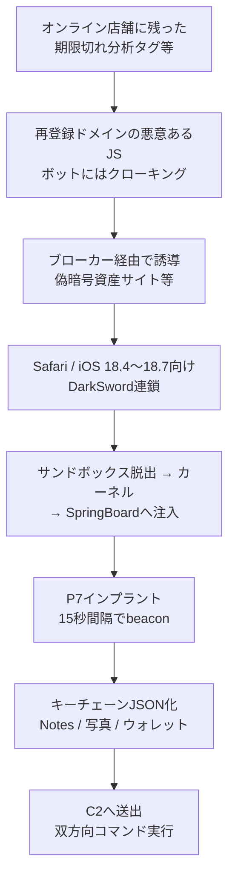

# P7 DarkSword ― 漏洩iOSエクスプロイトキットで暗号資産を窃取

## 要点

### 影響範囲

- **DarkSword本体**: 2026年3月に Google Threat Intelligence Group（GTIG）・iVerify・Lookout が公開文書化した、商用のiOSエクスプロイトキット。対象はおおむね **iOS 18.4〜18.7**。野生での観測は2025年11月以降（The Hacker News が各社報告を要約）。
- **P7変種**: iVerifyが2026年8月の顧客端末対応で確認し、10月8日に報告。変数接頭辞 `p7_` から命名。端末上の痕跡を減らし、キーチェーンを端末内でJSON化してから持ち出し、双方向C2を追加する（iVerify）。
- **配信の一例**: 期限切れのEC分析ドメイン `ecomtrack[.]io` が2026年9月15日に再登録され、店舗に残ったトラッキングタグ経由で訪問者を誘導。偽の暗号資産サイト `chainmate[.]top` などがDarkSword連鎖を配信し、インプラントは `mertio[.]cc` に接続する、とReport URI（Scott Helme）が報告。25以上のウォレットアプリを狙う、としている。

### 今すぐやること

- iPhoneを **最新のiOS** に更新する。Report URIは、DarkSwordが使う後段の脆弱性の一部が iOS 18.7.2 で修正された、というGoogleの報告に触れつつ、回収した連鎖の実機検証範囲は限定的だとしている。
- Webサイト運営者は、使っていない第三者スクリプト（とくに期限切れ・放置ドメイン）を削除する。ドメイン失効後の再登録は、タグが残っているサイトすべてを攻撃面にする（Report URI）。
- 企業のモバイル監視では、iVerifyが示したIOC（C2ドメイン、`/private/var/tmp/keychain_c2_dump.json` などのパス、固定User-Agent）を検知ルールに入れる。
- 暗号資産ウォレット利用者は、シードやリカバリーフレーズを端末のメモ・キーチェーン以外のオフラインにも分散保管し、不審なリダイレクト先ではSafariをすぐ閉じる。

## 概要

- DarkSwordは、ブラウザのサンドボックス脱出からカーネル権限、そしてSpringBoardへの注入までをつなぐ連鎖として知られる。キットは二次流通し、トルコの監視ベンダーPARS Defense、ロシア系のStar Blizzard（COLDRIVER）、中国語話者の攻撃者など複数の主体が使ってきた、とThe Hacker Newsが各社の調査をまとめている。
- P7は、そのインプラント側を「静かで、盗み方が上手い」方向へ改修した変種である。デバッグログを消し、ブラウザのlocalStorageで再攻撃を防ぎ、キーチェーン処理を端末内で完結させてから送出する（iVerify）。
- 同時期に、捨てられた分析タグのドメイン再取得という、Web側の古い借金がiPhoneのフルチェーン配信口になった事例がReport URIから報告された。キットの入手難易度が下がったことと、配信口の多様化が同時に進んでいる。

> この記事では、ベンダー・公的機関・研究者・報道で確認できた内容を「事実」、筆者の推測や意見を「考察」として分けて書いています。個別CVE番号の列挙は、一次のCensys／iVerifyページで未確認のものは避け、連鎖の段階説明に留めます。

## 何が起きたか（時系列）

| 時期 | 出来事 |
| --- | --- |
| 2025-11頃〜 | DarkSwordが野生で観測され始める（THNがGTIG／iVerify／Lookout系の報告を引用） |
| 2026-03 | GTIG・iVerify・LookoutがDarkSwordを公開文書化。iOS 18.4〜18.7を対象とする連鎖（THN） |
| 2026-08 | iVerifyが顧客端末で通常と異なるDarkSword検知。インシデント対応と並行してValidin上の狩猟からP7変種を分離（iVerify） |
| 2026-08頃 | Censysが、未知の中国語話者主体によるDarkSword利用や、Apple IDを装った偽サインインなどを報告（THNが引用） |
| 2026-09 | iVerifyが、漏洩後の「iOS 26.x向け更新」を試みるLLM支援とみられる失敗作を複数観測、と説明（THN） |
| 2026-09-15 | `ecomtrack[.]io` が再登録される。店舗に残ったタグが悪意あるJSを配信し始める（Report URI） |
| 2026-10-08 | iVerifyがP7 DarkSwordの技術報告を公開 |
| 2026-10-09 | Report URIが、回収インプラントをP7と照合。モジュール2つがバイト一致、より新しいビルド（v24）で別インフラ・より多くのウォレットを狙う、と更新 |
| 2026-10-11 | The Hacker NewsがP7と配信経路、Censysが確認したオープンディレクトリなどを総合報道。iVerifyはDarkSwordとCorunaの同時配布を稀に見て DarkCoruna と呼ぶ、とも述べている |

## 技術的な問題点（根本原因）

**事実（iVerify、THN、Report URI）**

- **連鎖の骨格（高レベル）**: SafariのJavaScriptエンジンでのコード実行 → サンドボックス脱出（GPUプロセスやmediaplaybackdなどを経る、とReport URI） → カーネル系の権限獲得 → SpringBoardへインプラント注入。SpringBoardがC2通信を担う（iVerify）。
- **P7の改修点**:
  1. **ステルス**: HTTPリクエストやsyslogへのデバッグログを削除し、プロセス注入の回数を減らす。
  2. **安定性**: ブラウザのlocalStorageで再エクスプロイトを抑止する。
  3. **窃取**: 従来はキーチェーンDBをコピーして攻撃者側で処理していたのに対し、P7は端末上でJSONに展開してから送出する。暗号資産ウォレット向けのスキャン／抽出コマンドを持つ。
- **C2**: 既定で約15秒ごとに `POST /beacon`（間隔は `sleep` で変更可）。ほかに登録、ハートビート、アプリ一覧、Notes、写真、キーチェーン＋ウォレット（`/war`）などのエンドポイントがある（iVerify）。Report URIが回収したビルドは `mertio[.]cc` へ約30秒間隔、としている（ビルド差）。
- **コマンド例（iVerify）**: `execute_command`（ls／cat／ps／memdump／netstat等）、`download`、`photos`、`wallet_scan`、`wallet_extract`（imToken）、`memo_scan`、`photo_scan`、`disk_scan`、`ios_app_data`、`exec`（インプラント内JS）、`sleep`、`exit` など。
- **配信（Report URI）**: 失効した分析タグ → クローキング付きリダイレクタ → トラフィックブローカー → 偽「AI暗号クオンツ」サイト `chainmate[.]top` → 隠れフレームからiOS 18.4.0〜18.7.2向けローダ。SMS・連絡先・写真・ヘルスケア・位置・Wi-Fiパスワード、およびMetaMask／Trust／Phantom／Coinbase／OKX／Binance／imTokenなど25超のウォレットファイルを狙う、と記載。

**考察**

ブラウザ経由のゼロクリックに近い連鎖と、ECサイトに残った「忘れられたタグ」は、利用者から見ると別世界の話に見える。実際には、タグの行き先がキットの入り口になり、Safariを開いただけの訪問者がSpringBoard上のエージェントまで落ちる。モバイルの脆弱性管理と、Webのサードパーティ資産管理が、同じ被害者の一台でつながっている。

## 攻撃・侵入経路

**事実（補足）**

- iVerifyは、多くの変種がAI支援の粗雑な改変である一方、P7はコードを理解した改修だと評価している。
- Censysは、DarkSword／Coruna関連コンポーネントを載せたオープンディレクトリを複数ホストで確認し、中国語UIの運用パネルや実端末からのビーコン、別主体の独自C2なども報告している、とTHNが伝える（詳細ホスト一覧はTHN記事参照）。
- Corunaはブラウザセッション内で動くコンパニオンで、ウォレットのリカバリーフレーズやキーストアを狙う。両者を束ねた配布をiVerifyはDarkCorunaと呼ぶ。

## なぜ防げなかったか・構造的要因の考察

ここからは筆者の考察である。

1. **キットの二次流通**: 商用チェーンが漏洩・転売されると、国家級の攻撃面が犯罪者や監視ベンダーにコピーされる。パッチが追いつくまでの「対応OS帯」が、そのまま市場の商品仕様になる。
2. **忘れられた第三者タグ**: サービスが死んでもHTMLに残るスクリプトは、ドメイン代が切れた瞬間に攻撃者のCDNになる。CSPやSRIがなければ、サイト所有者は中身の差し替えに気づけない。
3. **防御の非対称**: 利用者は「怪しいIPAを入れない」訓練はしていても、正規の店舗サイトからSafariだけで完結する攻撃には無力に近い。
4. **LLMによる改変の両面**: 壊れた更新の量産はノイズだが、成功すれば対応バージョンが一気に広がる。P7のように手作業で質を上げる改変と、粗雑な量産が同時に存在する。

## 運用者向けの具体的な対策と検知ポイント

**対策**

1. iOSを最新にする。MDM管理端末はOSの強制更新と、不審な構成プロファイルの監視を行う。
2. Webの第三者スクリプトを棚卸しし、不要タグを削除。重要スクリプトはサブリソース完全性（SRI）や、Report URIが勧める整合性モニタで差分検知する。
3. 暗号資産を扱う利用者・企業は、シードを端末外のオフラインに保管し、iOS単体を単一障害点にしない。
4. SOCはiVerifyのIOCをモバイル／プロキシログに入れる。HTTPSでも証明書検証が緩い通信、とiVerifyは指摘している。

**検知ポイント（iVerify／Report URI）**

- ドメイン・URL例: `cdn[.]gotoiphone[.]com`、`mzpo30[.]cam`、`agdx53[.]cc`、`ecomtrack[.]io`、`chainmate[.]top`、`zhengxin021[.]top`、`mertio[.]cc` など（完全な一覧は各報告のIOC節）。
- 端末パス: `/private/var/tmp/keychain_c2_dump.json`（および `.tmp` / `.done`）、`/private/var/tmp/p7_debug.log`、`/private/var/tmp/c2_wallet_debug.log`、Notesコピー `_hq_notestore*` など。
- 通信: HTTP/1.0 の `POST /beacon`、固定のiPhone Safari User-Agent文字列、`/war` へのキーチェーン＋ウォレット送出。
- localStorageキー: `lab_device_uuid`、`__ds_inflight_worker`、`_x_pe_done` など。

## 参考リンク

- iVerify: [Sleep, Beacon, Steal, Repeat - The Story of P7 DarkSword Variant](https://www.iverify.com/blog/darksword-variant-threat-research)
- Report URI（Scott Helme）: [Abandoned Analytics Domain Funnels Store Visitors to DarkSword iPhone Exploits](https://blog.report-uri.com/abandoned-analytics-domain-funnels-store-visitors-to-darksword-iphone-exploits/)
- The Hacker News: [P7 DarkSword iOS Exploit Kit Adds Crypto Wallet Data Theft and Remote Commands](https://thehackernews.com/2026/10/p7-darksword-ios-exploit-kit-adds.html)
