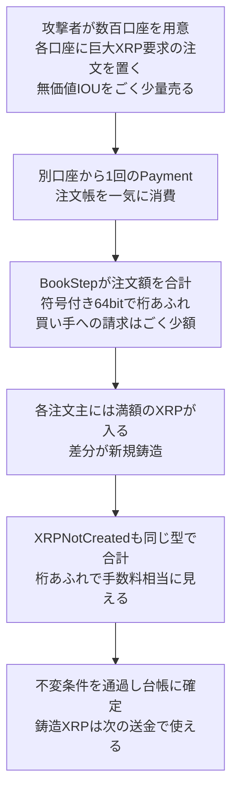

# XRP Ledger ― 支払いエンジンの整数オーバーフローで大量鋳造が可能に

## 要点

### 影響バージョン

- XRP Ledgerのサーバーソフト `xrpld`（旧名 `rippled`）**3.4.0以前**。支払いエンジンのXRP桁あふれ（Payment Engine XRP Overflow）は **3.4.1（2026年9月25日公開）** で修正され、更新した時点で効く（XRPL公式の開示報告）。
- 同じ3.4.1では、未有効化だったBatch機能の検証漏れ（`fixBatchV1_2`）も直った。この修正のアメンドメントは10月9日にメインネットで有効になり、**3.4.1未満のサーバーは同期できない「アメンドメントブロック」状態になっている**（XRPL公式）。
- XRPL側は、公開ネットワークで悪用された形跡はないとしている（XRPL公式）。

### 今すぐやること

- XRP Ledgerのノード（バリデーター、取引所や事業者が自前で動かすサーバーを含む）を運用しているなら、`xrpld` 3.4.1以上で動いているか確認する。3.4.1未満は、10月9日以降ネットワークに追従できていない（XRPL公式）。
- XRPを保有・送金しているだけの利用者が取る操作はない。XRPLは、不正に作られたXRPはなく資金の損失もないとしている（XRPL公式）。
- （考察）自前のコードで金額や残高を「合計」している箇所、特にその合計を使って不正を検知している箇所が、桁あふれを検査しているか点検する。

## 概要

- 決済がDEXの注文帳を通るとき、`xrpld` は同じ価格の注文をまとめて約定させ、買い手が払う合計額を符号付き64ビット整数の単純な足し算で求めていた。数百件の巨大な注文を1回の送金で食わせると、合計が桁あふれして小さな値に戻り、買い手はわずかな額しか払わないのに、各注文の持ち主には満額が支払われた（XRPL公式、Veria Labs）。
- その差を捕まえるはずの安全検査「XRPNotCreated」も、同じ符号付き64ビット整数で増減を合計していた。生み出されたXRPの総額をちょうど2の64乗の倍数に合わせると、検査には「手数料を払っただけの普通の取引」に見えた（Veria Labs）。
- AIペネトレーションテストの新興企業Veria LabsのAIエージェントが9月21日に見つけ、9月22日に報告。RippleXは当日に再現し、アメンドメント（バリデーターの投票）手続きを導入以来初めて飛ばして、3日後に修正版を出した。Veriaはバグバウンティの上限額25万ドルを受け取った（XRPL公式、Veria Labs）。

> この記事では、ベンダー・公的機関・研究者・報道で確認できた内容を「事実」、筆者の推測や意見を「考察」として分けて書いています。

## 何が起きたか（時系列）

| 日付 | 出来事 |
| --- | --- |
| 2015-11 | 注文帳を通る変換（BookStep）で複数の注文の額を合計するコードが書かれる（Veria Labs） |
| 2017-02 | 「XRPが新たに作られていないか」を確かめる不変条件検査 XRPNotCreated が追加される。同じく符号付き64ビット整数で合計していた（Veria Labs、XRPL公式） |
| 2026-09-21 | Veria LabsのAIエージェントが `rippled` を解析し、2つの桁あふれと、それをつなぐ方法を見つける（Veria Labs） |
| 2026-09-22 | ローカルネットワークで動く攻撃コード（PoC）を作り、メインネットでも到達できることを確認してXRPLのバグバウンティに報告。報告時の評価は「Major」。RippleXが当日に再現し、作ったXRPが次の送金で使えることを確かめて「Critical」に引き上げる（XRPL公式、Veria Labs） |
| 2026-09-22〜23 | 修正を非公開で開発・レビュー。アメンドメントを使わず、直接の変更として出すと決定（XRPL公式） |
| 2026-09-23 | 修正が3.4.1のリリースブランチに入る（XRPL公式） |
| 2026-09-25 | `xrpld` 3.4.1を緊急リリース。修正内容が漏れないよう、ソースコードは公開せずバイナリとパッケージだけを配布。同日中に既定のUNL（信頼するバリデーター一覧）の80％超が3.4.1以上になる（XRPL公式） |
| 2026-10-08 | Veria Labsが上限額25万ドルのバウンティを受け取る（Veria Labs） |
| 2026-10-09 | XRPLが開示報告を公開し、3.4.1のソースコードも公開。同日、Batchの修正アメンドメント `fixBatchV1_2` がメインネットで有効になる（XRPL公式） |
| 2026-10-10〜11 | Veria Labsが技術解説とPoCを公開。報道が相次ぐ（Veria Labs） |

※同じ3.4.1には、Batch機能の内側トランザクションのラッパー検証漏れ（`fixBatchV1_2`）の修正も含まれる。こちらはアメンドメント経由で10月9日に有効化された。本稿の主題は支払いエンジンの桁あふれである（XRPL公式）。

## 技術的な問題点（根本原因）

**事実（XRPL公式の開示報告、Veria Labsの技術解説）**

- XRPは1XRP＝100万drops（最小単位）で数え、`xrpld` はこれを符号付き64ビット整数（`std::int64_t`）で持つ。XRPは最初の台帳で1000億XRPがすべて作られ、以後どの取引も新しく作ってはいけない。
- **1つ目の桁あふれ（BookStep）**: 異なる通貨間の送金がDEXの注文帳を通ると、同じ価格の注文はまとめて処理される。BookStepは各注文の支払額を集めて `sum()`（内部では `std::accumulate`）し、買い手が最終的に払う額（`result.in`）を求める。この足し算にオーバーフロー検査がなかった。個々の注文は有効でも、数百件分を足すと符号付き64ビットの上限を越え、合計は小さな値に巻き戻る。一方、各注文の持ち主への支払いは `consumeOffer` 側で満額のまま行われる。
- **2つ目の桁あふれ（XRPNotCreated）**: 取引適用後に「この取引でXRPが増えていないか」を確かめる不変条件がある。修正された台帳エントリを歩き、残高の前後差を `std::int64_t drops_` に足し引きする。正ならXRPが生まれたとして棄却し、負ならその絶対値が手数料と一致することを求める。BookStepで大量のXRPが複数口座に振り込まれると、この累積も同じように桁あふれし、「手数料分だけ減った」ように見える。
- Veria LabsのPoCでは、256件の注文をそれぞれ約 \(2^{56}+1\) drops のXRPで売り、合計 \(2^{64}+256\) drops（約18.45兆XRP）を1回の支払いで消費する。買い手が払う額は桁あふれ後の256 dropsに見え、各注文主には満額が入り、不変条件も手数料相当の見た目で通過する。鋳造されたXRPは通常のXRPとして次の送金に使える。
- 口座ごとの残高上限（当初の供給量1000億XRP）は、鋳造分を数百口座に分散すればすり抜けられる。攻撃の実費は、口座と注文の準備金数百XRP（オブジェクト削除で戻る）と通常の手数料程度で、バリデーター権限も特別なアクセスも不要（XRPL公式、Veria Labs）。
- 通常の支払いがこのコードパスに、しかも2の64乗近くの値で到達することはない。総供給量が桁あふれ点よりはるかに小さいため、約10年気づかれなかった、というのが両社の説明である。

**考察**

守りの検査が「攻撃と同じ型の算術」で書かれていると、攻撃が検査を一緒に壊す。BookStepの桁あふれ単体なら不変条件で止められるはずだったが、不変条件も同じ符号幅で合計していたため、二重の失敗が一個のトランザクションになった。防御を厚くしたつもりが、同じ前提を共有していると厚くならない、という典型例に見える。

## 攻撃・侵入経路

**事実（XRPL公式、Veria Labs）**

- Veriaは、256口座にまたがる約18.45兆XRP（総供給の約184倍）を1トランザクションで鋳造できると試算した。当時の時価総額約940億ドル全体がリスクに晒されていた、としている。実際に市場価格で全量を売却できるわけではないが、既存XRPの価値を破壊しうる、というのが同社の評価である。
- 攻撃は偶然では起きない。実トレーダーが使わない価格の注文を数百件用意し、それらを一度に食う支払いを組む必要がある。注文帳を塞いで他人の支払いを妨げる「Griefing」は、実際には実用的でないとRippleXが検証した（XRPL公式）。
- 公開ネットワークでの悪用の証拠はない（XRPL公式）。

## なぜ防げなかったか・構造的要因の考察

ここからは筆者の考察である。

1. **「普通の値」の前提**: 総供給が2の64乗よりはるかに小さい世界では、合計が桁あふれするテストケースを誰も書かない。監査も攻撃コンテストも、到達しにくい経路は後回しになりやすい。
2. **防御の同型性**: 不変条件は「桁あふれで生まれたXRP」を捕まえる最後の砦だったが、実装が同じ幅の整数だった。独立した検査に見えて、失敗モードを共有していた。
3. **AIによる到達コストの低下**: Veriaは、一般的なコーディングエージェントを脆弱箇所に向けても見つけられなかったと述べつつ、自社のエージェントは「低深刻度の欠陥の連鎖」まで探す設計だと説明している。長い眠りのバグが、探索の単価が下がったことで表に出た、という構図は今後ほかの台帳でも繰り返されうる。
4. **アメンドメントを飛ばす判断**: 修正を公開するとバグ箇所が露わになる。通常の投票と2週間の有効化待ちでは、何週間も「見えるが直っていない」状態が続く。XRPLは、混在バージョンのリスクを承知で緊急配布を選んだ。バリデーターが同日に80％超まで上がったから成り立った判断で、遅ければ混在の害の方が大きかった、と開示報告は書いている。

## 運用者向けの具体的な対策と検知ポイント

**対策（XRPL公式の推奨を要約）**

1. すべての `xrpld` 運用者は **3.4.1以上** にする。支払いエンジンの修正はアップグレード時点で有効。`fixBatchV1_2` 有効化後、古いサーバーはアメンドメントブロックになる。
2. 自前で台帳をパースするSDK・インデクサは、Batchの内側ラッパーが `RawTransaction` 以外の場合も壊れないよう確認する（Batch側の修正に関連）。
3. XRPLは、修正済みとマークされたすべてのセキュリティ報告をリリース候補で再検証する手順を追加する、としている。

**考察（追加でできること）**

- 残高や金額の合計を「検知」に使うコードは、合計自体より広い型、またはオーバーフロー時に失敗する演算を使う。検査が本体と同じ幅なら、検査は本体と一緒に壊れる。
- 意図的に供給上限を大きく超える合成取引を、スタンドアロンやテストネットの回帰に入れる。

**検知ポイント**

- バージョン: `xrpld` 3.4.0以前が残っていないか。
- 異常なパターン（考察）: 同一価格帯に極端に大きなXRP要求の注文が数百件並び、直後にそれらをまとめて消費するPayment。通常の流動性では起きにくい。
- 開示後の指標: 既定UNLのバージョン分布、アメンドメント `fixBatchV1_2` / `BatchV1_1` の有効化状態。

## 参考リンク

- XRPL: [Vulnerability Disclosure Report for xrpld 3.4.1](https://xrpl.org/blog/2026/vulnerabilitydisclosurereport-bug-20261009)
- XRPL: [Introducing XRP Ledger version 3.4.1](https://xrpl.org/blog/2026/xrpld-3.4.1)
- Veria Labs: [The Biggest Hack in Crypto History That Never Happened](https://verialabs.com/blog/biggest-hack-in-crypto-history/)
