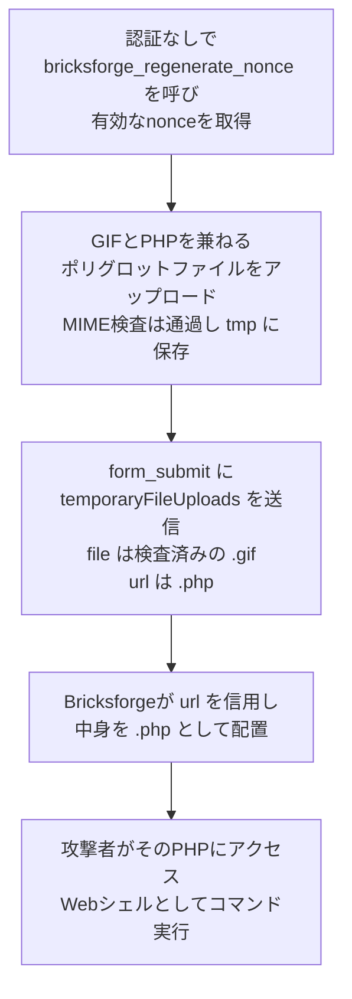

# Bricksforge CVE-2026-85097 ― WordPressフォームの認証なしRCE悪用

## 要点

### 影響バージョン

- WordPressプラグイン **Bricksforge 3.1.8.9以前**。**3.1.8.10で修正**（Patchstack、GitHub Advisory Database）。10月8日には4.0.1も出ている（SOCRadar）。
- 認証は不要。CVSSはPatchstackが10.0、GitHub Advisory Databaseの登録は9.8（Patchstack、GitHub）。
- Patchstackは **2026年10月7日21時47分（UTC、日本時間8日6時47分）** から悪用の試みを観測している（Patchstack）。

### 今すぐやること

- Bricksforgeを3.1.8.10以上（最新は4.0.1）に更新する（Patchstack、SOCRadar）。
- 更新前に脆弱な版で動いていたサイトは、`/wp-content/uploads/bricksforge/tmp/` や `/wp-content/uploads/` 配下に見覚えのないPHPファイル（特に `login_admin_*.php`）がないかを確認する（Patchstack）。
- アクセスログで、`/wp-json/bricksforge/v1/form_submit` への `temporaryFileUploads` を含むリクエストを探す（Patchstack）。

## 概要

- Bricksforgeは、WordPressのビジュアルサイトビルダー「Bricks」に、高度なフォーム、アニメーション、管理画面のカスタマイズなどを足す有償の拡張プラグインで、約6,000サイトで使われている（Patchstack、SecurityWeek）。
- そのフォーム機能（Pro Forms）は、ファイルのアップロード時にはMIMEタイプを正しく検査するが、フォーム送信時にクライアントが送る「どのファイルを、どこに置くか」の情報を信用していた。検査済みの一時ファイル（画像）を指しつつ、保存先のURLだけを `.php` にすると、画像に埋め込んだPHPコードが実行可能なファイルとして置かれる（Patchstack、GitHub Advisory Database）。
- Patchstackの観測では、63の送信元IPから自動化された攻撃が来ている。44のIPが数秒の間に同じペイロードを送ったまとまりと、3つのIPが25通りの拡張子・エンコードを試したまとまりがある（Patchstack）。

> この記事では、ベンダー・公的機関・研究者・報道で確認できた内容を「事実」、筆者の推測や意見を「考察」として分けて書いています。

## 何が起きたか（時系列）

| 日時 | 出来事 |
| --- | --- |
| 2026-10-07 21:47 UTC | Patchstackが、Bricksforgeへの最初の悪用の試みを観測。同社の緩和ルールは、最初の攻撃が届く前から有効だったとしている（Patchstack） |
| 2026-10-08 | Patchstackが悪用を公表。同日、GitHub Advisory Databaseに登録（CVSS 9.8、CWE-434）。Bricksforge 4.0.1が公開される（Patchstack、GitHub、SOCRadar） |
| 2026-10-12 | SecurityWeekなどが悪用を報道（SecurityWeek） |

※修正版3.1.8.10の公開日は、確認できた資料に書かれていなかった。

## 技術的な問題点（根本原因）

**事実（Patchstack、GitHub Advisory Database）**

- Pro Formsのファイル添付は2段階になっている。まずファイルを一時ディレクトリ（`/wp-content/uploads/bricksforge/tmp/`）にアップロードし、そのあとフォームを送信すると、一時ファイルが本来の保存先に置かれる。
- 1段階目のアップロードでは、MIMEタイプの検査が正しく行われる。
- 2段階目のフォーム送信では、`temporaryFileUploads` パラメータでクライアントがファイルの情報（サーバー上のパス `file`、保存先の `url`、`type` など）を送る。Bricksforgeはこの情報を信用し、特に `url` を検証していなかった。保存先のファイル名は、この `url` から決まる。
- 問題の箇所は `bricksforge/includes/elements/pro-forms/actions/init.php`（`temporaryFileUploads` からメタデータが入る箇所）と、`.../actions/base.php`（任意のファイル書き込みにつながる箇所）とされる。
- フォーム送信に必要なnonce（使い捨ての確認用トークン）は、認証なしで呼べるAJAXの `bricksforge_regenerate_nonce` から誰でも取得できた。

**考察**

検査（MIMEタイプ）と、危険かどうかを本当に決める属性（保存先の拡張子）が、別々のリクエストで扱われていた。1回目で「これは画像だ」と確かめたことが、2回目で「この名前で置く」ことの安全を保証すると思い込んだのが根本である。ファイルの正体は中身（MIME）ではなく、Webサーバーが拡張子をどう扱うかで決まる。PHPを実行するサーバーでは、`.php` で置かれた時点で中身が画像として正しいかは関係ない。

## 攻撃・侵入経路

**事実（Patchstack）**

- 観測された攻撃は、1件を除いてすべてREST APIの `POST /wp-json/bricksforge/v1/form_submit` に向いていた。残る1件は `/wp-admin/admin-ajax.php` の `bricksforge_form_submit` アクションだった。
- どのリクエストにも細工した `temporaryFileUploads` があった。典型は、`file` が `/wp-content/uploads/bricksforge/tmp/img_example.gif`、`url` が `.../tmp/img_example.php` という組み合わせ。捕まえたリクエストの95％で、サーバー側のパスが `.gif` か `.png` で終わっていた。
- 一部は保存先を通常のWordPressのアップロード先（`/wp-content/uploads/2026/10/` など）にし、`login_admin_*.php` という名前でPHPを置こうとしていた。
- 拡張子フィルタの回避を探る変種も観測された。`.php5`・`.php7`・`.php8`・`.phtml`・`.pht`・`.phtm`・`.phps` といった別の拡張子、`.PHP`・`.Php` のような大文字小文字の変更、`%2ephp`・`.%70hp`・`.%2570%2568%2570` のようなURLエンコード・二重エンコード、`path`・`name`・`originalFilename`・`url` を変えたり欠かしたりしたメタデータ。
- 送信元はデータセンター、クラウド、VPN・プロキシ、家庭用・固定回線のISPが混在する。最も多かったのはブラジルの固定回線ISPのアドレスで、過去の悪用報告がほとんどなかった。Patchstackは、これだけでは単一の攻撃者とは断定できないとしている。

**事実（Mallory）**

- 公開されたPoCとみられるPythonスクリプトは、nonceの取得、画像とPHPのポリグロット作成、`.php` 名での配置、組み込みのWebシェルによるコマンド実行を、複数のサイトに並行して行う作りだったと分析されている。

## なぜ防げなかったか・構造的要因の考察

ここからは筆者の考察である。

1. **2段階アップロードの「状態」をクライアントに預けた**: 一時ファイルのパスや保存先を、サーバー側のセッションやデータベースに持たず、クライアントに往復させていた。往復するデータは改ざんできる前提で、サーバーが発行したIDだけを受け取る設計なら、保存先の名前を攻撃者が選ぶ余地はなかった。
2. **nonceを「認証」と取り違えやすい**: WordPressのnonceはCSRF対策の仕組みで、利用者を認証するものではない。誰でも取れるnonceで保護されたエンドポイントは、実質的に誰でも呼べる。
3. **アップロード先でPHPが動くサーバー設定**: WordPressの `uploads` ディレクトリは本来、画像などの静的ファイル置き場である。ここでPHPが実行される設定だと、どのプラグインのアップロードの欠陥でも即RCEになる。プラグインの欠陥と、サーバー側の多層防御の欠如が重なって初めて「CVSS 10.0」になる。
4. **有償プラグインの更新の届きにくさ**: Bricksforgeは有償の拡張で、WordPress.orgの公式ディレクトリにある無償プラグインとは更新の届き方が違うことが多い。ライセンスの更新が切れたサイトや、制作会社が納品したまま保守していないサイトでは、修正が届くまで時間がかかりやすい。

## 運用者向けの具体的な対策と検知ポイント

**対策（Patchstack、SOCRadarの推奨を要約）**

1. Bricksforgeを3.1.8.10以上（最新4.0.1）に更新する。
2. すぐに更新できない場合、WAFで `temporaryFileUploads` の悪用リクエストを遮断する（Patchstackは同社の緩和ルールで遮断できるとしている）。
3. 脆弱な版で無防備に動いていたサイトは、過去のログとサーバー上のファイルを確認し、想定外のPHPファイル、不審なアプリケーションの動き、権限のない変更がないかを調べる。

**考察（追加でできること）**

- `wp-content/uploads/` 配下でのPHP実行を、Webサーバーの設定で禁止する（Nginxの `location` やApacheの `.htaccess` で、アップロード先の `.php`・`.phtml` などを実行させない）。今回のような欠陥が残っていても、置かれたファイルが動かなければRCEにはならない。
- Webシェルが置かれていた場合、WordPressの管理者アカウント、`wp-config.php` のデータベース認証情報、ソルト、外部サービスのAPIキーは漏れた前提で入れ替える。
- 制作会社として複数の顧客サイトを納品している場合は、Bricks／Bricksforgeを使ったサイトの一覧を作り、版と保守契約の有無を確認する。

**検知ポイント（Patchstackの指標を整理）**

- `/wp-json/bricksforge/v1/form_submit` への、`temporaryFileUploads` を含むリクエスト。
- アップロードのメタデータで、画像のパス（`.gif`・`.png`）とPHP系の保存先URLが組になっているもの。
- `bricksforge_regenerate_nonce` の呼び出しのあとに、アップロードとフォーム送信が続く流れ。
- 拡張子・エンコード・大文字小文字を変えながら繰り返されるフォーム送信。
- `/wp-content/uploads/bricksforge/tmp/` などアップロード先にある想定外のPHPファイル（特に `login_admin_*.php`）と、新しくできたPHPファイルへのHTTPリクエスト。

## 参考リンク

- Patchstack: [Critical Unauthenticated Arbitrary File Upload Vulnerability Exploited in Bricksforge Plugin](https://patchstack.com/articles/critical-unauthenticated-arbitrary-file-upload-vulnerability-exploited-in-bricksforge-plugin/)
- GitHub Advisory Database: [CVE-2026-85097（GHSA-jfvp-gc8p-45gp）](https://github.com/advisories/GHSA-jfvp-gc8p-45gp)
- SecurityWeek: [Bricksforge WordPress Plugin Vulnerability Exploited in the Wild](https://www.securityweek.com/bricksforge-wordpress-plugin-vulnerability-exploited-in-the-wild/)
- SOCRadar: [CVE-2026-85097: Bricksforge Flaw Exploited for Unauthenticated RCE](https://socradar.io/blog/bricksforge-cve-2026-85097-exploited-rce/)
- Mallory: [Unauthenticated PHP Code Execution in Bricksforge Pro Forms (CVE-2026-85097)](https://mallory.ai/vulnerabilities/CVE-2026-85097)
