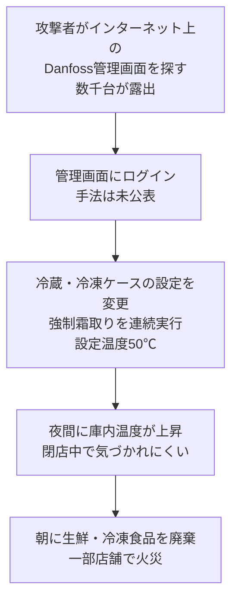

# フランスのスーパー数百店で冷蔵・冷凍設備が「50℃の霜取り」に ― ネットにつながったDanfoss製冷凍機管理装置が狙われた

## 要点

### 影響バージョン

- 狙われたのはDanfossの冷凍機管理装置（システムマネージャー）**AK-SMシリーズとAK-SCシリーズ**（CERT-FR）。Danfossによると、被害の大半は保守終了済みの **AK-SM800**（2021年にサポート終了）と **AK-SC355**（2016年に終了）で、ソフトウェア・セキュリティ更新はもう出ない。現行の **AK-SM800A** は古いファームウェアのまま動いていたものが被害を受けた（Danfoss、Cooling Post経由）。
- AK-SM800A（AK-SM 8xxAシリーズ）には、日付から作れる隠し認証コードによる認証回避（CVE-2025-41450、R4.2で修正）と、認証後のコマンド注入（CVE-2025-41451、R4.3.1で修正）が公表済み（CISA、Claroty）。**今回の攻撃でどの脆弱性が使われたかは公表されていない**。

### 今すぐやること

- AK-SM／AK-SCの管理画面をインターネットから切り離すか、信頼できるIPアドレス（保守業者など）だけに絞る（CERT-FR）。
- 侵害が疑われる装置は、工場出荷状態への初期化、入手できるすべての修正の適用、パスワードなど秘密の入れ替え、既存アカウントの確認、設定のやり直しを行う（CERT-FR）。
- AK-SM800Aはファームウェアを **R4.3.1以上** にする。AK-SM800とAK-SC355は修正が出ないため、ネットワーク上の遮断と現行機への移行を検討する（Danfoss、Claroty）。

## 概要

- 10月11日（日）夜から12日（月）未明にかけ、フランス各地のスーパーで、冷蔵・冷凍ショーケースを制御するDanfossの管理装置が遠隔から操作され、強制霜取り（デフロスト）を50℃の設定で何時間も続けさせられた。朝には生鮮・冷凍食品の多くが廃棄対象になり、一部の店では火災も起きた（BFMTV、パリ検察、AFP）。
- 被害を認めたのはIntermarché／Netto、Coopérative U、E.Leclerc、Carrefour、Monoprixなど。被害店舗の総数は公表されておらず、Cooling Postは報じられた事例から約500店とみている。ベルギーとオランダのスーパーにも被害が出たとの報道がある（Infosecurity Magazine）。
- CERT-FRは「Danfoss AK-SM／AK-SCシリーズの多数の侵害」を把握したとして、インターネットからの遮断を求める警報を出した。仏首相周辺は、国家情報システムセキュリティ庁（ANSSI）がDanfoss製ソフトウェアの脆弱性を特定しベンダーに連絡したと述べた（CERT-FR、AFP）。

> この記事では、ベンダー・公的機関・研究者・報道で確認できた内容を「事実」、筆者の推測や意見を「考察」として分けて書いています。

## 何が起きたか（時系列）

| 日付 | 出来事 |
| --- | --- |
| 2023-05 | SynacktivがAK-SM800・AK-SC255／SC355の認証回避を公表。日付だけから作れる「その日のコード」でログインできた。Danfossは保守終了製品のみの問題とし、ネットワーク側の対策を案内（Synacktiv） |
| 2023-08-19 | オランダのDIVDが、AK-SM800Aの遠隔コマンド実行（CVE-2023-25915、CVSS 9.9）を公開。ファームウェア3.3への更新を案内（DIVD） |
| 2025-05-20 | 米CISAが、AK-SM 8xxAの日付ベースの隠し認証による認証回避（CVE-2025-41450、R4.2で修正）を公表（CISA） |
| 2025-08-26 | CISAが同じ勧告を更新し、認証後のコマンド注入（CVE-2025-41451）とNginx設定の注入（CVE-2025-41452）を追加。いずれもR4.3.1で修正（CISA） |
| 2026-08-09 | Claroty Team82が、AK-SM 800Aの研究「Freeze the Controller, Defrost the Food」を公開。Censysで2,765台の管理画面がインターネットに露出していたと報告（Claroty） |
| 2026-10-11（日）夜〜12日（月）未明 | 多数のスーパーで冷蔵・冷凍設備に強制霜取りが連続で設定され、庫内温度が上昇。設定温度は50℃（BFMTV） |
| 2026-10-12 | Coopérative UのCEOがXで攻撃を公表（11日から複数店舗に影響）。各社が被害を確認。パリ検察がサイバー犯罪対策部門による捜査を開始し、食品の損失と「火災の発生」を確認（Infosecurity Magazine、AFP、BFMTV） |
| 2026-10-12 | DanfossがAFP・BFMTV・Cooling Postに声明。被害の大半は保守終了製品、AK-SM800Aは古いファームウェアだったと説明（Danfoss） |
| 2026-10-12 | CERT-FRが警報CERTFR-2026-ALE-012を公開（CERT-FR） |

## 技術的な問題点（根本原因）

**事実（Danfoss、CERT-FR、報道）**

- スーパーの冷蔵・冷凍売り場は通常、店全体の冷凍機と冷蔵ケースをまとめて管理する制御盤で動いている。保守業者がどこからでも調整できるよう、この制御盤にはインターネット経由で接続できる（Reuters）。
- Intermarchéの広報は、攻撃者が狙ったのは古い版のDanfossの冷凍・冷蔵制御ソフトで、遠隔操作機能を持ち、通信経路が十分に保護されていないコンソールが被害を受けたと説明した（Infosecurity Magazine）。
- CERT-FRは、管理画面をインターネットに出すこと自体が良い慣行に反する、としている。
- 攻撃者がどの脆弱性・どの認証情報を使ったかは、どの機関も公表していない。

**事実（公表済みの脆弱性：Synacktiv、CISA、Claroty）**

- **AK-SM800・AK-SC255／SC355の認証回避（2023年、Synacktiv）**: 通常のユーザー名とパスワードとは別に、特定の属性付きのリクエストでは「その日のコード」でも認証できた。コードの計算は日付だけに依存しており、その日付は認証なしで取得できたため、誰でも有効なコードを作れた。Danfossは保守終了製品だけの問題として、修正ではなくネットワーク側の対策を案内した（Synacktiv）。
- **CVE-2023-25915（AK-SM800A）**: 入力検証の不備で、遠隔の攻撃者が任意のコマンドを実行できた（CVSS 9.9）。発見者はSynacktivで、DIVDはファームウェア3.3への更新を案内した（DIVD）。
- **CVE-2025-41450（AK-SM 8xxA、R4.2で修正）**: 後継機のAK-SM 800Aにも、ベンダーのサポート用とみられる隠しの「code of the day」認証が残っていた。装置の現在日付から作るパスワードで、管理者パスワードを知らなくても管理者のセッションが得られた（Claroty、CISA）。
- **CVE-2025-41451（R4.3.1で修正）**: メール通知設定のSMTP認証パスワード欄の値が、無害化されずにOSのシェルコマンドに埋め込まれていた。認証後に任意のコマンドを実行できる（Claroty、CISA）。
- **CVE-2025-41452（R4.3.1で修正）**: 外部に公開されたNginxの設定ファイル `headers.conf` を、認証後に差し替えて再読み込みさせる機能があり、任意の設定を注入して通信の扱いを変えたり、管理画面を落としたりできた（Claroty）。
- Clarotyは2026年8月のDEF CON 34で、侵害したAK-SM 800Aで冷却を止めながら温度表示を偽装し、コールドチェーンの異常を隠せることを示した（Infosecurity Magazine）。

**考察**

Danfossの説明どおり被害の大半が保守終了機なら、2023年にSynacktivが報告した「その日のコード」のように直らないまま残った認証回避があり、そこへ管理画面の露出が重なった、という筋が最も単純である。ただし、これは公表済みの欠陥から筆者が推測したもので、当局もDanfossも攻撃手法を明らかにしていない。保守業者の共通の遠隔保守経路や使い回された認証情報が使われた可能性もある。E.Leclercは「冷凍設備の供給業者の一つ」がサイバー攻撃を受けたと説明しており（AFP）、この「供給業者」がDanfossを指すのか保守業者を指すのかも、現時点ではわからない。

## 攻撃・侵入経路

※B（ログインの手法）は未公表。A（露出台数）はClarotyとInfosecurity Magazineの調査値で、今回の被害台数ではない。

**事実（BFMTV、AFP、Infosecurity Magazine）**

- 攻撃者は、本来は霜を取り除くための霜取り機能を、強制・連続で動かし、設定温度を50℃にした。冷蔵・冷凍設備は数時間にわたって温め続けられ、朝に扉を開けると「熱気が漏れ出た」と業界関係者は話した（BFMTV）。
- 数百台が同時に影響を受けたことについて、仏コンサルティング会社Almondの担当者は「一定の高度さ」を示すとAFPに述べた。
- 2026年8月19日のShodan検索で、3,726台の同種の管理装置がインターネットから到達できたと報じられている（Infosecurity Magazine）。

**事実（各社の発表・報道で示された被害の規模）**

| チェーン | 報じられた被害 | 出典 |
| --- | --- | --- |
| Intermarché／Netto（Les Mousquetaires） | 300店。Infosecurity Magazineの取材には、Intermarchéの広報が150店と回答 | AFP、BFMTV、Infosecurity Magazine |
| Coopérative U | 100店余り（AFP）、100店未満（BFMTV） | AFP、BFMTV |
| Carrefour | 6,000店のうち80店 | Reuters、Infosecurity Magazine |
| Monoprix（Groupe Casino） | 店舗の5％ | Infosecurity Magazine |
| E.Leclerc | 「複数の店舗」（店舗数は非公表） | AFP、BFMTV |

- 損害額の例として、アグノー（バ＝ラン県）のIntermarchéは冷凍食品の在庫をすべて失い約5万ユーロ、近隣のヴァスロンヌのLeclercは冷凍・生鮮食品を廃棄し約22万ユーロと報じられた。全国では数百万ユーロ規模になりうると業界関係者は話している（BFMTV）。

**考察**

日曜夜から月曜未明という時間帯の選び方は、閉店中で店員が温度警報に気づきにくい時間を狙ったように見える。多数の装置を一晩で書き換えたことから、露出した装置を探して同じ操作を自動で流した可能性が高い。

## なぜ防げなかったか・構造的要因の考察

ここからは筆者の考察である。

1. **「保守のための遠隔接続」が攻撃面になる**: 冷凍機の管理装置は、保守業者が現地に行かずに調整できることが価値だった。そのために管理画面をインターネットに出す運用が広まり、2,765〜3,726台という露出がClarotyや報道で何度も示されていた。CERT-FRの最初の対策が「切り離すか、IPで絞る」なのは、それが最も効くからである。
2. **保守終了機が現場に残る**: AK-SC355は2016年、AK-SM800は2021年に終わった製品だが、被害の大半はこれらだった（Danfoss）。冷凍設備は10年単位で使う設備で、管理装置だけを入れ替える動機が小売の現場には生まれにくい。2023年のSynacktivの報告時点で、Danfossは保守終了機には修正を出さずネットワーク側の対策で対応するとしていた。
3. **隠し認証の「世代をまたいだ残存」**: 日付から作る保守用コードは、AK-SM800（2023年のSynacktivの報告）にもAK-SM 800A（CVE-2025-41450）にも見つかった。旧機で問題になった仕組みが後継機にも引き継がれていたことは、ベンダー側の設計の見直しが遅れていたことを示す。
4. **物理被害に直結する操作が、普通の設定変更として通る**: 50℃での霜取り連続運転のような、食品を確実にだめにする設定値が、管理画面から特に制限なく入れられた可能性がある。設定値の上限や夜間の変更のアラートなど、物理側の安全の網があれば被害は小さくできたと考える。

## 運用者向けの具体的な対策と検知ポイント

**対策（CERT-FR、Danfoss、CISAの推奨を要約）**

1. AK-SM／AK-SCの管理画面へのインターネットからのアクセスを切るか、保守業者などの信頼できるIPアドレスに限る（CERT-FR）。
2. 遠隔保守が必要なら、ファイアウォールの内側に置き、業務ネットワークと分け、VPNなどの安全な方法を使う（CISA）。
3. 侵害が疑われる場合は、工場出荷状態への初期化、修正の適用、秘密の入れ替え、アカウントの確認、全体の再設定を行う（CERT-FR）。
4. AK-SM800Aはファームウェア R4.3.1以上に更新する。保守終了機は現行機への移行を進める（Danfoss、Claroty）。

**考察（追加でできること）**

- 日本の店舗・物流倉庫でも、冷凍冷蔵の管理装置や保守業者のリモート接続口が、グローバルIPで直接到達できる状態になっていないかを確認する。管理を委託している場合は、保守業者に接続方式とファームウェアの版を問い合わせる。
- 管理装置の温度表示だけに頼らず、独立した温度ロガーや警報を併用する。Clarotyは、侵害した装置で温度表示を偽装できることを示している。
- 霜取りの連続運転や異常な設定温度など、物理的にありえない設定変更を、夜間でも担当者に通知する仕組みを置く。

**検知ポイント（考察）**

- 管理装置のアクセスログに、保守業者以外の国外・未知のIPアドレスからのログインや設定変更がないか。
- 夜間・休日の霜取りスケジュールや設定温度の変更、新しいユーザーアカウントの作成。
- メール通知設定（SMTP）やWebサーバー設定の不審な変更。公表済みのCVE-2025-41451／41452が使われた場合の痕跡になりうる。

## 参考リンク

- CERT-FR: [Incident de sécurité ciblant les Danfoss série AK-SM et AK-SC（CERTFR-2026-ALE-012）](https://www.cert.ssi.gouv.fr/alerte/CERTFR-2026-ALE-012/)
- Cooling Post: [Danfoss moves to mitigate cyberattack](https://www.coolingpost.com/world-news/danfoss-moves-to-mitigate-cyberattack/)
- CISA: [Danfoss AK-SM 8xxA Series (Update A)（ICSA-25-140-03）](https://www.cisa.gov/news-events/ics-advisories/icsa-25-140-03)
- Claroty Team82: [Freeze the Controller, Defrost the Food: Uncovering Vulnerabilities in Danfoss Refrigeration Controllers](https://claroty.com/team82/research/freeze-the-controller-defrost-the-food-uncovering-vulnerabilities-in-danfoss-refrigeration-controllers)
- DIVD CSIRT: [Remote Command Execution in Danfoss AK-SM800A（CVE-2023-25915）](https://csirt.divd.nl/cves/CVE-2023-25915/)
- Synacktiv: [Authentication bypass in Danfoss System-Managers model SM800 & SC255/SC355](https://www.synacktiv.com/sites/default/files/2023-10/synacktiv-danfoss-sm800-sc255-sc355-auth-bypass.pdf)
- BFMTV: [Au moins 300 supermarchés touchés, un système danois visé... Ce que l'on sait des cyberattaques](https://www.bfmtv.com/economie/entreprises/au-moins-300-supermarches-touches-un-systeme-danois-vise-ce-que-l-on-sait-des-cyberattaques-qui-ont-frappe-les-systemes-frigorifiques-des-supermarches_AV-202610120616.html)
- CBS News（AFP）: [Hackers turn up the heat in refrigerators at hundreds of supermarkets in France](https://www.cbsnews.com/news/cyberattack-supermarkets-refrigerators-france-fires-food-losses/)
- Infosecurity Magazine: [Major French Supermarket Chains Hit by Cyber-Attack](https://www.infosecurity-magazine.com/news/french-supermarket-chains/)
- Internazionale（Reuters）: [Hackers heat French supermarket fridges, sparking fires and spoiling food](https://www.internazionale.it/ultime-notizie-reuters/2026/10/12/hackers-heat-french-supermarket-fridges-sparking-fires-and-food-losses)
