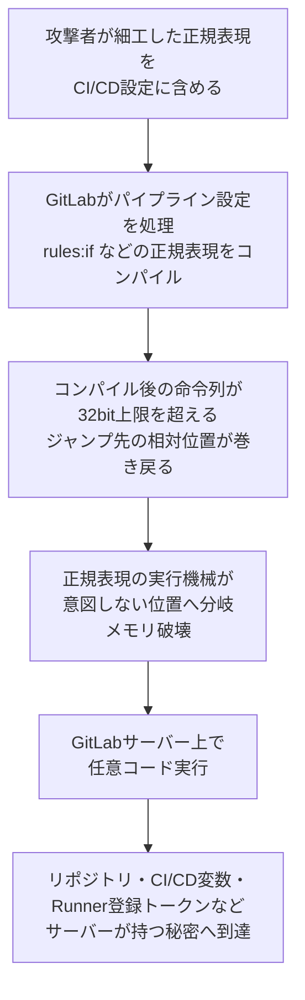

# GitLab CVE-2026-97229 ― CI/CDの正規表現処理で認証なしRCE

## 要点

### 影響バージョン

- 自前で運用するGitLab CE/EEの **19.2.0〜19.2.7、19.3.0〜19.3.4、19.4.0〜19.4.1**。修正版は **19.2.8、19.3.5、19.4.2**（2026年10月12日公開）。19.3.4は、Ona連携を有効にしているとマージリクエスト画面が壊れる不具合があり、19.3.5で差し替えられた（GitLab）。
- GitLab.comは修正済み、GitLab Dedicatedの利用者は対応不要（GitLab）。
- 公開時点で、実際の悪用は報告されていない（Cyber Kendraの報道）。

### 今すぐやること

- 自前のGitLabを19.2.8／19.3.5／19.4.2以上に更新する。CERT-EUは、インターネットに公開しているインスタンスから先に更新するよう勧めている（GitLab、CERT-EU）。
- 単一ノード構成では、データベース移行が終わるまでGitLabが起動せず停止時間が出る。複数ノードならゼロダウンタイム手順で適用できる（GitLab）。
- 9月23日の19.2.7／19.3.3／19.4.1をまだ当てていない環境は、同じ正規表現まわりの認証ありRCE 2件（CVE-2026-89078／CVE-2026-93577）も残っている。今回の修正版でまとめて解消する（GitLab）。

## 概要

- GitLabが10月12日、自前運用のGitLab CE/EE向けに臨時の重大パッチを出し、24件の脆弱性を直した。最重要のCVE-2026-97229は、CI/CD設定に書かれた細工した正規表現で整数オーバーフローを起こし、認証なしでGitLabサーバー上の任意コード実行につながる（CVSS 10.0）。報告者はHackerOne経由の研究者joaxcar（GitLab）。
- GitLabは原因の部品を名指ししていないが、同じリリースにはGitLabが同梱するRubyへの「正規表現のプログラムサイズ」修正と「繰り返し範囲の二重解放」修正が入っている。前者は、Rubyの正規表現エンジンOnigmoのコンパイラで、コンパイル後の命令列の長さが32ビット整数を超えてジャンプ先の位置が巻き戻る欠陥を直すもの（GitLab、Ruby、Cyber Kendra）。
- 同じ研究者は9月にも、同じ正規表現のパーサーとコンパイラで認証ありのRCE 2件（CVSS 9.9）を報告している。今回はその「ログイン不要」版にあたる（GitLab）。

> この記事では、ベンダー・公的機関・研究者・報道で確認できた内容を「事実」、筆者の推測や意見を「考察」として分けて書いています。

## 何が起きたか（時系列）

| 日付 | 出来事 |
| --- | --- |
| 2026-09-23 | GitLabが19.4.1／19.3.3／19.2.7を公開。CI/CD設定の正規表現の解析での二重解放（CVE-2026-89078）と、コンパイルでの整数オーバーフロー（CVE-2026-93577）を修正。どちらも認証ありでサーバー上のコード実行、CVSS 9.9、報告者はjoaxcar（GitLab） |
| 2026-09-25 | Ruby本体に、正規表現コンパイラのプログラムサイズ計算の桁あふれを直すプルリクエスト（ruby/ruby #19020）がマージされる。Ruby 3.4系・4.0系へのバックポートも作られる（Ruby） |
| 2026-10-12 | GitLabが臨時の重大パッチ19.4.2／19.3.4／19.2.8を公開。CVE-2026-97229（CVSS 10.0、認証不要）を含む24件を修正。同梱Ruby 3.3／3.4への正規表現の2つのパッチを含む（GitLab） |
| 2026-10-12 | CERT-EUがセキュリティアドバイザリ2026-016を公開し、公開インスタンスからの更新を推奨（CERT-EU） |
| 2026-10-12以降 | 19.3.4にOna連携時の不具合があり、19.3.5に差し替え。GitLabのリリースページは19.4.2／19.3.5／19.2.8を修正版として案内（GitLab） |
| 今後 | GitLabの方針では、各脆弱性の詳細を記したIssueは修正リリースの90日後に公開される（GitLab） |

※一部報道は公開日を10月8日としているが、GitLabのリリースページとCERT-EUは10月12日としている。本稿は10月12日で書く。

## 技術的な問題点（根本原因）

**事実（GitLab）**

- GitLabの説明は、「CI/CD設定に含まれる細工した正規表現を通じ、正規表現の検証が不十分なため、特定の条件下で認証のない利用者がGitLabサーバー上で任意のコードを実行できた」というもの。分類は整数オーバーフロー（CWE-190）。
- CVSSベクトルは `AV:N/AC:L/PR:N/UI:N/S:C/C:H/I:H/A:H`。ネットワーク越し、攻撃条件は単純、権限も利用者の操作も不要で、影響がGitLabの外（スコープ変更）にも及ぶ評価になっている。
- 9月の2件は「認証された利用者」が前提だった（`PR:L`）。今回は `PR:N` で、ログインなしで届く経路がある、とGitLabは評価している。ただし、認証のない攻撃者がどうやってCI/CD設定を処理させるのかは説明していない（Cyber Kendraも同じ点を指摘）。

**事実（Ruby #19020、GitLabのリリースノート）**

- 10月12日の3つの修正版にはどれも、「Add Ruby regexp program size patch for 3.3 and 3.4」と「Add Ruby regexp repeat-range double-free patch for 3.3 and 3.4」が入っている。
- Ruby #19020は、Onigmo（Rubyの正規表現エンジン）のコンパイラで2つの桁あふれを直す。
  1. `(?:.{90000,}){90000}` のような入れ子の繰り返しで、「インライン展開してよい大きさか」を判断する掛け算 `tlen * qn->lower` が `int` で桁あふれし、上限チェックを素通りする。巨大な命令列が展開され、`Regexp.new` が応答しなくなる。修正では掛け算をやめ、割り算で上限と比べる。
  2. `.{100000,}` は10バイトほどの記述から約10万命令に展開される。これを数百KB並べると、コンパイル後の命令列が `INT_MAX` を超え、命令列に書き込むジャンプ先の相対位置（`RelAddrType`）が巻き戻る。事前の長さ計算も一緒に桁あふれするため、修正では命令を書き出す時点の実際のサイズで上限をかけ、超えたら `RegexpError` にする。

**考察**

GitLabの公告とRubyのプルリクエストを直接結び付ける記述は、どちらにもない。ただ、「CI/CDの正規表現コンパイラ」「整数オーバーフロー」「同じリリースで同梱Rubyの正規表現プログラムサイズを修正」がそろっており、CVE-2026-97229の実体はOnigmoのコンパイル結果の桁あふれである可能性が高いと読む。ジャンプ先の相対位置が巻き戻ると、正規表現の実行機械が命令列の外や意図しない位置へ飛ぶ。ここからメモリ破壊、さらにコード実行へつなげた、という筋書きが想像できるが、エクスプロイトの詳細は公開されていない。

## 攻撃・侵入経路

※図のB以降は、GitLabの説明とRuby #19020の内容から筆者が組み立てた想定で、GitLabが公開した攻撃手順ではない。B（どの構文の正規表現か）とD〜Fは考察である。

**事実（GitLab、報道）**

- 攻撃の入口は「CI/CD設定に含まれる正規表現」で、GitLabはこれを認証なしで突けると評価した。
- 公開時点で、悪用やPoCの公開は報告されていない（Cyber Kendra）。
- 9月にも同じ研究者が同じ領域（正規表現のパーサーとコンパイラ）で2件の重大な欠陥を報告しており、1か月で3件目になる（GitLab）。

**考察**

GitLabはCI/CDの設定ファイルで、`rules:if` の変数比較（`=~`）などに正規表現を書ける。設定は同じインスタンス内の別プロジェクトから `include` で取り込んだり、外部のURLから読み込んだりもできる。認証なしでの到達経路が公開されていない以上、どれが使われたかは書けないが、公開プロジェクトや外部から取り込まれる設定、パイプラインの検証API（Lint）など、「ログインしていない人の入力が、サーバー側の正規表現コンパイラに渡る」場所の存在が `PR:N` の根拠だと考えるのが自然である。

## なぜ防げなかったか・構造的要因の考察

ここからは筆者の考察である。

1. **正規表現は「データ」ではなく「プログラム」**: CI/CD設定の正規表現は、利用者が書いた小さなプログラムを、サーバーのプロセス内でコンパイルして実行しているのと同じである。Onigmoのような機能の多いエンジンは、10バイトが10万命令に化けるほど記述と結果の大きさが離れる。入力の長さを制限しても、コンパイル後の大きさは制限できない。
2. **C言語の算術という古い土台**: Ruby #19020の2つの欠陥は、どちらも `int` の掛け算・足し算で上限を判定していたことによる。上限チェックそのものが、守るべき値と一緒に桁あふれした。昨日の[XRP Ledgerの記事](/security-notes/notes/2026-10-12-xrpl-payment-engine-xrp-overflow-infinite-mint/)と同じ構図で、検査が対象と同じ幅の整数で書かれていると、検査ごと壊れる。
3. **1か月で3件という密度**: 同じ研究者が9月にパーサーの二重解放とコンパイラの整数オーバーフロー、10月にさらに別のコンパイラの桁あふれを見つけた。最初の修正の後も、同じ部品の周辺に同じ型の欠陥が残っていたことになる。一点ずつ直すより、正規表現エンジン全体を隔離する設計（別プロセスやサンドボックス、あるいは線形時間で動き機能を絞ったエンジンへの置き換え）を考える段階に見える。
4. **自前運用の更新の重さ**: 今回の修正版にはデータベース移行が含まれ、単一ノード構成では停止時間が出る。重大な修正が9月23日と10月12日の3週間で2回続くと、更新を後回しにする判断が出やすい。9月の修正を当てていない環境は、認証あり2件と認証なし1件の3件を抱えたままになる。

## 運用者向けの具体的な対策と検知ポイント

**対策（GitLab、CERT-EUの推奨を要約）**

1. 自前のGitLab CE/EEを **19.2.8／19.3.5／19.4.2** 以上に更新する。19.3系は19.3.4ではなく19.3.5を使う。
2. インターネットに公開しているインスタンスを優先する（CERT-EU）。
3. 単一ノードは停止時間を見込んで計画し、複数ノードはゼロダウンタイム手順で適用する（GitLab）。

**考察（追加でできること）**

- すぐに更新できない場合、GitLabを社外から到達できないようにする（VPNやIP制限の内側に置く）ことで、`PR:N` の前提をなくせる。公開プロジェクトや匿名アクセスの要否もこの機会に見直す。
- GitLabサーバー上でコードが動いた場合、サーバーが持つ秘密（CI/CD変数、Runner登録トークン、各種連携のトークン、`gitlab-secrets.json` の中身）はすべて漏れた前提になる。更新前の状態が長かったインスタンスは、更新後に秘密の入れ替えを検討する。
- 同梱のRubyではなく、正規表現を扱う自社のサービスでも、利用者が書いた正規表現をそのままRuby（Onigmo）でコンパイルしている箇所がないかを点検する。Ruby本体の修正版（#19020のバックポート）が入っているかも確認する。

**検知ポイント（考察）**

GitLabは今回の侵害の痕跡（IoC）を公開していない。そのため、振る舞いで見る。

- `.gitlab-ci.yml` や `include` 先に、極端に長い正規表現、`{90000,}` のような大きな繰り返し回数、同じ繰り返しの大量の連結がないか。
- Pumaなどアプリケーションのワーカープロセスの異常終了、長時間の応答なし、メモリ使用量の急増。正規表現のコンパイルで固まった、あるいは落ちた形跡になりうる。
- GitLabのアプリケーションサーバーから見慣れない宛先への外向き通信、ワーカー配下の想定外の子プロセス。
- 誰も書いていない設定によるパイプライン実行、見覚えのないRunnerの登録。

## 参考リンク

- GitLab: [GitLab Critical Patch Release: 19.4.2, 19.3.5, 19.2.8](https://docs.gitlab.com/releases/patches/patch-release-gitlab-19-4-2-released/)
- GitLab: [GitLab Critical Patch Release: 19.4.1, 19.3.3, 19.2.7](https://docs.gitlab.com/releases/patches/patch-release-gitlab-19-4-1-released/)
- CERT-EU: [Security Advisory 2026-016 ― Critical Vulnerability in GitLab CE and EE](https://cert.europa.eu/publications/security-advisories/2026-016/)
- Ruby: [Avoid overflow in the regexp compiler's program size arithmetic (ruby/ruby #19020)](https://github.com/ruby/ruby/pull/19020)
- Cyber Kendra: [GitLab Patches Critical CVE-2026-97229 RCE Flaw](https://www.cyberkendra.com/2026/10/cve-2026-97229-gitlab-regex-rce.html)
- BleepingComputer: [GitLab warns of max severity code execution vulnerability](https://www.bleepingcomputer.com/news/security/gitlab-warns-of-max-severity-rce-flaw-in-regex-compiler-engine/)
