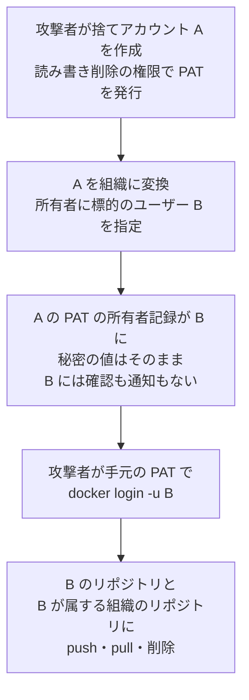

# Docker Hub「GhostPat」 ― 自分のトークンが他人として通る欠陥

## 要点

### 影響バージョン

- **Docker Hub（SaaS）**。2024年8月26日20時33分（UTC）から、修正が入った **2026年9月30日19時10分ごろ（UTC、日本時間10月1日4時10分ごろ）** まで（Docker）。
- Docker Hub側で修正済みで、利用者が入れる更新はない（The Hacker News）。
- CVSS 4.0は9.4、CWE-266（不適切な権限の割り当て）。Dockerは「重大（critical）」と評価した（CVEレコード、Docker）。
- Dockerは、変換で付け替えられたトークンで行われた約30万4,000回のpushを調べ、**悪用の証拠はなかった** としている（Docker）。

### 今すぐやること

- Dockerから10月2日に件名「Docker Hub Vulnerability Identified & Resolved」のメールが届いていなければ、対応は不要とされている（Docker）。
- 届いた場合、または念のため、Docker Hubの「Account settings」→「Personal access tokens」で、作った覚えのないトークンや使っていないトークンを無効にする。トークンの説明文は作った人が自由に付けられるので、見慣れた名前でも安心材料にならない（Docker、GhostPat）。
- アカウント切り替えのメニューに、参加した覚えのない組織がないかを確認する（GhostPat）。
- 組織の自動化には、個人のPATではなく組織用のアクセストークン（Organization access tokens）を使う（Docker）。

## 概要

- Docker Hubには、リポジトリを別のアカウントへ移す機能がない。そのため、`alice/app` を組織の持ち物にしたいときは、個人アカウント `alice` を組織に変換し、既存のDocker Hubアカウントを新しい組織の所有者に指定する（Docker）。
- 2024年8月26日から、この変換で、変換されるアカウントのPATが新しい所有者に付け替えられるようになっていた。**トークンの所有者の記録だけを書き換え、秘密の値は変えず、無効にもしなかった**。指定された所有者には確認も通知もなかった（Docker）。
- このため、攻撃者が自分のアカウントでPATを作り、そのアカウントを組織に変換して他人を所有者に指定すると、手元のPATがその人としてレジストリに通った（Docker）。
- 研究者のPeter Molnar氏とKrisztian Hozak氏（mptrdev.com）が見つけて「GhostPat」と名付け、Dockerは報告から4時間足らずで修正した（Docker、GhostPat）。

> この記事では、ベンダー・公的機関・研究者・報道で確認できた内容を「事実」、筆者の推測や意見を「考察」として分けて書いています。

## 何が起きたか（時系列）

| 日時 | 出来事 |
| --- | --- |
| 2024-08-26 20:33 UTC | 変換でPATが新しい所有者に付け替えられるようになる（Docker） |
| 2025-04-22 | Dockerの変換手順のドキュメントに「所有者に指定したユーザーへPATが移る」旨の注記が追加される（The Hacker Newsが公開の編集履歴から確認） |
| 2026-09-28〜29 | 研究者が2回、別々に再現（GhostPat） |
| 2026-09-30 11:40（米国東部、日本時間10月1日0時40分） | Dockerが報告を受領（Docker） |
| 同 15:10ごろ（米国東部） | 修正を本番に反映。変換でPATが移らなくなる。15時23分ごろにはドキュメントも更新（Docker） |
| 2026-10-02 17:30（米国東部） | 影響を受けうる利用者と組織の所有者にメールで通知（Docker） |
| 2026-10-08 15:45（米国東部） | 変換で移ったPATを強制的に無効化（残すよう申し出たものは除く）（Docker） |
| 2026-10-12 | Dockerがアドバイザリを公開（Docker） |
| 2026-10-13 | CVE-2026-105445が公開される（CVEレコード） |

## 技術的な問題点（根本原因）

**事実（Docker、CVEレコード、GhostPat）**

- PATは、Docker Hubのレジストリでパスワードの代わりに使う認証情報で、作るときに選んだ権限（読み取り、書き込み、削除など）の範囲で、持ち主のアカウントとして振る舞う。
- 変換処理は、PATの所有者の記録を新しい所有者に書き換えていた。秘密の値はそのままで、作った人の手元のトークンが使い続けられた。
- 新しい所有者に指定されたユーザーへの確認や通知はなかった。Dockerの変換ページには2024年8月の時点から「新しい所有者には通知メールが届く」と書かれていた（The Hacker News）。
- 付け替えられたPATは、権限の範囲内で、所有者のリポジトリと、所有者が参加する組織のリポジトリに対してpush・pull・削除ができた。
- できなかったこと: Docker HubのWeb画面へのアクセス、パスワード・メールアドレス・2要素認証の変更、アカウントの乗っ取り。

**考察**

認証情報の「持ち主」を変えるなら、同時に秘密の値を作り直すか、元の持ち主の手元のものを使えなくするのが原則である。ここでは、データベース上の所有者の欄だけが書き換わり、秘密を知っている人は変わらなかった。しかも、移す先の人の同意をとらなかったので、「誰が誰の権限を持つか」を、権限を受け取る側ではなく渡す側が一方的に決められた。権限を渡す操作に受け取る側の同意がいらず、渡された側が知らないまま「自分のもの」になっている、という形が根本にある。

## 攻撃・侵入経路

**事実（GhostPat）**

- 研究者は、同意を得たテスト用アカウントで、別のIP・別の人・別の日に2回再現した。標的のユーザー名と、別アカウントで作ったPATで `docker login` が成功した。
- 標的の名前空間にリポジトリを作ってpushし、標的が参加する組織のリポジトリにもpushできた。標的の非公開リポジトリもpullできた。
- レジストリAPIのトークン交換（`POST /v2/auth/token`）とリポジトリ一覧もこのPATで通った。
- 攻撃に必要なのは無料の捨てアカウント1つと、通常のWeb画面での操作だけだった。
- 研究者は、公式イメージ（`library/` の `ubuntu`・`alpine`・`nginx` など）がこの変換の経路で届く普通のアカウントの下で公開されていれば、基盤イメージそのものに書き込めた可能性を「未確認の最悪のケース」として挙げている。

**事実（Docker）**

- 2024年8月26日以降の変換をすべて洗い出し、レジストリの認証ログ、利用データ、トークンの記録と突き合わせた。複数の身元で使われたトークンを探し、付け替えられたトークンによるpush約30万4,000回をすべて調べた。
- どのpushも、変換された組織自身か、指定された所有者自身のリポジトリに入っていた。無関係な利用者や組織には入っていなかった。大半は、変換するアカウントと所有者が同じ人かチームだった。
- 同じ人が両方を持っていると確かめられなかった、リスクの高い公開イメージを、実行せずに静的に解析し、マルウェアや改ざんは見つからなかった。
- ただし、レジストリのログはトークンが使われたことを記録するが、存在していることは記録しない。一度も使われていないトークンは痕跡を残さないため、変換で移ったPATはすべて「影響を受けうる」として扱った。

## なぜ防げなかったか・構造的要因の考察

ここからは筆者の考察である。

1. **「リポジトリを移せない」制約を、アカウントの変換で埋めていた**: 本来は「リポジトリの持ち主を移す」操作が必要なところを、アカウントごと組織に変える機能で代用していた。アカウントに紐づく認証情報の扱いが、その代用の中で後回しになったとみられる。
2. **ドキュメントは書いていた、だが危険とは読まれなかった**: The Hacker Newsによると、PATが移ることは2025年4月から公式ドキュメントに書かれていた。約25か月の穴のうち約17か月は、仕様として公開されていたことになる。「移る」と書いてあっても、「秘密を知る他人のトークンが自分のものになる」とは読み取りにくい。また「通知メールが届く」という記述は実際の動作と合っていなかった。
3. **調べられるのはpushだけで、pullは見えにくい**: Dockerはpushについて「無関係なリポジトリには入っていない」と示したが、The Hacker Newsが指摘するとおり、アドバイザリは付け替えられたトークンによるpullや削除、特に非公開リポジトリからのpullの調査結果には触れていない。改ざんは成果物に残るが、読み取りは残りにくい。非公開イメージに埋め込まれた設定や秘密情報が読まれたかどうかは、利用者側からは確かめにくい。
4. **個人のPATが組織の自動化に使われている**: CIが個人のPATでpushしていると、その人の権限がそのまま組織のリポジトリに及ぶ。Dockerが組織用トークンを勧めるのはこのためだが、The Hacker Newsによると組織用トークンはDocker TeamかDocker Businessの契約が必要で、Docker DesktopやImage Access Managementでは使えない。無料・個人の利用者ほど個人のPATに頼りやすい。
5. **署名で救われた利用者もいた**: Docker Composeのリンター「compose-lint」の作者Todd Matens氏は、通知を受けてCI用のトークン2つを入れ替え、公開している42のイメージの署名を確かめ、それぞれを作ったCIの実行まで遡ったとブログに書いている。イメージに署名と来歴があれば、「自分が作ったものか」を後から確かめられる。

## 運用者向けの具体的な対策と検知ポイント

**対策（Dockerの推奨を要約）**

1. 「Account settings」→「Personal access tokens」でPATを見直し、心当たりのないもの、使っていないものを無効にする。
2. 組織のための自動化には、個人のPATではなく組織用のアクセストークンを使う。
3. 質問はDocker Supportへ。

**考察（追加でできること）**

- 通知を受けた組織は、組織の所有者・メンバーのPATをすべて作り直し、CIのシークレットを入れ替える。強制無効化から除外を申し出たトークンがあれば、改めて必要か見直す。
- 公開・非公開のイメージに、Cosign（Sigstore）やDocker Content Trustなどで署名し、利用側は署名と来歴を検証してからpullする。Matens氏のように、イメージのダイジェストとCIの実行を対応づけておくと、改ざんの有無を後から確かめられる。
- 非公開イメージに、認証情報や内部のホスト名など、読まれて困るものを入れない。入っていた場合は、読まれた前提で入れ替える。
- 利用側は、タグではなくダイジェスト（`@sha256:...`）でイメージを固定し、知らない間に中身が差し替わっても取り込まないようにする。

**検知ポイント（Docker、GhostPat、The Hacker Newsの情報を整理）**

- PATの一覧で、作った覚えのないトークン。一覧には作成日時と最終使用日時が出る。
- アカウント切り替えメニューにある、参加した覚えのない組織。
- 組織の監査ログ（Activity logs、Team・Business契約）で、pushされたタグと、pushに使われたトークン。Docker Homeでは30日分を見られ、それより古いものはDocker Hub APIで取れる。
- 自分のCIで作っていないタグやダイジェストが、自分のリポジトリにpushされていないか。

## 参考リンク

- Docker: [Docker Hub security advisory: personal access tokens transferred during account-to-organization conversions](https://www.docker.com/blog/docker-hub-security-advisory-cve-2026-105445/)
- 研究者（mptrdev.com）: [GhostPat](https://ghostpat.com/)
- CVE: [CVE-2026-105445](https://www.cve.org/CVERecord?id=CVE-2026-105445)
- The Hacker News: [Docker Fixes Critical Two-Year-Old Hub Flaw That Let One User Push Images as Another](https://thehackernews.com/2026/10/docker-fixes-critical-two-year-old-hub.html)
- BleepingComputer: [Docker Hub flaw let attackers impersonate users, tamper with images](https://www.bleepingcomputer.com/news/security/docker-hub-flaw-let-attackers-impersonate-users-tamper-with-images/)
- Todd Matens: [Docker Hub's access token vulnerability: how signing let me verify my images](https://dev.to/tmatens/docker-hubs-access-token-vulnerability-how-signing-let-me-verify-my-images-58i3)
- Docker Docs: [Organization access tokens](https://docs.docker.com/security/access-tokens/organization-access-tokens/)
