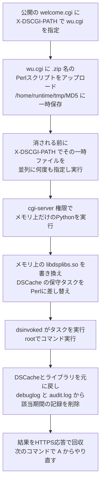

# Ivanti Connect Secure CVE-2026-104935 ― 公開ページのURLと別のCGIを指すヘッダーで認証を素通り、3つのゼロデイの連鎖でroot、権限昇格はまだ未修正

## 要点

### 影響バージョン

- **Ivanti Connect Secure（ICS）25.1.3.0より前**。ただし **22.7R2.14以前は影響なし**（CVEレコード）。報道では、影響を受けるのは **22.8R2.4以前、25.1.2.2以前、25.1.1.1以前**（BleepingComputer）。
- 修正版は **22.8R2.5、25.1.1.2、25.1.3.0、25.1.3.1**（SecurityWeek）。CVEレコードは22.8R2.5・25.1.3.0・25.1.3.1を「影響なし」としている。
- CVSS 3.1は8.6（Ivanti）。CISAは10月13日にKEV（悪用が確認された脆弱性の一覧）に追加し、連邦機関の対応期限を **10月16日** とした（CISA KEV）。
- **連鎖の3つ目、rootへの権限昇格は未修正**。Ivantiは「数週間以内の将来のリリース」で直すとしている（Volexity）。

### 今すぐやること

- ICSを修正版に更新する。Ivantiは対象版の利用者に「直ちに行動する」よう求めている（Ivanti）。
- Ivantiの整合性チェックツール（Integrity Checker Tool）だけで「侵害なし」と判断しない。この攻撃はディスク上のファイルを残さず、ツールでは検出できなかった（Volexity）。
- `/dana-na/auth/url_default/welcome.cgi` への大量のリクエストで、`X-DSCGI-PATH` ヘッダーの値がURLのパスと食い違うものを探す。`/tmp/` と `/data/.icscap/` に覚えのないファイルがないかも確認する（Volexity）。
- 侵害が疑われるときは、ネットワークとメモリのフォレンジックを行う。装置に保存しているLDAPなどの認証情報は漏れた前提で入れ替える（Volexity、考察）。

## 概要

- Volexityは、ネットワーク監視の顧客のICS VPN装置が、当時最新の **22.8R2.4（Build 19097）** だったにもかかわらず侵害されているのを見つけた。未知の攻撃者「UTA0576」が、**認証回避・ファイル書き込みによるコード実行・権限昇格** の3つのゼロデイを連鎖させ、ログインなしでroot権限のコード実行に至っていた（Volexity）。
- 前2つはまとめてCVE-2026-104935として10月13日に修正された。3つ目の権限昇格はまだ修正されていない（Volexity）。
- 攻撃者はバックドアもWebシェルも置かず、**コマンドを1つ実行するたびに連鎖全体を打ち直し**、結果をHTTPSの応答で受け取っていた。ログを選んで消し、メモリ上で書き換えたライブラリや設定も元に戻していた（Volexity）。
- 侵入後は、装置に保存されたドメインの認証情報を抜き、Active Directory（AD）からLAPSのローカル管理者パスワードやBitLockerの回復キーを探し、パスワードスプレーを行っていた（Volexity）。

> この記事では、ベンダー・公的機関・研究者・報道で確認できた内容を「事実」、筆者の推測や意見を「考察」として分けて書いています。

## 何が起きたか（時系列）

| 日時 | 出来事 |
| --- | --- |
| 2026-09-30〜10-07 | 攻撃に使われたホスト（108.165.147[.]64、Evoxt社のVPS）でOpenVPNサーバーが動いていた（Volexity） |
| 2026-10-01 | 脅威情報企業Defusedが、CVE-2026-104935の悪用の最初の兆候を観測したとしている（BleepingComputer） |
| 2026-10-03 | UTA0576が顧客のICS装置への悪用を始める（Volexity） |
| 2026-10-05 | Volexityが不審な活動の調査を始め、原因がICS装置だと突き止める（Volexity） |
| 2026-10-10 | Volexityが脅威情報の顧客に指標の提供を始める（Volexity） |
| 2026-10-13 | Ivantiがアドバイザリと修正版を公開し、「限定的な悪用」を認める。Volexityが詳細を公表。CISAがKEVに追加（Ivanti、Volexity、CISA） |

## 技術的な問題点（根本原因）

**事実（Volexity）**

1. **認証回避（`welcome.cgi`）**: ICSは、フロントとバックのプロセスからCGIの処理へリクエストを振り分ける。攻撃者は、ログイン画面を出す公開スクリプト `/dana-na/auth/url_default/welcome.cgi` にリクエストを送り、ヘッダー `X-DSCGI-PATH` で別のスクリプト（例: `/home/webserver/htdocs/dana/fb/smb/wu.cgi`）を指定する。**許可するかどうかはURLのパスで判断し、実際に実行する先はヘッダーのパスで決める** ため、認証が必要なCGIにも届いてしまう。
2. **ファイル書き込みからのコード実行（`wu.cgi`）**: `wu.cgi` のアップロード処理は、クライアントが送ったファイル名のMD5を計算し、中身を `/home/runtime/tmp/<MD5(ファイル名)>` に書き込む。ZIPとして正しいかの検査は **書き込んだあと** で、不正ならファイルを消す。攻撃者は拡張子 `.zip` のPerlスクリプトを送り、消される前のわずかな間に、`X-DSCGI-PATH: /home/runtime/tmp/<MD5>` を付けたリクエストを並列で何本も送って実行させる（競合状態）。ここまでで `cgi-server` ユーザーとしてコードが動く。
3. **権限昇格（`dsinvoked` と DSCache）**: rootで動く保守用のサービス `dsinvoked` は、各タスクでどのプログラムを動かすかを、共有の設定ストア「DSCache」から読む。攻撃者は `cgi-server` プロセスのメモリ上にあるライブラリ `/home/lib/libdsplibs.so` を書き換えてDSCacheを変更できるようにし、既存の保守タスク（`ScriptUtil/updateOpswatSDK`）の実行先をPerlのインタプリタに差し替える。そのうえで `dsinvoked` にタスクを実行させ、引数に渡した悪意のあるPerlスクリプトをrootで動かす。

- CVE-2026-104935は1と2をまとめたもの。CWEは「なりすましによる認証回避」（CWE-290）とされている（CVEレコード）。
- 3はまだ修正されていない。Volexityの報告は、1と2を直した装置で3がどの程度の危険になるかには触れていない（The Hacker News）。

**考察**

1は、「誰に許可するか」の判断と「何を動かすか」の決定が、同じリクエストの別々の値から作られていたことが根本である。判断に使った値と実行に使う値が一致しているかを確かめないかぎり、攻撃者は「許可される値」と「本当に動かしたい値」を別々に渡せる。2は、検査の前に「実行できる場所」へ書いてしまう、典型的な検査と使用の順序の問題である。3は、権限の低いプロセスが書き換えられる設定を、権限の高いサービスが信用して実行先を決めていた。3つとも、信用の境界をまたぐところで「誰が書いた値か」を確かめていない、という同じ形をしている。

## 攻撃・侵入経路

**事実（Volexity）**

- 最初のPerlスクリプトはBashスクリプトを、BashスクリプトはPythonスクリプトを起動する。Pythonスクリプトは Base64＋zlib で圧縮された形で届き、展開後に `exec()` で実行されるため、メモリ上にしか存在しない。
- rootが取れたかどうかは `/etc/shadow` が読めるかで確かめていた。
- 侵入後の主な行動:
  - 装置に保存されたLDAP用のドメイン認証情報などを抜き出す。
  - ICS装置のADサービスアカウントで内部のドメインコントローラにLDAPで接続し、自作のツール（`/tmp/ml.py`・`/tmp/rq5.py`）でLAPSのパスワード、BitLockerの回復情報、`userPassword`・`unixUserPassword` 属性などを探す。結果は圧縮・Base64化したJSONで `/tmp/` に書き、攻撃の通り道で持ち出す。
  - 自作のKerberos実装（`/tmp/mk.py`・`/tmp/rr.py`）で認証情報を試す（Kerberoastの機能も含まれていたが使われなかった）。
  - 名前を `dsstatmond` に変えたtcpdumpを隠しディレクトリ `/data/.icscap/` で動かし、LDAP・HTTP・FTP・telnetなど平文のプロトコルを8つの回転するファイルに記録。`h.py` で平文のLDAP認証情報、HTTP Basic認証、NTLMのチャレンジ・レスポンスを取り出す。
  - 設定ファイル（`/home/etc/pulse/` など）や認証ログ（`log.events.vc0`）から有効なユーザー名を集め、`sp_run.py` でADアカウントにパスワードスプレーを行う。
- Volexityは、攻撃者が実行結果を見ながら手で操作していたと高い確度で、動機は諜報ではなく金銭目的と低い確度で、また **LLMをエクスプロイト開発と侵入後の作業に使っている** と中程度の確度でみている。理由として、Webシェルを使わず毎回チェーンを通す運用、ハードコードした認証情報入りのごく専用のスクリプト、チェーンの複雑さを挙げている。
- 攻撃は途中で検知・遮断されたため最終目的はわからないが、Volexityは横展開と、より広いネットワーク侵害の準備だったと高い確度でみている。

## なぜ防げなかったか・構造的要因の考察

ここからは筆者の考察である。

1. **「最新版を当てていた」装置が破られた**: 対象は当時の最新版だった。パッチ適用の速さだけでは、ゼロデイの連鎖は防げない。VPN装置のような境界機器は、侵入される前提で「装置から内側へ何ができるか」を絞っておく必要がある。今回の攻撃者が真っ先に使ったのは、装置が持つADサービスアカウントだった。
2. **整合性チェックの前提を外された**: Integrity Checker Toolはディスク上のファイルの改ざんを見る道具である。攻撃者は、ディスクに何も残さず、メモリ上の書き換えも元に戻し、Webシェルすら置かなかった。「ファイルが変わっていなければ安全」という検査を、運用の工夫だけで外している。ベンダーが「ツールを定期的に実行せよ」と案内しても、それで見つからない攻撃がすでに使われている。
3. **装置が平文の通信と強い認証情報の集まる場所になっている**: VPN装置はLDAPでADに問い合わせ、利用者の認証情報が通り、ネットワークの要所に置かれる。LDAPを暗号化せずに使っていれば、装置上でパケットを取るだけで認証情報が手に入る。Volexityは、別の攻撃者（UTA0533）がSonicWall SMAで同じ手口を最近使ったとしている。
4. **3つ目が未修正のまま公表された**: 権限昇格は直っていない。考察として、1と2を直しても、別の入口で `cgi-server` 権限を取られれば、再びrootに届く道が残る。今後、別の認証回避やコード実行が見つかったときに組み合わされるおそれがある。
5. **Ivanti製品は繰り返し狙われている**: BleepingComputerによると、CISAは2021年11月以降、Ivanti製品の36件の脆弱性を悪用確認済みとしており、うち12件はランサムウェアでも使われた。ICSでは2024年1月のCVE-2023-46805とCVE-2024-21887の連鎖、2025年のCVE-2025-0282とCVE-2025-22457もゼロデイとして悪用された。

## 運用者向けの具体的な対策と検知ポイント

**対策（Ivanti、Volexityの推奨を要約）**

1. ICSを修正版（22.8R2.5、25.1.1.2、25.1.3.0、25.1.3.1のいずれか、利用中の系列に合わせる）に更新する。Volexityは、25.1.1以前、25.1.2、22.8R2.4の装置を最新版に上げるよう勧めている。
2. 侵害が疑われる場合は、ネットワークとメモリのフォレンジックを行う。Volexityの指標は同社のGitHubで公開されている。
3. Ivantiは、修正版の適用に加え、アクセス制御、ネットワーク監視、ログの確認、装置の整合性の継続的な確認を組み合わせるよう求めている。

※確認できた資料には、すぐに更新できない場合の一時的な回避策と、更新で既に取られたアクセスが消えるかどうかは書かれていなかった（The Hacker News）。

**考察（追加でできること）**

- 侵害の痕跡があった、または判断がつかない装置では、装置に保存しているLDAP・RADIUSなどのサービスアカウントのパスワードを入れ替え、ADのLAPSパスワードとBitLocker回復キーが読まれた前提で、重要な端末から順に入れ替える。
- ICS装置のADサービスアカウントに、LAPS（`ms-Mcs-AdmPwd`・`msLAPS-Password`）やBitLocker回復情報を読む権限が付いていないかを確認し、付いていれば外す。
- 装置とドメインコントローラの間のLDAPを、LDAPSやLDAP署名・チャネルバインディングで保護し、平文で認証情報が流れないようにする。
- ICS装置を送信元とする社内への通信（LDAPの大量検索、Kerberosの認証試行、多数のアカウントへのログイン失敗）を、ドメインコントローラ側で監視する。装置自身のログは消されうる前提で、外部のSIEMに送っておく。

**検知ポイント（Volexityの指標を整理）**

- `/dana-na/auth/url_default/welcome.cgi` への大量のリクエスト。
- `X-DSCGI-PATH` ヘッダーが付き、値がURLのパスと合わないもの（例: `/home/webserver/htdocs/dana/fb/smb/wu.cgi`、`/home/runtime/tmp/<32桁の16進数>`）。Volexityは、別のパスを使う変種が今後出てくる可能性が高いとし、URLとヘッダーの食い違いそのものを見るよう勧めている。
- 隠しディレクトリ `/data/.icscap/` と、その中の `dsstatmond`・`cap0`〜`cap7`・`h.py`。
- `/tmp/` の `ml.py`・`rq5.py`・`mk.py`・`rr.py`・`pu.txt`・`sp_out.txt`・`spray_hits.json`、`/home/runtime/tmp/ics-root-run-inband-*.pl`・`ics-root-result-inband-*`。
- `/home/runtime/dlogs/debuglog` や `/var/log/audit/audit.log` で、特定の時間帯だけ記録が抜けている、ファイルが切り詰められて書き直された形跡。
- 通信先 108.165.147[.]64。

## 参考リンク

- Volexity: [A Series of Unauthenticated Events: Chained Exploitation of Ivanti Connect Secure Zero-Days](https://www.volexity.com/blog/2026/10/13/a-series-of-unauthenticated-events-chained-exploitation-of-ivanti-connect-secure-zero-days/)
- Ivanti: [October 2026 Security Update](https://www.ivanti.com/blog/october-2026-security-update)
- Ivanti: [Security Advisory Ivanti Connect Secure (CVE-2026-104935)](https://hub.ivanti.com/s/article/Security-Advisory-Ivanti-Connect-Secure-CVE-2026-104935)
- CVE: [CVE-2026-104935](https://www.cve.org/CVERecord?id=CVE-2026-104935)
- CISA: [Known Exploited Vulnerabilities Catalog（CVE-2026-104935）](https://www.cisa.gov/known-exploited-vulnerabilities-catalog?field_cve=CVE-2026-104935)
- The Hacker News: [Attacker Chains Three Ivanti Connect Secure Zero-Days for Root Access, Only Two Patched So Far](https://thehackernews.com/2026/10/attacker-chains-three-ivanti-connect.html)
- SecurityWeek: [Ivanti Zero-Day Chain Gave Attackers Root Access to Fully Patched VPN](https://www.securityweek.com/ivanti-zero-day-chain-gave-attackers-root-access-to-fully-patched-vpn/)
- BleepingComputer: [Ivanti warns of Connect Secure zero-day exploited in attacks](https://www.bleepingcomputer.com/news/security/ivanti-warns-of-connect-secure-zero-day-exploited-in-attacks/)
