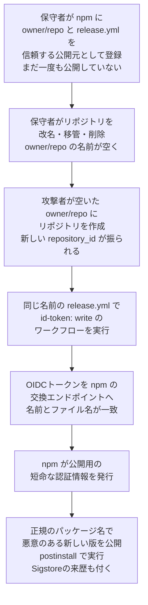

# npmのTrusted Publishing「SlugFest」 ― 信頼の紐づけ先を「owner/repo」の名前で覚えていたため、空いた名前を取り直すだけで他人のパッケージを公開できた

## 要点

### 影響バージョン

- **npmレジストリのTrusted Publishing（信頼できる公開元）の設定のうち、まだ一度もその設定で公開していないもの**。GitHub Actionsのほか、GitLabのTrusted Publishingの実装も同じ問題を抱えていた（Bloom Security）。
- サービス側の問題で、npm CLIの特定の版の問題ではない。GitHubは **2026年10月2日** に、未検証の設定を作成から48時間で失効させる変更を入れた（GitHub Changelog）。
- Bloom Securityは、該当するパッケージを **1,500超**、合計ダウンロード数1,000万超（月100万超）と数えている。報告から修正まで120日以上かかった（Bloom Security）。
- 確認できた資料に、CVE番号と、実際に悪用されたかどうかの記載はなかった。

### 今すぐやること

- 自分のパッケージごとに `npm trust list` を実行し、登録されているリポジトリの名前が、今も自分の管理するリポジトリを指しているか確かめる（Bloom Security）。
- 紐づけたリポジトリを改名・移管した場合は、今の設定を消して、今の名前で作り直す。削除するリポジトリは、先に紐づけを消す（Bloom Security）。
- 新しく設定を作ったら、**2日以内に** その設定で1回公開する。最初の公開で、設定がリポジトリの変わらない識別子に結びつく（npm Docs）。
- Trusted Publishingに移ったパッケージは、「Publishing access」で「Require two-factor authentication and disallow tokens」を選び、従来のトークンでの公開を止める（npm Docs）。

## 概要

- npmのTrusted Publishingは2025年7月に一般提供された。長く使い回される公開用トークンをCIに置く代わりに、GitHub ActionsなどのワークフローがOIDCの短命なトークンを取得し、npmレジストリで数分で切れる公開用の認証情報と交換する仕組みである（Bloom Security、GitHub）。
- 保守者が `npm trust github` で設定すると、CLIは **リポジトリ名（owner/repo、「スラッグ」）**、**ワークフローのファイル名**、任意で **環境名** の3つだけをレジストリに送る（Bloom Security）。
- GitHubのOIDCトークンには、改名や移管でも変わらない `repository_id` と `repository_owner_id` も入っている。しかしnpmは、その設定で最初に公開が成功するまで、これらを記録していなかった（Bloom Security）。
- そのため、紐づけ先のリポジトリが改名・移管・削除され、名前が空くと、攻撃者が同じ名前のリポジトリを作り、同じファイル名のワークフローを動かすだけで、npmが公開用の認証情報を発行した。Bloom Securityはこれを「SlugFest」と名付けた（Bloom Security）。

> この記事では、ベンダー・公的機関・研究者・報道で確認できた内容を「事実」、筆者の推測や意見を「考察」として分けて書いています。

## 何が起きたか（時系列）

| 日時 | 出来事 |
| --- | --- |
| 2025-07 | npm Trusted Publishing（OIDC）が一般提供される（GitHub Changelog、Bloom Security） |
| 2026-06-06 | Bloom SecurityがGitHubのHackerOneプログラムに報告（Bloom Security） |
| 2026-06-09 | GitHubがトリアージし、問題を確認（Bloom Security） |
| 2026-07-08 | GitHubから「修正と、リスク・深刻度の判断を進めている」との返事。これを最後に、Bloomの6回の問い合わせとHackerOneへの仲介依頼に返事がなかった（Bloom Security） |
| 2026-10-02 | GitHubが、未検証のTrusted Publishing設定を作成48時間で失効させる変更と、`issue_comment` イベントからのトークンの拒否を公表（GitHub Changelog） |
| 2026-10-13 | Bloom Securityが公表。公表前の再確認で修正に気づいた（Bloom Security、The Hacker News） |

## 技術的な問題点（根本原因）

**事実（Bloom Security）**

- 公開時、ワークフローはGitHubにOIDCトークンを求め、npmの交換用エンドポイントに送る。交換は、トークンの `repository` クレームが記録されたスラッグと一致し、ワークフローのファイル名が記録されたものと一致すれば成功していた。
- トークンには数値の `repository_id` も入っているが、最初の公開が済むまで、npmには照合する値がなかった。
- GitHubでは、リポジトリが改名・移管・削除されたとき、また所有者のアカウントが改名・削除されたとき、元の `owner/repo` の名前を誰でも取り直せる。取り直したリポジトリには、新しい `repository_id` が振られる。
- PyPIの実装（Warehouse）は、Trusted Publishingを始めた当初から、変わらない識別子を記録して照合しており、この攻撃を防いでいた。

**事実（GitHub Changelog、npm Docs）**

- 新しく作ったTrusted Publishingの設定は、2日以内に最初の公開を成功させる必要がある。最初の公開で設定が検証され、リポジトリの変わらない識別子に結びつく。
- 2日以内に検証されなければ失効し、使うことも編集することもできなくなる。リポジトリやプロジェクトの識別情報を変えるには、新しい信頼関係を作り直す必要があり、新たに48時間の検証期間が始まる。通常の編集では期限は延びない。
- あわせて、GitHub Actionsの `issue_comment` イベントから来たトークンも、既存の `pull_request_target` と同じく拒否するようになった。

**考察**

信頼の相手を「名前」で覚えるか「変わらない識別子」で覚えるかの違いが、すべてである。名前は手放されれば他人が拾える。npmは最初の公開で識別子を記録する作りにしていたので、「設定はしたが、まだ一度も公開していない」状態だけが名前だけに頼る窓になっていた。GitHubの修正は、窓をなくすのではなく48時間に縮める方法で、作成直後の2日間に名前を奪われる可能性は理屈の上では残る。Bloomが勧める、設定作成時にGitHub APIで識別子を引いて保存し、交換時に一致を求めるやり方なら、その窓自体がなくなる。

## 攻撃・侵入経路

**事実（Bloom Security）**

- 保守者のnpmアカウントもGitHubアカウントも、認証情報も一切使わずに、他人のパッケージの公開用トークンが手に入る。内部の知識も競合状態もいらない。
- Bloom Securityは、自社のnpmスコープと研究者が管理するリポジトリで最初から最後まで再現した。別の組織に属する2つ目のGitHubリポジトリから、パッケージを公開できた。2つの共通点は名前だけだった。
- 攻撃者の公開にも、攻撃者のリポジトリを指すSigstoreの来歴証明（provenance）が付く。「署名されているか」だけを確かめ、来歴が期待するリポジトリかを確かめない下流のツールでは、正当に見える。
- 全レジストリを調べ、該当するパッケージは1,500超と数えた。この数はnpm全体ではなく、Trusted Publishingを設定しているパッケージの中の数である。Trusted Publishingの利用は、活発なパッケージの20％未満と見積もられている。Bloomは、問題が残っているとして該当パッケージの一覧を公開していない。
- Bloomは、AIのコーディングエージェントが人の確認なしに依存パッケージを選んで入れることを、被害を広げる要因として挙げる。同社の測定では、エージェント1つが1日に0.3〜1.2個、開発者の端末では2〜3個のパッケージを新たに入れ、端末あたり月約70個（開発者の端末では約350個）になる。同社は、該当するパッケージを顧客のエージェントが入れようとしたのを検知して止めたこともあるとしている。

## なぜ防げなかったか・構造的要因の考察

ここからは筆者の考察である。

1. **「最初の公開まで」という過渡状態の見落とし**: npmは識別子を記録する仕組み自体は持っていた。抜けていたのは、設定を作ってから最初に公開するまでの間である。設定だけ先に済ませて、実際の公開はしばらく先、という使い方は珍しくない。移行期にこそ生まれやすい状態が、守られていなかった。
2. **改名・移管・削除が「権限を手放す操作」だと意識されない**: 保守者にとってリポジトリの改名は日常の整理で、npmの信頼設定を外す操作だとは思われにくい。GitHubは改名時に古い名前からのリダイレクトを用意するが、新しく同じ名前のリポジトリが作られればそちらが優先される。名前が他人に渡ることで、どこかの信頼が付いてくることは、両方のサービスをまたがないと見えない。
3. **来歴証明が「本物らしさ」を補強してしまう**: Trusted Publishingで公開された版には来歴証明が付く。本来は「どこで作られたか」を示す仕組みだが、検証する側が「署名があるか」だけを見ていると、攻撃者の版にも同じ印が付くことで、かえって信用が増す。来歴は「期待するリポジトリから来たか」まで照合して初めて意味を持つ。
4. **報告から修正まで120日超、その間の連絡が途絶えた**: Bloomによると、7月8日の返事を最後に連絡がなく、修正に気づいたのは公表直前の再確認だった。修正（10月2日）は公表（10月13日）より前に入っていたが、利用者が問題を知ったのは公表後である。npmのようにエコシステム全体の信頼の根になるサービスで、窓が開いていた期間と、その間に名前を取り直された設定がなかったかの調査結果は、確認できた資料にはなかった。
5. **同じ形は他にもある**: Bloomは8月にも、Open VSXとVS Code Marketplaceの拡張機能パックが、存在しない拡張機能を名前で参照しているため、空いた名前空間を取れば正規のパックに混ぜ込めるという「Extension Resurrection」を公表している（The Hacker News）。10月12日に公表されたDocker Hubの「[GhostPat](/security-notes/notes/2026-10-14-docker-hub-ghostpat-cve-2026-105445-pat-transfer/)」も、認証情報の持ち主を記録の書き換えで移した問題だった。名前や所有者の記録と、実体との結びつきが崩れたとき、信頼が誰に渡るのかという同じ問いである。

## 運用者向けの具体的な対策と検知ポイント

**対策（Bloom Security、npm Docsの推奨を要約）**

1. パッケージごとに `npm trust list` を実行し、登録されたスラッグが今も自分のリポジトリを指しているか確かめる。
2. 紐づけたリポジトリを改名・移管した場合は、設定を消して今の名前で作り直す。
3. リポジトリの削除・移管・改名を「信頼の取り消し」として扱い、同じ名前で作り直す予定がなければ、先に紐づけを消す。
4. 設定を新しく作ったら、すぐにその設定で1回公開して検証を済ませる。npmの新しい仕様では2日以内に公開しないと失効する。
5. Trusted Publishingに移ったら、「Require two-factor authentication and disallow tokens」で従来のトークンでの公開を止める。
6. 公開を、`pull_request_target` や `issue_comment` ではなく、`push`・`release`・`workflow_dispatch` などのイベントから行う（GitHub Changelog）。

**考察（追加でできること）**

- 使わなくなったパッケージや、移行を途中でやめたパッケージの信頼設定を残さない。設定は「まだ使っていないが、名前で誰かを信頼している」状態のまま放置するのがいちばん危ない。
- 利用側は、来歴証明の「署名があるか」ではなく、「期待するリポジトリ（できれば数値ID）とワークフローから来たか」を確かめる。`npm audit signatures` だけで満足しない。
- AIのコーディングエージェントにパッケージを入れさせる環境では、新しく公開されたばかりの版を入れない待機期間や、許可リスト型のレジストリプロキシで、入るパッケージを絞る。
- 依存関係のロックファイルを使い、CIでは `npm ci` と `--ignore-scripts` を基本にして、`postinstall` が勝手に動かないようにする。

**検知ポイント（Bloom Securityの推奨を整理）**

- 自分が始めていない公開。とくに、期待するリポジトリ以外から来た公開（来歴証明の参照先が、自分のリポジトリの今の名前・ID と合わないもの）。
- `npm trust list` に出るが、GitHub上ではもう存在しない、または自分の管理下にないリポジトリ名。
- 自分の組織から改名・移管・削除したリポジトリの旧名が、他人に取られていないか。

## 参考リンク

- Bloom Security: [SlugFest: Millions of AI Agents Install npm Packages Exposed to Malicious Takeover through GitHub](https://bloom.security/blog/slugfest-millions-of-ai-agents-download-exposed-npm-packages)
- GitHub Changelog: [Unvalidated npm trusted publishing configurations now expire](https://github.blog/changelog/2026-10-02-unvalidated-npm-trusted-publishing-configurations-now-expire/)
- npm Docs: [Trusted publishing for npm packages](https://docs.npmjs.com/trusted-publishers)
- The Hacker News: [GitHub Tightens npm Publishing After Flaw Left 1,500+ Packages Vulnerable to Hijacking](https://thehackernews.com/2026/10/github-tightens-npm-publishing-after.html)
- Help Net Security: [npm Trusted Publishing flaw exposed 1,500+ npm packages to takeover](https://www.helpnetsecurity.com/2026/10/13/slugfest-npm-trusted-publishing-flaw/)
- Bloom Security: [Extension Resurrection](https://bloom.security/blog/extension-resurrection)
