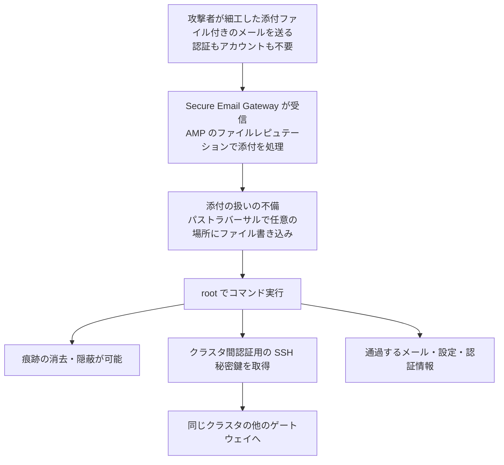

# Cisco Secure Email Gateway CVE-2026-76519 ― 添付ファイル1通でroot、マルウェア対策の「ファイルレピュテーション」が攻撃の入口になった今年2件目のゼロデイ

## 要点

### 影響バージョン

- **Cisco Secure Email Gateway（物理・仮想）** で、次の **両方** を満たすもの（Cisco）。
  - AMP（Advanced Malware Protection）の **File Reputation（ファイルレピュテーション）サービスが有効で、メールポリシーに割り当てられている**。
  - **Content Scanner Tools のバージョンが 25.3.0.5525 より前**。
- AsyncOS の修正版は 15.5 系が **15.5.5-014**、16.5 系が **16.5.0-780**。16.0 系は「修正版へ移行」とされ、Ciscoは16.5より前の全利用者に16.5.0-780への移行を強く勧めている（Cisco）。
- 修正は Content Scanner Tools **25.3.0.5525 以降** としても配布されており、ソフトウェア更新や再起動なしで入る（Cisco）。
- CVSS 3.1 は 9.8。回避策はない。Secure Email and Web Manager と Secure Web Appliance は対象外（Cisco）。
- Ciscoは2026年10月に悪用を把握した。CISAは10月14日（米国時間）にKEVへ追加し、対処期限を10月17日とした（Cisco、CISA）。

### 今すぐやること

- CLIで `contentscannerstatus` を実行し、Content Scanner Tools が 25.3.0.5525 以降かを確認する。自動更新が有効でも「届いたはず」で済ませず、版数を見て確かめる（Cisco、The Hacker News）。
- 古ければ `contentscannerupdate` で手動更新するか、Security Services > Service Updates で自動更新を有効にする（Cisco）。
- 更新の前に `grep "System Security" system_logs` を **クラスタの全台** で実行し、侵害の痕跡の有無を確かめる（Cisco）。
- 痕跡があった仮想アプライアンスは、**更新する前にフォレンジック情報を保全** し、新しいVMで設定を一から作り直して、認証情報と鍵を入れ替える。更新するとログと証跡が消える（Cisco）。

## 概要

- Secure Email Gateway のAMP機能が、ファイルレピュテーションの有効時に添付ファイルを正しく扱わない。細工した添付ファイル付きのメールを **アプライアンスを経由させるだけ** で、認証なしに任意のファイルを書き込み、rootでコマンドを実行できる（Cisco）。
- Ciscoは社内のセキュリティスキャンで見つけて9月14日の「ハードニングリリース」で直していたが、10月に悪用を把握し、10月14日（米国時間）に単独のアドバイザリとCVEを出した（Cisco、The Hacker News）。
- 同じ製品では9月14日にも、メール解析のSQLインジェクション（CVE-2026-76461）が悪用確認済みとして公表されている。メールを1通送るだけでrootに届く欠陥が、1か月で2件目になった（Cisco、The Hacker News、BleepingComputer）。

> この記事では、ベンダー・公的機関・研究者・報道で確認できた内容を「事実」、筆者の推測や意見を「考察」として分けて書いています。

## 何が起きたか（時系列）

| 日時 | 出来事 |
| --- | --- |
| 2025-12-17 | 迷惑メール隔離機能のゼロデイ CVE-2025-20393 がKEVに追加される（CISA）。Cisco Talosは中国とつながりのあるグループ UAT-9686 による悪用としていた（The Hacker News） |
| 2026-09-14 16:00 GMT（日本時間9月15日1時） | Ciscoが Secure Email Gateway / Secure Email and Web Manager の「ハードニングリリース」を公開。社内で見つけた欠陥を弱点の種類（CWE）ごとに5つのCVEにまとめ、修正版 15.5.5-014・16.5.0-780 を示す（Cisco） |
| 同日 | メール解析のSQLインジェクション CVE-2026-76461 を悪用確認済みとして公表。CISAが同日KEVに追加（Cisco、CISA） |
| 2026年10月 | Cisco PSIRTが CVE-2026-76519 の悪用を把握（Cisco） |
| 2026-10-14 16:00 GMT（日本時間10月15日1時） | Ciscoが CVE-2026-76519 のアドバイザリを公開。ハードニングリリースのアドバイザリも更新され、「2件が悪用されている」と追記（Cisco） |
| 2026-10-14（米国時間） | CISAがKEVに追加、対処期限は10月17日（CISA） |

## 技術的な問題点（根本原因）

**事実（Cisco、CISA）**

- 弱点はCWE-23（相対パストラバーサル）。AMPのファイルレピュテーションが有効なときに、メールの添付ファイルの扱いが不適切で、攻撃者が書き込み先を基盤のOS上の任意の場所に向けられる。
- 書き込みの結果、rootでコマンドを実行できる。
- 修正は、AsyncOS本体の更新と、Content Scanner Tools パッケージの更新の2つの経路で配られている。脆弱な例として、アドバイザリは `Content Scanner Tools 25.2.0.5427.15.5.001`（更新歴なし）を示している。
- ハードニングリリースでは、パストラバーサル系の欠陥は CVE-2026-76440 にまとめられていた。今回の欠陥はその1つで、悪用が確認されたため単独のCVEを割り当てられた。

**事実（The Hacker News）**

- Ciscoは6月に、ハードニングリリースで直した欠陥はまとめたCVEを共有し、悪用が確認されたものなどには個別のCVEを付ける方針を示していた。
- アドバイザリは、何台が攻撃されたか、攻撃者は誰か、実際にrootを取られた機器があるかを明らかにしていない。

**考察**

アドバイザリは、どのファイル名やパスがどう解釈されるかまでは書いていない。ただ「ファイルレピュテーションが有効なときだけ」「Content Scanner Tools を更新すれば直る」という条件から、添付ファイルを検査のために展開・保存する部品が、ファイル名やアーカイブ内のパスをそのまま書き込み先に使っていたと読める。メールゲートウェイは、知らない相手から届いたファイルを中身まで開いて調べるのが仕事である。検査のための展開処理は、外部の入力をもっとも深く受け止める場所であり、そこで「書き込み先」を外部に決めさせてしまうと、守るための機能がそのまま攻撃の入口になる。

## 攻撃・侵入経路

**事実（Cisco）**

- 攻撃は、細工した添付ファイルを含むメールを、脆弱なアプライアンスを通過させることで成立する。
- rootを取った攻撃者は、悪用の証拠や痕跡を消したり隠したりできる。
- Secure Email Gateway はクラスタを組め、クラスタのメンバー同士はSSH鍵ペアで認証する。侵害された機器の秘密鍵が読まれると、他のメンバーも侵害されうる。そのためCiscoは、1台でも侵害されたクラスタは全台を安全な構成に戻すよう強く勧めている。
- クラウド版（Cisco Secure Email Cloud）では、Ciscoが調査し、侵害の可能性を示す痕跡があった顧客に直接連絡し、復旧作業にあたっている。修正済みの Content Scanner Tools はすでに配備済みで、利用者の操作は不要。

**事実（BleepingComputer）**

- Shadowserverは、インターネットに公開されている Secure Email Gateway を300台近く観測している（ハニーポットや対策済みの機器の内訳は不明）。

## なぜ防げなかったか・構造的要因の考察

ここからは筆者の考察である。

1. **「直っていた」のに、それと分からなかった**: 修正は9月14日のハードニングリリースに含まれていた。しかし当時は、パストラバーサルという種類ごとのCVE（CVE-2026-76440）の中の1件で、どの機能のどんな欠陥かは分からなかった。同日に悪用確認済みのSQLインジェクションが出ていたので、15.5.5-014 や 16.5.0-780 に上げた組織は結果として守られた。一方、16.0系で SQLインジェクションの修正版 16.0.4-302 に上げて安心した組織は、今回の欠陥には手当てされていない（The Hacker News、Cisco）。まとめたCVEは整理には便利だが、「どれを急ぐか」の判断材料を利用者から奪う面がある。
2. **検査機能が攻撃面になる**: 影響条件は「ファイルレピュテーションを有効にしている」ことで、つまり守りを厚くしていた組織ほど対象になる。メールゲートウェイは境界に置かれ、不特定多数からの入力を受け、しかも中身を深く解析するため、構造的に攻撃面が大きい。
3. **メールは「届けば実行できる」経路**: VPNや管理画面と違い、メールゲートウェイは外からの接続を断ることができない。管理インターフェースを閉じていても、SMTPで届くメールそのものが攻撃になるので、アクセス制限という定番の緩和策が効かない。
4. **侵害の確認が機器の中に閉じている**: 確認方法は機器のログを `grep` するもので、何を調べているかは公表されていない（The Hacker News）。rootを取られれば痕跡は消せる、とCisco自身が書いている。クラウド版の利用者はCLIに入れないため、自分で確認する手段がなく、Ciscoの連絡を待つしかない。
5. **同じ製品で続くroot級の悪用**: 2025年12月の CVE-2025-20393、2026年9月の CVE-2026-76461、そして今回と、メールを入口にrootに届く欠陥の悪用確認が続いている。いずれもメールの受信・解析・隔離という中核の処理にある。攻撃者が、この製品の解析処理を継続的に調べていると考えるのが自然である。

## 運用者向けの具体的な対策と検知ポイント

**対策（Ciscoの推奨を要約）**

1. Content Scanner Tools を 25.3.0.5525 以降にする（`contentscannerupdate`、または自動更新の有効化）。
2. AsyncOS を修正版にする。16.5より前の利用者は 16.5.0-780 へ移行する。
3. 侵害の疑いがある物理アプライアンスは、TACに連絡し、調査のためにリモートアクセスを有効にする。
4. 侵害の疑いがある仮想アプライアンスは、フォレンジック情報を記録したうえで、修正版の新しいVMを立て、以前の設定ファイルを読み込まずに設定を作り直し、認証情報と暗号鍵類を入れ替える。
5. 侵害されたクラスタは、全メンバーを作り直す。
6. 一般的なハードニングとして、インターネットから機器への接続を制限し、メール用と管理用のインターフェースを分け、ログは外部のサーバーへ送って長く保管する。管理画面のHTTPや不要なFTPなどは無効にする。

**検知ポイント（Cisco）**

- `grep "System Security" system_logs` の結果:
  - 「Suspected compromise indicator was found」→ 侵害あり。上記の復旧手順へ。
  - 「Security scan did not complete」→ TACに連絡。
  - 「No compromise indicator was found」→ この確認では痕跡なし。対象版なら更新する。
- 機器の中の結果だけを信じず、機器の **外** のネットワーク・ファイアウォールのログで、ゲートウェイから外部IPへの想定外のアップロードや、不審なIPからのダウンロードがないかを照合する。

**考察（追加でできること）**

- 影響条件の1つはファイルレピュテーションの有効化だが、Ciscoは「回避策はない」としている。機能を止めて済ませず、Content Scanner Tools の版数で修正を確かめる。
- ゲートウェイには通過するメールのほか、LDAPやSMTP認証、クラスタ間のSSH鍵などが置かれている。侵害があった場合は、ゲートウェイが知っていた認証情報（連携先のディレクトリやリレー先のものを含む）をすべて入れ替える対象に含める。
- 9月のハードニングリリースの時点で更新を済ませていた組織も、`contentscannerstatus` と `system_logs` の確認だけは行っておく。悪用がいつ始まったかは公表されていない。

## 参考リンク

- Cisco: [Cisco Secure Email Gateway Arbitrary File Write Vulnerability（cisco-sa-esa-afw-zqYJkjxp）](https://sec.cloudapps.cisco.com/security/center/content/CiscoSecurityAdvisory/cisco-sa-esa-afw-zqYJkjxp)
- Cisco: [Cisco Secure Email Gateway and Secure Email and Web Manager Security Hardening Release: September 2026（cisco-sa-hardening-esa-dfCrfXkm）](https://sec.cloudapps.cisco.com/security/center/content/CiscoSecurityAdvisory/cisco-sa-hardening-esa-dfCrfXkm)
- Cisco: [Cisco Secure Email Gateway SQL Injection Vulnerability（cisco-sa-esa-inj-2bLVGmhX、CVE-2026-76461）](https://sec.cloudapps.cisco.com/security/center/content/CiscoSecurityAdvisory/cisco-sa-esa-inj-2bLVGmhX)
- CISA: [Known Exploited Vulnerabilities Catalog](https://www.cisa.gov/known-exploited-vulnerabilities-catalog)
- CVE: [CVE-2026-76519](https://www.cve.org/CVERecord?id=CVE-2026-76519)
- The Hacker News: [Cisco Warns of Active Attacks Exploiting New Critical Secure Email Gateway Vulnerability](https://thehackernews.com/2026/10/cisco-warns-of-active-attacks.html)
- BleepingComputer: [Cisco patches new Secure Email Gateway zero-day exploited in attacks](https://www.bleepingcomputer.com/news/security/cisco-patches-actively-exploited-secure-email-gateway-zero-day/)
- The Register: [Cisco make-me-root email bug exploited as a 0-day by unknown crims](https://www.theregister.com/security/2026/10/14/cisco-make-me-root-email-bug-exploited-as-a-0-day-by-unknown-crims/5303168)
