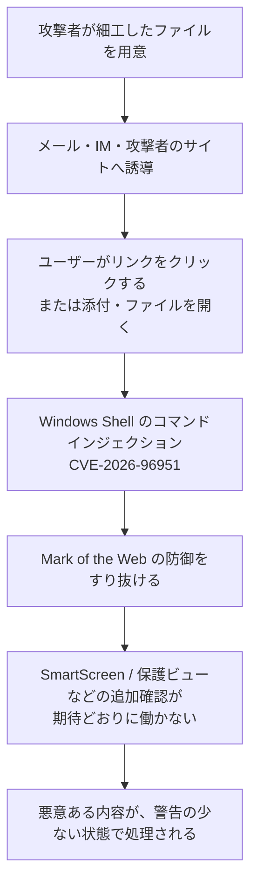

# Microsoft 2026年10月の月例更新 CVE-2026-96951 ― 1,400件超の中で「いま悪用されている」のは、添付ファイルのMark of the Webをすり抜けるWindows Shellの欠陥だけ

## 要点

### 影響バージョン

- **CVE-2026-96951（Windows Shell Security Feature Bypass）**: Windows 10（1607 / 1809 / 21H2 / 22H2）、Windows 11（23H2 / 24H2 / 25H2 / 26H1 / 26H2）、Windows Server 2012 R2 / 2016 / 2019 / 2022 / 2025、および Outlook.com（MSRC）。CVSS 3.1 は 8.8（AV:N / AC:L / PR:N / UI:R）。悪用は「Yes」、公開は「No」（MSRC）。
- 代表的な更新パッケージ（MSRCのAffected Product一覧）:
  - Windows 11 24H2 / 25H2 / 26H2: **KB5127648**
  - Windows 11 23H2: **KB5126653**
  - Windows 10 21H2 / 22H2: **KB5126657**
  - Windows Server 2025: **KB5126646**
  - Windows Server 2022: **KB5126655**
  - Windows Server 2019 / Windows 10 1809: **KB5126651**
- 同日の月例では、公開済みだった .NET Framework の WDAC 回避（CVE-2026-108398、CVSS 8.8）と MessagePack-CSharp の DoS（CVE-2026-92707）も「ゼロデイ」として扱う報道が多いが、Microsoftの分類では悪用確認済みはこの1件だけである（MSRC、BleepingComputer、ZDI）。
- CISAは CVE-2026-96951 を2026年10月13日（米国時間）にKEVへ追加し、対処期限を10月16日とした（CISA）。

### 今すぐやること

- Windows の累積更新を当てる。悪用確認済みの CVE-2026-96951 を含む。Windows Update または WSUS / Microsoft Update Catalog で、上記のKBを入れる（MSRC）。
- MOTW に依存している防御（SmartScreen、Officeの保護ビューなど）がすり抜けられた前提で、メール・IM経由のファイルを扱う端末の更新を優先する（MSRC、SecurityWeek）。
- 件数が多い月なので、まず悪用確認済みと公開済み、次にインターネットに面したサーバー、最後にそれ以外、という順で割り振る（ZDI、Microsoftの risk cohorts の考え方）。

## 概要

- 2026年10月の Patch Tuesday は、Microsoftが公表する件数で **1,400件を超える** 修正になり、9月の約1,000件をさらに上回る過去最大規模になった。報道では1,411件、1,413件、1,417件など数字がわずかに食い違うが、いずれも「千件超」である点は共通する（BleepingComputer、The Hacker News、SecurityWeek、SANS ISC、Krebs on Security）。
- その中で **悪用が確認されているのは CVE-2026-96951 だけ** である。Windows Shell のコマンドインジェクションにより、ネットワーク越しに、ユーザーがファイルを開くなどの操作をしたときに Mark of the Web（MOTW）の防御をすり抜けられる（MSRC）。
- Microsoftは同日、更新の優先付けを助ける「risk cohorts（リスク・コホート）」という整理の枠組みも紹介した。CVEの数そのものではなく、環境で同じ問いが立つグループごとに見直す、という提案である（Microsoft）。

> この記事では、ベンダー・公的機関・研究者・報道で確認できた内容を「事実」、筆者の推測や意見を「考察」として分けて書いています。

## 何が起きたか（時系列）

| 日時 | 出来事 |
| --- | --- |
| 2026-09 | Microsoftが約1,000件規模の月例更新を出し、当時の記録を更新（The Hacker News、Krebs on Security） |
| 2026-10-13（米国時間、日本時間10月14日未明） | 10月の月例更新を公開。CVE-2026-96951 を悪用確認済みとして掲載（MSRC） |
| 同日 | CISAが CVE-2026-96951 をKEVに追加、期限は10月16日（CISA） |
| 同日 | Microsoftが「Using risk cohorts to prioritize security updates」を公開（Microsoft） |
| 同日前後 | ZDI、BleepingComputer、The Hacker News、SecurityWeek、Krebs on Security、SANS ISC、Action1 などが月例の解説を掲載 |

## 技術的な問題点（根本原因）

**事実（MSRC）**

- CVE-2026-96951 の種別は CWE-77（コマンドインジェクション）。「Windows Shell」における特殊文字の不適切な無効化により、権限のない攻撃者がネットワーク越しにセキュリティ機能をすり抜けられる。
- すり抜けられる機能は **Mark of the Web（MOTW）** である。MOTWは、インターネットやメールから来たファイルに「信頼できない出所」の印を付け、SmartScreenやOfficeの保護ビューなどが追加の確認をかけるための仕組みである。
- 攻撃者がユーザーに閲覧を強制する手段はない。メールやインスタントメッセージで細工したファイルを送り、リンクを開かせる、添付を開かせるなど、ユーザーの操作が必要である。
- 悪用の有無は「Exploitation Detected」。報告者は Fujitsu Limited の Riku Bamba 氏と Yuya Chudo 氏、Anthropic の Benoit Sevens 氏（「Claude with Anthropic」と記載）、および yhw 氏である（MSRCのCVRF）。

**事実（SecurityWeek、Action1、ZDI）**

- MOTWをすり抜けると、ダウンロードしたファイルに対する警告や制限が期待どおりに働かなくなる。メール添付やWebからのファイル配布は日常業務に組み込まれているため、フィッシングと組み合わせやすい。
- ZDIは、2024年以降にMOTW回避が複数の手法で使われてきたこと、今回は SmartScreen ではなく Shell 側であること、悪用中の欠陥として優先して当てるべきことを指摘している。

**考察**

MOTWは「ファイルを開くな」と止める壁ではなく、「このファイルは外から来た」と印を付け、他の防御に判断材料を渡す仕組みである。Shellがその印を正しく付けられない、または付けた印をすり抜けられると、あとに続く SmartScreen・保護ビュー・アプリケーション制御が、本来なら踏むはずの分岐を飛ばす。結果として「ユーザーが1回クリックした」だけで、インターネット由来のファイルが、ローカルで作ったファイルと同じ扱いに近づく。ユーザー操作が必要な欠陥でも、フィッシングとセットにすると実運用上は十分に厳しい。

## 攻撃・侵入経路

**事実（MSRC）**

- 攻撃の典型は、メールまたはインスタントメッセージで細工したファイルを送るシナリオである。
- 攻撃者に既存の権限は要らないが、ユーザーの操作は要る。

**事実（報道各社）**

- 誰が・どのキャンペーンで・どの組織を狙ったかは、Microsoftも報道も明らかにしていない（The Hacker News、BleepingComputer、SecurityWeek）。

## なぜ防げなかったか・構造的要因の考察

ここからは筆者の考察である。

1. **発見の速度が運用の速度を追い越している**: ZDIの Dustin Childs 氏は、「数百件が例外だったのが今は基準」「AIはゼロから欠陥を作っているのではなく、気づくまでの時間を短くしている」と書いている。Krebs on Securityも、9月の約1,000件に続き10月が1,400件超で、通常月の約10倍規模が続いていると伝えている。件数そのものより、「悪用が確認されたもの」と「公開済みのもの」を先に当てられるかが、運用の成否を分ける。
2. **MOTWは「印」であり、最後の砦ではない**: すり抜けられても、すぐに任意コード実行になるとは限らない。しかし印が消えると、後段の防御が「外から来たファイル」として扱わない。防御の連鎖の最初のラベルが壊れる、という形である。
3. **ユーザー操作が必要でも、悪用は起きる**: フィッシングは日常的にユーザー操作を引き出せる。UI:R だから後回し、という判断は、悪用確認済みの欠陥には当てはまらない。CISAの期限がパッチ公開の数日後であることも、その緊急度を示している。
4. **リスク・コホートは「並べ替え」であり「省略」ではない**: Microsoft自身が、「コホートは公式の分類ではなく、個別CVEの評価を置き換えない」と書いている。1,400件を全部同じ速度で追えない現場向けの補助線であり、悪用確認やUI:N・Criticalといった属性の差は、コホートの中でも残る。

## 同日の月例で押さえておく周辺

**事実（MSRC、ZDI、報道）**

- **CVE-2026-108398**（.NET Framework Security Feature Bypass、CVSS 8.8）: 信頼できない検索パスにより、権限のある攻撃者がローカルで WDAC の強制をすり抜けられる。ユーザー操作は不要。公開済みだが、Microsoftは悪用を検出していない。報告は Google Project Zero の James Forshaw 氏（MSRC）。
- **CVE-2026-92707**（MessagePack-CSharp Denial of Service）: 公開済みの第三者製品の欠陥で、Microsoftの月例に含まれた（ZDI）。
- **CVE-2026-21413**（Raw Image Extension Remote Code Execution、CVSS 9.8）: 細工したRAW画像があるフォルダを開くだけで、サムネイル生成時にヒープバッファオーバーフローが起きうる。ファイルを開く必要はない（MSRC）。
- ZDIは、SharePointの Critical な権限昇格（CVE-2026-102866）、SQL Serverの高いCVSSのRCE（CVE-2026-65674）、ExchangeのRCE（CVE-2026-70571）なども優先候補として挙げている。DHCP Server など、認証なし・ユーザー操作なしでネットワーク経由の欠陥が多数あることも指摘している。

**考察**

「ゼロデイが3件」と書く報道と、「悪用確認は1件」と書く報道が並ぶのは、Microsoftのゼロデイ定義が「公式修正がない状態で、公開されたか悪用されたか」だからである（BleepingComputer）。運用では、定義の違いより、**いま悪用されているかどうか** で先頭を決めた方がよい。

## 運用者向けの具体的な対策と検知ポイント

**対策**

1. CVE-2026-96951 を含むWindowsの累積更新を、端末・サーバーに展開する（MSRC）。
2. 公開済みの CVE-2026-108398 を含む .NET Framework の更新も、WDACを使っている環境では優先する（MSRC）。
3. インターネットに面した役割（RDPゲートウェイ、DHCP、Exchange、SQL、SharePointなど）は、ZDIやベンダー解説で挙げられたCritical・認証なしの欠陥を次に当てる。
4. 件数に追われないため、Microsoftの risk cohorts の問い（「どの資産が未信頼のファイルを扱うか」「どの経路が外に開いているか」など）で環境を一度整理し、その答えに対応するCVE群を順に見る（Microsoft）。

**検知ポイント（公開情報の範囲）**

- Microsoftは、CVE-2026-96951 の具体的な悪用の痕跡やIOCを公表していない。
- そのため、公開情報だけで「このログがあれば侵害」と断定する指標はない。更新の適用状況（該当KBの有無）と、メール・IM経由の不審なファイル実行の増加を、既存のEDR・メールゲートウェイの検知と組み合わせて見る、という運用になる。

**考察**

MOTWすり抜けは、単体では目立たない。後続のマルウェア実行やOfficeマクロなどとセットで初めて被害になることが多い。更新前に「警告なしで動いた添付」の報告が増えていないか、ヘルプデスクやSOCのチケットを短期間だけでも見直す価値がある。

## 参考リンク

- MSRC: [CVE-2026-96951 Windows Shell Security Feature Bypass Vulnerability](https://msrc.microsoft.com/update-guide/vulnerability/CVE-2026-96951)
- MSRC: [CVE-2026-108398 .NET Framework Security Feature Bypass Vulnerability](https://msrc.microsoft.com/update-guide/vulnerability/CVE-2026-108398)
- MSRC: [October 2026 Security Updates（Release Notes）](https://msrc.microsoft.com/update-guide/releaseNote/2026-Oct)
- Microsoft: [Using risk cohorts to prioritize security updates](https://www.microsoft.com/en-us/msrc/blog/2026/10/using-risk-cohorts-to-prioritize-security-updates)
- CISA: [Known Exploited Vulnerabilities Catalog](https://www.cisa.gov/known-exploited-vulnerabilities-catalog)
- ZDI: [The October 2026 Security Update Review](https://www.zerodayinitiative.com/blog/2026/10/13/the-october-2026-security-update-review)
- BleepingComputer: [Microsoft October 2026 Patch Tuesday fixes 1,411 flaws, 3 zero-days](https://www.bleepingcomputer.com/news/microsoft/microsoft-october-2026-patch-tuesday-fixes-1-411-flaws-3-zero-days/)
- The Hacker News: [Microsoft Patches Record 1,413 Flaws, Including Exploited Windows Shell Bug](https://thehackernews.com/2026/10/microsoft-patches-record-1413-flaws.html)
- SecurityWeek: [Microsoft Patches Record 1,413 Vulnerabilities, Including Exploited Windows Zero-Day](https://www.securityweek.com/microsoft-patches-record-1413-vulnerabilities-including-exploited-windows-zero-day/)
- Krebs on Security: [Microsoft Patches More Than 1,400 Security Flaws](https://krebsonsecurity.com/2026/10/microsoft-patches-more-than-1400-security-flaws/)
- SANS ISC: [October 2026 Microsoft Patch Tuesday](https://isc.sans.edu/diary/33422)
