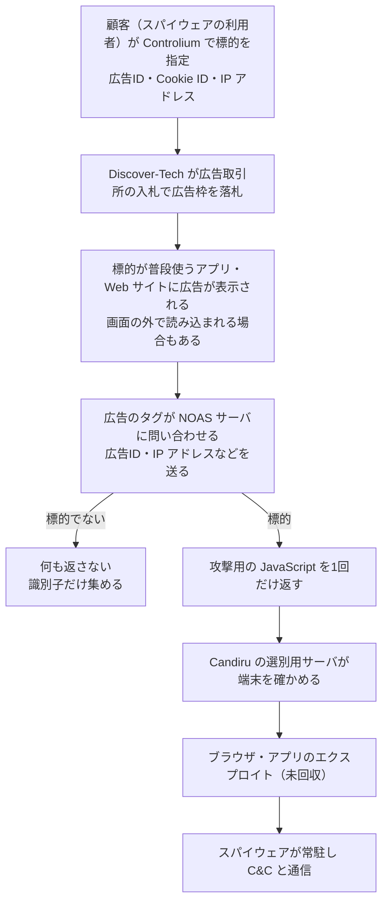

# AdFection ― 広告が表示されただけで感染、イスラエルの広告会社Discover-Techの「狙った1台にだけ攻撃コードを返す」配信でAl JazeeraにCandiruのスパイウェア

## 要点

### 影響範囲

- **確認された被害**：報道機関 Al Jazeera の端末で、2024年と2025年に **少なくとも45台** が標的になった。Citizen Labは、これを傭兵型スパイウェア企業 Candiru（現在は「Integrity Labs」に改称）によるものと高い確度で結論づけた。どの政府が依頼したかは明らかにしていない（Citizen Lab、The Hacker News）。
- **手口が届きえた範囲**：攻撃用の仕掛けを含む Discover-Tech の広告は、2026年3〜6月に **75,373のAndroid・iOSアプリ** と **120,768のWebサイト** で実際に表示された（Citizen Lab）。広告が表示されたことは、その端末が感染したことを意味しない（The Hacker News）。
- **回収できたもの・できていないもの**：感染端末の1台から Windows のDLL（スパイウェア本体）は回収されたが、ブラウザやアプリを破って入り込む **最初のエクスプロイトは回収されていない**（The Hacker News）。

### 今すぐやること

- 公表された痕跡（指標）で、自組織のDNS・プロキシのログを検索する。Discover-Tech の広告配信サーバ `mtrtb[.]com`（`noas`、`infinoas`、`ppv2`、`pqv2` などのサブドメイン）、`dtech.adtimizer[.]co`、回収されたスパイウェアの SHA-256 `255869de85e2a171993fc5eb8a556d873a1b8966e040f6f55926f2fa2d595cc8`、C&Cサーバ `fearevolve[.]com`・`jobmarcher[.]com` など。全件は Confiant の報告にある（Citizen Lab、The Hacker News）。
- 「広告配信サーバ → Candiru の選別用サーバ → C&C」という順の通信が短時間に続いた端末がないかを確かめる（Citizen Lab）。
- 社用端末と社内の出口で広告とトラッキングを遮断し、MDMで端末の広告IDを無効にする。報道・人権・外交・政府など狙われやすい立場の人の端末を優先する（Citizen Lab）。

## 概要

- Citizen Lab（トロント大学）は10月15日、標的型の広告を通じて傭兵型スパイウェアがゼロクリックで配られたことを、初めて技術的に公に確認したと発表し、この手口を **AdFection** と名付けた（Citizen Lab）。
- 広告を買っていたのは、普通の広告会社を名乗るイスラエルの **Discover-Tech**。同社の操作画面「Controlium」では、広告ID・ブラウザのCookie ID・IPアドレスで相手を指定して、その相手にだけ攻撃用のコードを返す広告を出せた（Citizen Lab）。
- Discover-Tech は2020年から2026年10月上旬まで、Google と IAB Europe の「認定」「承認」済みの広告ベンダーの一覧に載っていた。指摘を受けて、Google、IAB Europe、Beeswax、Vungle（Liftoff）、Eskimi が同社を締め出した（Citizen Lab）。

> この記事では、ベンダー・公的機関・研究者・報道で確認できた内容を「事実」、筆者の推測や意見を「考察」として分けて書いています。

## 何が起きたか（時系列）

| 時期 | 出来事 |
| --- | --- |
| 2020年 | Discover-Tech がイスラエルで登記される。同年から Google と IAB Europe のベンダー一覧に載る（The Hacker News、Citizen Lab） |
| 2021年 | Citizen Lab が Candiru のツールを分析した報告を出す。米国が同年、Candiru を輸出規制の対象（エンティティ・リスト）に加える（The Hacker News） |
| 2022年8月〜2026年7月 | Candiru の選別用サーバと同じ応答の特徴を持つサーバが、305のドメイン・319のIPアドレスで見つかる（2026年5〜6月から徐々に姿を消す）（Citizen Lab） |
| 2024〜2025年 | Al Jazeera の少なくとも45台が標的になる（Citizen Lab） |
| 2025年 | Candiru の資産が米国の投資会社に買われ、制裁の対象外の新会社（Integrity Labs と報じられている）に移される（The Hacker News） |
| 2026年3〜6月 | Discover-Tech の自社DSP「MyDSP」が約37.7億回の入札を行い、約4.4億回を落札（Citizen Lab） |
| 2026年8月 | 入札記録を誰でも読める状態で公開していた Discover-Tech のデータベースが閉じられる。Eskimi 経由の最後のキャンペーンが8月6日に止められる（Citizen Lab） |
| 2026年10月上旬 | Google と IAB Europe がベンダー一覧から削除。Google は広告取引所への接続を打ち切る（Citizen Lab） |
| 2026年10月11〜14日 | 関係企業が Citizen Lab に回答（Citizen Lab） |
| 2026年10月15日 | Citizen Lab が報告を公開（UTC 10:00、日本時間19時）。広告セキュリティ企業 Confiant も同時に報告を公開（Citizen Lab） |

## 技術的な問題点（根本原因）

**事実（Citizen Lab）**

- Webサイトやアプリの広告枠は、多くの場合、1回表示されるごとにリアルタイムの入札（RTB）で売られる。入札の依頼には、端末の識別子、IPアドレス、位置、アプリやサイトの情報が含まれ、広告主は1人の利用者を指定して入札できる。
- 広告は画像や動画だけではない。広告主や広告の買い付けを担うDSPが書いたJavaScriptを含めることができ、そのコードが広告を表示したアプリやブラウザの中で動く。
- Discover-Tech の広告には、自社の「NOAS」サーバからJavaScriptを読み込むタグが入っていた。NOASサーバは、あらかじめ指定された広告IDやCookie IDに対して **一度だけ** コードを返し、それ以外の相手や2回目以降には何も返さない。研究者が架空のIDで試すと、1×1ピクセルの見えないiframeを差し込むコードが返った。
- 狙われていない大多数の端末でも、広告は Cookie やIPv6アドレスなどを集めて Discover-Tech に送り返していた。
- MyDSP の入札の少なくとも約7億1,900万回（約19%）が、NOASサーバを指すタグ付きの広告だった。入札記録に残る広告主はほぼ Discover-Tech 自身か関係先で、売上やコンバージョン（購入など）の記録はほとんどなかった。

**事実（Eskimi の回答、Citizen Lab 経由）**

- 「広告主のタグは自動スキャンを避けるように作られていた。見る人の端末、IPアドレス、位置によって別のコードを読み込み、キャンペーンは非常に狭いIPアドレスの一覧に絞られていることが多かった。そのため第三者の広告検証をすり抜けた」と説明している。

**考察**

広告の審査は、審査する側から見た広告が無害かどうかを確かめる仕組みである。一方 AdFection の広告は、狙った1台の端末にだけ、しかも1回だけ攻撃コードを返す。審査用のスキャナーや研究者が見ても、空の応答しか返ってこない。根本にあるのは、「誰に何を見せるかを細かく選べる」という広告の正規の機能と、「広告の中で第三者のコードが動く」という正規の機能が、そのまま「狙った相手にだけコードを実行させる」能力になっていることだと思う。

## 攻撃・侵入経路

**事実（Citizen Lab、The Hacker News）**

- Al Jazeera が提供したネットワークのログでは、感染した端末はいつも同じ順で通信していた。まず Discover-Tech の広告配信のドメイン、次に Candiru の選別用（validator）サーバ、最後に C&C サーバである（Citizen Lab）。
- 利用者のクリックなどの操作は要らない。広告が画面に読み込まれた時点で攻撃コードが動き、広告が見えない位置で読み込まれた例もある（The Hacker News）。
- Al Jazeera が感染端末から取り出したWindowsのDLLは、2021年に分析した Candiru のツールと同じく、COMハイジャックでの常駐、48バイトの繰り返しXORによる文字列の難読化（独特の「ダミーの終端文字」付き）、`www.google.com` と `www.microsoft.com` の順での接続確認を使っていた。これが Candiru と結びつける根拠である（Citizen Lab）。
- Discover-Tech の広告は、Google や Yandex の広告取引所、Beeswax、Vungle などを通じて配信された。MyDSP の入札の約67%は Yandex、約25%は Google Ad Manager 経由だった（Citizen Lab）。
- Discover-Tech の広告は、NATO、国連、EUの機関、20数か国の政府機関、半導体メーカー、報道機関のネットワークにも表示されていた。ただし Confiant によれば、Candiru と直接結びつけられた少数の広告は、主に家庭やモバイルの回線に届いていた（The Hacker News）。
- Citizen Lab は、Discover-Tech の広告が数百万台の端末に Candiru のサーバとの通信をさせており、大規模な追跡や下調べのためだったとみている。また、別の攻撃者「DARK CARTOGRAPHER」が同社の基盤と携帯電話会社側の弱点を使い、広告IDと電話番号を結びつけていたとして、別の報告で詳しく扱うとしている（Citizen Lab）。

**事実（Controlium の作り、Citizen Lab）**

- Controlium のログイン画面には画面側のソースコードが丸ごと含まれており、Citizen Lab はそれを保存して操作画面を再現した。管理者は、顧客ごとに入札してよい国、1日・1か月のキャンペーン数、対象のドメインやアプリを制限でき、「OpSec」と呼ぶ入札の頻度などの制限もかけられた。
- 認証には Auth0 を使っていたが、署名付きのトークン（JWT）を検証せず、名前やメールアドレスなどを、画面に埋め込まれた鍵で暗号化しただけのものをトークンとして使っていた。正しい実装はコメントアウトされていた。Citizen Lab はこれを悪用していない。
- 認証なしで読めるエンドポイントから、128日分のログイン記録（120のユーザー名と接続元IPアドレス）が取得できた。

## なぜ防げなかったか・構造的要因の考察

1. **「認定ベンダー」の審査が自己申告だった。** Citizen Lab は、広告業界は「認定」「承認」という言葉を使うが、実質的な審査をせず、ベンダーがオンラインのフォームにチェックを入れる自己申告に頼っていると指摘している（Citizen Lab）。Discover-Tech は6年近く一覧に載り続けた。正規の広告主が見当たらず、売上の記録もない広告会社が、一覧の上では他社と同じに見えていた。
2. **標的にだけ攻撃コードを返す配信は、外からの検査では見えない。** 広告の検証は、広告を取ってきて中身を調べる。相手を選んで1回だけコードを返すサーバに対しては、検査する側が標的のIDとIPアドレスを持っていない限り、何も見えない（考察）。Eskimi の回答も、まさにこの理由で第三者の検証をすり抜けたと説明している。
3. **広告IDは「既定で有効」で、利用者の特定に使える。** スマートフォンの広告IDは利用者がリセットや削除をできるが、既定では有効になっている（Citizen Lab）。標的の広告IDや、自宅・職場のIPアドレスが分かれば、その人の端末だけに広告を出せる（考察）。
4. **広告は、組織のネットワークの中で「第三者のコードを動かす」通り道になっている。** 組織は、社員が業務で開くニュースサイトや無料アプリの中で、どの広告会社のコードが動いているかを把握していない。今回の件は、その通り道が国家の依頼を受ける監視企業に使われうることを、実例で示した（考察）。

## 運用者向けの具体的な対策と検知ポイント

**対策（事実に基づくもの）**

- 組織の出口と、社用端末・境界の機器で広告とトラッキングを遮断する。社用端末では、MDMで広告のターゲティングを無効にする（Citizen Lab）。
- トラッキング対策・広告ブロックを備え、Global Privacy Control（GPC）に対応したブラウザへの移行を検討する（Citizen Lab）。
- 広告の表示に伴う通信を監視し、不審な要求がないかを見る（Citizen Lab）。
- 個人としては、信頼できる広告ブロッカーを使い、端末の広告IDを定期的にリセットするか、広告のトラッキングを無効にする。狙われる立場にある人は、専門家の支援を受ける（Citizen Lab）。

**検知ポイント**

- 公表されたドメインとハッシュで、DNS・プロキシ・EDRの記録をさかのぼって検索する。攻撃コードの配信に関わるのは、Discover-Tech の NOAS サーバ（`mtrtb[.]com` の各サブドメイン、例：`pqv2.mtrtb[.]com/getAd`、ほかに `noas.adtimizer[.]co`・`noas.impchkdsp[.]com`・`noas.trakking[.]co` など）と `dtech.adtimizer[.]co`。Candiru 関連は選別用サーバの `keyadapter[.]com`・`sharethere[.]net`、C&C の `fearevolve[.]com`・`jobmarcher[.]com`・`insightenterprisells[.]com`・`plasticbells[.]com`（Citizen Lab、Eskimi の回答）。全件は Confiant の報告を参照する。
- `events.myweb3id[.]io` と `tracookiepixel[.]xyz` は、多くの有名サイトの閲覧中に、Discover-Tech の広告が出ていなくても裏で呼ばれる ID 同期用のドメインである（Citizen Lab）。ここへの通信があっても、それだけで感染を意味しない。遮断の対象にはしつつ、調査では上の配信・選別・C&C のドメインとの並びで見る。
- 1件ずつの一致だけでなく、「広告配信のドメイン → 見慣れないドメイン → 定期的な通信」という順の通信が、同じ端末で短時間に続いていないかを見る。Citizen Lab が Al Jazeera のログで見た「時間の並び」である（Citizen Lab）。
- Windows端末では、COMハイジャックによる常駐（正規のCOMオブジェクトの登録が、見慣れないDLLに書き換えられていないか）を点検する。回収されたサンプルはこの方法で常駐していた（Citizen Lab）。
- （考察）指標に一致しなくても安心はできない。Candiru の選別用サーバの特徴は2026年5〜6月から姿を消しつつあり、インフラは入れ替わっていると考えられる。

## 参考リンク

- [Exposing AdFection: How Discover-Tech Turned Targeted Ads Into a Pipeline for Zero-Click Mercenary Spyware（Citizen Lab、2026年10月15日）](https://citizenlab.ca/research/how-discover-tech-turned-targeted-ads-into-a-pipeline-for-spyware/)
- [ADINT: Weaponized Ad Tech for Zero-Click Spyware and Mass Identity Vacuuming（Confiant）](https://blog.confiant.com/p/adint-weaponized-ad-tech-for-zero-click-spyware-and-mass-identity-vacuuming)
- [Hooking Candiru: Another Mercenary Spyware Vendor Comes into Focus（Citizen Lab、2021年）](https://citizenlab.ca/research/hooking-candiru-another-mercenary-spyware-vendor-comes-into-focus/)
- [Citizen Lab Traces Zero-Click Candiru Spyware Infections at Al Jazeera to Targeted Online Ads（The Hacker News）](https://thehackernews.com/2026/10/citizen-lab-traces-zero-click-candiru.html)
- [Commerce Adds NSO Group and Other Foreign Companies to Entity List（米商務省、2021年）](https://www.commerce.gov/news/press-releases/2021/11/commerce-adds-nso-group-and-other-foreign-companies-entity-list)
