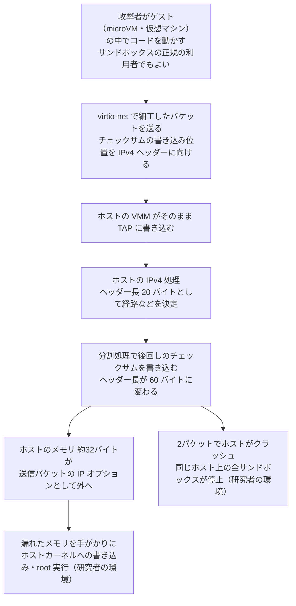

# Linuxカーネル PwnEscape（CVE-2026-99999） ― ゲストが渡した「チェックサムの書き込み位置」が検証済みのIPv4ヘッダーを書き換え、ホストのメモリが外へ漏れた

## 要点

### 影響バージョン

- **Linuxカーネル 2.6.27 以降** が影響を受ける（CVEレコード）。
- 各安定版ブランチの最初の修正版は **5.10.272 / 5.15.223 / 6.1.190 / 6.6.159 / 6.12.113 / 6.18.57 / 7.2.11**、メインラインは **7.3-rc7** 以降（CVEレコード）。
- 修正は1つのコミット（`6785011f8b16`「ipv4: validate checksum_start before completing checksum」）。Red HatのMichael S. Tsirkin氏が書き、10月14日にメインラインへ取り込まれた（コミット、pwn.ai）。
- CVSS 3.1は **9.3（Critical）**、攻撃元区分は「ローカル」。インターネット越しにパケットを送るだけでは突けず、**ゲストの中でコードを動かせる立場** が前提になる（CVEレコード、The Hacker News）。
- 実際の攻撃での悪用は報告されておらず、CISAのKEVにも入っていない（The Hacker News）。
- 日本時間10月16日昼の時点で、UbuntuのCVEページは各LTSを「Needs evaluation（評価中）」、Debianのセキュリティトラッカーは各リリースを「vulnerable」と表示している（Ubuntu、Debian）。

### 今すぐやること

- 他人のコードを仮想マシンやmicroVMで動かしている基盤（マルチテナントのクラウド、CI実行環境、AIエージェントのサンドボックスなど）では、**ホストのカーネル** を修正版か、修正を含むディストリビューションのビルドへ更新し、再起動してそのカーネルで起動する。**ゲストのカーネルだけを更新しても直らない**（The Hacker News）。
- ディストリビューションのカーネルは版数を変えずに修正を取り込むことが多い。`uname -r` の数字だけでなく、ディストリビューションのアドバイザリで修正が入ったビルドかを確かめる（The Hacker News）。
- 情報源には、更新できない場合の回避策は示されていない。更新までの間は、侵入されたときに届く範囲を絞る。Vercelはホストカーネルの更新、ネストした仮想化の無効化、Firecrackerの jailer による各microVMプロセスの権限制限を挙げている（Vercel）。

## 概要

- Linuxは、送信するパケットのチェックサム計算を後回しにし、「どこから計算して、どこに書き込むか」という情報（`csum_start` と `csum_offset`）をパケットに持たせておくことがある。ゲストの仮想マシンはこの情報を自分で付けてホストに渡せるが、ホストはそれがIPv4ヘッダーの後ろを指しているかを確かめていなかった（pwn.ai、コミット）。
- ホストがIPv4ヘッダーを読んで経路などを決めた **後で** 、後回しにしていたチェックサムが書き込まれ、その書き込みがIPv4ヘッダー自体に重なる。ヘッダー長が20バイトから60バイトに書き換わり、ホストはパケットの外にある約32バイトのメモリを「IPオプション」として送り出した（pwn.ai）。
- pwn.aiのPaulos Yibelo氏が、Vercelの賞金総額100万ドルのサンドボックス破りチャレンジの3日目に報告した。Vercelは本番のサンドボックスで漏えいが実証されたと認め、顧客データが読まれた報告はなかったとしている（Vercel）。

> この記事では、ベンダー・公的機関・研究者・報道で確認できた内容を「事実」、筆者の推測や意見を「考察」として分けて書いています。

## 何が起きたか（時系列）

日付は各情報源の表記に従う。

| 日付 | 出来事 |
| --- | --- |
| 2026-08-18 | Vercelが、自社のサンドボックス製品の分離を破る研究者に総額100万ドルを用意したチャレンジを発表（pwn.ai） |
| 2026-08-20 | pwn.aiが、ホストのメモリが漏れる最初の報告をVercelに提出（pwn.ai） |
| 2026-09-04 | pwn.aiが、根本原因をカーネルのセキュリティ窓口とネットワークのメンテナに非公開で報告し、修正案を添付（pwn.ai） |
| 2026-09-07 | Tsirkin氏が再現できたと返信（pwn.ai） |
| 2026-09-19〜22 | netdevメーリングリストに修正案が公開で投稿され、レビューが広がる（pwn.ai、oss-security） |
| 2026-10-07〜08 | Tsirkin氏の修正が投稿され、net.git に取り込まれる（pwn.ai、コミット） |
| 2026-10-14 | 修正がメインライン（Linus氏のツリー）に入る（pwn.ai）。Vercelがチャレンジの結果報告を公開（Vercel） |
| 2026-10-15 | CVE-2026-99999 が公開される（UTC 12:19、日本時間21:19）。oss-securityにも情報が流れる（CVEレコード、oss-security） |

**事実（Vercel、pwn.ai）**

- チャレンジには2週間で1,285件の報告が届き、Vercelは計24万2,000ドルを支払った。Criticalと判定されたのはこの1件だけだった。
- pwn.aiは、自社の調査用の仕組みと大規模言語モデルを組み合わせ、人間の研究者が方向を決めて3日で欠陥にたどり着いたとしている。APIの利用料は700ドル未満だったという。

## 技術的な問題点（根本原因）

**事実（pwn.ai、コミット、CVEレコード）**

- Linuxのパケット（`sk_buff`）は、チェックサムが未計算であることを `CHECKSUM_PARTIAL` で示し、計算の開始位置 `csum_start` と、そこから書き込み先までの距離 `csum_offset` を持つ。後で `skb_checksum_help()` などが計算し、`csum_start + csum_offset` の位置に結果を書き込む。
- 仮想マシンが virtio-net で送るパケットには、この情報をゲストが自分で付けられる。microVMの場合、仮想マシンを動かすホストのプロセス（VMM）がそれをホストのTAPデバイスに書き込み、`tun_get_user()` からホストのIPv4処理に入る（CVEレコード）。
- 入口のチェックは、開始位置が「いまのデータの先頭」から十分後ろにあるかしか見ていなかった。イーサネットなどの下位層のヘッダーが残っている段階では、この判定を通っても、下位層のヘッダーを外した後に開始位置がIPv4ヘッダーの中を指すことがある（pwn.ai）。
- 修正前の `ip_do_fragment()`（IPv4の分割処理）は、後回しのチェックサムを **先に** 書き込み、**その後で** IPv4ヘッダーを読み、そのヘッダー長（IHL）で分割を進めていた。
- 研究者の再現では、チェックサムの書き込みによって先頭のバイトが `0x45`（ヘッダー長20バイト）から `0x4f`（60バイト）に変わった。経路の判断などはすでに20バイトのヘッダーとして済んでいたが、分割処理は60バイトのヘッダーとして扱った（pwn.ai）。
- 再組み立て後のパケットの先頭部分は28バイト（ヘッダー20バイト＋データ8バイト）しかなかった。60バイト分をヘッダーとしてコピーした結果、その外側の32バイトのホストのメモリが、送り出される断片の「IPオプション」として外に出た（pwn.ai）。
- 修正は、`csum_start` が「IPv4ヘッダーの先頭＋ヘッダー長」より前を指していれば処理を止める `ip_check_csum_start()` を追加し、チェックサムを書き込む前に呼ぶ。対象は IPv4の分割処理、ブリッジのconntrack、nfnetlink_queue、iptablesの `CHECKSUM` ターゲット、xfrm（IPsec）の5か所。
- コミットは、これを「多層防御の措置」と説明し、入口でのより完全な検証は「まだ作業が要る」と書いている。

**考察**

この欠陥は、時間差の競合（レース）ではない。研究者も、処理は決定的に再現できると書いている。問題は「確かめた時点」と「使う時点」の間に、ゲストが指定した書き込みが挟まっていたことである。ホストはIPv4ヘッダーを一度検証して信じたが、そのヘッダーを、後で外部の指示どおりに書き換える処理が残っていた。パケットの中身ではなく、パケットに付いてくる「後でここに書け」という指示が、信頼の境界を越えていた点がこの件の本質だと思う。

## 攻撃・侵入経路

**事実（Vercel、pwn.ai、CVEレコード）**

- ゲストに必要なのは、割り当てられた virtio-net のインターフェースから送信できることだけで、ホストの認証情報や特別な権限、`/dev/net/tun` へのアクセスは要らない（CVEレコード）。
- **漏えい** は、Vercelの本番サンドボックスで実証された。ゲストが送り続ける限り、漏えいは続く（Vercel）。
- **クラッシュとホストでのコード実行** は、Vercelと同じ構成にした研究者自身のKVM・Firecrackerの環境で確認された。2つのパケットでホストが落ち、その上の全サンドボックスが止まった（Vercel）。
- 研究者は、漏えいで得たホストのメモリの情報とメモリ割り当ての制御を組み合わせ、64バイト単位でホストのカーネルに書き込み、ホストのroot権限で補助プログラムを動かした。電源を切った状態からの起動で4回再現した。ただし「どのベンダーの本番環境でもroot実行を主張するものではない」としている（pwn.ai）。
- 書き込みからroot実行までの具体的な手順は「第2部」で公開するとしており、現時点では出ていない（pwn.ai）。
- コミットとレビューの議論では、仮想マシンを使わない TUN や AF_PACKET 経由の場合も検討されていた（pwn.ai）。修正コミットが原因として挙げるのも、`tun` と `packet` に後回しのチェックサム機能を加えた古いコミットである（コミット）。

**考察**

pwn.aiは、条件の緩い構成では数週間、標準構成の仮想化基盤でも1か月以内に他者が攻撃コードを作るだろうと書いている。これは研究者の見通しであって事実ではない。ただ、修正のコミットが公開され、原理の解説も出た以上、「ゲストの中でコードを動かせる」立場の攻撃者にとって、狙う場所ははっきりした。

## なぜ防げなかったか・構造的要因の考察

**事実（Vercel、pwn.ai、The Hacker News）**

- Vercelのサンドボックスは、顧客ごとに専用のゲストカーネルを持つFirecrackerのmicroVMで動き、Trail of Bitsの設計レビューでも「仮想化の境界は健全」と評価されていた。研究者も、設定の誤りは見つからなかったとしている。
- 欠陥は仮想化（KVM）そのものではなく、ホストのネットワーク処理にあった。Vercelは、主要なクラウドのほとんどが同じ層で顧客の処理を分けているため、これは特定の事業者ではなく共有基盤のリスクだとしている。

**考察**

1. **「境界」は仮想化ソフトだけではない。** 仮想マシンの分離というと、KVMやVMMの堅さに目が向きやすい。しかし、ゲストが送ったパケットはホストのネットワーク処理をそのまま通る。今回のように、ゲストが付けた細かな情報まで、ホストのカーネルの奥深くで使われる。ホストの汎用的な処理も、攻撃面に含めて考える必要がある。
2. **性能のための「後回し」が、信頼を持ち越させた。** チェックサムの計算をネットワークカードや後段に任せる仕組みは、性能のための正規の機能である。ただ、その指示が信頼できない側から来るなら、ヘッダーを外したり、組み立て直したりするたびに、その指示が正しいままかを確かめ直す必要がある。研究者の言う通り、この点を後段のすべての処理が引き継ぐのは難しい。今回の修正が「入口でのより完全な検証は今後」としているのも、その難しさを示している。
3. **ホストのカーネル更新は、サービスを止めずにやりにくい。** 修正には、ホストを再起動して新しいカーネルに切り替える必要がある。マルチテナント基盤では、稼働中の仮想マシンの移動や計画停止が絡むため、ゲストの更新よりはるかに重い。修正が出てから実際の反映までに間が空きやすい構造である。
4. **AIで探す速度と、修正が届く速度の差。** 研究者は700ドル未満のAPI利用料で3日で欠陥に届き、Vercelには2週間で1,285件の報告が届いた。一方で、修正がメインラインに入るまでにはカーネルへの非公開報告（9月4日）から約6週間かかり、10月16日時点でも主要ディストリビューションは評価中だった。見つける側が速くなるほど、この差が攻撃者にとっての機会になる。

## 運用者向けの具体的な対策と検知ポイント

**対策（事実に基づくもの）**

- **ホストのカーネルを更新して再起動する。** 修正版は上の「影響バージョン」を参照。ディストリビューションのカーネルなら、そのアドバイザリで修正済みのビルドかを確かめる（The Hacker News、CVEレコード）。
- **ゲストの更新では直らない。** ホスト側の処理の欠陥なので、更新の対象はホストである（The Hacker News）。
- **侵入された場合の影響を絞る。** Vercelは、ホストカーネルの継続的な更新、ネストした仮想化の無効化、Firecrackerの jailer による各microVMプロセスの権限制限を実施している（Vercel）。

**考察（運用上の工夫）**

- 対象を洗い出すときは、「他人のコードを動かすホスト」を優先する。顧客のコードを動かすクラウド、CIのランナー、コード実行機能を持つAIエージェントの基盤、オンラインのコード実行サービスなどが当てはまる。自社の仮想マシンしか動かさないホストでも、ゲストの1台が侵害されればホストまで届く経路になりうる。
- 更新までの間、同じホストに載せる利用者の組み合わせを見直す。信頼度の違うワークロードを同じホストに混ぜないだけでも、漏えいしたメモリに他の利用者の情報が含まれるリスクは下がる。
- 検知の手がかりとして、ゲストから出るIPv4パケットのうち、不自然にIPオプションが付いた断片化パケットに注目できる。研究者の再現では、ホストのメモリはIPオプションとして外に出ていた。ただし、これは検知用の公式な指標として示されたものではない。
- ホストのカーネルログに、チェックサム処理に関する警告（`WARN_ONCE`）やパニックが出ていないかを確認する。CVEレコードは、不正なチェックサム位置がこの経路に入りうるとしている。

## 参考リンク

- [PwnEscape: Guest-to-Host KVM Escape (CVE-2026-99999)（pwn.ai）](https://pwn.ai/blog/pwnescape)
- [Findings from the $1M Vercel Sandbox challenge（Vercel）](https://vercel.com/blog/findings-from-the-1-million-dollar-vercel-sandbox-challenge)
- [ipv4: validate checksum_start before completing checksum（Linuxカーネル コミット 6785011f8b16）](https://github.com/torvalds/linux/commit/6785011f8b16abf40b1e9d8b2e332232b3e68822)
- [CVE-2026-99999（NVD）](https://nvd.nist.gov/vuln/detail/CVE-2026-99999)
- [oss-security: linux kernel: PwnEscape (CVE-2026-99999)](https://www.openwall.com/lists/oss-security/2026/10/15/5)
- [Ubuntu: CVE-2026-99999](https://ubuntu.com/security/CVE-2026-99999)
- [Debian Security Tracker: CVE-2026-99999](https://security-tracker.debian.org/tracker/CVE-2026-99999)
- [Critical PwnEscape Linux Kernel Vulnerability Lets Guest VMs Read Host Memory（The Hacker News）](https://thehackernews.com/2026/10/critical-pwnescape-linux-kernel.html)
