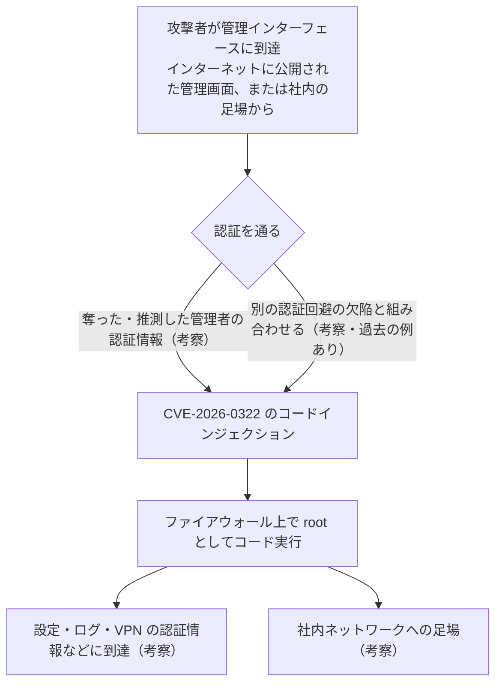

# Palo Alto Networks PAN-OS CVE-2026-0322 ― 管理画面にログインできる者がファイアウォールのrootに、「認証が必要」なコードインジェクションが悪用されてKEV入り

## 要点

### 影響バージョン

- 対象は **PA-Series・VM-Series のファイアウォールと Panorama（仮想・M-Series）** のPAN-OS。**Cloud NGFW と Prisma Access は対象外**（Palo Alto Networks）。
- 修正版（これ以降なら影響なし）は次のとおり（Palo Alto Networks）。
  - 12.2 系：**12.2.4**
  - 12.1 系：**12.1.4-h12 / 12.1.7-h8 / 12.1.10-h2**
  - 11.2 系：**11.2.4-h22 / 11.2.7-h21 / 11.2.10-h15 / 11.2.13-h3 / 11.2.16**（11.2.16は10月15日に公開）
  - 11.1 系：**11.1.4-h37 / 11.1.6-h39 / 11.1.7-h11 / 11.1.10-h35 / 11.1.13-h15 / 11.1.16-h3**
  - 10.2 系：**10.2.7-h38 / 10.2.10-h41 / 10.2.13-h26 / 10.2.16-h11 / 10.2.18-h12**
  - サポートの切れた古い版は、サポート中の修正版へ移行する。
- 影響を受けるのに特別な設定は要らない。**回避策はない**（Palo Alto Networks）。
- CVSS 4.0は、管理画面にインターネットから届く場合 **8.6**、ジャンプボックスからだけに絞った場合 8.5。どちらも攻撃者に高い権限（ログイン）が必要と評価されている。緊急度は最高（HIGHEST）、悪用状況は「ATTACKED（攻撃あり）」（Palo Alto Networks）。
- CISAは10月14日（米国時間）にKEVへ追加し、連邦政府機関の対処期限を **10月17日** とした。侵害の有無の確認（フォレンジックのトリアージ）も求める対象になっている（CISA）。

### 今すぐやること

- 管理インターフェース（Webの管理画面）に届く送信元を、信頼できる社内のIPアドレス、できれば **専用のジャンプボックスだけ** に絞る。インターネットから届く状態なら、最優先でふさぐ（Palo Alto Networks）。
- 自分の版数を確かめ、上の修正版へ更新する（Palo Alto Networks）。
- 公表された攻撃元のIPアドレス `66[.]42[.]72[.]14`、`208[.]83[.]239[.]114`、`149[.]248[.]47[.]234` からの管理画面へのアクセスやログインがないか、ログをさかのぼって確かめる（Palo Alto Networks）。
- （考察）悪用には認証が必要なので、管理者アカウントのパスワードを入れ替え、使っていないアカウントを止める。管理者ログインの成功記録を、送信元と時刻で見直す。

## 概要

- PAN-OSの管理インターフェースに、コードの生成を正しく制御していない欠陥（CWE-94、コードインジェクション）があり、ネットワークで届く **認証済み** の攻撃者が、ファイアウォール上で **root権限** で任意のコードを実行できる（Palo Alto Networks）。
- Palo Alto Networksは自社の研究者が見つけたとしたうえで、管理インターフェースを狙った「ごく限られた悪用」を確認したと書いた。いつから、誰が、何台が侵害されたかは明らかにしていない（Palo Alto Networks、The Hacker News、BleepingComputer）。
- 回避策はなく、Threat Prevention の署名は「限定的な保護」にとどまる。しかも署名を効かせるには、管理通信をデータプレーンのポートに通し、TLSを復号して検査する設定が要る（Palo Alto Networks）。

> この記事では、ベンダー・公的機関・研究者・報道で確認できた内容を「事実」、筆者の推測や意見を「考察」として分けて書いています。

## 何が起きたか（時系列）

| 日時 | 出来事 |
| --- | --- |
| 2025-11-03 | CVE番号が予約される（CVEレコード） |
| 2026-10-14 16:00 UTC（日本時間10月15日1時） | Palo Alto Networksがアドバイザリを公開。11.2.16 は10月15日に公開予定とした（Palo Alto Networks、BleepingComputer） |
| 2026-10-14（米国時間） | CISAが CVE-2026-0322 をKEVに追加。同じ日に Cisco Secure Email Gateway CVE-2026-76519、AhsayCBS CVE-2026-105133／105134 も追加（CISA） |
| 2026-10-15 | アドバイザリが更新され、11.2.16 の公開を追記（Palo Alto Networks） |
| 2026-10-17 | CISAが連邦政府機関に示した対処期限（CISA） |

## 技術的な問題点（根本原因）

**事実（Palo Alto Networks、CISA）**

- 弱点の種類は CWE-94（コードの生成の不適切な制御＝コードインジェクション）、攻撃パターンは CAPEC-242（コードインジェクション）。
- 攻撃者に必要なのは、管理インターフェースにネットワークで届くことと、認証を通っていること。成功すると、ファイアウォール上でroot権限のコードが動く。
- どの画面・どのAPI・どの入力が問題か、どの権限の管理者アカウントで突けるのかは、アドバイザリに書かれていない。
- 発見者は Palo Alto Networks 社内の研究者 Suraj Siddharudh 氏。

**考察**

アドバイザリは、細部を伏せたまま「認証済み」「root」「コードインジェクション」とだけ書いている。管理画面に入れる者がroot権限まで行けるということは、管理画面の権限（Web上の管理者）と、OSのroot権限との間の壁が働いていなかったことを意味する。ファイアウォールの管理者は設定を自由に変えられるが、それでもOSのシェルまでは渡さない設計になっているはずである。その前提を崩す欠陥は、管理者アカウントが1つ奪われただけで、ログや設定の改ざん、外から見えない常駐プログラムの設置にまでつながりうる。

## 攻撃・侵入経路

**事実（Palo Alto Networks、The Hacker News、BleepingComputer）**

- Palo Alto Networksは、管理インターフェースを狙った「ごく限られた悪用」を確認し、攻撃の試みに関係するとして3つのIPアドレスを公表した。The Hacker Newsは、これらのIPアドレスの位置が米国と判定されると書いている。
- BleepingComputerは、悪用がいつ始まったか、誰によるものか、ファイアウォールが侵害されたか、内部ネットワークへの侵入に使われたかをPalo Alto Networksに問い合わせている。記事の時点では、これらは明らかにされていない。

**事実（CISA KEV）**

- PAN-OSの管理インターフェースでは、過去にも悪用された欠陥が続いている。2024年11月18日には、管理画面の **認証回避**（CVE-2024-0012）と、管理画面を通じた権限昇格につながる **OSコマンドインジェクション**（CVE-2024-9474）が同じ日にKEVへ追加され、どちらもランサムウェアでの利用が「Known」とされている。
- 2025年2月には、管理画面の認証回避（CVE-2025-0108、2月18日）と、認証済みの攻撃者がファイルを読める欠陥（CVE-2025-0111、2月20日）が追加された。

**考察**

「認証が必要」という条件は、攻撃者にとって越えられない壁とは限らない。考えられる入口は2つある。1つは、認証情報そのものを手に入れること。フィッシング、使い回されたパスワード、ほかの機器や管理ツールから流出した情報などである。今月はFortiGateでも、使い回された認証情報で管理者が締め出される被害が警告された（当サイトの[FortiBleedの記事](/security-notes/notes/2026-10-08-fortibleed-fbi-usss-fortigate-admin-lockout/)）。もう1つは、別の認証回避の欠陥と組み合わせることで、2024年11月の2件はまさにその形で同時にKEVに入った。今回、Palo Alto Networksが攻撃者の認証の手段を明らかにしていない以上、「うちはパスワードが強いから大丈夫」と判断する材料はない。

## なぜ防げなかったか・構造的要因の考察

1. **管理画面は「入れる人を信じる」作りになりやすい。** 管理画面の入力は管理者しか使わないという前提で、外部からの入力ほど厳しく扱われないことがある。しかし、管理者アカウントが奪われる前提で見ると、管理画面の入力は外部からの入力と同じである。今回の欠陥は、その前提の差が、Web上の管理権限とOSのroot権限との差を飛び越えさせた例だと考える。
2. **管理画面のインターネット公開がなくならない。** Palo Alto Networksは毎回、管理画面を信頼できる社内のIPアドレスに絞るよう勧め、今回もインターネットから届く場合を最も危険としている。それでも同じ勧告が繰り返されるのは、遠隔での保守や委託先からの接続のために、管理画面への経路を広く開けたままの運用が残っているからだろう。
3. **署名による保護が、管理通信の構成を変えないと効かない。** Threat Prevention の署名を効かせるには、管理通信をデータプレーンのポートに通し、管理用の証明書を入れ替え、TLSを復号して検査する必要がある。普段その構成にしていない環境で、修正版を当てるまでの間だけ切り替えるのは現実的ではない。結局、確実な手段は経路を絞ることと更新の2つになる。
4. **詳細が伏せられているため、痕跡の探し方を利用者が組み立てにくい。** 攻撃元のIPアドレスは出たが、どの要求が攻撃なのか、侵害後に何が残るのかは書かれていない。IPアドレスは攻撃者がすぐ変えられるため、ログで当たりがなくても安心材料にはならない。

## 運用者向けの具体的な対策と検知ポイント

**対策（事実に基づくもの）**

- 管理インターフェースへのアクセスを、信頼できる社内のIPアドレス、または専用のジャンプボックスだけに絞る（Palo Alto Networks）。
- 修正版へ更新する。サポート切れの版は、サポート中の修正版へ移行する（Palo Alto Networks）。
- Threat Prevention を契約していれば、Threat ID 510046 と 510047（Applications and Threats コンテンツ 9159-10287 以降）を有効にする。ただし、管理通信をデータプレーンのポートに通し、管理用の証明書を入れ替え、管理通信を復号して検査する構成が前提で、保護も「限定的」とされている（Palo Alto Networks）。
- 公表された3つのIPアドレスとの通信を遮断し、過去の通信の有無を確かめる（Palo Alto Networks）。
- 連邦政府機関は、BOD 26-04 に沿って、対象の機器がインターネットに公開されているかを評価し、パッチの前に侵害されていなかったかを確かめる（CISA）。

**考察（運用上の工夫）**

- 管理画面へのログイン成功の記録（システムログ、設定変更の監査ログ）を、普段の管理者・送信元・時間帯と照らし合わせる。見覚えのない送信元からのログイン成功や、深夜の設定のコミットは要注意である。
- 管理者アカウントの棚卸しをする。退職者や委託先の古いアカウント、共有アカウント、多要素認証のないローカルアカウントを減らす。
- Panoramaを使っている場合、Panoramaの管理画面も同じく対象である。Panoramaが奪われると、配下の多数のファイアウォールに設定を配れる立場を与えることになるため、Panoramaへの経路の制限を特に厳しくする。
- 侵害の疑いがあれば、更新する前に、ログと設定のバックアップ、可能ならテクニカルサポートファイルを保全する。更新や再起動で痕跡が失われるおそれがある。侵害が確認された機器では、管理者の認証情報に加え、機器に保存されたVPNや連携先の認証情報、証明書の秘密鍵の入れ替えも検討する。

## 参考リンク

- [CVE-2026-0322 PAN-OS: Authenticated Remote Code Execution (RCE) in the Management Interface（Palo Alto Networks）](https://security.paloaltonetworks.com/CVE-2026-0322)
- [CISA Adds Four Known Exploited Vulnerabilities to Catalog（CISA、2026年10月14日）](https://www.cisa.gov/news-events/alerts/2026/10/14/cisa-adds-four-known-exploited-vulnerabilities-catalog)
- [Known Exploited Vulnerabilities Catalog（CISA）](https://www.cisa.gov/known-exploited-vulnerabilities-catalog)
- [Palo Alto Networks Patches PAN-OS Authenticated RCE Flaw Amid Active Exploitation（The Hacker News）](https://thehackernews.com/2026/10/palo-alto-networks-patches-pan-os.html)
- [Palo Alto Networks warns of PAN-OS RCE flaw exploited in attacks（BleepingComputer）](https://www.bleepingcomputer.com/news/security/palo-alto-networks-warns-of-pan-os-rce-flaw-exploited-in-attacks/)
- [Tips & Tricks: How to Secure the Management Access of Your Palo Alto Networks Device（Palo Alto Networks LIVEcommunity）](https://live.paloaltonetworks.com/t5/community-blogs/tips-amp-tricks-how-to-secure-the-management-access-of-your-palo/ba-p/464431)
