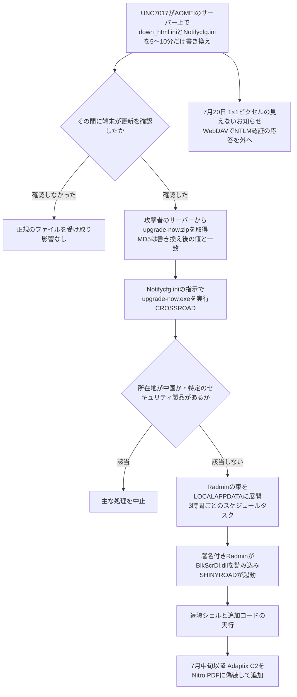

# AOMEI Backupper ― 更新サーバー改ざんでバックドア配布

## 要点

### 影響バージョン

- 対象は、AOMEI Backupper（とAnyViewer）が使う更新・お知らせの仕組み（ABMarket の更新フロー、`Backupper.exe` と `ABNotify.exe`）で、**ソフトウェアの脆弱性ではない**（GTIG、ManageEngine）。
- GTIGとManageEngineの報告は、影響を受ける版を挙げていない。ManageEngineが調べた端末は 8.3.0 だった。The Hacker Newsによると、10月9日公開の最新版 8.5.0 まで、更新の検証方法を変えたという記載は更新履歴にない（The Hacker News）。
- GTIGとMandiantが確認した改ざんの時間帯は次の3回（日本時間は筆者換算）。ほかにも見えていない改ざんがあった可能性が高いとしている（GTIG）。
  - 5月28日 05:40〜05:50 UTC（日本時間14:40〜14:50）
  - 7月16日 08:33〜08:39 UTC（日本時間17:33〜17:39）
  - 7月20日 10:35〜10:40 UTC（日本時間19:35〜19:40）
- 関連するマルウェアは4月下旬から観測されている。GTIGは、4〜7月の全期間をさかのぼって調べるよう求めている（GTIG）。

### 今すぐやること

- AOMEIの製品を使う端末で、スケジュールタスク `RadminComponentRuntime` と `NitroRuntime` がないか確かめる（GTIG、The Hacker News）。
- `%LOCALAPPDATA%\Radmin\` に `FamItrfc.exe`・`BlkScrDl.dll`・`config.zip`・`metadata.dat` などがないか、AOMEIのインストール先の `html\` に実行ファイルがないか確かめる。正規のお知らせの束に実行ファイルは含まれない（GTIG、ManageEngine）。
- `storage-data[.]com` とそのサブドメイン、`8.210.84[.]56`、`47.239.60[.]117`、`8.218.65[.]184` への通信を遮断し、過去の通信を探す（GTIG）。
- 社外のIPアドレスへの SMB（TCP 445）と WebDAV の送信を止める。お知らせ画面を使ってNTLM認証の応答を外へ送らせる手口への対策になる（GTIG）。
- 警告が出たら、ベンダーの配布ページを今見て「きれいだから誤検知」と判断しない。書き換えは数分で元に戻るためである。端末に残った設定ファイルと、警告の時刻のプロキシの記録を保全して調べる（GTIG）。

## 概要

- AOMEI Backupper は、更新とお知らせのために2つの設定ファイル（`down_html.ini` と `Notifycfg.ini`）をAOMEIのサーバーからHTTPSで定期的に取得する。攻撃者は2026年4〜7月、この2つをAOMEIのサーバー上で1回5〜10分だけ書き換え、時間が過ぎると元に戻した（GTIG）。
- 書き換えの間に問い合わせた端末は、攻撃者のサーバーから偽の更新パッケージを取り込み、お知らせの仕組みに実行させられた。中身はダウンローダー CROSSROAD で、署名付きの正規の Radmin を使ってバックドア SHINYROAD を読み込ませた（GTIG、ManageEngine）。
- GTIGは攻撃者を UNC7017 と呼び、国や既知の攻撃者とは結び付けていない。IT サービス、通信、高等教育などの組織が、オーストラリア、ブラジル、インド、パキスタン、ポルトガル、シンガポール、南アフリカ、スペイン、スイス、トルコ、米国の11か国で影響を受けた（GTIG）。

> この記事では、ベンダー・公的機関・研究者・報道で確認できた内容を「事実」、筆者の推測や意見を「考察」として分けて書いています。

## 何が起きたか（時系列）

| 日時 | 出来事 |
| --- | --- |
| 2026-04下旬 | 関連するマルウェアの検体が観測され始める。初期は Alibaba Cloud のオブジェクトストレージから配布（GTIG） |
| 2026-05-20 | 初期の CROSSROAD（`upgrade-now.exe`）がVirusTotalに投稿される。コンパイル日時は2024年に偽装されていた（GTIG） |
| 2026-05-28 | 改ざん（10分間）。ManageEngineのEDRが、別々の国の無関係な2顧客で、AOMEI Backupper が Radmin を導入するのを記録（GTIG、ManageEngine） |
| 2026-06-07 | 顧客からの指摘を受け、ManageEngineがAOMEIに通知。AOMEIは当初「通信の途中で書き換えられた」と説明したが、ManageEngineは証拠と合わないとした（ManageEngine、The Hacker News） |
| 2026-07-01〜07 | 攻撃者が配布先を、ベンダー風の専用ドメイン `storage-data.com` に移す（GTIG） |
| 2026-07-16 | 改ざん（6分間）。ManageEngineの監視が、書き換えをその場で捉える（GTIG、ManageEngine） |
| 2026-07-17 | MandiantがAOMEIに通知し、指標を共有（GTIG） |
| 2026-07-20 | 改ざん（5分間）。初回のダウンロード先を Google Cloud Storage に変え、お知らせ画面でNTLM認証の応答を外へ送らせる手口も追加（GTIG） |
| 2026-07-29 | AOMEIが「是正措置を取った」とMandiantに回答（GTIG） |
| 2026-10-15 | GTIG・MandiantとManageEngineが分析を公開（GTIG、ManageEngine） |

ManageEngineは、公開の時点で、改ざんが止まったことを独自には確かめられていないとしている（ManageEngine）。

## 技術的な問題点（根本原因）

**事実（GTIG、ManageEngine、The Hacker News）**

- `down_html.ini` は `https://www2.aomeisoftware.com/download/abpopup/down_html.ini` から取得され、版数、更新パッケージ `upgrade-now.zip` のダウンロード先URL、そのパッケージの MD5 ハッシュを持つ。`Notifycfg.ini` は `https://account.aomeitech.com/Notifycfg.ini` から取得され、お知らせの表示内容と、ソフトのフォルダー内で実行するコマンドやプログラムを `ABNotify.exe` に指示する（GTIG）。
- どちらのファイルにも暗号学的な署名がない。ダウンロードが正しいことを示すはずのチェックサムは、ダウンロード先を指定するのと同じ署名なしのファイルの中にある（The Hacker News、ManageEngine）。
- 攻撃者は書き換えのたびに、`down_html.ini` の版数（`thrid`）を1つ上げ、ダウンロード先を自分のサーバーに変え、MD5をそのパッケージに合わせた。7月16日には `Notifycfg.ini` に `[dummy_XXXXXX]` という節を3万5千行以上詰め込み、版数の確認を飛ばして、展開した `upgrade-now.exe` をすぐ実行させた（GTIG）。
- 実行されたプログラムは、それを起動したAOMEIのプロセスの権限で動く。ManageEngineが調べた端末では、それだけでシステム全体にソフトを入れられた。権限の高さはAOMEIのサービスがどう動いているかによる（ManageEngine、The Hacker News）。
- 攻撃者がAOMEIのサーバー上のファイルをどうやって書き換えられたのかは、どちらの報告にも書かれていない（The Hacker News）。

**考察**

チェックサムは「届いたものが、指定されたものと同じか」は確かめられても、「指定そのものが正しいか」は確かめられない。指定とチェックサムを同じ署名なしのファイルに入れれば、そのファイルを書き換えられる者は両方をそろえて書き換えられる。HTTPSも、通信の途中での改ざんは防ぐが、送り元のサーバーで書き換えられたものは正しく届けてしまう。今回守りに欠けていたのは、通信路ではなく、「誰がこの指示を書いたか」を端末が確かめる仕組みだった。さらに、お知らせを出すための仕組みが「ソフトのフォルダー内のプログラムを実行する」力まで持っていたため、広告の配信路がコードを実行する経路になった。

## 攻撃・侵入経路

**事実（GTIG、ManageEngine）**

- **CROSSROAD**：C言語製の64ビットのダウンローダー。外部のDNSやHTTPのサービスで自分のIPアドレスを調べ、国コードが中国（CN）なら主な処理を中止する分岐がある。ManageEngineによると、特定のセキュリティ製品を見つけても止まる。条件を満たすと、`component.zip` を取得して `%LOCALAPPDATA%\Radmin\` に展開し、`FamItrfc.exe --runtimechk` を3時間ごとに実行するスケジュールタスク `RadminComponentRuntime` を作る（GTIG、ManageEngine）。
- **痕跡の巻き戻し**：CROSSROAD は端末側の `down_html.ini` を元の値に戻し、ダウンロード先も正規のAOMEIのサーバーに戻す。そのうえで、NTFSの代替データストリーム（`:wtfbbq`）を使って自分自身をディスクから消す。感染した端末は普通に見え、ベンダーの配布ページもきれいに見える（GTIG、The Hacker News）。
- **SHINYROAD**：スケジュールタスクが署名付きの正規の Radmin（`FamItrfc.exe`）を起動すると、隣に置かれた署名なしの `BlkScrDl.dll` が読み込まれる（DLLの検索順の乗っ取り）。そこからCOMの仕組みで `RuntimeComponent.dll` が呼ばれ、暗号化された `metadata.dat` を復号して、組み込みの PocketPy インタプリタでPythonのバイトコードを動かす。遠隔シェルと、ディスクに書かない機能追加ができる。通信先は1つのIPアドレスに固定され、予備はない（GTIG、The Hacker News）。
- **Radmin の扱い**：GTIGは、5月28日の波で改変された Radmin Server が導入されたと書いている。ManageEngineは、調べた端末では Radmin は置かれていたものの起動されておらず、待ち受けも設定も新しいアカウントもなかったとし、遠隔操作は攻撃者へつなぎに行く別の実装（SHINYROAD）が担っていたとしている（GTIG、The Hacker News）。
- **Adaptix C2**：7月中旬以降、条件を満たした端末には、オープンソースの攻撃フレームワーク Adaptix C2 のエージェントが、Nitro PDF の宣伝・スキャンツールに偽装して追加された。スケジュールタスク `NitroRuntime` から起動され、2分ごとに `8.210.84.56:6800` へ通信する（GTIG）。
- **NTLM応答の誘い出し**：7月20日、`Notifycfg.ini` の「World Cup Deals」の宣伝バナー（400×380）が、最優先（Priority=9999）で幅1・高さ1の見えない窓に差し替えられ、`file://8.210.84.56/DavWWWRoot/...` を表示させようとした。Windowsが利用者のNetNTLMv2の認証応答を攻撃者のアドレスへ送る可能性がある。プログラムを実行させる必要がないため、バックドアの実行を止められた端末でも漏れうる（GTIG、The Hacker News）。
- **配布先の変化**：4〜5月は Alibaba Cloud のオブジェクトストレージ、7月1〜7日は専用ドメイン `storage-data.com`、7月20日は初回のダウンロードだけを Google Cloud Storage のバケットにして、新規登録ドメインを遮断するプロキシをすり抜けようとした（GTIG）。

## なぜ防げなかったか・構造的要因の考察

1. **「時点の確認」では見えない攻撃だった。** GTIGは、ここまで短い時間帯で行うサプライチェーン攻撃に出会ったのは初めてだとし、時点ごとのトリアージや自動のファイル検査を事実上かわしたと書いている。配布物を後から調べても正規のものしか出てこず、ベンダーも、警告を受けた分析者も「今は問題ない」と判断してしまう。実際、分析者が本物の検知を誤検知として退けた例があったとされる（GTIG、The Hacker News）。
2. **ベンダーの最初の説明が、調査の向きを変えかけた。** AOMEIは当初「通信の途中での書き換え」と説明したが、ManageEngineは、別々の国とネットワークの端末がHTTPSでAOMEI自身のサーバーから同じものを取っていたことから、それを否定した。サーバー側を疑わずにいれば、被害の原因は利用者の環境にあることになってしまう。7月16日に書き換えをその場で捉えたことが、決め手になった（ManageEngine、The Hacker News）。
3. **宣伝の仕組みと更新の仕組みが一体だった。** GTIGはベンダーに向けて、コアの更新とお知らせのバナーを切り離し、宣伝の経路でローカルのコードが実行されないようにすることを勧めている。バックアップソフトは高い権限で常駐することが多い。その常駐サービスが宣伝の指示まで受け取る作りは、広告の配信サーバーを、端末で高い権限のコードを動かせる場所に変えてしまう（考察）。
4. **サーバーを直しても端末は治らない。** CROSSROAD はスケジュールタスクを作ってから端末側の設定を元に戻し、自分を消す。AOMEIがサーバーを対処しても、その前に感染した端末はそのまま残る。GTIGは「AOMEIがサーバー側で対処したからといって守られていると考えてはいけない」と書いている（GTIG）。
5. **「バックアップソフトは安全側の道具」という思い込み。** 守るための道具ほど、許可リストに入り、高い権限で動き、監視の対象から外されやすい。今回の攻撃者がバックアップソフトを選んだ理由は報告に書かれていないが、結果として、端末の監視からもネットワークの監視からも目立ちにくい入口になった（考察）。

## 運用者向けの具体的な対策と検知ポイント

**対策（事実に基づくもの）**

- 4〜7月の全期間について、端末とネットワークをさかのぼって調べる。GTIGはYARAルール、ManageEngineはSigmaルールを公開している（GTIG、ManageEngine）。
- 警告の確認に、ベンダーの配布URLの「今の中身」を使わない。端末に残った `%PROGRAMFILES(X86)%\AOMEI\*\Tmphtml\` の設定ファイルを保全し、警告が出た正確な時刻のプロキシやファイアウォールの記録を調べる（GTIG）。
- 攻撃者の基盤（`storage-data[.]com`、`promotion.storage-data[.]com`、`aomei.storage-data[.]com`、`8.210.84[.]56`、`47.239.60[.]117`、`8.218.65[.]184`）への通信を遮断する（GTIG）。
- 社外のIPアドレスへの SMB（TCP 445）と WebDAV の送信を遮断する（GTIG）。

**検知ポイント（事実に基づくもの）**

- スケジュールタスク `\RadminComponentRuntime`（説明文「Radmin Component runtime checkable.」）、`\NitroRuntime`（GTIG）。
- `%LOCALAPPDATA%\Radmin\` の `FamItrfc.exe`・`FamItrf2.exe` は正規の署名付きの Famatech のソフトなので、署名があっても見逃さない。隣の署名なしの `BlkScrDl.dll` や、`--runtimechk` 付きの起動に注目する（GTIG）。
- AOMEIの発行元の情報を持ちながら署名のない `upgrade-now.exe`。AOMEIのお知らせ用の `html\` フォルダーから動くプログラム（The Hacker News、ManageEngine）。
- `--nitrod` 付きで起動される短命の子プロセス、`:wtfbbq` という代替データストリーム（GTIG）。
- プロキシやWebゲートウェイの記録で、User-Agent `Anyviewer-loader/1.0`、`Anyviewer-ipcheck/1.0`、Alibaba Cloud OSS の `serv.oss-cn-hongkong.aliyuncs.com` への要求（GTIG）。
- 更新を担うプロセスが、署名のない子プロセスを生む動きや、信頼しているデスクトップソフトからの見慣れない宛先への通信（GTIG）。

**考察（運用上の工夫）**

- 業務で必要がないなら、AOMEIの製品のお知らせ機能や自動更新の確認を止めるか、更新は管理者が配布物を確かめてから手動で行う運用にする。製品側の検証方法が変わったことを確かめられるまでの間の措置として検討したい。
- ソフトウェアの台帳で、AOMEI Backupper や AnyViewer が、情報システム部門の知らないうちに個人の判断で入れられていないか確かめる。無料版でも同じ更新の仕組みを使っている可能性がある。
- 同じ「署名のない設定ファイルで更新先を指示する」作りは、ほかのソフトにもありうる。自社で使う常駐型のソフトについて、更新の指示とパッケージに署名の検証があるかを、調達や更新の際の確認項目に加えるとよい。

## 参考リンク

- [Investigating Ephemeral Supply Chain Tampering（Google Threat Intelligence Group / Mandiant、2026年10月15日）](https://cloud.google.com/blog/topics/threat-intelligence/investigating-ephemeral-supply-chain-tampering)
- [AOMEI Backupper supply chain attack（ManageEngine Threat Analysis Lab）](https://www.manageengine.com/threat-analysis-lab/aomei-backupper-supply-chain-compromise.html)
- [AOMEI Backupper Changelog（AOMEI）](https://www.ubackup.com/changelog.html)
- [Attackers Tampered with AOMEI Backupper's Update Servers for Minutes to Deliver a Backdoor（The Hacker News）](https://thehackernews.com/2026/10/attackers-tampered-with-aomei.html)
