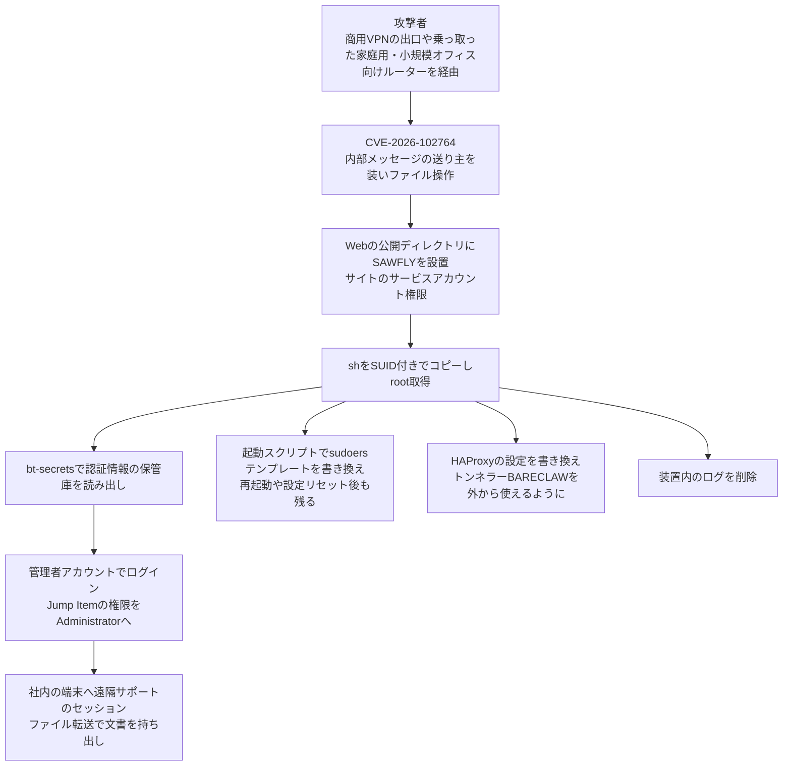

# BeyondTrust Remote Support CVE-2026-102764 ― 内部メッセージの「送り主」を確かめない欠陥で、遠隔サポート装置ごと奪われ社内の端末へ

## 要点

### 影響バージョン

- 対象は **BeyondTrust Remote Support（RS）の 26.2.3 以前のすべての版**。修正は **BT26-05-RS パッチ**（24.3.1〜26.2.3 向け）。**24.3.1 より古い版はまず新しい版へ上げてからパッチを当てる**（BeyondTrust）。
- **SaaS版** は、アドバイザリによると10月9日時点で全顧客に適用済み。BeyondTrustのブログでは、パッチの公開日を10月8日とし、SaaSのRemote SupportとPrivileged Remote Access（PRA）は自動で適用されたとしている（BeyondTrust）。
- **Privileged Remote Access（PRA）** は、社内の検証では悪用の方法が見つかっていないが、問題のコードを共有しているため、念のためパッチを出し、自前運用の顧客にすぐ当てるよう求めている（BeyondTrust）。
- CVSS 4.0は **9.3**（ネットワーク経由・認証不要・利用者の操作不要）。弱点の種類は CWE-290（なりすましによる認証回避）（BeyondTrust）。
- CISAは10月16日（米国時間）にKEVへ追加し、連邦政府機関の対処期限を **10月19日** とした。侵害の有無の確認（フォレンジックのトリアージ）も求める対象になっている（CISA）。

### 今すぐやること

- 自前運用の装置は、`/appliance` の管理画面から BT26-05-RS パッチを当てる。自動更新を有効にしていれば、適用済みかを確かめる。パッチが見えなければ、BT26-05 を挙げてサポートに問い合わせる（BeyondTrust、Mandiant）。
- 脆弱な版のままインターネットから届く状態だった装置は、**侵害されたものとして扱い、確認が済むまで信用しない**（Mandiant）。
- 疑いがあれば、変更や再起動の前に仮想装置のスナップショット（メモリを含む）を取り、装置の外にある syslog・リバースプロキシ・WAF・ファイアウォールのログを集める。攻撃者は装置内のログを消していた（Mandiant）。
- パッチ適用または再構築の **後で**、装置が保管・仲介していた認証情報（管理者、API、SAML署名鍵、Vault内の資格情報など）を入れ替える。先に入れ替えると、まだ装置を握っている攻撃者に新しい認証情報を渡すことになる（Mandiant）。
- `/login` と `/appliance` の管理画面に届く送信元を、信頼できるネットワークだけに絞る（BeyondTrust、Mandiant）。

## 概要

- BeyondTrust Remote Support の内部コンポーネントが、受け取ったメッセージの送り主（origin）を正しく確かめておらず、条件がそろうと遠隔の攻撃者が装置上でファイル操作をできた。Mandiantは、悪用に成功すると任意のファイルをアップロードできると書いている（BeyondTrust、Mandiant）。
- 中国系とされるスパイ活動の攻撃者 ARMORY CASTLE（旧 UNC5221、CrowdStrikeの呼び名は WARP PANDA）が、2026年8月29日にゼロデイとして悪用した。BeyondTrustが把握する被害は、BeyondTrustが運用するSaaSの1インスタンスと、顧客が自前で運用する1台の計2件である（BeyondTrust）。
- 攻撃者はWebシェル SAWFLY から root を取り、装置の認証情報保管庫を読み出そうとし、管理者アカウントの「Jump Item」の権限を引き上げて、社内の端末へ遠隔サポートのセッションを張り、文書を持ち出した（Mandiant）。

> この記事では、ベンダー・公的機関・研究者・報道で確認できた内容を「事実」、筆者の推測や意見を「考察」として分けて書いています。

## 何が起きたか（時系列）

| 日時 | 出来事 |
| --- | --- |
| 2026-08-29 | ARMORY CASTLE がゼロデイを悪用し、BeyondTrustが運用するSaaSの1インスタンスと、自前運用の1台に侵入（BeyondTrust） |
| 2026-09-27 | 別のセキュリティ機器ベンダーへの悪用が公になり、BeyondTrustが同様の活動を探し始める。同じ日にMandiantからも、具体的でない注意の連絡が入る（BeyondTrust） |
| 2026-09-28 | BeyondTrustの脅威ハンティングが自社SaaSの被害を見つけ、発見から27分で封じ込める。約7時間後に侵入経路を特定して再現し、修正に着手（BeyondTrust） |
| 2026-09-30 | Mandiantが自前運用の顧客での調査結果を共有し、BeyondTrustの発見と一致。修正を試験版で検証（BeyondTrust） |
| 2026-10-08 | BT26-05 パッチを公開。周辺コードの類似の経路もあわせて修正。SaaSは自動で適用（BeyondTrust） |
| 2026-10-15 | アドバイザリ BT26-05 と CVE を公開。BeyondTrustのブログとMandiantの分析も同時に公開（BeyondTrust、Mandiant） |
| 2026-10-16（米国時間） | CISAがKEVに追加。同じ日に Fortinet の CVE-2025-61624 も追加（CISA） |
| 2026-10-19 | CISAが連邦政府機関に示した対処期限（CISA） |

## 技術的な問題点（根本原因）

**事実（BeyondTrust、CISA）**

- 欠陥は Remote Support の内部コンポーネントにあり、そのコンポーネントが受け取るメッセージの送り主を十分に確かめていなかった。「条件がそろえば」装置上のファイル操作に使えるとされる。
- CISAはKEVで、この欠陥を「なりすましによる認証回避」と分類し、遠隔の攻撃者が装置上でファイル操作をできると説明している。
- BeyondTrustは、自前運用の装置へのパッチ適用が進む間は利用者の危険を高めるとして、技術的な詳細を公表していない。

**事実（Mandiant）**

- 悪用のあと、攻撃者は `/app_84304470%2Ephp` へのPOST要求を送った。このファイルは回収できなかった。最初のPOSTから約11分後に、Laravelアプリの公開ディレクトリ（`.../ingredi/app/laravel/public/`）にWebシェル SAWFLY（`mangoapi.php`）が作られた。
- 悪用の痕跡は access、syslog、messages などのログに残っていたが、これらは `/home` を含む LUKS で暗号化された領域にあり、利用者は直接見られない。

**考察**

「内部のメッセージ」は、装置の中の部品どうしが信頼し合う前提でやり取りするものだろう。その前提のまま、外から届く経路のどこかで内部向けのメッセージを差し込めると、外部の誰かが内部の部品になりすませる。認証の画面を破るのではなく、そもそも認証を求められない内側の通り道に入るので、パスワードの強さや多要素認証は効かない。BeyondTrustが修正の際に「周辺コードの別の経路」もあわせて直したと書いていることは、同じ前提に立つ入口が1つではなかったことを示している。

## 攻撃・侵入経路

**事実（Mandiant）**

- **root取得**：SAWFLYはサイトのサービスアカウント（権限の低いローカルユーザー）で動いていた。攻撃者は `/bin/sh` を `/usr/bin/dbus-authd` にコピーし、所有者をrootにしてSUIDを付けた。
- **認証情報の窃取**：BeyondTrust独自の管理用コマンド `/ns/sbin/bt-secrets` を使い、サービスアカウント向けの保管庫と装置全体の保管庫の読み出しを試み、その後 `bt-secrets.log` を削除した。
- **持続化**：起動時に実行される `/home/bomgar/sbin/post_boot.d` に `zz-root-persist` というスクリプトを置き、`/ns/config/sudoers.template` にサービスアカウントへパスワードなしで全権を与える行を足して、`bt-sysconfig` で `/etc/sudoers` を作り直させた。テンプレートを書き換えるため、再起動や設定のリセットでも消えない。
- **トンネル**：C言語製のSOCKS5トンネラー BARECLAW を `/tmp/ingredi_ws` として動かし（ポート19800、WebSocketのパス `/uidchanarge`）、`/ns/config/haproxy.conf` にそのパスを内部の19800番へ転送する設定を足した。トンネラー自体はローカルにしか待ち受けないため、外からのポートスキャンでは見えない。
- **横展開**：管理者アカウントで管理画面にログインし、そのアカウントの Jump Item と Team の権限を「No Access」から「Administrator」に変えた。Jump Item は遠隔接続できる端末の一覧で、この変更により一覧のすべての端末へセッションを張れるようになった。攻撃者は社内の端末にセッションを張り、組み込みのファイル転送でソフトウェアの一覧などの文書を持ち出した。
- **痕跡の消去**：認証、SSL、HTTPアクセス、PHPのログや `/var/log/messages` を繰り返し削除した。

**事実（BeyondTrust）**

- BeyondTrustが自社SaaSで調べた1件でも、動きはMandiantの説明と一致した。攻撃者は数分で装置の管理者権限まで上がり、再起動後も残る仕組みを入れた。インフラは被害者ごとに入れ替えるため、ある侵入の痕跡（IOC）が次の侵入で使えることはまれだとしている。
- 攻撃者が権限を上げた時点で、BeyondTrustのセンサーはリアルタイムに警告を出していた。しかし、外部の検知製品に組み込まれた自動トリアージ機能が、その警告を誤検知として閉じていた。

## なぜ防げなかったか・構造的要因の考察

1. **遠隔サポート装置は「全社の鍵束」と「接続先の地図」を兼ねている。** BeyondTrust自身が書くとおり、遠隔接続の装置は特権の認証情報を保管・仲介し、誰がどこへつなぐかの一覧を持つ。ここを奪えば、攻撃者は新しいマルウェアを社内に配らなくても、正規の遠隔サポートの機能で端末に入り、正規のファイル転送で持ち出せる。製品の正しい動作がそのまま攻撃の道具になるため、端末側の対策では区別がつきにくい。
2. **装置の中を利用者が調べられない。** 痕跡が残るログは暗号化された領域にあり、Mandiantは「利用者は装置のホストのファイルシステムを監査できない」として、疑わしい装置は掃除ではなく作り直すよう勧めている。中身を見られない箱を境界に置いている以上、装置の外に送ったログだけが頼りになる。外部へのログ転送をしていなければ、侵害を確かめる手段がほとんど残らない。
3. **自動トリアージが本物の警告を閉じた。** BeyondTrustほどの監視体制でも、権限昇格の警告は自動の判定で誤検知とされ、見つかったのは脅威情報から始めた別のハンティングだった。攻撃者が、防御側が買うのと同じ市販の製品で自分の手口を試している前提に立つべきだというBeyondTrustの指摘は重い。重大度の高い警告を、機械の判定だけで閉じない運用が必要である。
4. **ゼロデイから「公開後の一斉悪用」へ移る攻撃者。** BeyondTrustとMandiantは、この攻撃者がゼロデイを選んだ標的にだけ使い、公表後は未修正の装置を手当たり次第に狙ってきたと書いている。Ivanti Connect Secureの2件のゼロデイでも公表後に広く悪用された。今回、公表から日が浅い今が最も危ない時期だと考える。Shadowserverはインターネットに公開された BeyondTrust の遠隔サポート関連のインスタンスを1,400以上観測している（BleepingComputer）。

## 運用者向けの具体的な対策と検知ポイント

**対策（事実に基づくもの）**

- BT26-05-RS パッチを当てる。24.3.1 より古い版は、サポート中の版へ上げてから当てる。版を上げても、それまでの露出の影響は消えない（BeyondTrust、Mandiant）。
- 自前運用の PRA にも、念のためパッチを当てる（BeyondTrust）。
- 侵害が確認された、または不明な装置は、クリーンで修正済みのイメージから作り直す。設定のバックアップは露出期間より前の日付のものを戻すか、隔離したまま最新を戻して設定を見直してから接続する。新しいTLS証明書を発行し、Jump Client、Jumpoint、担当者用コンソールを作り直した装置から配り直す（Mandiant）。
- 隔離するときは、装置の設定画面ではなく外側のファイアウォールで受信を止め、設定を調査のために残す。送信はBeyondTrustの更新・ライセンス先以外を拒否し、拒否した通信を記録する。進行中のセッションを終え、Jump Client、Jumpoint、APIアカウントは削除ではなく無効化して監査記録を残す（Mandiant）。
- 認証情報は、パッチ適用・再構築のあとに、依存関係の順で入れ替える。`/appliance` の管理者 → `/login` の管理者とローカルユーザー → APIのシークレット → 認証基盤との連携アカウントとSAML署名鍵 → Vault内の資格情報（接続先のシステム側で） → SMTP・syslog・ITSM連携などの認証情報 → 露出期間中にサポートセッションで入力された認証情報（Mandiant）。
- `/login` の利用者にはSAMLによるシングルサインオンとフィッシングに強い多要素認証を求め、ローカルアカウントは監視付きの緊急用1つに減らす。各グループポリシーで Jump Item の既定の権限を「No Access」にする。装置からの送信は既定で拒否する（Mandiant）。
- 装置の syslog とセッションのイベントを、ほぼリアルタイムでSIEMに転送する。攻撃者は装置内のログを消す（BeyondTrust、Mandiant）。

**検知ポイント（事実に基づくもの）**

- `user_changed` イベントのうち、Jump Item や Team の権限を引き上げたもの。変更記録のない `user_added`、`api_account`、`security_provider` のイベント。送信イベントや syslog の宛先の変更（Mandiant、BeyondTrust）。
- 家庭用回線や商用VPNのアドレスからの `/login` の成功、業務時間外の管理者ログイン（Mandiant、BeyondTrust）。
- ファイル転送のイベントと、露出期間中に権限が変わったアカウントが始めたセッション。触れられた端末はすべて調査の対象にする（Mandiant）。
- リバースプロキシやWAFで、Remote Supportの既知のパス以外への要求、特に見覚えのない `.php` のパスや、サポート担当者・端末のアドレス以外からのWebSocketの接続（Mandiant）。
- 装置からのsyslog転送が1つのセッションの間だけ途切れていれば、ログ改ざんの強い兆候である（Mandiant、BeyondTrust）。
- Mandiantは SAWFLY と BARECLAW のハッシュとYARAルールを公開している（Mandiant）。

**考察（運用上の工夫）**

- 「誤検知として自動で閉じられた警告」を、今回の露出期間（少なくとも8月下旬から修正まで）についてさかのぼって見直す価値がある。遠隔サポート装置からの権限昇格やシェルの起動に関する警告は特にである。
- 遠隔サポート装置のVaultに、ドメイン管理者のような強い資格情報を置かない。Mandiantの推奨どおり、特権の資格情報は外部の保管庫に置き、都度注入する形にすると、装置を奪われたときに失うものが減る。

## 参考リンク

- [BT26-05 Security Advisory（BeyondTrust）](https://www.beyondtrust.com/trust-center/security-advisories/bt26-05)
- [ARMORY CASTLE and BT26-05: What Security Teams Need to Know（BeyondTrust、2026年10月15日・16日更新）](https://www.beyondtrust.com/blog/entry/bt26-05)
- [ARMORY CASTLE Exploits BeyondTrust（Google Threat Intelligence Group / Mandiant）](https://cloud.google.com/blog/topics/threat-intelligence/armory-castle-exploits-beyondtrust)
- [Known Exploited Vulnerabilities Catalog（CISA）](https://www.cisa.gov/known-exploited-vulnerabilities-catalog)
- [BeyondTrust patches zero-day exploited in attacks since August（BleepingComputer）](https://www.bleepingcomputer.com/news/security/beyondtrust-patches-zero-day-exploited-in-attacks-since-august/)
- [China-Linked Hackers Exploited BeyondTrust Zero-Day to Take Over Remote Support Servers（The Hacker News）](https://thehackernews.com/2026/10/china-linked-hackers-exploited.html)
- [Suspected Chinese espionage attackers abusing BeyondTrust IT support zero-day（The Record）](https://therecord.media/beyond-trust-cyberattack-china)
