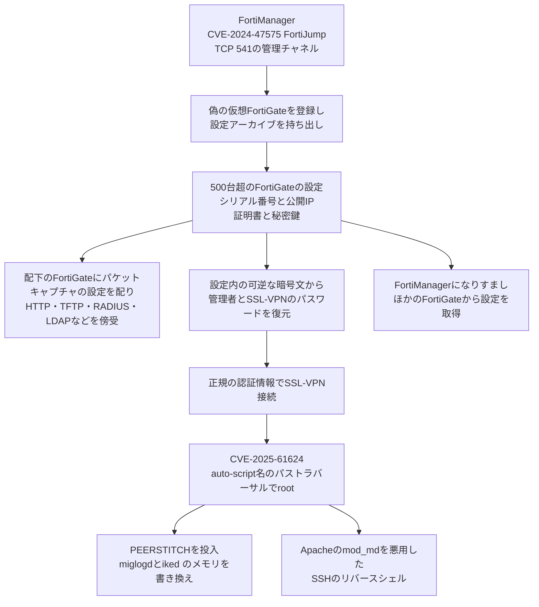

# FortiOS CVE-2025-61624とPEERSTITCH ― FortiManager 1台から500台超のFortiGateの設定と鍵が抜かれ、ディスクにもネットにも跡を残さない常駐型の実装へ

## 要点

### 影響バージョン

- CVE-2025-61624 の対象と修正版は次のとおり（Fortinet FG-IR-26-122）。
  - FortiOS 7.6.0〜7.6.4 → **7.6.5 以降**。7.4.0〜7.4.9 → **7.4.10 以降**。7.2・7.0・6.4 は全版が対象で、修正版のある系列へ移行する。
  - FortiProxy 7.6.0〜7.6.4 → **7.6.5 以降**。7.4.0〜7.4.11 → **7.4.12 以降**。7.2・7.0 は全版が対象で移行が必要。
  - FortiPAM 1.7.0 → **1.7.1 以降**。1.0〜1.6 は全版が対象で移行が必要。1.8 は対象外。
  - FortiSwitchManager 7.2.0〜7.2.7 → **7.2.8 以降**。7.0.0〜7.0.6 → **7.0.7 以降**。
- 悪用には、読み書き権限のある管理者プロファイルでのログインが必要（CISA）。Fortinetの評価はCVSS 3で6.0（一時スコア5.4）、深刻度「中」、悪用は「あり」（Fortinet）。
- CISAは10月16日（米国時間）にKEVへ追加し、連邦政府機関の対処期限を **10月19日** とした。侵害の有無の確認も求める対象になっている（CISA）。
- 最初の侵入に使われた FortiManager の CVE-2024-47575（FortiJump）は、2024年10月にKEVへ追加済みの欠陥である（CISA）。

### 今すぐやること

- FortiOS などを上の修正版へ更新する（Fortinet）。
- FortiOS の設定の版履歴で、名前に `../` を含む `system.auto-script` のオブジェクトがないか確かめる（Unit 42）。
- `diagnose debug crashlog read` で、`miglogd`・`iked`・`syslogd` のセグメンテーション違反（Signal 11）の記録を確かめる（Unit 42）。
- FortiManager を使っているなら、FortiManager が侵害された時点で、配下のFortiGateの設定に入っている管理者・SSL-VPNのパスワードと、FortiManagerとの信頼関係に使う鍵・証明書が攻撃者の手に渡ったものとして扱い、入れ替えを検討する（考察。Unit 42は、設定内の認証情報を総当たりで復元できたことを確かめている）。

## 概要

- Palo Alto NetworksのUnit 42が、2024年9月に起きた通信事業者のマネージドサービス企業への多段階の侵入を報告した。攻撃者（CL-STA-0954、別名 UNC5820）は、FortiManager の CVE-2024-47575 を突いて侵入し、管理下の500台を超える FortiGate の稼働中の設定、暗号鍵、データベースを持ち出した（Unit 42）。
- 攻撃者は、持ち出した設定から復元した正規の認証情報で境界のファイアウォールにSSL-VPN接続し、FortiOS の CLI にあるパストラバーサル CVE-2025-61624 で管理者権限からOSのrootへ上がった。そこで新種のメモリ常駐型ARM64マルウェア PEERSTITCH を入れた（Unit 42）。
- PEERSTITCH はディスクに残らず、待ち受けポートも外向きの接続も作らない。FortiOSの正規のプロセス2つ（ログの `miglogd` とVPNの `iked`）のメモリを書き換えて、その間に隠れた連絡路を作り、特定の印の付いたVPNセッションでFortiOSの検証を飛ばす（Unit 42）。

> この記事では、ベンダー・公的機関・研究者・報道で確認できた内容を「事実」、筆者の推測や意見を「考察」として分けて書いています。

## 何が起きたか（時系列）

| 日時 | 出来事 |
| --- | --- |
| 2024-09 | 通信事業者のマネージドサービス企業への侵入が起きる。FortiManager の CVE-2024-47575 が入口（Unit 42） |
| 2024-10-23 | CISAが FortiManager の CVE-2024-47575 をKEVに追加（CISA） |
| 2026-04-14 | Fortinetが CVE-2025-61624（FG-IR-26-122）を公開。発見は社内、悪用は「あり」（Fortinet） |
| 2026-10-14 | Unit 42が CL-STA-0954 と PEERSTITCH の分析を公開（Unit 42） |
| 2026-10-16（米国時間） | CISAが CVE-2025-61624 をKEVに追加。同じ日に BeyondTrust の CVE-2026-102764 も追加（CISA） |
| 2026-10-19 | CISAが連邦政府機関に示した対処期限（CISA） |

Unit 42の報告は、侵入が「2024年9月に起きた」とし、長い潜伏期間のあとに偵察へ移ったと書いている。CVE-2025-61624 を悪用した正確な日付は、報告の中で確認できなかった。

## 技術的な問題点（根本原因）

**事実（Fortinet、Unit 42、CISA）**

- CVE-2025-61624 は、FortiOS などの CLI のパストラバーサル（CWE-22）で、特権を持つ攻撃者が既存のコマンドに細工した引数を渡すと、任意のファイルを書き込んだり消したりできる（Fortinet）。
- Unit 42によると、問題の場所は CLI の `system.auto-script`（自動実行スクリプト）の仕組みである。auto-script のオブジェクト名が無害化されていないため、`../` を含む名前を付けると、スクリプト本体を本来のディレクトリの外、任意の場所に置ける。スクリプトは auto-script エンジンの権限で動く（Unit 42）。
- FortiOS の管理者は、たとえ `super_admin` でも、制限されたCLIの中でしか操作できず、シェルやファイルシステム、プロセスには直接触れない。その下でFortiOSを実装するデーモンはrootで動いている。この欠陥は、その壁を越えて管理者からrootに上がる手段になった（Unit 42）。

**考察**

auto-script は管理者が定型の操作を自動化するための正規の機能で、名前は人が付ける「ラベル」にすぎないはずだった。ところが実装は、その名前をそのままファイルのパスの一部に使っていた。名前に `../` が入ると、ラベルがパスになり、置き場所を自由に選べる書き込みに変わる。「管理者しか使わない入力だから安全」という前提が、ここでも、管理画面の権限とOSのroot権限との間の壁を崩した。

## 攻撃・侵入経路

**事実（Unit 42）**

- **最初の侵入**：攻撃者は CVE-2024-47575 を突き、外部の基盤から `localhost` という名前の偽の仮想FortiGateをFortiManagerに登録した。直後に `.tm` という設定アーカイブを作って持ち出した。中身は、FortiManager自身のシリアル番号と全管理対象との関係、500台を超えるFortiGateの稼働中の設定、`global.db` と `revinfo.db`、FortiGateのシリアル番号と公開IPアドレスの一覧、ネットワーク構成、証明書と秘密鍵などだった。
- **傍受**：長い潜伏期間のあと、奪ったFortiManagerから配下のFortiGateに許可のないパケットキャプチャの設定を配り、暗号化されていないHTTPと11のサービスを傍受した。その後、境界のファイアウォールで TFTP（UDP 69）、RADIUS（UDP 1812/1813）、LDAP（TCP 389）も狙った。
- **認証情報の復元とVPN侵入**：設定に入っていた認証情報は可逆な暗号文で、Unit 42は管理者とSSL-VPNのパスワードを総当たりで復元できることを確かめた。攻撃者は正規の認証情報で境界のファイアウォールにSSL-VPN接続した。
- **root化と PEERSTITCH**：CVE-2025-61624 で `../../../../setup` という名前の auto-script を作り、外部サーバーから5つのファイル（Emscriptenの実行環境 `index.js`、WebAssemblyの `index.wasm`、ARM64の注入ツール `lldprx` など）を `/data2/template/` に取り込んだ。`lldprx` は `/proc` から `miglogd` と `iked` を探し、ptraceで止め、16KBの読み書き実行可能なメモリを確保して1,344バイトの処理を書き込み、実行をそこへ向けた。
- **隠れた連絡路**：両プロセスに入れたフックは、通過するデータの中から「8550」と「169.254.0.1」という印を探す。見つけると、そのセッションの識別子を相手のプロセスのメモリ（`/proc/<pid>/mem`）に直接書き込む。`iked` は後のVPNセッションを処理するときにその識別子を照合し、一致すれば別の戻り先へ分岐して、FortiOSの既定の検証を飛ばす。
- **別のC2**：auto-script で `../../tmp/apache2/conf/md-acme.conf` を作り、FortiGate上のApacheの `mod_md`（ACMEで証明書を自動取得する機能）の向き先を攻撃者のACMEサーバーにした。DNS-01の検証処理を `/bin/node` に割り当て、ドメイン名の欄にコマンドを差し込んでSSHのリバースシェルを開かせた。更新を常に試みる設定にして、繰り返し実行されるようにした。
- **管理基盤のなりすまし**：外部からのFGFM（FortiGateとFortiManagerの間の通信、TCP 541）のやり取りのあと、`FortiGateCloud` という名前の管理者アカウントが複数のFortiGateから設定一式を取得した。被害組織はFortiManager Cloudを使っておらず、そのアカウントも作っていなかった。Unit 42は、攻撃者がFGFMで管理基盤になりすましたと中程度の確度で評価している（手段として CVE-2024-26009 か、盗んだ鍵の再利用の2通りを挙げ、どちらかは区別できないとした）。
- **痕跡の消去**：`miglogd` と `syslogd` を強制終了してログを止め、クラッシュログを消し、偽の管理者アカウントやVPNグループ、auto-script を実行後に自動で削除した。`lldprx` は自分のファイルを消した。
- Unit 42の調査はマネージドサービス企業自身の環境に限られ、管理対象だった顧客のネットワークは調べていない。報告が示すのは顧客側の設定と認証情報の露出で、顧客ネットワークへの侵入が確認されたわけではない。

## なぜ防げなかったか・構造的要因の考察

1. **管理基盤は、管理される側すべての「合鍵の束」になる。** Unit 42は「侵害された1台の装置が、顧客を守る機器を含む500台超のファイアウォールの鍵・認証情報・ネットワーク構成をもたらした」と書き、管理基盤の侵害は、それを持つ組織の境界にとどまらず、パッチを当てても終わらないと指摘している。FortiManagerとFortiGateの信頼関係を支える鍵は、入れ替えるまで有効なままだからである。
2. **設定ファイルの中の認証情報は「可逆」だった。** 設定のバックアップや集中管理のために、FortiGateの設定には認証情報が復元できる形で入っていた。設定を盗まれることが、そのままパスワードを盗まれることにつながった。今月のFortiBleed（使い回された認証情報で管理者が締め出される被害、当サイトの[FortiBleedの記事](/security-notes/notes/2026-10-08-fortibleed-fbi-usss-fortigate-admin-lockout/)）とも通じる、「認証情報が奪われたあと」に備えていない構造である。
3. **「中程度」の欠陥が最後の一押しになった。** CVE-2025-61624 は管理者権限が前提で、CVSSも6.0にとどまる。しかし、攻撃者はすでに正規の管理者の認証情報を持っていた。その状態では、管理者からrootへの昇格こそが、ディスクに残らない常駐型の実装を入れるために必要な最後の段だった。深刻度の数字だけで更新の優先度を決めると、こうした「連鎖の一部」を後回しにしてしまう。
4. **従来の検知が効かない作りだった。** PEERSTITCHはファイルを残さず、ポートを開かず、外へ接続しない。正規のプロセスの通信に紛れ、プロセス間のやり取りもメモリへの直接の書き込みで済ませる。ファイアウォール自体には利用者がEDRを入れられないため、ログを止められると手がかりがさらに減る。防御側が頼れるのは、クラッシュログや設定の版履歴のように攻撃者が消し損ねた跡と、機器の外に送ったログになる。

## 運用者向けの具体的な対策と検知ポイント

**対策（事実に基づくもの）**

- FortiOS・FortiProxy・FortiPAM・FortiSwitchManager を修正版へ更新する（Fortinet）。アドバイザリには、仮想パッチ「FG-VD-59270.0day.」が FMWP のデータベース更新 25.120 で提供されていると書かれている（Fortinet）。
- 管理基盤（FortiManagerなど）の管理インターフェースは、最も厳しいゼロトラストの考え方で隔離する。管理基盤が侵害されたら、その瞬間に、管理基盤が持つ認証情報と証明書を侵害されたものとして扱う（Unit 42）。
- 連邦政府機関は、BOD 26-04 に沿って対象の機器のインターネットへの公開状況を評価し、侵害の有無を確かめる（CISA）。

**検知ポイント（事実に基づくもの。Unit 42）**

- `/bin/miglogd` と `/bin/iked` のメモリマップ（`/proc/<pid>/maps`）に、16,384バイトで `rwxp`（読み書き実行可能）の無名領域がないか。
- 両プロセスの間で `/proc/<pid>/mem` への open・write がないか（カーネルのシステムコールの記録）。
- `diagnose debug crashlog read` で、`miglogd`・`iked`・`syslogd` のSignal 11のクラッシュがないか。注入を試みた際のクラッシュが残ることがある。
- 設定の版履歴で、`system.auto-script` のオブジェクト名に `../../` がないか。
- `/tmp/apache2/conf/md-acme.conf` が、ACMEの決まり文句の文字列で上書きされていないか（偽装に使われた）。
- 作っていない `FortiGateCloud` などの管理者アカウントによる設定の取得や、FGFM（TCP 541）での外部とのやり取り。
- Unit 42は PEERSTITCH のハッシュ、通信先、YARAルールを公開している。

**考察（運用上の工夫）**

- FortiManagerを2024年10月以前から使っていて、CVE-2024-47575 の修正が遅れた心当たりがあるなら、今回の報告は過去の話ではない。Unit 42の事例では、侵入は2024年9月で、その後の長い潜伏を経て偵察と横展開が続いた。配下のFortiGateの管理者とSSL-VPNのパスワード、FGFMの信頼関係の鍵や証明書を、いま入れ替える価値がある。
- 機器のsyslogを外部へ送り、送信が途切れた時間帯を監視する。攻撃者は `miglogd` と `syslogd` を止めてから作業していた。
- マネージドサービスの利用者は、委託先の管理基盤が侵害された場合に、自社の機器の設定や認証情報がどう扱われるかを確かめておく。Unit 42の事例では、被害は委託先の環境から、委託元の機器の設定にまで及んでいた。

## 参考リンク

- [Unit 42 Uncovers PEERSTITCH, a Stealthy FortiGate Implant（Palo Alto Networks Unit 42、2026年10月14日）](https://unit42.paloaltonetworks.com/fortimanager-cve-2024-47575-peerstitch-malware/)
- [FG-IR-26-122 Path Traversal in CLI（Fortinet PSIRT）](https://fortiguard.fortinet.com/psirt/FG-IR-26-122)
- [Known Exploited Vulnerabilities Catalog（CISA）](https://www.cisa.gov/known-exploited-vulnerabilities-catalog)
- [PEERSTITCH Malware Deployed via FortiOS Flaw Bypasses Checks on Tagged VPN Sessions（The Hacker News）](https://thehackernews.com/2026/10/attackers-exploit-fortios-flaw-to.html)
