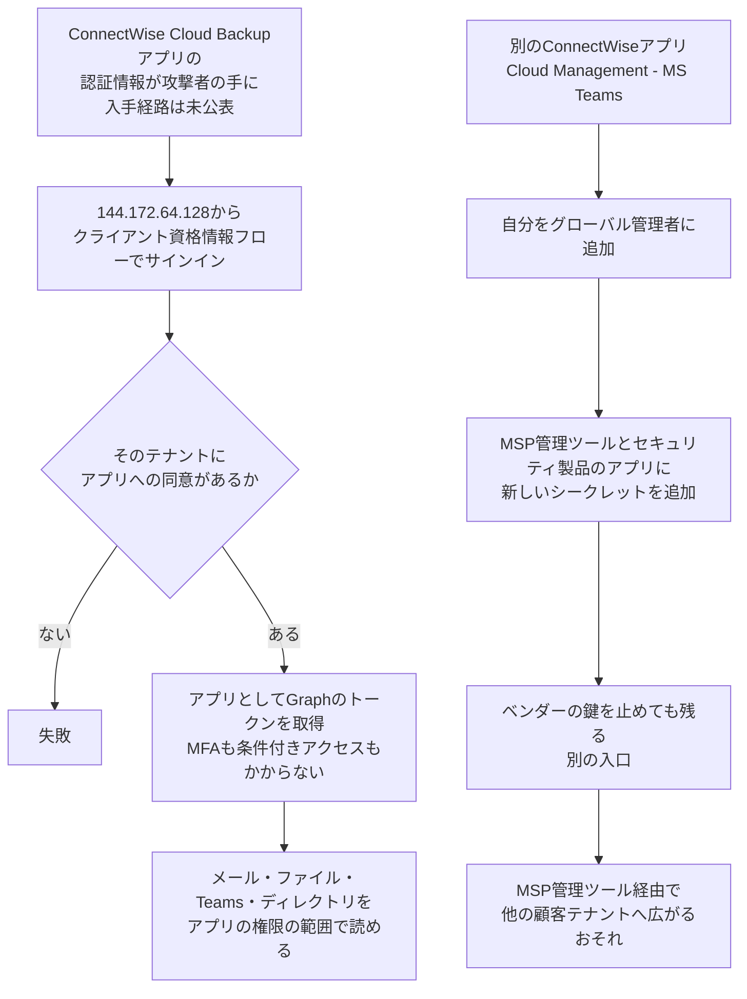

# ConnectWise Cloud Backup ― アプリの鍵でM365テナントに侵入

## 要点

### 影響バージョン

- 対象は ConnectWise Cloud Backup（旧 SkyKick Backup）と、同じ発行元の ConnectWise Cloud Management 系の Microsoft 365 アプリ。**製品の版数の問題ではなく、ベンダーが持つアプリの認証情報が悪用された事案**である（Huntress、Todyl、ConnectWise）。
- これらのアプリに管理者が同意（consent）したことのある Microsoft 365 テナントはすべて対象になりうる。何年も使っていない古い SkyKick の接続が残っているテナントも含む（ConnectWise、BleepingComputer）。
- ConnectWise が10月17日 07:00 UTC（日本時間16:00）に無効化した7つのアプリ（ConnectWise）：

| アプリ | アプリケーションID |
| --- | --- |
| ConnectWise Cloud Backup | `506e08f9-6e9a-4da4-942b-a099a03644ae` |
| ConnectWise Cloud Management | `2399d300-6fca-4e6a-a686-399fefe75b83` |
| Cloud Management - MS Teams | `24205314-2b89-4e07-a2a4-579e898a5640` |
| Cloud Management - Exchange Online | `b78f6a77-d4e5-46fb-87e5-d1648bd02519` |
| Cloud Management - MS Graph | `0de14c77-b9b0-4137-9360-34878a929827` |
| Cloud Management - Partner Center | `412dcf96-176d-4b3a-a1b0-4981ad66971e` |
| Cloud Management - SharePoint Online | `b2b55f5b-7758-4719-8d8f-88ae172e6bdb` |

- 古いテナントでは Cloud Management 系が「SkyKick Cloud Manager」の名前で出ることがある。表示名ではなくアプリケーションIDで照合する（Huntress、ConnectWise）。

### 今すぐやること

- Entra 管理センターの「エンタープライズ アプリケーション」で上の7つのIDを探し、「ユーザーのサインインが有効」を「いいえ」にする。**削除はしない**。削除すると同意が消え、調査の材料も失う（Huntress、ConnectWise）。
- ConnectWise 側の無効化とテナント側の設定は別の制御である。ベンダーが止めたと言っていても、自分のテナントの設定を確かめる（ConnectWise）。
- サインインと監査の記録をすぐ書き出して保全する。Entra ID Free の保持期間は7日で、あとからライセンスを上げても消えた記録は戻らない（ConnectWise、Todyl）。
- すべてのアプリ（エンタープライズ アプリケーションとアプリの登録）について、10月13日以降に足された、心当たりのないクライアントシークレットや証明書がないかを確かめる。管理ツールとセキュリティ製品のアプリを優先する。**アプリを無効化しても、すでに足された認証情報は消えない**（Huntress、ConnectWise）。
- ConnectWise／SkyKick のアプリがグローバル管理者や Exchange 管理者などのディレクトリロールを持っていないか確かめ、意図して付けたものでなければ外す（Huntress）。
- ConnectWise が全認証情報の再発行を確認するまで、無効にしたアプリを戻さない（Huntress）。

## 概要

- ConnectWise Cloud Backup は、MSP（IT運用を請け負う事業者）が顧客の Microsoft 365 や Google Workspace のデータをバックアップするためのクラウドサービス。仕事の性質上、導入された各テナントで、メールボックス、OneDrive、SharePoint、Teams、ディレクトリのデータへの広い権限を与えられている（Huntress、The Hacker News）。
- 10月15日、このアプリの認証情報が、ConnectWise とは関係のないホスティング事業者のIPアドレス `144.172.64[.]128` から使われ、顧客テナントで Microsoft Graph のアクセストークンが取得された。テナントはGUIDの昇順に数秒〜数分おきに巡回されており、標的のリストを順に処理するスクリプトとみられる（Huntress、Todyl）。
- Huntress は10月16日 19:00 UTC の時点で162テナントでの不正なサインインを確認した（The Hacker Newsは173テナントと報じた）。10月17日の追記では、このIPアドレスからのサインイン活動があった Entra テナントを約1,000、そのうち成功したものを300超としている（Huntress、The Hacker News）。
- 1つのテナントでは、別のアプリ「ConnectWise Cloud Management - MS Teams」が自分をグローバル管理者に加え、MSPの管理ツールと Huntress 自身のアプリに新しいクライアントシークレットを足していた（Huntress）。
- ConnectWise は「Cloud Backup 環境のアプリケーションIDへの不正アクセス」を認め、サービスを停止した。保管しているバックアップのアーカイブにアクセスされた証拠はないとしている。攻撃者が認証情報をどう手に入れたかは公表されていない（ConnectWise、BleepingComputer）。

> この記事では、ベンダー・公的機関・研究者・報道で確認できた内容を「事実」、筆者の推測や意見を「考察」として分けて書いています。

## 何が起きたか（時系列）

日本時間は筆者がUTCから換算した。

| 日時（UTC） | 出来事 |
| --- | --- |
| 10-13〜14 | `144.172.64[.]128` から4つの法律事務所のテナントへパスワードスプレー。User-Agent は `curl/7.88.1`。2アカウントがスマートロックアウトで締め出され、成功したサインインは見つかっていない。同じアドレスは、ほかのツールのクライアントIDを使ったサインインも試していた（Huntress） |
| 10-15 01:58〜 | Huntress が見ている約50テナントで、ConnectWise の Cloud Management 系アプリが自分にディレクトリロール（主に Exchange 管理者）を付ける。User-Agent はベンダーのアプリが使う `kiota-dotnet` で、Huntress はベンダーの自動処理の可能性を指摘しつつ未確認としている（Huntress） |
| 10-15 03:44〜03:49（日本時間12:44〜12:49） | 1つのテナントで「Cloud Management - MS Teams」が自分をグローバル管理者に加え、`Python-urllib/3.12` のスクリプトで他の2つのアプリに有効期限2028年のシークレットを追加。送信元は Azure 内部のプライベートIPv6だった（Huntress） |
| 10-15 06:13〜08:34（日本時間15:13〜17:34） | Cloud Backup のアプリが `144.172.64[.]128` から各テナントにサインインし、Graph のトークンを取得。Todyl が見たテナントでは 07:11〜08:47、1テナントにつき1回だった（Huntress、Todyl） |
| 10-15 09:25〜12:35、13:54〜14:20 | 政策、国家安全保障、通商、重要鉱物の分野の16テナントを狙った2回目の波。多くは ConnectWise の製品を使っておらず、アプリが存在しないため失敗した。後半は手作業とみられ、Exchange Online、SharePoint、Teams、Azure Resource Manager、Entra、Office 365 管理APIを狙った（Huntress） |
| 10-16 | Huntress、Todyl が分析を公開。Huntress は自社アプリに足されたシークレットを削除。ConnectWise が勧告を公開（17:47 UTC）（Huntress、Todyl、ConnectWise） |
| 10-17 05:01（日本時間14:01） | ConnectWise が Cloud Backup のアプリのアクセスを止め、バックアップを中断すると発表（ConnectWise） |
| 10-17 07:00（日本時間16:00） | ConnectWise が7つのアプリを無効化し、アプリの接続に使う証明書を失効させる（ConnectWise） |
| 10-18 01:00（日本時間10:00） | ConnectWise が、予防として SaaS Security と Cloud Management も止めたと更新。復旧の時期は示していない（ConnectWise） |

## 技術的な問題点（根本原因）

**事実（Huntress、Todyl、ConnectWise、BleepingComputer）**

- Cloud Backup は、複数の組織にまたがって使われる「マルチテナント」のアプリである。各テナントの管理者が同意すると、そのテナントにアプリの代理（サービスプリンシパル）ができ、利用者がサインインしていなくてもデータを読める「アプリケーション権限」が与えられる（Todyl、BleepingComputer）。
- アプリが自分を証明するための認証情報（シークレットや証明書）は**発行元のベンダーのテナントにあり**、同意したすべてのテナントで同じものが通る。Entra の記録では、使われた資格情報の種類は「client assertion」だった。Huntress は「顧客が自分の環境で何をしても、これを生むことはできない」と書いている（Huntress、Todyl）。
- 攻撃者は OAuth 2.0 のクライアント資格情報フローで、アプリとして直接トークンを取った。利用者がいないため、MFA も利用者向けの条件付きアクセスもかからない。Todyl の記録では条件付きアクセスの状態は `notApplied` だった（Todyl）。
- 得られる権限は、各テナントでアプリに与えられていたものそのまま。Todyl の確認では、メールと添付ファイルの読み書き（Exchange Web Services 経由のメールボックス全体へのアクセスを含む）、OneDrive と SharePoint のファイル、Teams のチャット、データの復元だった。Microsoft は、`Directory.ReadWrite.All` を含む既存の権限が悪用された可能性が高いとみている（Todyl、BleepingComputer）。
- 利用者のセッションを取り消してもこのアクセスは終わらない。テナントでアプリを無効化すると新しいトークンは出なくなるが、発行済みのトークンは最大90分有効なまま残る（Todyl）。
- 攻撃者が認証情報をどこから得たのかは、公表されているどの資料にも書かれていない（BleepingComputer）。

**考察**

利用者のアカウントを守る仕組み（MFA、条件付きアクセス、セッションの取り消し）は、どれも「人がサインインする」ことを前提にしている。アプリケーション権限で動くアプリは、その前提の外にいる。しかもマルチテナントのアプリでは、鍵を持つのは顧客ではなくベンダーで、1本の鍵が同意したすべてのテナントの扉を開ける。顧客から見れば、自分の環境で何も間違えていないのに、他社の鍵1本の管理に、自社のメールとファイルの安全がかかっていたことになる。バックアップは「読む」だけでなく「書き戻す」ためにも権限を必要とするので、与えられる権限はもともと広い。

## 攻撃・侵入経路

**事実（Huntress、Todyl、BleepingComputer）**

- **巡回**：テナントはGUIDの昇順に処理された。Huntress は数秒おき、Todyl は1〜6分おきで、途中に43分の空白があったと記録している。Todyl は「アプリが有効なテナントはすべて侵害されたと考えてよい」と書いている（Huntress、Todyl）。
- **偵察段階のアクセス**：Todyl が調べた9テナントでは、サインインのほかに、アカウントの作成、権限の追加、パスワードの変更、居座りの仕掛けは見つからなかった。バックアップを契約していないテナントでは、トークン取得後のメールやファイルの読み取りの記録はなかった（Todyl）。
- **居座り**：Huntress が見た1テナントでは、約5分の間に「Cloud Management - MS Teams」が 03:44 と 03:48 の2回グローバル管理者に加わり、他の2つのアプリに9回の変更を加えた（6回成功、3回失敗）。証明書の追加は拇印の不一致で拒否され、その後のシークレットの追加は成功した。足されたシークレットで Huntress のアプリに7回続けてサインインされた。Huntress は、この段階と `144.172.64[.]128` からのサインインが同じ攻撃者かどうかは確かめられていないとしている（Huntress）。
- Microsoft も、サービスプリンシパルでのサインインに成功したあと、Graph APIでの偵察と、認証情報を追加しようとする動きを観測したとしている（BleepingComputer）。
- **攻撃者を見分ける手がかり**：正規の Cloud Backup は Azure 内部のプライベートIPv6（`fd00::` の範囲）から接続する。不正なサインインは単一の商用VPSのIPv4、Python の User-Agent（`Python-urllib/3.12`、`python-requests/2.31` など）、1テナント1回のトークン取得という点で、いずれも正規の動きと違っていた。ただし、グローバル管理者への追加と認証情報の追加は Azure 内部のプライベートIPv6から来ており、正規の ConnectWise の通信も同じ範囲から来るため、アドレスだけでは操作者を特定できない（Todyl、Huntress）。

## なぜ防げなかったか・構造的要因の考察

1. **「アプリとしてのサインイン」には、人向けの防御が効かない。** 不正なサインインには MFA の要求も、利用者向けの条件付きアクセスもかからなかった。Microsoft の「ワークロードID向けの条件付きアクセス」は、テナントに登録された単一テナントのアプリが対象で、他社のマルチテナントのアプリには使えない（Todyl、ConnectWise）。顧客の側に残る手段は、同意する権限を絞ることと、使わないアプリを外すことくらいしかない（考察）。
2. **見えない読み取りがある。** Huntress は、Graph を使ったディレクトリの読み取りは監査の記録に残らないとし、「トークンは出たが、取られたものは見えない」が現状だと書いている。バックアップを契約しているテナントでは、攻撃者の読み取りと正規のバックアップの読み取りが同じアプリの名前で記録され、送信元のIPもMicrosoftの基盤のものになる。要求ごとの送信元を残す Microsoft Graph アクティビティログは P1/P2 が必要で、さかのぼって有効にはできない（Huntress、Todyl）。「痕跡がない」ことが「何もされていない」ことを意味しない（考察）。
3. **ベンダーのアプリが、自分で自分の権限を上げられた。** 約50テナントで Cloud Management 系のアプリが自分に Exchange 管理者などのロールを付け、1テナントではグローバル管理者にまでなった。ロールを割り当てられるアプリは、管理者そのものと同じ扱いが要る（Huntress）。ある Reddit の利用者は、何年も使っていない SkyKick のアプリが自分を Exchange 管理者にしたという通知を受け取ったと書いている（BleepingComputer）。
4. **ベンダーの鍵を止めても、足された鍵は残る。** グローバル管理者になったアプリは、他のアプリへの認証情報の追加、新しいアプリの作成と権限付与、利用者のパスワードや認証方法のリセット、条件付きアクセスの変更ができる。どれもベンダーの鍵に頼らない新しい入口になる。Huntress は「ベンダーの認証情報の再発行は必要だが、それだけでは足りない」と書いている（Huntress）。
5. **MSPの構造が被害を広げうる。** MSPの管理ツールは多くの顧客テナントに同意されていることが多く、そこに鍵が足されれば、1つのテナントから他の顧客へ広がる道ができる。Huntress は、実際に広がったところはまだ見ていないとしたうえで、MSPには管理ツールとセキュリティ製品のアプリから点検するよう求めている（Huntress）。セキュリティ製品のアプリに鍵が足されたことは、守る側の道具が、そのまま攻撃者の道具になりうることを示している（考察）。

## 運用者向けの具体的な対策と検知ポイント

**対策（事実に基づくもの）**

- 7つのアプリを、各テナントで無効化する（削除しない）。ConnectWise が全認証情報の再発行と復旧の手順を示すまで戻さない。無効化の間はバックアップが止まるので、最後に取れた復元ポイントを確かめておく（Huntress、ConnectWise）。
- MSPは、自社のテナントと管理しているすべての顧客テナントで点検する。使われていない古い SkyKick の接続が残るテナントも含める（ConnectWise）。
- 10月13日以降（記録があれば10月1日以降）を対象に、アプリの認証情報（シークレット、証明書、フェデレーション資格情報）、ディレクトリロール、所有者、同意、条件付きアクセスや信頼できる場所の変更を確かめる。心当たりのないものは、証拠を残してから外す（ConnectWise、Huntress、Todyl）。
- Exchange で、外部への自動転送、受信トレイのルール（隠しルールを含む）、トランスポートルール、メールボックスへの代理アクセスの追加がないか確かめる（ConnectWise）。
- 条件付きアクセスでこれらのアプリを除外しているポリシーがあれば、アプリを無効化したうえで見直す（Huntress）。
- Microsoft Graph アクティビティログを有効にする（さかのぼっては効かない）（Todyl）。

**検知ポイント（事実に基づくもの）**

- Entra のサインインログは、既定の「ユーザーのサインイン」ではなく「サービス プリンシパルのサインイン」のタブで、上のアプリケーションIDに絞って見る。`144.172.64[.]128`（AS14956、RouterHosting）と、Microsoft／Azure 以外のアドレスに注目する（ConnectWise、Huntress）。
- 監査ログの「Add member to role」「Update application」「Add service principal credentials」。サービスプリンシパルが自分をロールに加える、あるいは他のアプリを変更する動きは、多くのテナントでそれだけで調べる価値がある（Huntress）。
- User-Agent の組み合わせ。ベンダーのアプリは `kiota-dotnet`、不正な操作では `Python-urllib/3.12`、`python-requests/2.31`、`python-requests/2.34.2`、パスワードスプレーでは `curl/7.88.1` が見られた。どれも単独では弱く、アプリとIPと組み合わせて使う（Huntress、BleepingComputer）。
- アプリの所有元テナントID `3f9cd7a0-127a-4ed4-bf06-2f830d5616b7`（ConnectWise S-K LLC）。SkyKick のアプリはすべてここから発行されている（Huntress、Todyl）。

**考察（運用上の工夫）**

- 他社のアプリに同意するときは、「そのベンダーの鍵が漏れたら、自社の何が読まれ、何が書き換えられるか」を確かめる項目に加えたい。バックアップ、メール保護、管理ツールのように広い権限が要るアプリほど、台帳に載せ、使わなくなったら外す運用が要る。
- アプリの登録でシークレットを禁止したり有効期間を短くしたりできるアプリケーション管理ポリシーや、アプリ管理者ロールを持つ人を絞ることは、足された鍵を使いにくくする（Huntressの指摘）。自社の管理ツールやセキュリティ製品のアプリにも、ロールの割り当てと認証情報の追加を監視する警報を設けておくとよい。
- 今回の点検項目は、ConnectWise の製品を使っていない組織にとっても、「ベンダーのアプリを経由した侵入」への備えとしてそのまま使える。

## 参考リンク

- [ConnectWise (SkyKick) Vendor Credentials Abused in M365 Attacks（Huntress、2026年10月16日、17日更新）](https://www.huntress.com/blog/vendor-credential-enables-unauthorized-access)
- [Investigation: Unauthorized Access Through the ConnectWise Cloud Backup Microsoft 365 App（Todyl、2026年10月16日）](https://www.todyl.com/blog/investigation-unauthorized-access-through-the-connectwise-cloud-backup-microsoft-365-app)
- [Cloud Backup (formerly known as SkyKick) Service Interruption（ConnectWise Trust Center、10月18日 01:00 UTC 更新）](https://www.connectwise.com/company/trust/advisories)
- [Hackers breach Microsoft 365 tenants via ConnectWise supply-chain attack（BleepingComputer）](https://www.bleepingcomputer.com/news/security/hackers-breach-microsoft-365-tenants-via-connectwise-supply-chain-attack/)
- [Hackers Use Compromised ConnectWise Credential to Sign In to 173 Microsoft 365 Tenants（The Hacker News）](https://thehackernews.com/2026/10/hackers-use-compromised-connectwise.html)
