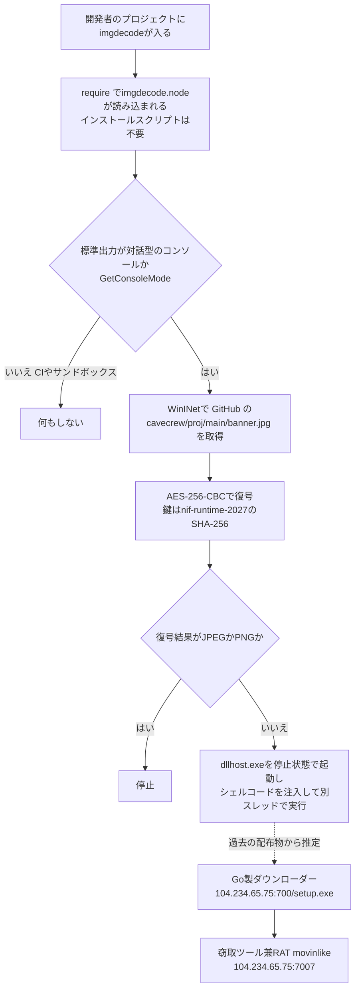

# npm「imgdecode」 ― require()だけでシェルコードを取得する悪性パッケージ

## 要点

### 影響バージョン

- 対象：npm パッケージ `imgdecode` 1.0.0〜1.0.3（公開者 `malfexteste8`）。1.0.0 は9月30日、最新の 1.0.3 は10月11日に公開された（SafeDep）。
- 関連して、すでに削除された `imgbundle` 1.0.0〜1.0.2、`runhelper` 1.0.0、`cdn-img-fetch`、`img-to-native`、`native-runner` も同じ攻撃の部品である（SafeDep、The Hacker News）。
- 動くのは **Windows（x64）** で、標準出力が対話型のコンソールにつながっているときだけ。CIのジョブや、出力をリダイレクトするサンドボックスでは発動しない（SafeDep）。
- 筆者が10月18日 12時ごろ（日本時間）に npm のレジストリを確かめたところ、`imgdecode` は 1.0.0〜1.0.3 のすべてが取得可能なままで、非推奨の印も付いていなかった。npm の統計では、9月30日〜10月17日のダウンロード数は1,009件。SafeDep は、公開されたプロジェクトでこれを依存に持つものは見つからなかったとし、数字にはミラーやスキャナーの取得が含まれうるとしている（npm、SafeDep）。

### 今すぐやること

- 自社のリポジトリのロックファイルと、開発者の端末の `node_modules` に `imgdecode`、`imgbundle`、`runhelper`、`cdn-img-fetch`、`img-to-native`、`native-runner` がないか確かめる（SafeDep）。
- 見つかった、あるいは読み込んだ可能性があるWindows端末は、侵害されたものとして扱う。**再起動の前に**ネットワークから切り離してメモリを採取する。ローダーはシェルコードをメモリ上で動かすためである（SafeDep）。
- その端末に保存されていた、または使われた認証情報（ブラウザーのパスワードとセッションCookie、Discord のトークン、クラウドの鍵、SSHの鍵、npm と GitHub のトークン）を取り替える。シードフレーズを置いていた暗号資産のウォレットは、新しいウォレットに資金を移す（SafeDep）。
- `raw.githubusercontent[.]com/cavecrew/proj/`、`104.234.65[.]75`（ポート700と7007）への通信を遮断し、過去の通信を探す（SafeDep）。

## 概要

- MALFEX は、Windows の開発者を狙って npm に悪性パッケージを出す攻撃キャンペーンで、Checkmarx が10月5日に分析を公開した。報告によると2023年8月6日から5つの公開者名でパッケージを出しており、ポルトガル語を使う攻撃者と結び付けられている（The Hacker News、SafeDep）。
- 先行の報告が扱ったのは、取得・復号・実行を3つのJavaScriptパッケージに分けた「窃取ツールの連鎖」だった。SafeDep は、攻撃者が npm に削除されるたびに同じ役割の代わりを2日以内に出し、最後はローダーをコンパイル済みの Node.js ネイティブアドオン（`.node` という拡張子のDLL）に移したことを突き止めた。それが `imgdecode` である（SafeDep）。
- `imgdecode` の JavaScript は9行しかなく、同梱のDLLを読み込むだけである。DLLは、Node.js が読み込んだ時点で動き、GitHub から暗号化されたシェルコードを取得し、復号して、停止状態で起動した `dllhost.exe` に注入する（SafeDep）。
- 同じ GitHub の置き場所から過去に配られていたものは、Go 製のダウンローダーを経て、71.5MBの窃取ツール兼遠隔操作ツール（RAT）に至る。ただし、`imgdecode` が取りに行く `banner.jpg` は回収できておらず、同じものが配られたかは推定にとどまる（SafeDep）。

> この記事では、ベンダー・公的機関・研究者・報道で確認できた内容を「事実」、筆者の推測や意見を「考察」として分けて書いています。

## 何が起きたか（時系列）

| 日時（UTC） | 出来事 |
| --- | --- |
| 2026-09-26 | `cdn-img-fetch`（取得）、`img-to-native`（復号）、`native-runner`（実行）1.0.0 が公開される（SafeDep） |
| 2026-09-28 16:06 | npm が `native-runner` と `img-to-native` を削除（SafeDep） |
| 2026-09-30 03:29 | `imgbundle` 1.0.0 公開（復号の役。`img-to-native` の代わり）（SafeDep） |
| 2026-09-30 03:37 | `runhelper` 1.0.0 公開（実行の役。FFIライブラリ koffi で JavaScript からシェルコードを実行）（SafeDep） |
| 2026-09-30 16:13 | `runhelper` が取り下げられる（SafeDep） |
| 2026-09-30 22:32 | `imgdecode` 1.0.0 公開（実行の役をネイティブアドオンに）（SafeDep） |
| 2026-09-30 23:07 | `imgdecode` 1.0.1 公開（DLLが取得・復号・実行をすべて担う）（SafeDep） |
| 2026-10-01 17:48 | `imgdecode` 1.0.2 公開（SafeDep） |
| 2026-10-05 | Checkmarx が MALFEX の分析を公開（SafeDep） |
| 2026-10-07〜08 | npm が `imgbundle`、`cdn-img-fetch` を削除（SafeDep） |
| 2026-10-11 22:09 | `imgdecode` 1.0.3 公開（DLLは1.0.2と同じ。`imgbundle` への依存を外し、単独で動く）（SafeDep） |
| 2026-10-13 | SafeDep が分析を公開。この時点で `imgdecode` は npm に残っていた（SafeDep） |
| 2026-10-18 | 筆者の確認時点でも npm に残っている（npm） |

## 技術的な問題点（根本原因）

**事実（SafeDep）**

- `imgdecode` 1.0.3 の `index.js` は `./prebuilds/win32-x64/imgdecode.node` を `require()` し、何もしない `load()` を返すだけである。アーカイブの `package.json` にインストールスクリプトはなく、ネイティブのソースや `binding.gyp` もない。
- DLLは `napi_register_module_v1` を公開している。Node.js はアドオンを読み込むときにこの関数を呼ぶ。DLLは、モジュールの関数を返す前に悪性の処理を呼ぶ。つまり、**パッケージを `require()` した時点で、関数を1つも呼ばなくても動く**。1.0.1 以降はこの形である。
- SafeDep が保存していたレジストリのメタデータには `install: node-gyp rebuild` が載っていたが、アーカイブの `package.json` にはなかった。この食い違いを npm がインストール時にどう扱うかは確かめられていない。いずれにせよ、悪性の処理はビルドを必要としない。
- 1.0.0 は別の作りで、JavaScript の側で `process.stdout.isTTY` を確かめ、`imgbundle` が書き出した復号済みのファイルをアドオンの `decode()` に渡していた。これがのちのDLLのコンソール確認の原型になっている。

**考察**

npm のマルウェア対策としてよく勧められるのは、インストール時のスクリプト（`postinstall` など）を止めることだ。`imgdecode` はその対策の外側を通る。悪性の処理は「インストール」ではなく「読み込み」で動き、しかも中身は JavaScript ではなくコンパイル済みのバイナリなので、ソースを目で見る審査も、JavaScript の静的解析も役に立ちにくい。`prebuilds/` に置いたビルド済みのアドオンは正規のパッケージでも普通に使われる形で、それだけでは怪しまれない。攻撃者は、削除されるたびに「同じ役を別の方法で」作り直し、JavaScript での実行（`native-runner`）、FFIでの実行（`runhelper`）、ネイティブのDLLでの実行（`imgdecode`）と、検査しにくい方向へ移っていった。

## 攻撃・侵入経路

**事実（SafeDep、The Hacker News）**

- **コンソールの確認**：DLLは標準出力のハンドルを取り、`GetConsoleMode` を呼ぶ。出力がパイプやファイルに向いていると失敗し、何もせずに戻る。SafeDep はこれを、開発者の端末での実行に絞る仕掛けと推定している（SafeDep）。
- **文字列の隠し方**：URLや関数名などの文字列は、1バイトの鍵 `0x37` とのXORで隠されている。長い文字列は16バイトの塊で置かれ、`xorps` 命令で戻される（SafeDep）。
- **取得と復号**：WinINet で `hxxps://raw.githubusercontent[.]com/cavecrew/proj/main/banner.jpg` を User-Agent `Mozilla/5.0` で取得し、メモリに置いたまま Windows の暗号API（CNG）で復号する。鍵は `nif-runtime-2027` の SHA-256、方式は AES-256-CBC で、応答の先頭16バイトが初期化ベクトルになる（SafeDep）。
- **止める仕掛け**：復号した結果の先頭が JPEG（`FF D8`）か PNG（`89 50 4E 47`）なら処理をやめる。SafeDep は、攻撃者が「復号すると画像になるもの」を置けばローダーを止められる仕掛けと推定している（SafeDep）。
- **注入**：`%SystemRoot%\System32\dllhost.exe` を、窓もコンソールもない停止状態で起動し、`VirtualAllocEx` で読み書きできるメモリを取り、`WriteProcessMemory` で書き込み、`VirtualProtectEx` で実行可能に変え、`CreateRemoteThread` で先頭から動かす。`dllhost.exe` の本来のスレッドは止まったままである。注入に失敗したときは、Node.js のプロセスの中で同じものを動かす（SafeDep）。
- **その先**：GitHub のアカウント `cavecrew` は分析の時点で使えなくなっていたが、Internet Archive に10月6日の `banner.png` が残っていた。1×1の画像のあとに約8MBの暗号化データが続き、同じ鍵で復号すると、Checkmarx の指標にある Go 製のダウンローダー（SHA-256 `2f268ca7…`）になった。これは `http://104.234.65.75:700/setup.exe` を取得して実行する。`setup.exe` は10月13日にも配信されており、中身は Node.js 18 の `pkg` で固めた71.5MBの `movinlike` だった（SafeDep）。
- **movinlike の機能**（文字列からの推定で、SafeDep は実行の成功までは確かめていない）：仮想環境や解析ツールの確認、Chromium 系ブラウザーのパスワードと Cookie（Chrome のアプリ結合暗号鍵を取り出す処理を含む）、Discord のトークン（`discord_desktop_core/index.js` を書き換えてログイン情報を送らせる）、ブラウザー拡張と単体の暗号資産ウォレット、Steam・Epic Games・Riot・Battle.net・Minecraft・Ubisoft・Telegram Desktop のデータ、`seed`・`mnemonic`・`wallet`・`secret`・`token`・`senha` などを名前に含むファイルや `.kdbx`・`.pem`・`.ppk`・`.env` の収集。`ws://104.234.65[.]75:7007/agent` で命令を受け、シェルの実行、ファイルの転送、画面の取得、マウスとキーボードの操作ができる。Security と Sysmon のイベントログを書き換えてチェックサムを計算し直す機能もある（SafeDep）。

## なぜ防げなかったか・構造的要因の考察

1. **「インストールスクリプトを止める」対策の外側だった。** SafeDep は「パッケージが入っていれば、インストールスクリプトだけを止める対策ではこの実行経路は止まらない」と書いている（SafeDep）。`--ignore-scripts` は依然として有効な対策だが、それだけで npm のマルウェアを防げるわけではない（考察）。
2. **自動の検査をよける作りだった。** 出力がリダイレクトされる環境では動かないため、CIや、パッケージを自動で動かして調べるサンドボックスでは何も起きない。悪性の部分はバイナリの中にあり、文字列もXORで隠されている（SafeDep）。「CIで問題が出なかった」ことは、開発者の端末で安全なことを意味しない（考察）。
3. **削除しても、すぐに作り直された。** `native-runner` と `img-to-native` が消されてから2日以内に代わりが出て、`runhelper` が取り下げられた6時間後には `imgdecode` が出た。Checkmarx の報告の6日後に 1.0.3 が出ている（SafeDep）。個々のパッケージの削除は、攻撃者にとっては作り直しの合図にしかなっていない（考察）。
4. **報告のあとも残っている。** SafeDep の分析から5日たった10月18日の時点でも、`imgdecode` は npm から取得できた（npm）。利用者の側で名前を手がかりに止める仕組みがなければ、レジストリの対応を待つ間は無防備になる（考察）。
5. **狙いは開発者の端末そのもの。** 盗む対象には、ブラウザーのセッション、クラウドの鍵、SSHの鍵、npm と GitHub のトークンが含まれる。開発者の端末1台が、そのまま組織のソースコードや配布の仕組みへの入口になりうる（SafeDep、考察）。

## 運用者向けの具体的な対策と検知ポイント

**対策（事実に基づくもの）**

- 侵害が疑われる端末は隔離し、再起動の前にメモリを採取する。永続化の痕跡（下記）と、`node.exe` の子プロセスとしての `dllhost.exe` を確かめる（SafeDep）。
- 端末のイベントログは改ざんされている可能性があるため、外部に集めたログと突き合わせる（SafeDep）。
- 端末で使われた認証情報を取り替え、ウォレットの資金を移す（SafeDep）。

**検知ポイント（事実に基づくもの）**

- ネイティブのソースも `binding.gyp` もないのに `prebuilds/` にDLLを持つパッケージ。画像を扱うと言いながら、画像処理のコードがなく、WinINet や WinHTTP と `bcrypt.dll` を読み込むアドオン（SafeDep）。
- 親プロセスが `node.exe` で、`/Processid:` 引数のない `dllhost.exe`（SafeDep）。
- `node.exe` が `raw.githubusercontent.com` に接続した直後に、`dllhost.exe` が未知の宛先に接続する動き（SafeDep）。
- 永続化：`%APPDATA%\Microsoft\EdgeUpdate\MicrosoftEdgeUpdate.exe`、Run キーとスケジュールタスクの `MicrosoftEdgeUpdateService`、`%TEMP%\svc_update.exe`（SafeDep）。
- SafeDep が公開したYARAルール `MALFEX_imgdecode_native_addon`（3つのDLLのビルドすべてに一致し、better-sqlite3、koffi などの正規のアドオンには一致しない）と、各ファイルのSHA-256（SafeDep）。

**考察（運用上の工夫）**

- 社内の npm ミラーやプロキシで、公開から日の浅いパッケージや、ダウンロードの少ないパッケージの取り込みを遅らせる、あるいは審査を挟む。`imgdecode` は公開から2週間あまりで、累計のダウンロードも千件ほどだった。
- 依存の審査で、`prebuilds/` や `.node` のファイルを含むパッケージを別扱いにし、そのパッケージがネイティブのコードを必要とする理由があるかを確かめる。
- 開発者の端末を「CIと同じ程度に安全」とみなさない。開発者の端末にもEDRを入れ、`node.exe` からのプロセス生成や注入を監視の対象にしておきたい。

## 参考リンク

- [MALFEX Moves Its npm Loader into a Native Windows DLL（SafeDep、2026年10月13日）](https://safedep.io/malfex-imgdecode-npm-native-addon-loader/)
- [MALFEX npm malware campaign analysis（Checkmarx Zero、2026年10月5日）](https://checkmarx.com/zero-post/malfex-npm-malware-campaign-three-payloads-and-an-adversary-that-signs-their-work/)
- [imgdecode（npm）](https://www.npmjs.com/package/imgdecode?activeTab=versions)
- [MAL-2026-17330 imgbundle（OSV）](https://osv.dev/vulnerability/MAL-2026-17330)
- [MAL-2026-17332 runhelper（OSV）](https://osv.dev/vulnerability/MAL-2026-17332)
- [MALFEX npm Package 'imgdecode' Hides Shellcode Loader in Windows Native Addon（The Hacker News）](https://thehackernews.com/2026/10/malfex-npm-package-imgdecode-hides.html)
