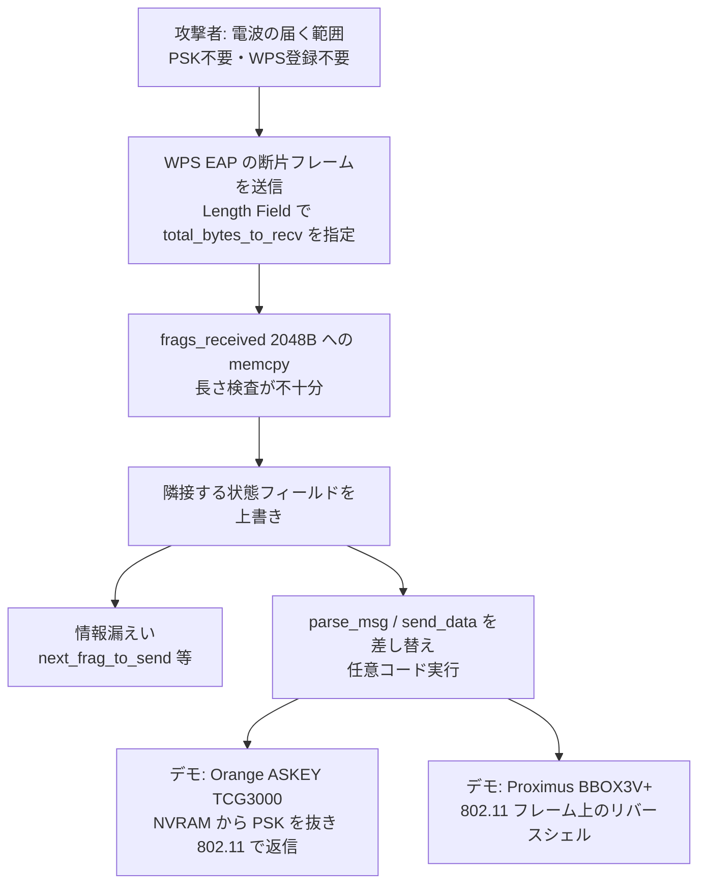

# Broadcom製Wi-Fi ― WPS処理の古い欠陥でルーターのrootに

## 要点

### 影響バージョン

- 対象は、Broadcom の SDK に含まれる独自の 802.11 実装で、WPS（Wi-Fi Protected Setup）を担う `wps_monitor`（eCos 版では WPSM）。公開されている Asus RT-N66U Merlin 向けソース（Copyright 2010）にも同じ断片組み立て処理がある（Kaiser、公開ソース）。
- **eCos 系**（BCM3380、BCM3383、BCM33834）は、Broadcom が hostapd への移行を勧めたあとも独自実装が残るため、**forever-day**（事実上直らない欠陥）と Kaiser は位置づけている（Kaiser）。
- **Linux 系**（BCM3390、BCM65xx、BCM68xx）は、OEM が hostapd に移せば直るが、移さない限り **potential forever-day** だとされている（Kaiser）。
- 影響ベンダー・機種は Cisco RV／WAP、Netgear、Sagemcom、ZTE、Nokia、TP-Link、Askey、Arcadyan など多数。一覧は不完全で、数千機種に及ぶ可能性がある（github.com/qkaiser/broadcom-wps）。
- CVE は割り当てられていない。Broadcom は CNA（CVE 番号を発行できる組織）であり、CERT/CC の VINCE 案件は Broadcom が CVE を出さないため当日に閉じられた（Kaiser）。

### 今すぐやること

- 自社・自宅のアクセスポイント／CPE が Broadcom 系かを、[指紋スクリプトと YARA](https://github.com/qkaiser/broadcom-wps/) で確かめる（Kaiser）。モニターモード対応の無線 NIC が必要。
- 影響が疑われる機種は、ベンダー／ISP に hostapd 移行やパッチの有無を問い合わせる。eCos 系は OEM 側の修正が期待しにくい（Kaiser）。
- 可能な範囲で **WPS を無効化**する。欠陥の入口は WPS の EAP 断片組み立てであり、通常の WPA 鍵を知らなくても届く（Kaiser）。無効化が設定画面にない機種もある（考察）。
- ホテル・近隣の Wi-Fi を踏み台にした攻撃の文脈（Nearest-Neighbour、CaptiveCrunch）を踏まえ、社用ノートが「信頼できない AP」に勝手につながらないよう、既知 SSID の自動接続を絞る（Kaiser が引用する Volexity／Microsoft の文脈、考察）。

## 概要

- Quentin Kaiser 氏が 2026年10月16日の Hexacon（パリ）で発表し、同日に長文の技術解説を公開した。Broadcom 独自の 802.11 実装にある WPS EAP の断片再組み立てに、少なくとも 2010 年から続くバッファオーバーフローがある（Kaiser）。
- Wi-Fi の事前共有鍵（PSK）を知らず、正規の WPS 登録も完了していない相手が、電波の届く範囲から情報漏えいと任意コード実行を起こせることを、Orange Belgium の ASKEY TCG3000 と Proximus の Sagemcom F@st／BBOX3V+ で実演した（Kaiser）。
- Broadcom には 7月18日と 7月27日に報告し、「パッチはある」との返答だったが、CVE も OEM 向け通知の写しも拒否された。2018 年に不完全な黙修正が出たあと hostapd 移行が推奨され、eCos では事実上 forever-day になった、と Kaiser は書いている（Kaiser）。

> この記事では、ベンダー・公的機関・研究者・報道で確認できた内容を「事実」、筆者の推測や意見を「考察」として分けて書いています。

## 何が起きたか（時系列）

| 日時 | 出来事 |
| --- | --- |
| 2010 ごろ | 公開されている Asus RT-N66U Merlin 向け Broadcom ソース（`ap_eap_sm.c`、Copyright 2010）に、同じ断片再組み立ての実装がある（Kaiser、公開ソース） |
| 2018 | Broadcom が不完全な修正を告知なしに出し、その後 hostapd への移行を推奨（Kaiser） |
| 2026-07-18 | Kaiser が Broadcom PSIRT に KS-20260718-02（eCos：BCM3380／3383／33834）を報告（Kaiser） |
| 2026-07-27 | KS-20260727-01（Linux：BCM3390、BCM65xx、BCM68xx）を報告（Kaiser） |
| 2026-07-28 | Broadcom が「パッチはある。影響機種があればメーカーに Broadcom へ連絡させるように」と返答（Kaiser） |
| 2026-07-29 | Broadcom が CVE 登録と OEM 通知の写し提供を拒否。Proximus・Orange Belgium・VOO・ベルギー Cyber Security Center へ連絡開始（Kaiser） |
| 2026-08-04 | CERT/CC VINCE 案件を開くが、Broadcom が CNA で CVE を出さないため当日に閉鎖（Kaiser） |
| 2026-10-15 | ベルギーの対象デモ機種はいずれも未パッチ、と Kaiser が確認（Kaiser） |
| 2026-10-16 | Hexacon で発表。指紋スクリプトと YARA、影響機種表を公開（Kaiser） |

## 技術的な問題点（根本原因）

**事実（公開 SDK ソース、Kaiser）**

- WPS の EAP メッセージは断片化できる。AP 側の状態構造体 `EAP_WPS_AP_STATE` には、組み立て先バッファ `frags_received[WPS_EAP_DATA_MAX_LENGTH]`（`eap_defs.h` で **2048** バイト）と、攻撃者が最初の断片の Length Field で指定する `total_bytes_to_recv`、これまでに書いた量を示す `total_received` がある（公開ソース）。
- 断片受信時は `memcpy` で `frags_received[total_received]` へ書き込む。長さの検査はあるが、バッファ上限 2048 に対する十分な抑えになっていない、というのが Kaiser の指摘の核である（公開ソース、Kaiser）。
- 同じ構造体の近くに、関数ポインタ `parse_msg` と `send_data` がある。Kaiser は悪用の部品を次のように整理している（Kaiser のスライド）。
  - `total_received` を操ると **任意書き込み**
  - `next_frag_to_send` を変えると **任意読み取り**
  - `parse_msg`／`send_data` を差し替えると **任意実行**
- トリガーは電波経由で、ネットワーク鍵の知識も通常の WPS 登録完了も不要（Kaiser）。

**考察**

長さフィールドを「信じる」古典的な再組み立て欠陥である。バッファ直後（または近傍）に制御用の関数ポインタが並ぶ状態構造体は、オーバーフローがそのまま制御フロー奪取につながる。2018 年の黙修正が不完全だった、という点は、OEM が「パッチ済み SDK」だと誤認しやすい構造的な問題でもある。

## 攻撃・侵入経路

**事実（Kaiser）**

- Orange Belgium の ASKEY TCG3000 では、認証なし RCE のあと NVRAM から PSK を取り出し、802.11 経由で攻撃者へ返し、その鍵で正規接続できることを示した。
- Proximus の BBOX3V+（Sagemcom F@st）では、同じく認証なし RCE のあと、クラウドの C2 を使わず 802.11 フレーム上でリバースシェルを成立させた。
- ベルギーの推計（IBPT と ISP の公開情報からの概算、中程度の確信度）：Proximus 約 85 万、VOO レガシー約 50 万、Orange Belgium 約 21 万 → **合計 150 万台超**。Telenet の Sagemcom は未確認。10月15日時点でデモ対象は未パッチ。
- Kaiser は、近隣 Wi-Fi を踏み台にする Nearest-Neighbour 攻撃（Volexity）や、ホテルネットワークを狙う CaptiveCrunch（Microsoft）のような文脈で、可視性の低い CPE 上の欠陥が好まれると指摘している。

## なぜ防げなかったか・構造的要因の考察

1. **チップベンダーが CVE を出さない。** Broadcom は CNA であり、CERT/CC 経由でも番号が付かない。OEM や ISP が「自分の製品の CVE」として追えない（Kaiser）。
2. **2018 年の黙修正と hostapd 推奨が、現場に届いていない。** 「パッチはある」と言われても、eCos では移行できず、Linux でも OEM が移さなければ残る（Kaiser）。
3. **サポート切れ・レガシー CPE の寿命が長い。** 欠陥の「賞味期限」は Kaiser の表現で 16 年。ISP 網に古いゲートウェイが大量に残る（Kaiser）。
4. **AI 支援で発見コストが下がった。** Kaiser は、単独なら何か月かかるとし、フロンティアモデルのエージェントで **1 週間未満**、スライド上の実費は **約 103€** だったと述べている（Kaiser）。同じ層を、防御側も攻撃側も短期間で掘れる時代になっている（考察）。

## 運用者向けの具体的な対策と検知ポイント

**対策（事実に基づくもの）**

- 指紋スクリプト（Broadcom 独自 IE＋ `wps_monitor` と hostapd の応答差）と、ファーム抽出後の YARA（`VULN_BRCM_WPS_EAP_Fragment_Reassembly_ELF` など）で対象を洗い出す（qkaiser/broadcom-wps）。
- 影響機種はベンダー／ISP にパッチまたは機種交換を求める。eCos 系は交換前提になりやすい（Kaiser）。
- WPS を無効化できる機種では無効化する（Kaiser の攻撃面の説明に基づく運用判断）。

**検知ポイント（事実に基づくもの）**

- モニターモードで、未認証端末からの異常な WPS／EAP 断片シーケンス（通常の登録フローに見えない Length／断片パターン）。エンタープライズの無線 IDS で取れるかは環境次第（考察）。
- ファームウェア差分で `wps_monitor` が残っているか、hostapd に置き換わっているか。

**考察（運用上の工夫）**

- 社用端末の「知っている SSID への自動接続」を減らし、ホテル・カフェのゲスト Wi-Fi を社内 VPN 前提にする。CPE 自体を監視できない前提の防御になる。
- 調達時に「Wi-Fi スタックが hostapd か独自か」をベンダーに文書で確認する項目を足す。

## 参考リンク

- [Quentin Kaiser — One Parser, Two Bugs, Many Routers（2026-10-16）](https://quentinkaiser.be/security/2026/10/16/one-parser-two-bugs/)
- [Hexacon スライド PDF](https://quentinkaiser.be/assets/qkaiser-broadcom-wps-hexacon-2026.pdf)
- [qkaiser/broadcom-wps — 指紋スクリプト・YARA・影響機種表](https://github.com/qkaiser/broadcom-wps/)
- [公開 Broadcom ソース例（asus-rt-n66u-merlin, ap_eap_sm.c）](https://github.com/shantanugoel/asus-rt-n66u-merlin/blob/ede220728e1eb417b4cc88912738b4311abdc088/release/src-rt/wps/common/ap/ap_eap_sm.c)
- [SecurityAffairs 要約](https://securityaffairs.com/201268/iot/16-year-old-broadcom-wi-fi-bug-lets-attackers-take-over-routers-without-a-password.html)
- [Volexity — Nearest Neighbor Attack（Kaiser が引用）](https://www.volexity.com/blog/2024/11/22/the-nearest-neighbor-attack-how-a-russian-apt-weaponized-nearby-wi-fi-networks-for-covert-access/)
- [Microsoft — CaptiveCrunch（Kaiser が引用）](https://www.microsoft.com/en-us/security/blog/2026/07/31/captivecrunch-midnight-blizzard-targets-travelers-worldwide-for-malware-delivery-and-credential-theft/)
