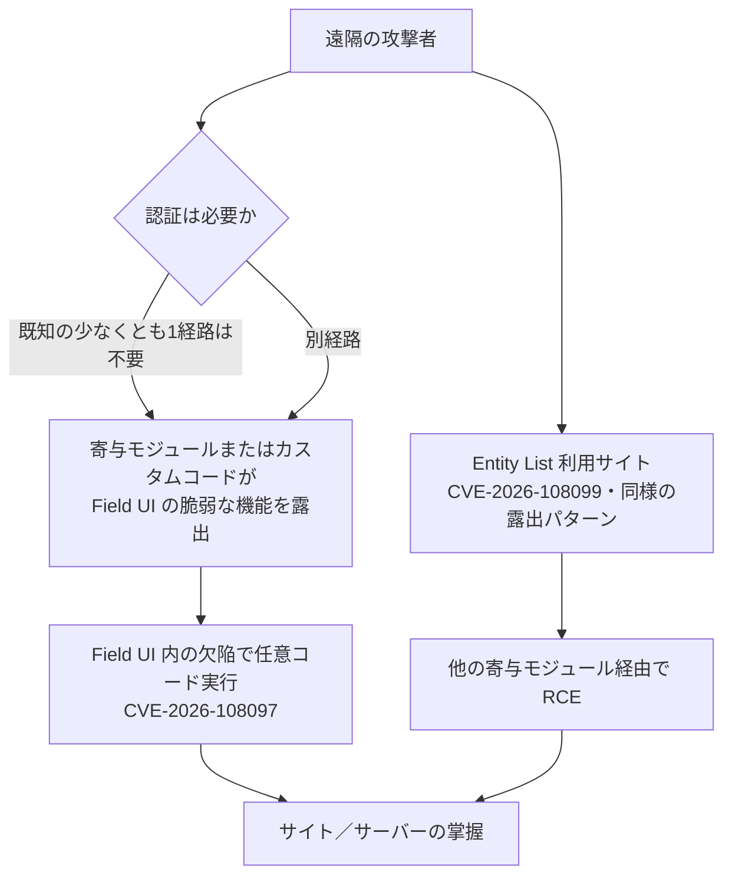

# Drupal core CVE-2026-108097 ― Field UIの致命的RCE

## 要点

### 影響バージョン

- **Drupal core（CVE-2026-108097 / SA-CORE-2026-014）**
  - 影響：`>= 8.9.0 < 10.6.19`、`>= 11.0.0 < 11.3.19`、`>= 11.4.0 < 11.4.10`、`>= 12.0.0-alpha1 < 12.0.0-beta2`（Drupal SA）。
  - 修正：**10.6.19**、**11.3.19**、**11.4.10**（および 12 系リリース側の対応）。リスク評価は Critical **19／25**（AC:Basic / A:None など）（Drupal SA）。
- **Entity List 寄与モジュール（CVE-2026-108099 / SA-CONTRIB-2026-218）**
  - 影響：`< 3.0.10`。修正：**3.0.10**。同様に Critical 19／25（Drupal SA）。
- コアの Field UI 欠陥は **コア単体では直接悪用できない**が、寄与モジュールが複数の深刻な経路を提供し、**少なくとも1つは認証不要**。カスタムコードも脆弱な機能を露出させうる（Drupal SA）。Entity List も「モジュール単体では直接悪用できないが、他の寄与モジュール経由で認証なし経路がある」と同型の説明（Drupal SA）。
- **EOL**：10.6.x より前のすべて、および 11 系の 11.3.x より前はサポート終了でセキュリティ修正の対象外（Drupal PSA／SA）。
- Drupal Steward は既知の一部経路を防ぐが、**すべての攻撃経路はカバーしない**（Drupal SA、PSA）。

### 今すぐやること

- サポート中ブランチへ上げる：**10.6.19** または **11.3.19**／**11.4.10**。Entity List を使っているサイトは **3.0.10** へ（Drupal SA）。
- すぐに上げられない場合は、コアの **Field UI（`field_ui`）をアンインストール**する。これが公式の緩和である（Drupal SA）。
- Steward 利用サイトも、追加経路が見つかる可能性に備え、近いうちにアップグレードする（Drupal SA）。
- EOL の 10.5.x 以前や 11.2.x 以前は、まずサポート中のマイナーへ移行してからセキュリティ更新を当てる（Drupal SA）。

## 概要

- Drupal Security Team は 10月12日の PSA（PSA-2026-10-12）で、10月14日 16:00〜21:00 UTC に全サポートブランチ向けの致命的コア更新があると予告し、「攻撃コードが数時間〜数日で出うるので時間を確保せよ」「10月14日より前に、その時点の最新パッチ（バグフィックス）版へ上げておけ」と書いた（Drupal PSA、BleepingComputer）。
- 10月14日、Field UI の RCE（CVE-2026-108097）と Entity List の RCE（CVE-2026-108099）が公開された。いずれも寄与モジュールやカスタムコードが経路になり、認証なしの既知経路が少なくとも1つある（Drupal SA）。
- 100万サイト超が Drupal を使うとされるなか、政府・大学・非営利での利用が多い、と BleepingComputer は位置づけている（BleepingComputer、Drupal の紹介ページ）。

> この記事では、ベンダー・公的機関・研究者・報道で確認できた内容を「事実」、筆者の推測や意見を「考察」として分けて書いています。

## 何が起きたか（時系列）

| 日時（UTC） | 出来事 |
| --- | --- |
| 2026-10-12 | PSA-2026-10-12 公開。10月14日 16:00〜21:00 UTC に Critical（19/25）のコア更新予定。Steward は一部経路のみ保護、と明記（Drupal PSA） |
| 2026-10-14 | SA-CORE-2026-014（CVE-2026-108097）と SA-CONTRIB-2026-218（CVE-2026-108099）を公開。修正版を配布（Drupal SA） |
| 2026-10-17 | BleepingComputer が両欠陥と更新手順、緩和（`field_ui` アンインストール）を報じる（BleepingComputer） |

## 技術的な問題点（根本原因）

**事実（Drupal SA）**

- 欠陥はコアの **Field UI モジュール**内のリモートコード実行。アドバイザリは、コアだけでは直接触れないが、寄与モジュールが「深刻な悪用経路」を複数提供し、そのうち少なくとも1つは認証不要、カスタムコードでも同様に露出しうると述べている。実装の行単位の説明や、具体的なモジュール名の列挙は SA 本文にはない。
- Entity List（Views なしでエンティティ一覧を作る寄与モジュール）にも、同趣旨の RCE がある。こちらも「単体では直接悪用できないが、他モジュール経由で認証なし経路がある」。
- 緩和として Field UI（`field_ui`）のアンインストールが有効、と明記されている。
- Steward による保護は「一部の既知ベクトル」に限る。

**考察**

「コア単体では届かない」は安心材料に見えて、実際の Drupal サイトの多くは寄与モジュールなしでは成り立たない。経路が寄与側に分散していると、コアの CVE だけを追う運用では、自サイトが「認証なし経路を持つ組み合わせ」かどうかが判別しにくい。PSA がアップデート窓口の前にバグフィックス版へ上げるよう求めたのは、セキュリティ当日に依存の衝突で手が止まるのを避けるためだろう。

## 攻撃・侵入経路

**事実（Drupal SA、PSA、BleepingComputer）**

- 悪用の前提は「Field UI（または Entity List）の脆弱な機能が、寄与モジュールやカスタムコード経由で外部から触れること」。SA は具体的なリクエスト例を公開していない。
- PSA 時点の評価も Critical 19／25。公表後、短期間で攻撃コードが出る可能性を Security Team が明示している。

## なぜ防げなかったか・構造的要因の考察

1. **コアと寄与の境界に欠陥がまたがる。** コアのモジュールが危険な機能を持ち、寄与がそれを「公開 API」のように露出する形は、コアの単体テストや Steward の「既知ベクトル」だけでは取り切れない（SA の記述からの考察）。
2. **EOL サイトの残留。** 10.6／11.3 未満は修正を受け取れない。PSA も「公開された他の欠陥も含め尽快上げよ」と書いている（Drupal PSA）。
3. **「Steward があるから大丈夫」は成り立たない。** 公式が繰り返し「全経路はカバーしない」と書いている（Drupal SA／PSA）。
4. **CMS の更新窓口運用。** 予告 PSA → 当日一斉公開は Drupal の定石だが、予約時間を取れない運用体制だと、公表直後の数日が最も危険になる（PSA、考察）。

## 運用者向けの具体的な対策と検知ポイント

**対策（事実に基づくもの）**

- コアを 10.6.19／11.3.19／11.4.10 へ。Entity List は 3.0.10 へ（Drupal SA）。
- 上げられない間は `field_ui` をアンインストール（Drupal SA）。本番で Field UI を常時有効にしているか棚卸しする。
- Steward 利用の有無にかかわらず、近いうちにアップグレード（Drupal SA）。
- EOL バージョンはサポート中ブランチへ移行（Drupal PSA／SA）。

**検知ポイント（事実に基づくもの）**

- サイトの Drupal バージョンと有効モジュール一覧（`field_ui`、`entity_list`、および Field UI を拡張する寄与）。
- 公表後の異常な POST／管理画面外からの Field UI 関連パスへのアクセス（一般論。公式 IOC は SA にない）（考察）。

**考察（運用上の工夫）**

- ステージングで「セキュリティ窓口の当日に一気に上げる」のではなく、PSA が出た時点で依存を最新パッチまで上げ、当日はセキュリティ差分だけを入れる。
- 寄与モジュールの「最終更新が古い」「メンテナ不在」を、Field UI 連携の有無とあわせてリスク表に載せる。

## 参考リンク

- [SA-CORE-2026-014 / CVE-2026-108097](https://www.drupal.org/sa-core-2026-014)
- [SA-CONTRIB-2026-218 / CVE-2026-108099（Entity List）](https://www.drupal.org/sa-contrib-2026-218)
- [PSA-2026-10-12 — 10月14日の致命的コア更新予告](https://www.drupal.org/psa-2026-10-12)
- [BleepingComputer 報道](https://www.bleepingcomputer.com/news/security/drupal-patches-critical-rce-flaws-warns-exploits-may-emerge-soon/)
