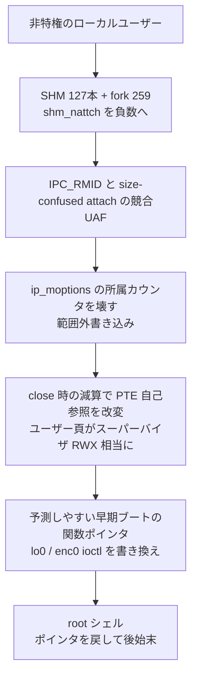

# OpenBSD「Big Fish」 ― 37年前からの欠陥でローカルroot

## 要点

### 影響バージョン

- Calif が実証したのは **OpenBSD 7.9**（KARL／SMAP／SMEP 有効、情報漏えいなしのローカル root）（Calif）。
- 修正：
  - **7.9**：errata **018**（2026-09-14、RELIABILITY — `shmat(4)` の整数オーバーフロー防止）、errata **026**（2026-09-30、SECURITY — 参照カウントのバグによるカーネル UAF）（OpenBSD errata、Calif）。
  - **7.8**：対応する **054**（RELIABILITY）と **062**（SECURITY）（OpenBSD errata、The Hacker News）。
- 適用手段は `syspatch`、または署名付きソースパッチ（`018_shmat.patch.sig`、`026_sysvipc.patch.sig`）からカーネル再構築（OpenBSD）。
- **CVE は未割り当て**。野生での悪用は報告されていない（Calif、The Hacker News）。
- 攻撃は **ローカル**（対象機で非特権コードを実行できること）が前提（Calif）。

### 今すぐやること

- OpenBSD 7.9／7.8 で `syspatch` を当て、**018／026（または 054／062）の両方**が入っているか確かめる。018 は「信頼性」ラベルのため、セキュリティだけを選ぶ運用だと漏れる（OpenBSD errata、The Hacker News）。
- パッチ後に再起動し、カーネルが新しい版になっていることを確認する（OpenBSD の通常手順）。
- マルチユーザーのシェルや、リモート欠陥でユーザー権限まで取られたあとの「二段目」として効く欠陥なので、共有ホストや踏み台の OpenBSD を優先する（考察）。

## 概要

- Calif の Andrew Griffiths 氏が 2026年10月16日に「Big Fish」を公開した。OpenBSD 7.9 で、KARL・SMAP・SMEP が有効なまま、情報漏えいなしにローカル root を取る連鎖を示し、PoC を GitHub に置いた（Calif）。
- 入口は System V 共有メモリの添付数 `shm_nattch` が、1988 年ごろの BSD 由来で **符号付き 16 ビット（`short`）** のまま残っていたこと。32767 を超えると負数に回り、参照カウント破壊と競合経由の UAF につながる（Calif）。
- OpenBSD は 9月に両欠陥を修正済みで、Calif はそのうえで詳細と PoC を出した。CVE はなく、悪用の報告もない（Calif、The Hacker News）。

> この記事では、ベンダー・公的機関・研究者・報道で確認できた内容を「事実」、筆者の推測や意見を「考察」として分けて書いています。

## 何が起きたか（時系列）

| 日時 | 出来事 |
| --- | --- |
| 約1988 | オリジナル BSD の `shm.h` で `shm_nattch` が `short` として定義される（Calif、weiss/original-bsd） |
| 2026 年前半 | Calif が OpenBSD に報告し、パッチ案も添えた（Calif） |
| 2026-09-14 | OpenBSD 7.9 errata 018（RELIABILITY：`shmat` 整数オーバーフロー防止）。7.8 は 054（OpenBSD errata） |
| 2026-09-30 | OpenBSD 7.9 errata 026（SECURITY：参照カウント UAF）。7.8 は 062。カーネル側で `shm_nattch` を `uint64_t` に拡げるなどの修正（OpenBSD errata、026 パッチ） |
| 2026-10-16 | Calif が「Big Fish」と PoC を公開。The Hacker News などが報じる（Calif、THN） |

## 技術的な問題点（根本原因）

**事実（Calif、OpenBSD パッチ）**

- `shm_nattch` は符号付き 16 ビットで上限 32767。Calif の手順では、SysV SHM を 127 本マップして `munmap` し、259 プロセスを fork して添付カウントを **-32643** まで回す（Calif）。
- 壊れた参照カウントのもとで `IPC_RMID` と、サイズの解釈がずれた別セグメントの attach を競合させ、**UAF** を起こす（Calif）。
- 別経路の範囲外書き込みで、`struct ip_moptions` 内のマルチキャスト所属カウンタ（`imo_num_memberships`／`imo_max_memberships`）を壊す。`close()` 時のリスト走査でアトミックな減算が走り、**PTE の自己参照マップ**がユーザーからスーパーバイザ RWX 相当へ変わる（Calif）。
- OpenBSD の KARL はカーネルバイナリの配置をランダム化するが、**ブート時・best-fit のアロケータにはベースのランダム化がない**。そのため同じハードでは、起動直後の構造体（例：`lo0`／`enc0` の ioctl ハンドラ）のアドレスが再現しやすく、情報漏えいなしで関数ポインタを狙える（Calif）。
- errata 026 のパッチでは、カーネル内部の `shm_nattch` を `uint64_t` に拡げ、ユーザーランド互換のため `ipcs` 向けには `SHRT_MAX` で頭打ちするなどの ABI 配慮が入っている（026_sysvipc.patch）。

**考察**

「カウンタが小さい」「ラベルが RELIABILITY」は、どちらも運用で見落とされやすい。セキュリティ神話の強い OpenBSD でも、アロケータの決定性と 37 年物の型定義が、現代のハード緩和（SMAP／SMEP）をまとめて迂回する足場になった。

## 攻撃・侵入経路

**事実（Calif）**

- 連鎖の要約は Calif の記事にステップ列として載っている。書き込みの「where」は予測可能なカーネルポインタ、「what」は SMAP／SMEP を避けるためスーパーバイザ権限にしたユーザー頁、「write」は `TAILQ_REMOVE` などに起因する、と整理されている。
- 緩和提案として、safe-unlinking（FreeBSD／NetBSD の `sys/queue.h` に先例）、PTE 自己参照スロットのランダム化、アロケータのベース／順序のランダム化、配列境界サニタイザ、Alloc Tokens などを挙げている（Calif）。

## なぜ防げなかったか・構造的要因の考察

1. **型が 37 年据え置きだった。** 当時の SHMSEG 上限では現実的でなかったオーバーフローが、いまのプロセス数では現実になった（Calif の PoC コメント、考察）。
2. **入口の修正が「信頼性」扱い。** 018 だけを「セキュリティではない」と後回しにすると、026 を当てても連鎖の片翼が残る（THN、考察）。
3. **KARL だけではアロケータが読める。** バイナリの並び替えと、ヒープ／ブート割当の決定性は別問題だった（Calif）。
4. **クラス単位の緩和が未導入。** Calif が挙げる safe-unlinking や境界サニタイザは、個々のバグを潰すより先に「同じ型の primitive」を高くする方向である（Calif、考察）。

## 運用者向けの具体的な対策と検知ポイント

**対策（事実に基づくもの）**

- `syspatch` で 7.9 なら 018＋026、7.8 なら 054＋062 を適用し再起動する（OpenBSD）。
- ソースから追う場合は公式の署名付きパッチを `signify` で検証してから当てる（OpenBSD errata の手順）。

**検知ポイント（事実に基づくもの）**

- 短時間に大量の `shmget`／`shmat`／`fork`、異常な `IPC_RMID` 競合、マルチキャストオプションを伴うソケットの開閉が続く動き（PoC の振る舞いからの運用仮説であり、公式 IOC ではない）（考察）。
- パッチ適用状況：`syspatch -l` や errata 番号の有無。

**考察（運用上の工夫）**

- 「セキュリティ errata だけ自動適用」にしている環境は、今回のような RELIABILITY ラベルの入口を取りこぼす。OpenBSD では errata をラベルで絞り込まず、サポート中リリースの errata をまとめて追う方が安全、という運用方針が取りうる。
- Calif の硬化提案は上流への要望として追跡し、自組織のカーネルカスタムがある場合は safe-unlinking 等の移植可否を検討する。

## 参考リンク

- [Calif — Big Fish: Exploiting a 37-Year-Old Kernel Bug in OpenBSD（2026-10-16）](https://calif.io/research/big-fish)
- [PoC（califio/publications, MADBugs/openbsd）](https://github.com/califio/publications/tree/main/MADBugs/openbsd)
- [OpenBSD 7.9 Errata](https://www.openbsd.org/errata79.html)
- [OpenBSD 7.8 Errata](https://www.openbsd.org/errata78.html)
- [The Hacker News 報道](https://thehackernews.com/2026/10/researchers-demonstrate-openbsd-root.html)
- [weiss/original-bsd — 歴史的な shm.h](https://github.com/weiss/original-bsd/blame/master/sys/sys/shm.h#L33)
