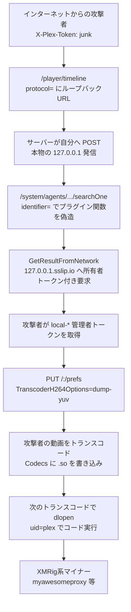

# Plex2Shell ― 認証なしのSSRFから管理者トークン、コーデックのdlopenへつなぎ、公開翌日にマイナーと住宅IP用プロキシが配られた

## 要点

### 影響バージョン

- **Plex Media Server 1.43.3.10861 未満**が影響を受ける。それ以降は対象外（Plex、zmain）。PoCのREADMEは「1.43.3.10828 未満」とも書いているが、修正が入った公開版は 1.43.3.10861（Plex、GitHub plex2shell）。
- 関連する4件のCVEは次のとおり。つなぐと認証なしのリモートコード実行になる（Plex、zmain、The Hacker News）。
  - CVE-2026-96652 — `/player/timeline` 経由の認証なしSSRF（CVSS 5.3）
  - CVE-2026-96654 — ループバック上のエージェントAPIと `searchOne` の `identifier=` 注入（CVSS 6.9）
  - CVE-2026-96655 — 所有者トークンでのトランスコーダー経由SSRFと任意パスへの書き込み（CVSS 5.3）
  - CVE-2026-96656 — Codecs ディレクトリ上の未署名 `.so` の `dlopen` によるコード実行（CVSS 8.6）
- GitHub上のPoCは鎖全体のCVSS 3.1を 9.8（AV:N/AC:L/PR:N/UI:N）としている（plex2shell）。
- ポート32400をインターネットに出している家庭用NASやクラウド上のサーバーが主な対象（zmain、SecurityWeek）。

### 今すぐやること

- Plex Web の「設定 → 一般」で版が **1.43.3.10861 以上**であることを確かめる。古い場合はすぐ更新する（Plex）。
- インターネットから届く古いサーバーは、乗っ取られた可能性があるものとして扱う（Plex）。
- 次を探す（Plex、boredhackerblog）。
  - Plex が起動した見慣れないプロセス（`myawesomeproxy`、`mylovelyminer`、`x12345` など）
  - Codecs フォルダー内の見慣れない `.so` / `.dll`
  - `proxystream[.]st` への外向き通信、再生していないのに高いCPU使用率
- 痕跡がある、または否定できない場合は、古いデータディレクトリを流用せずクリーンに入れ直す。最低でも Codecs を空にし、`Preferences.xml` のトランスコーダー関連の設定を確認する。Plexアカウントから全デバイスをサインアウトし、パスワードを変える。Plexがマウントしていた共有や、同じマシン上の認証情報も漏れたものとして扱う（Plex）。
- 遠隔アクセスが不要なら「設定 → リモートアクセス」を切り、ポート32400の転送をやめる（Plex）。

## 概要

- 研究者 Zach Main（zmain）は、Plex Media Server のコンパニオンプロトコル、エージェントAPI、トランスコーダー、コーデックの読み込みを4段階でつなぎ、認証なしで `uid=plex` のコード実行に至る鎖を報告した。Plex は8月初旬に修正版を出し、9月1日に更新を呼びかけた（zmain、Plex）。
- 10月16日に技術詳細とPoCが公開され、10月17日には脆弱な版のハニーポットで、公開されたPoCと同じ経路の悪用が観測された。暗号通貨マイナー（XMRig系）と、住宅IPとして通信を中継させるプロキシウェアが落とされた（boredhackerblog、The Hacker News、SecurityWeek）。
- 10月19日、Plex はフォーラムで4件のCVEと「広く悪用されている」ことを追記し、古いインターネット向けサーバーは乗っ取られたものとして扱うよう求めた（Plex）。

> この記事では、ベンダー・公的機関・研究者・報道で確認できた内容を「事実」、筆者の推測や意見を「考察」として分けて書いています。

## 何が起きたか（時系列）

| 日時 | 出来事 |
| --- | --- |
| 2026-07-27 | Zach Main が Plex のセキュリティ窓口へ報告（zmain） |
| 2026-08-03前後 | 修正を含む Plex Media Server 1.43.3.10861 が Plex Pass のベータ更新に出る。セキュリティ修正として CompanionProxy と、ネットワーク経由での `TranscoderH264Options` 変更の封じが記載される（Plexフォーラム） |
| 2026-08-04 | Plex が受理し報奨金を支払う（zmain、SecurityWeek） |
| 2026-09-01 | Plex が「重要なセキュリティ更新」として全サーバー所有者に 1.43.3 への更新を呼びかけ。当時はCVEの詳細は未公表（Plex） |
| 2026-09-23 | CVE-2026-96652／96654／96655／96656 が割り当てられる（zmain） |
| 2026-10-16 | zmain が技術詳細と PoC（github.com/code-zm/plex2shell）を公開（zmain） |
| 2026-10-17 | boredhackerblog のハニーポットで悪用を確認。マイナーと後にプロキシウェアを観測（boredhackerblog） |
| 2026-10-19 | Plex がフォーラムにCVEの表と「広く悪用されている」との追記を公開（Plex） |

## 技術的な問題点（根本原因）

**事実（zmain、Plex）**

鎖は次の5段階で説明されている（zmain）。

1. **認証なしの自己宛SSRF（CVE-2026-96652）**  
   `/player/timeline` は WAN からの要求に `X-Plex-Token` ヘッダーの**有無**だけを見て、中身が正しいトークンかは見ない。プレイヤーの登録・購読・購読解除の流れで、コールバックURLに使う `protocol` パラメータが検証されずに埋め込まれる。`protocol` に `http://127.0.0.1:32400/...` を入れると、購読解除のときにサーバーが自分自身へ POST する（zmain）。

2. **ループバック専用のエージェントAPIと壊れたガード（CVE-2026-96654）**  
   `/system/agents/*` はループバックからの要求ではトークンなしで開く。`searchOne` の識別子チェックは `@lock` で包まれた内側関数の戻り値を捨てるため、未登録の識別子でも処理が続く。識別子は内部URLにそのまま埋め込まれるので、`?` と `#` で任意のプラグイン関数を呼べる（zmain）。

3. **所有者トークンの持ち出し（CVE-2026-96655 の前段）**  
   同梱の TheTVDB エージェントの `GetResultFromNetwork` に、`http://127.0.0.1` で始まるURLを渡すと、プラグイン枠が所有者の管理者トークン（`PLEXTOKEN`）を付けて外へ送る。`http://127.0.0.1.<攻撃者>.sslip.io/...` のように、文字列の先頭は `127.0.0.1` のまま、DNS解決先は攻撃者のIPにできる（zmain）。

4. **トランスコーダー経由の任意パス書き込み（CVE-2026-96655）**  
   所有者トークンで `/:/prefs` の `TranscoderH264Options` に x264 の `dump-yuv=<Codecs内のパス>:qp=0` を書き、攻撃者の動画をトランスコードさせると、復号フレームがビット単位で指定パスへ書かれる。パスのホスト制限はない（zmain）。

5. **Codecs ディレクトリの無条件 `dlopen`（CVE-2026-96656）**  
   トランスコーダー起動時、Codecs のセットディレクトリ内の `.so` を、署名も実行ビットも `lib` 接頭辞も見ずに `dlopen(RTLD_NOW)` する。コンストラクタだけを持つ共有オブジェクトでもコードが走る。PoCでは fork／execve でリバースシェルを返す（zmain）。

Plex の9月1日の案内は「複数のセキュリティ問題」とだけ書いていたが、10月19日の追記で上記4件のCVEと、つなぐと認証なしでPlexプロセス権限のコード実行になることを明示した（Plex）。

**考察**

1件ずつのCVSSは中程度でも、信頼境界のすき間が並んでいる。WANでは「トークンがあるか」だけ見て、ループバックではエージェントAPIを開き、内部向けの「`127.0.0.1` なら所有者トークンを付ける」という便宜が文字列の先頭一致のまま、デバッグ用の x264 オプションがネットワークから書き換えられ、コーデックの読み込みに署名検証がない。どれか1つでも欠けていれば、認証なしのRCEまでは届かなかった。家庭向けメディアサーバーでありながら、インターネットに出す前提の機能（リモート再生・コンパニオン）と、ローカル専用の深いAPIが同じプロセス・同じポートに載っていることが、鎖の土台になっている。

## 攻撃・侵入経路

**事実（boredhackerblog、The Hacker News、Plex）**

- ハニーポットでの最初の悪用は 2026-10-17。要求の例は、公開されたPoCと同じく `/player/timeline/subscribe` の `protocol=` にループバックの `searchOne` と `GetResultFromNetwork`、ホスト名に `sslip.io` を使う形だった。User-Agent は `Python-urllib/3.10`（boredhackerblog）。
- 観測された攻撃元IP（ハニーポット時点）：`91.92.40[.]202`、`176.65.139[.]228`、`45.194.92[.]222`（boredhackerblog、The Hacker News）。
- ペイロードの取得元として `217.60.194[.]116` が観測された。落とされたものの一例は、UPX圧縮された実行ファイルと Docker 関連のファイル、XMRig系のマイナー（プロセス名 `mylovelyminer`）、および `myawesomeproxy`（boredhackerblog）。
- `myawesomeproxy` を実行すると「このソフトウェアを動かすと、自分のインターネット通信が外部から使われる可能性に同意したことになる」という趣旨のメッセージが出る。関連ドメイン `ota.proxystream[.]st`、`global.relay.proxystream[.]st` は、Bitsight が 2026年8月に AISURU ボットネット／プロキシウェアと関連付けて指摘した系譜にある（boredhackerblog、The Hacker News）。
- Reddit 上では、同じ `mylovelyminer` が載った、とみられる報告がある。ただしそれらがすべて Plex2Shell 経由かは不明（boredhackerblog、The Hacker News）。
- Plex は10月19日、「広く悪用されている」「公開されたPoCの翌日以降、未更新のインターネット向けサーバーへの攻撃が広がっている」とし、落ちているものは暗号通貨マイナーと、被害者の回線を通すプロキシだと書いている（Plex）。

## なぜ防げなかったか・構造的要因の考察

1. **修正は出ていたが、詳細が遅かった。** 8月に修正版、9月1日に更新の呼びかけがあった一方、CVEと技術詳細の公開は10月中旬までなかった。boredhackerblog は、ハニーポットを立てても詳細が出るまでは偵察程度しか見えなかったと書いている。家庭用NASの自動更新の遅れと重なり、インターネットに古い版が残ったままPoCが出た（Plex、boredhackerblog、考察）。
2. **「家庭用」でもポートを開けると企業の境界になる。** 住宅回線上のPlexは、到達しやすい攻撃面であり、乗っ取ると住宅IPのプロキシとして使える。boredhackerblog は、企業がVPNやメールに使う経路になりうると指摘し、実際にプロキシウェアが観測された（boredhackerblog、考察）。
3. **信頼境界の積み重ね。** 「トークンの有無」「ループバックなら信頼」「`127.0.0.1` で始まるURLなら所有者トークン」「Codecs 内の `.so` はすべて読む」といった、それぞれは便利のための決定が、鎖の中ではすべて攻撃者に都合がよい（zmain、考察）。
4. **トランスコーダーとコーデックの読み込みが実行面だった。** メディア処理のデバッグ用スイッチと、署名のない共有ライブラリの一括読み込みが、管理者トークンを得たあとのコード実行の出口になった。バックアップや監視の対象外に置かれやすい「再生のためのプロセス」が、事実上のRCEだった（考察）。

## 運用者向けの具体的な対策と検知ポイント

**対策（事実に基づくもの）**

- 全Plex Media Server を 1.43.3.10861 以上にする。NASのパッケージ管理にまだ無い場合は、Plexのダウンロードページから手動で入れる（Plex）。
- リモートアクセスが不要なら切る。32400のポート転送をやめる（Plex）。
- 痕跡がある、またはインターネットに出ていた古い版を動かしていた場合は、クリーンインストールとアカウントの再設定を優先する（Plex）。
- 検知用のpcapとYARA／検出ルールは、研究者側（BoredHackerBlog の pcap リポジトリ、code-zm/plex2shell の `detection/`）が公開している（boredhackerblog、plex2shell）。

**検知ポイント（事実に基づくもの）**

- `/player/timeline` 系で、`protocol=` に `http://127.0.0.1` や自サーバーのアドレスが入る要求（zmain、boredhackerblog）。
- プロセス名 `myawesomeproxy`、`mylovelyminer`、見慣れない短い名前の実行ファイル（Plex、boredhackerblog）。
- Codecs ディレクトリへの突然の `.so` / `.dll` の出現、`Preferences.xml` の `TranscoderH264Options` に見慣れない `dump-yuv=`（Plex、zmain）。
- `proxystream[.]st` 系への通信、再生していないときの高いCPU（Plex、The Hacker News）。
- 上記の攻撃元IP・配布元IPへの通信（boredhackerblog）。ただしハニーポットで見た範囲に限る、と著者自身が注意している。

**考察（運用上の工夫）**

- 社内や個人のネットワークでPlexを動かす場合は、インターネット直結ではなくVPNやリバースプロキシの認証の後ろに置く。家庭向けソフトでも、ポートを開けると「境界上の機器」と同じ扱いになる。
- ベンダーが「セキュリティ更新」とだけ言って詳細を出さない期間は、インターネットに出ているインスタンスの更新を優先する運用ルールを決めておくとよい。今回のように、詳細公開の翌日に悪用が始まることがある。

## 参考リンク

- [Plex2Shell（zmain、2026年10月16日）](https://zmain.info/blog/plex2shell)
- [plex2shell PoC（code-zm / GitHub）](https://github.com/code-zm/plex2shell/)
- [Important security update for Plex Media Server（Plex Forums、2026年9月1日／10月19日追記）](https://forums.plex.tv/t/important-security-update-for-plex-media-server-v1-43-2-and-earlier/942319)
- [Plex vulnerabilities being exploited in the wild to drop a cryptominer（boredhackerblog、2026年10月17日）](https://www.boredhackerblog.info/2026/10/plex-vulnerabilities-being-exploited-in.html)
- [Hackers Exploit Plex2Shell Flaws to Install Crypto Miners and Linux Proxy Backdoor（The Hacker News）](https://thehackernews.com/2026/10/hackers-exploit-plex2shell-flaws-to.html)
- [Plex2Shell Exploit Chain Weaponized Against Plex Servers Hours After Disclosure（SecurityWeek）](https://www.securityweek.com/plex2shell-exploit-chain-weaponized-against-plex-servers-hours-after-disclosure/)
