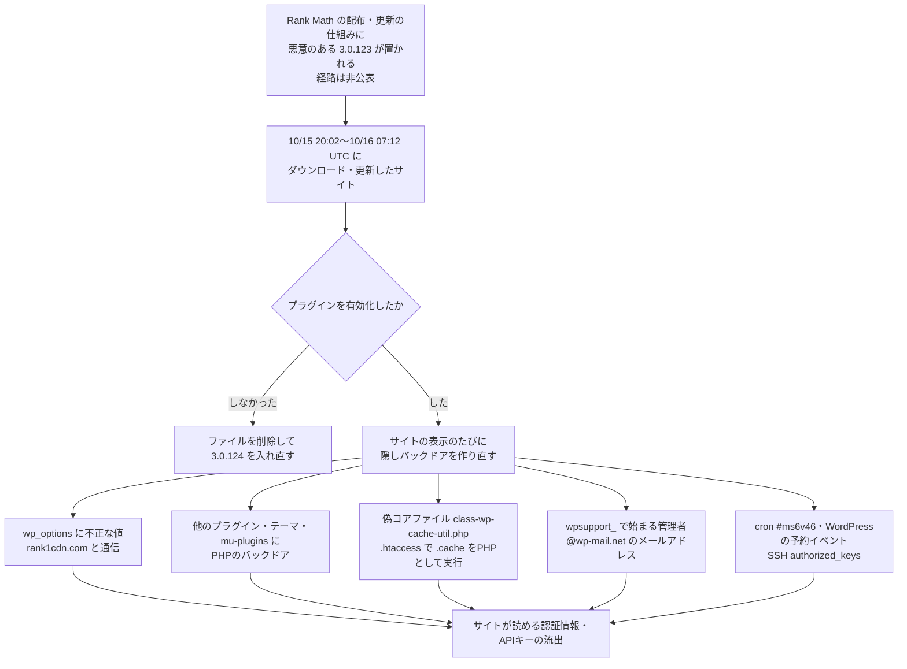

# Rank Math PRO ― 公式の配布物にバックドア混入

## 要点

### 影響バージョン

- 対象は有料版の **Rank Math PRO 3.0.123** のうち、**2026年10月15日 20:02 UTC 〜 10月16日 07:12 UTC**（日本時間 10月16日 05:02〜16:12、筆者換算）に rankmath.com からダウンロードした、または更新で受け取ったもの（Rank Math）。
- 3.0.123 自体は10月7日に公開された版で、その期間より前に入手した 3.0.123 は対象外。**版数だけでは改ざん版かどうか見分けられない**（Rank Math、The Hacker News）。
- 修正版（クリーンな版）は 3.0.124。ただし入れ替えても、すでに置かれたファイル・管理者アカウント・定期実行は消えない（Rank Math、The Hacker News）。
- WordPress.org で配布される無料版 Rank Math SEO は対象外（Rank Math）。
- CVE-2026-111862、CVSS 9.8（Wordfence 採番、Patchstack）。

### 今すぐやること

- 期間中に 3.0.123 を入れて**有効化した**サイトは、3.0.124 に更新済みでも乗っ取られたものとして扱う（Rank Math）。
- 10月15日 20:02 UTC より前のバックアップがあれば、サイトとデータベースを復元する。なければ、**次の3つを先に済ませてから**ほかの痕跡を探す（Rank Math）。
  - `rank-math-pro` フォルダーを丸ごと削除する（無効化だけでは不十分）。
  - `wp_options` から `option_name` が `_uf6qdn2hmm`・`t8krdk990phb`・`_np5pvf754c` の行を削除する。
  - `rank1cdn[.]com` への外向き通信を遮断する。
- 復元した場合も含め、WordPress・データベース・`wp-config.php` の鍵とソルト・決済やSMTPのAPIキー・ホスティングやSSHの認証情報をすべて変更する（Rank Math）。
- 3.0.124 は、メールのリンクではなく rankmath.com に直接ログインして入手する（Rank Math）。

## 概要

- Rank Math は10月16日、PRO 3.0.123 の一部の配布物にマルウェアが入っていたと公表した。公式サイトからのダウンロードと更新が対象で、プラグインを有効化するとサイトが乗っ取られうる（Rank Math、The Hacker News）。
- マルウェアはサイトが表示されるたびに隠しバックドアを作り直す。ほかのプラグインやテーマのフォルダー、`mu-plugins`、偽のWordPressコアファイル、`.htaccess`、cron、SSHの `authorized_keys` にまで痕跡を残しうる（Rank Math）。
- Rank Math は、どうやって配布物が書き換えられたか、何件に届いたか、自動更新でも配られたかを公表していない（The Hacker News、BleepingComputer）。

> この記事では、ベンダー・公的機関・研究者・報道で確認できた内容を「事実」、筆者の推測や意見を「考察」として分けて書いています。

## 何が起きたか（時系列）

| 日時（UTC） | 出来事 |
| --- | --- |
| 2026-10-07 | Rank Math PRO 3.0.123 が公開される（更新履歴の日付、Rank Math） |
| 2026-10-14 19:31 | 遮断対象のドメイン `rank1cdn[.]com` が登録される（The Hacker News がドメイン登録記録で確認） |
| 2026-10-15 20:02 | 改ざんされた 3.0.123 の配布が始まる（Rank Math） |
| 2026-10-16 07:12 | 配布期間の終わり（Rank Math） |
| 2026-10-16 | Rank Math がセキュリティのお知らせを公開し、クリーンな 3.0.124 を公開（Rank Math、The Hacker News） |
| 2026-10-17 | Wordfence が勧告を公開し、CVE-2026-111862（CVSS 9.8）を採番。Patchstack もバックドアとして登録（The Hacker News、Patchstack） |
| 2026-10-19 | The Hacker News、BleepingComputer、SecurityWeek が報道（各社） |

## 技術的な問題点（根本原因）

**事実（Rank Math、Patchstack、The Hacker News）**

- 問題はプラグインのコードの欠陥ではなく、Rank Math 自身の配布・更新の仕組みから悪意のあるファイルが配られたことにある。Patchstack は「Rank Math SEO PRO の基盤に対するサプライチェーン攻撃のため、緩和ルールは作れない」としている（Patchstack）。
- 3.0.123 は10月7日に公開された版で、改ざん版も同じ版数で配られた。Rank Math のお知らせは、対象を「期間中にダウンロード・更新で入手したもの」に限っている（The Hacker News、Rank Math）。
- WordPress.org はPRO版のチェックサムを公開していない。The Hacker News が10月19日にプラグインのチェックサムのサービスを確かめたところ、無料版の分はあったがPRO版の分はなかった。Rank Math も、有料プラグインではチェックサムによる確認ができない場合があるとしている（The Hacker News、Rank Math）。
- Rank Math は、悪意のあるファイルがどう配布・更新の仕組みに入ったか、何人の顧客が受け取ったか、自動更新で配られたか、正規版と改ざん版のハッシュ値を公表していない（The Hacker News）。

**考察**

利用者の側から見ると、「公式サイトから、正しい版数のプラグインを、正規の更新で受け取った」という、普段なら安全とされる条件がすべてそろっていた。更新を確かめる手がかりが版数しかなく、チェックサムも第三者の検証も用意されていない有料プラグインでは、配布元が書き換えられると利用者には見分ける手段がほとんど残らない。同じ版数で中身だけが差し替わったことも、「3.0.123 なら大丈夫」「3.0.123 なら危ない」のどちらの判断も成り立たなくしている。

## 攻撃・侵入経路

**事実（Rank Math）**

- マルウェアは持続的なアクセスを確保し、`rank1cdn[.]com` と通信し、サイトが表示されるたびに隠しバックドアを作り直す（Rank Math、BleepingComputer）。
- 手作業で掃除する場合、作り直す仕組みを止める前にファイルを消しても解決しないことがある。そのため Rank Math は、①プラグインのフォルダーの削除、②`wp_options` の3つの値の削除、③`rank1cdn[.]com` の遮断を先に済ませるよう指示している（Rank Math）。
- その後に調べる場所として、`wp-content/mu-plugins/`、ほかのプラグインのフォルダー、標準以外のテーマの `inc/`・`includes/`・`lib/`、Rank Math 自身の `includes/`、`uploads/` 内のPHPを挙げる。目印は、`base64_decode` とXORのループ、キー `xmmqhn`、`proc_open`、PHP-FPMのソケットを使うコード（Rank Math）。
- WordPressのコアファイルではない `wp-includes/class-wp-cache-util.php`、`.cache` ファイルをPHPとして実行させる `.htaccess` の規則、PHPコードを含む `.cache` ファイルも痕跡になる（Rank Math）。
- Webサーバーのユーザーのcrontabにある `#ms6v46` の付いた行、WordPressの予約イベント、SSHの `authorized_keys`、ほかのユーザーのcrontab、実行中のプロセス、Webサーバーが書き込めるサイト外の場所も確認対象（Rank Math）。

**事実（BleepingComputer）**

- BleepingComputer は VirusTotal で、Rank Math の指標と同じもの（`wpsupport_` の管理者アカウントと `@wp-mail.net` のアドレスを作るコード）を含むPHPの検体 `cache-preloader-fff033 (1).php` を見つけた。`class-wp-cache-util.php` のバックドアを作る第1段階のスクリプトとみられ、コマンドの実行、WordPressのデータベースの変更、AWS・Cloudflare・Google Cloud・Azureの認証情報やSSH鍵の窃取の機能があった。ただし、この検体が改ざん版のプラグインで配られたかは確認できていない（BleepingComputer）。
- Rank Math のお知らせとWordfenceの勧告は、コードの分析を載せておらず、攻撃者も名指ししていない（The Hacker News）。

## なぜ防げなかったか・構造的要因の考察

1. **有料プラグインの更新路は、ベンダー1社の仕組みに閉じている。** 無料版は WordPress.org を通り、チェックサムも公開される。有料版は各ベンダーが自前の配布・ライセンス・更新の仕組みを持ち、第三者の目も検証の手段も乏しい。The Hacker News は、今年少なくとも3度目の「有料プラグインのベンダーが運営する更新路からバックドア入りの版が配られた」事例だとし、4月の Nextend「Smart Slider 3 Pro」（約6時間）、6月の ShapedPlugin の Pro プラグイン（同じ版数で後から改ざん）を挙げている。今回と攻撃者を結び付ける公表はない（The Hacker News）。WordPressの利用者にとって、有料プラグインのベンダーの数だけ「更新サーバー」という攻撃面がある、という構造は今後も変わらない（考察）。
2. **WAFや脆弱性ルールでは止められない。** 改ざん版は正規の更新としてサイトの中に入り、管理者の操作で有効化される。Patchstack が「ルールは作れない」とした通り、外からの攻撃の通信を前提にした防御は効かない（Patchstack、考察）。
3. **自己修復型の持続化が、普段の対応手順を逆手に取る。** 「怪しいファイルを消す」「プラグインを更新する」という普通の対応では、表示のたびに作り直され、データベースにも値が残る。Rank Math が手順の順番を強調しているのはこのためで、更新して安心するのが最も危ない（Rank Math、考察）。
4. **Webサーバーの権限で届く範囲が広い。** 痕跡の一覧に、ほかのプラグイン、テーマ、`.htaccess`、cron、SSHの `authorized_keys` が並ぶことは、Webサーバーのユーザーがコードや設定やログイン手段まで書き換えられる構成が多いことを示している。プラグインの改ざん1件が、サーバー全体の乗っ取りにつながりうる（考察）。
5. **公表されていないことが多い。** 侵入経路、件数、自動更新の有無、ハッシュ値がわからないため、利用者は「期間中に入手したか」を自分の記録から確かめるしかない。ハッシュ値が公表されれば、手元のファイルが改ざん版かを機械的に判定できる（The Hacker News、考察）。

## 運用者向けの具体的な対策と検知ポイント

**対策（事実に基づくもの）**

- 期間中にPRO 3.0.123 を入れたかどうかを、ホスティングの記録、WordPressの更新記録、バックアップの差分などで確かめる。わからない場合は Rank Math のサポートに問い合わせる（Rank Math）。
- 有効化していた場合は、10月15日 20:02 UTC より前のバックアップから復元し、スキャンを行い、すべての認証情報を変えてから 3.0.124 を入れる（Rank Math）。
- 有効化していなかった場合は、プラグインのファイルを削除し、3.0.124 を入れ直してスキャンする（Rank Math）。
- 掃除の後は `wp core verify-checksums` と `wp plugin verify-checksums --all` で確かめる。PRO版はチェックサムがないため、公式から入手したクリーンなコピーと比べる（Rank Math、The Hacker News）。
- 数日間、外向きの通信と、削除したファイルが戻ってこないかを監視する。戻ってきたら掃除が不完全と考える（Rank Math）。
- Rank Math からのログインやダウンロードのリンクをメールで受け取っても開かない。同社はそうしたリンクを送らないとしている（Rank Math）。

**検知ポイント（事実に基づくもの）**

- `wp_options` の `_uf6qdn2hmm`・`t8krdk990phb`・`_np5pvf754c`（Rank Math）。
- `wp user list --role=administrator` で、`wpsupport_` で始まる管理者、`@wp-mail[.]net` のメールアドレス（Rank Math）。
- `wp-includes/class-wp-cache-util.php` の存在、`.htaccess` の `.cache` をPHPとして扱う規則、`uploads/` 内のPHP（Rank Math）。
- crontab の `#ms6v46`、`wp cron event list` の見慣れない予約イベント（Rank Math）。
- DNSやプロキシの記録で `rank1cdn[.]com` への問い合わせ（Rank Math）。

**考察（運用上の工夫）**

- 有料プラグインの自動更新を、本番に直接入れずに、検証環境で数日寝かせてから入れる運用を検討したい。今回の配布期間は約11時間で、お知らせは配布が止まったのと同じ10月16日に出ている。即日適用をやめるだけで避けられた可能性がある。ただし脆弱性の修正が遅れる副作用もあるため、更新の種類ごとに決めるとよい。
- Webサーバーのユーザーが、プラグイン・テーマ・コアのディレクトリや `.htaccess` に書き込めない構成（更新はデプロイの仕組みで行う）にすると、改ざん版が入っても持続化の手段が減る。
- Webサーバーからの外向き通信を、決済・メール・更新など必要な宛先に絞っておくと、今回のようなC2への通信を止めやすい。
- 秘密情報を `wp-config.php` やプラグインの設定に直書きせず、権限を絞ったキーを使うと、乗っ取られたときに変更すべき範囲と被害を小さくできる。

## 参考リンク

- [Rank Math PRO 3.0.123 Security Incident: How to Secure Your Website（Rank Math）](https://rankmath.com/kb/pro-3-0-123-security-incident/)
- [Rank Math PRO v3.0.123 Changelog（Rank Math）](https://rankmath.com/changelog/pro/v3-0-123/)
- [WordPress Rank Math SEO PRO Plugin 3.0.123 - Backdoor（Patchstack）](https://patchstack.com/database/wordpress/plugin/seo-by-rank-math-pro/vulnerability/wordpress-rank-math-seo-pro-plugin-3-0-123-unauthenticated-embedded-malicious-code-vulnerability)
- [Rank Math SEO PRO 3.0.123 malware（Wordfence、2026年10月17日。筆者の環境からは本文を取得できず、内容は The Hacker News の引用で確認）](https://www.wordfence.com/blog/2026/10/rank-math-seo-pro-3-0-123-malware/)
- [Popular WordPress SEO Plugin Rank Math PRO Hijacked to Deliver Self-Restoring Backdoor（The Hacker News）](https://thehackernews.com/2026/10/popular-wordpress-seo-plugin-rank-math.html)
- [WordPress SEO plugin Rank Math compromised to backdoor websites（BleepingComputer）](https://www.bleepingcomputer.com/news/security/wordpress-seo-plugin-rank-math-compromised-to-backdoor-websites/)
- [Rank Math PRO WordPress Plugin Compromised in Supply Chain Attack（SecurityWeek）](https://www.securityweek.com/rank-math-pro-wordpress-plugin-compromised-in-supply-chain-attack/)
