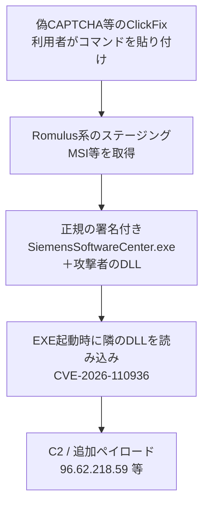

# Siemens Software Center CVE-2026-110936 ― 署名付き正規EXEの隣に置いたDLLが読み込まれ、Romulus系ClickFixの運び屋になった

## 要点

### 影響バージョン

- **Siemens Software Center の V4.0.9.8 未満のすべて**が CVE-2026-110936 の影響を受ける（Siemens SSA-580366）。
- CVSS v3.1 は 6.7（AV:L/AC:L/PR:H）、CVSS v4.0 は 8.4。CWE-427（制御されていない検索パス要素）（Siemens）。
- 既存のインストールは、次に起動したときに自動で 4.0.9.8 以降へ更新される。手動の入手先もアドバイザリに示されている（Siemens）。
- 攻撃で使われたのは、当時の最新に近い **3.5.8.7**。隣のヘルパーDLLを検証せずに読み込んでいた（Siemens ProductCERT のニュース）。

### 今すぐやること

- Siemens Software Center を起動して 4.0.9.8 以降へ更新する。業務で使っていないPCに入っていないかも確かめる（Siemens）。
- Webページの指示で Win+R や PowerShell にコマンドを貼り付けない。本物の「私はロボットではありません」はそう求めない（Siemens）。
- 次を探す・遮断する（Siemens）。
  - IP `96.62.218[.]59`、ドメイン `wizardexpensive[.]com`（稼働中のC2／配布）、IP `2.27.248[.]127`（配布に使われたが現在は停止）
  - 正規に入れていないのにスタートアップやタスクスケジューラに「Siemens Software Center」がある
  - `%LOCALAPPDATA%\Programs` 以下の `SM Software Provisioning Service`、`SiemensSoftwareCenter.exe` の隣の `activate.bak` / `statinfosta.DB`、`%LOCALAPPDATA%\FTSuite\ftc.uml`
- 見つかったら端末を隔離し、プロセスを止めてからスタートアップとタスクを消し、パスワードを変える。**SiemensのEXEのハッシュで見ない**。本物だからである（Siemens）。

## 概要

- Siemens ProductCERT は10月15日、Software Center のDLLサイドローディング欠陥 CVE-2026-110936 を公表し、10月17日に修正版、10月19日に悪用確認のニュースを出した（Siemens）。
- 攻撃者は、Siemensのシステムや更新路を破らず、正規の署名付きEXEを手元で悪意のあるDLLと並べて配った。ClickFix（偽のCAPTCHAなどで利用者にコマンドを貼らせる）キャンペーン「Romulus」と関連付けられている（Siemens、SecurityWeek）。
- Forescout は同名の配信パネル ROMULUS を分析し、正規ソフトを使ったサイドローディングや LegionLoader など複数の経路を持つ共用のClickFix基盤だと報告している。Siemensの件とのインフラの重なりを SecurityWeek が指摘している（Forescout、SecurityWeek）。

> この記事では、ベンダー・公的機関・研究者・報道で確認できた内容を「事実」、筆者の推測や意見を「考察」として分けて書いています。

## 何が起きたか（時系列）

| 日時 | 出来事 |
| --- | --- |
| （報告日不明） | Huntress Labs の Jose Oregon が欠陥をSiemensへ報告（SSA-580366） |
| 2026-09-28 | Huntress が、偽のChatGPT Custom GPTからClickFixへ誘導し、Canon／Stardockの署名付きソフトでサイドローディングするキャンペーンを報告（Forescoutが引用） |
| 2026-10-15 | Forescout が ROMULUS 配信パネルの分析を公開（Forescout） |
| 2026-10-15 | Siemens が SSA-580366（CVE-2026-110936）を公開（V1.0）（Siemens） |
| 2026-10-17 | SSA を V1.1 に更新し、修正版 V4.0.9.8 を明示（Siemens） |
| 2026-10-19 | SSA を V1.2 に更新。悪用確認のニュース記事を公開し、Romulus キャンペーンと関連付け（Siemens） |
| 2026-10-19 | SecurityWeek が報道。Forescout／Huntressの報告との手口の類似を指摘（SecurityWeek） |

## 技術的な問題点（根本原因）

**事実（Siemens）**

- Software Center は、購入ソフトのダウンロード・インストール・有効化・更新、無料試用の起動に使うクライアントである（Siemens）。
- CVE-2026-110936 は、制御されていない検索パスからDLLを読み込む欠陥である。認証済みのローカル攻撃者が、アプリケーションが探すディレクトリに細工したDLLを置くと、Software Center と同じ権限で任意のコードが実行される（SSA-580366）。
- 攻撃で使われた版 3.5.8.7 は、自分のフォルダー内のヘルパーファイルを検証せずに読み込んでいた。攻撃者は**改変していない**正規の署名付きEXEの隣に、自分で用意したDLLを置いた（Siemens ニュース）。
- Siemensは、自社のシステム・製品・更新路が破られた形跡はないとしている（Siemens）。

**考察**

「正規の署名付きバイナリ」は、多くの環境で許可リストや利用者の安心材料になる。しかしWindowsのDLL検索順では、EXEの隣に置かれたDLLが先に読まれることがあり、署名は隣のDLLまでは保証しない。サプライチェーンを破らずに「正規ソフト＋悪意のある隣」を配るだけで、署名の信頼を借りられる。ClickFixは、その束を利用者自身にダウンロード・実行させる役割を担う。

## 攻撃・侵入経路

**事実（Siemens）**

- キャンペーンは Romulus のマルチプラットフォーム ClickFix に関連付けられている（Siemens）。
- IoC（ニュース公開時点）：
  - `96.62.218[.]59` — ペイロード／C2（稼働）
  - `wizardexpensive[.]com` — 同上（稼働）
  - `2.27.248[.]127` — `AllMyBasic.msi` の配布（停止済みだが、過去に取った端末は感染しうる）
  - `AllMyBasic.msi` SHA-256 `f4d7c5321bb0d1bda439304a753bcf9b467b98ca53c7e9493b9c2c3451092e4a`
  - `archive.dll` SHA-256 `3fdcc7d7d049a89711fb31fb236940a1c5a09d899143ffd20c3c41fb1f2cf491`（Siemens）
- 感染の目安：正規に入れていないスタートアップ／タスク、`SM Software Provisioning Service` フォルダー、`activate.bak` / `statinfosta.DB`、`FTSuite\ftc.uml`、`msiexec` から起動された `%LOCALAPPDATA%\Programs` 配下の `SiemensSoftwareCenter.exe`（Siemens）。

**事実（Forescout、SecurityWeek）**

- Forescout が分析した ROMULUS は、トークン付きの `/s/<token>`（PowerShellステージ）と `/app/<token>`（トロイの木馬化したMSI）を持つ共用のClickFix配信基盤である。観測例として Stardock DeElevation のサイドローディング経路と、LegionLoader を落とす経路がある。運営者の正体は特定されていない（Forescout）。
- Forescout／Huntressの報告本文に Siemens Software Center は出てこない。一方 SecurityWeek は、重なるインフラと似たサイドローディングの手口から、Siemensのプログラムが同じ道具箱に加わった可能性があるとしている（SecurityWeek）。Siemens自身は脅威アクターを「Romulus multi-platform ClickFix campaign」と書いている（Siemens）。

## なぜ防げなかったか・構造的要因の考察

1. **署名は「ファイルが改ざんされていない」ことしか言わない。** 攻撃者はEXEを触らず、隣のDLLだけを用意した。ハッシュベースの許可リストや「Siemensの署名があるから安全」という判断は、この束では誤検知ではなく見逃しになる。Siemensが「指紋ではなくフォルダーと振る舞いを見よ」と書いているのはそのためである（Siemens、考察）。
2. **ClickFixは技術的な侵入ではなく、利用者の手を借りる。** 偽CAPTCHAで「このコマンドを実行して」と書かれれば、ブラウザやメールのサンドボックスの外で、利用者の権限のPowerShellやmsiexecが動く。エンドポイントの防御は、そのあとのサイドローディングとC2を見る必要がある（Forescout、Siemens、考察）。
3. **「業務で使っていないソフト」でも運ばれる。** Software Center はSiemens製品の利用者向けだが、攻撃の束としては、署名がある都合のよいEXEとして選ばれた可能性がある。正規に入れていないPCのスタートアップに出てきたら、業務ソフトの更新ではなく感染の兆候である（Siemens、考察）。
4. **ベンダーの更新路が無事でも、利用者は守られない。** 今回は更新サーバーの改ざんではなく、正規バイナリの再利用である。AOMEI Backupper の更新サーバー改ざん（本サイト 10/17）とは入口が違うが、「正規に見えるソフトが端末上で高い権限のコードを動かす」結果は似ている（考察）。

## 運用者向けの具体的な対策と検知ポイント

**対策（事実に基づくもの）**

- Software Center を 4.0.9.8 以降にする。起動で自動更新される（Siemens）。
- Siemens製品は公式の入手先からのみ入れる（Siemens）。
- 上記IoCをファイアウォール・プロキシ・DNSで遮断し、過去の通信を探す（Siemens）。
- 利用者向けに、Webページの内容を Run や PowerShell に貼らないよう周知する（Siemens）。

**検知ポイント（事実に基づくもの）**

- `%LOCALAPPDATA%\Programs` 配下から動く `SiemensSoftwareCenter.exe`、親プロセスが `msiexec`（Siemens）。
- 上記のフォルダー名・隣ファイル・`FTSuite`（Siemens）。
- ClickFix全般：`%TEMP%` からの長いPowerShell、`-NoProfile` / `-ep bypass` / `-w hidden` とURL付きの起動、10進表記のIPへのHTTP（Forescout）。
- ファイルのハッシュだけでSiemensのEXEを「安全」と判定しない（Siemens）。

**考察（運用上の工夫）**

- 許可リストは「発行者＋パス＋親プロセス」まで見ると、AppData配下の不意なSiemensやStardockを拾いやすい。
- エンジニアリング系のPCでは、試用やダウンロード用のクライアントが常駐しがちである。台帳にない Siemens Software Center がないか、定期的に確かめるとよい。

## 参考リンク

- [SSA-580366: DLL Sideloading Vulnerability in Siemens Software Center（Siemens ProductCERT）](https://productcert.siemens.com/productcert/html/ssa-580366.html)
- [Active Exploitation of CVE-2026-110936 in Siemens Software Center（Siemens ProductCERT、2026年10月19日）](https://productcert.siemens.com/news/2026/10/19/active-exploitation-of-cve-2026-110936-in-siemens-software-center/)
- [ROMULUS: Analysis of a New Multi-Payload ClickFix Delivery Platform（Forescout Vedere Labs、2026年10月15日）](https://www.forescout.com/blog/romulus-analysis-of-a-new-multi-payload-clickfix-delivery-platform/)
- [Siemens Software Center Vulnerability Exploited in ClickFix Malware Attacks（SecurityWeek）](https://www.securityweek.com/siemens-software-center-vulnerability-exploited-in-clickfix-malware-attacks/)
