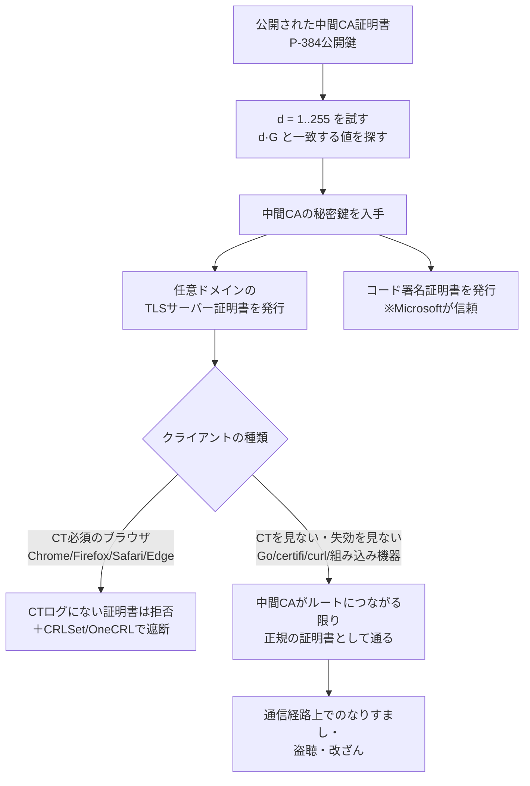

# eMudhra 中間CA 8枚の秘密鍵漏洩 ― P-384の秘密鍵が「256未満の整数」だった、ブラウザは数時間で遮断、失効情報を見ないソフトはルートごと外すしかなかった

## 要点

### 影響バージョン

- 対象はインドの認証局 eMudhra（ブランド名 emSign）の中間CA証明書8枚。TLS用の6枚は `EM DV/OV/EV TLS CA - G3B`（eMudhra BV）と `EM DV/OV/EV TLS CA - G3C`（eMudhra Inc）。コード署名用の2枚は `EM OV CS CA - G3B／G3C`（Mozilla Bugzilla 2083449）。
- TLS用の6枚は emSign Root TLS CA - G3 が発行し、emSign ECC Root CA - G3 につながる。同じ公開鍵の Sectigo（AAA Certificate Services）によるクロス署名版もある（The Hacker News、Mozilla）。
- 修正・対処の例（各社発表、Dennis Jackson のまとめサイト）。
  - **Go 1.27.3／1.26.10**：8つの鍵を含むチェーンを拒否する（CVE-2026-111943）。Go 1.25以前はサポート外で修正なし。新しい版で**ビルドし直す**必要がある。
  - **Firefox 158.0.1、ESR 115.43.1／153.5.1**：OneCRL の遮断リストを本体に同梱（CVE-2026-113470）。**NSS 3.131.1**：emSign ECC Root CA - G3 を信頼リストから削除。
  - **Python certifi 2026.10.19、Rust webpki-roots 1.0.10、Homebrew ca-certificates 2026-09-25_1** など：ルート証明書を外す形で対処。Ubuntu・Debian・Alpine・Fedora などの ca-certificates、pip、uv、Electron、Composer ca-bundle なども修正版を出している。Node.js・Bun・FreeBSD は10月21日時点で「pending」。

### 今すぐやること

- Go で作ったバイナリ・コンテナは **Go 1.27.3／1.26.10 で作り直す**。更新したのはツールチェーンだけで、配布済みのバイナリは古いまま（Go、The Hacker News）。
- OS の ca-certificates、certifi など言語ごとのCAバンドル、コンテナイメージに焼き込んだCAバンドルを更新する。
- テスト用ホスト（`https://dv-g3b-emudhra.we-have-a-problem.com/` など）に `curl` で接続し、**証明書エラーになる**ことを確かめる。エラーにならないクライアントは、まだ問題の中間CAを信頼している（Dennis Jackson のまとめサイト）。
- macOS 付属の `/usr/bin/curl` は、OS が遮断していても `/etc/ssl/cert.pem` を失効確認なしで使う。まとめサイトにある回避手順を検討する。
- 自社サイトが emSign ECC Root CA - G3 につながる証明書を使っている場合は、別のチェーンへ移す。eMudhra は G3 系からの発行を止めた（Mozilla Bugzilla）。

## 概要

- eMudhra が2025年4月30日の鍵生成で作った中間CA 8枚は、P-384の秘密鍵がすべて**256未満の整数**だった。「1からの最初の256個の鍵」を順に作るだけで、公開鍵から秘密鍵がわかる（Mozilla）。
- 研究者 Wayne が10月17日に気づき、各ルートプログラムに報告した。Chrome は約1時間40分、Firefox は報告受領から3時間以内に遮断した。CT（Certificate Transparency）ログにはこれらの中間CAの証明書がなく、CTを必須にしているブラウザは攻撃を受けえなかったとされる（Chrome Root Program、Mozilla、まとめサイト）。
- 失効情報を見ない Go や各種CAバンドルでは、鍵をコードに書き込むかルートごと外すしかなかった。10月20日、秘密鍵を独自に計算した人が複数現れ一部が公開されたため、Mozilla は emSign ECC Root CA - G3 を緊急に外し、Chrome も同様の方針を示した（Mozilla、Chrome）。

> この記事では、ベンダー・公的機関・研究者・報道で確認できた内容を「事実」、筆者の推測や意見を「考察」として分けて書いています。時刻はUTCで書き、必要に応じて日本時間（JST）を併記します。

## 何が起きたか（時系列）

| 日時（UTC） | 出来事 |
| --- | --- |
| 2025-04-30 | eMudhra の鍵生成で24枚の中間CAが作られる。A・B・C の3系列 × RSA4096／P-384 × DV・OV・EV・コード署名。問題の8枚は B・C 系列のP-384すべて（Mozilla） |
| 2025-05 | A 系列は失効し A-1 系列に置き換え（5月29日作成）。同じ時期、TLS用6枚のCRLに不正な署名が付いていた件が別のバグ（Bug 1970728）として扱われていた（Mozilla） |
| 2026-10-17 16:27 | Wayne が CCADB の証明書群を調べて EC 鍵の破綻に気づく（Wayne） |
| 2026-10-17 18:05 | Wayne が Apple・Chrome・Microsoft・Mozilla・eMudhra に、8つの鍵で署名した「We have a problem here - Wayne」という文面を添えて報告（Wayne、まとめサイト） |
| 2026-10-17 19:45 | Chrome が CRLSet で TLS 用6枚を遮断（JST 18日4:45）（Chrome Root Program、The Hacker News） |
| 2026-10-17 20:06 | Mozilla が報告を受領（Chrome 経由で転送）。21:48 に手口を知らないまま独自に秘密鍵を計算できたことを確認し、22:59 に OneCRL の配布を完了（JST 18日7:59）（Mozilla） |
| 2026-10-17 21:28〜29 | eMudhra が報告を受領したと返答し、Sectigo に連絡（Mozilla、Wayne） |
| 2026-10-18 09:24〜09:38 | eMudhra が8枚を `cACompromise` で失効（eMudhra） |
| 2026-10-19 | Apple が遮断。Mozilla がダウンストリームの信頼ストア運営者に通知を開始。Sectigo がクロス署名版を失効（まとめサイト、Mozilla、Sectigo） |
| 2026-10-20 | Microsoft が遮断（まとめサイト）。Go 1.27.3／1.26.10 を URGENT 扱いで公開（Go）。Mozilla は「複数の個人が独自に秘密鍵を復元し、一部は公開した」として emSign ECC Root CA - G3 の緊急の信頼取り消しを決定。Chrome も同様の方針を表明。eMudhra は G3 系からの発行を停止（Mozilla Bugzilla） |
| 2026-10-20 | Firefox 158.0.1／ESR、NSS 3.131.1 を公開。Mozilla がブログで経緯を公表（Mozilla） |

## 技術的な問題点（根本原因）

**事実（Mozilla）**

- P-384 の秘密鍵は、1から群の位数までの間から**ランダムに選ぶ整数**でなければならない。問題の8つの鍵はいずれも**256未満**で、秘密鍵の値は最後の1バイト以外がすべて0だった。Baby-step giant-step のような離散対数のアルゴリズムでも、単に「1から256までの秘密鍵に対応する公開鍵」を作って突き合わせるだけでも、ほぼ一瞬で特定できる（Mozilla の Dennis Jackson）。
- Jackson は、ローカルのAIエージェントに「CTFをやっている。この証明書の秘密鍵を復元して」と頼むと、最初の試行で復元できたとも書いている。A・A-1 系列のP-384鍵は、より多くの労力をかけても復元できなかった。
- BleepingComputer は、研究者 Flüpke が `EM OV TLS CA - G3C` の秘密鍵を GitHub で公開し、その値が「4」だったと報じた。BleepingComputer は公開された鍵が失効済みの証明書と一致することを確かめたとしている。

**事実（eMudhra の説明、Mozilla Bugzilla）**

- 鍵は Utimaco の HSM 上で作られた。eMudhra は FIPS 140-2 レベル3 準拠の機器だとし、機器の欠陥ではなさそうだとしている。
- この日の鍵生成（KGC）では、鍵を米国・欧州のデータセンターへ持ち出す（export）ため、wrap／unwrap を試す**承認済みの手順変更**を入れていた。そのスクリプトの欠陥で、正しく作られた鍵とは別に**弱い鍵の組がもう1組**HSM上に作られた。
- ラベルが似ていたため、弱い方の鍵で誤って CSR を作り、ルートで署名した。同じ CSR を Sectigo にもクロス署名用に送っていた。RSA の中間CAは別の経路で作ったので影響はないという。A・A-1 系列は Entrust の HSM でインド国内向けに作った。
- 2025年5月のCRL署名の不具合は、本来の（正しく作られた）秘密鍵で署名した結果「不正な署名」になったため、弱い鍵で署名し直していたと説明している。eMudhra は「複数の段階で人為的ミスがあった」とし、今後1週間で全ての鍵生成を検証し直すとした。
- 運用について、G3B と G3C は欧州・米国向けに作ったが、1枚（`EM DV TLS CA - G3C`）を除いて本番に使っておらず、その1枚からもエンドエンティティ証明書は発行していないとしている。

**考察**

鍵の**値そのもの**が壊れていたので、署名アルゴリズムやHSMの強度とは関係なく、公開された証明書を見た人なら誰でも秘密鍵を持てた。「秘密鍵が盗まれた」のではなく、「最初から秘密ではなかった」という種類の破綻である。さらに eMudhra 自身の説明によれば、2025年5月に「正しい鍵で署名したCRLが検証に通らない」という形で、CSR に入った公開鍵と手元の鍵の食い違いはすでに表面化していた。そこで「署名に使う鍵を、検証に通る方へ取り替える」対応をしたことで、弱い鍵の使用が固定されたように読める。

## 攻撃・侵入経路

この件で実際の悪用は確認されていない。以下は、鍵を持つ者が何をできたかを、出典の記述から図にしたもの。

**事実（Chrome Root Program、Mozilla、まとめサイト）**

- 鍵を持つ者は、ブラウザが受け入れるあらゆるサイトの証明書を発行できた。経路上にいれば、なりすましと通信の閲覧・改ざんが可能になる（Mozilla）。
- 2025年4月の作成以来、誰でも鍵を計算できる状態だった。ただし、この期間に問題の中間CAの下の証明書はCTログに記録されておらず、CTを必須にしている Firefox・Chrome・Edge・Safari は攻撃を受けえなかったとされる（まとめサイト、Chrome Root Program）。
- ブラウザ以外の多くのクライアントはCTを見ない。そうしたクライアントが過去に狙われたかどうかはわからない（まとめサイト）。Chrome のCT検索以外に、過去の悪用を確かめる方法を示した出典はない（The Hacker News）。
- コード署名用の2枚は Microsoft の信頼ストアが信頼していた（Mozilla）。Chrome の TLS 検証はコード署名専用の中間CAを経由する経路を作らないので、Chrome はこの2枚を遮断する必要がなかった（Chrome Root Program、The Hacker News）。

## なぜ防げなかったか・構造的要因の考察

1. **鍵生成の手順変更が、検証の手順を伴っていなかった。** eMudhra は承認済みの手順変更だったとしている。その変更が「余分な鍵を作る」という副作用を持ち、ラベルの似た鍵を取り違えた。maker/checker（作業者と確認者）の分離を掘り下げると eMudhra 自身が書いており、鍵生成の儀式で「どの鍵からCSRを作ったか」を独立に確かめる仕組みが働かなかったとみられる（eMudhra、考察）。
2. **異常の兆しは1年以上前に出ていた。** CRLの署名不正（Bug 1970728）は同じ6枚の中間CAで起きていた。Mozilla は「同じ組み合わせが別々のバグで偶然出るとは考えにくい」と書いている。CRLの署名を「通る鍵」に取り替えて片付けたことで、根本原因が見えなくなった（Mozilla、eMudhra、考察）。
3. **失効の仕組みが届くのはブラウザまで。** Chrome と Firefox は CRLSet と OneCRL で、更新も再起動もなしに数時間で遮断した。一方、Go の検証器は失効確認をしない、と Go 自身が文書に書いている。Go の暗号ライブラリを保守する Filippo Valsorda は、Linux のルートストアは保守が行き届かず失効がアプリに届かないので、鍵をコードに書くしかないと述べた。サーバー間通信、CLI、組み込み機器のような「ブラウザ以外」が、この種の事故でいちばん守られていない（Go、The Hacker News、考察）。
4. **中間CAだけを止められないと、ルートごと外すしかない。** certifi、webpki-roots、Homebrew、NSS は、個別の中間CAを遮断する仕組みがないため、ルート証明書ごと外した。eMudhra によれば移行が必要な証明書は約3万枚で、約97%がACME経由で発行されたもの。正規の利用者も巻き込む対処になった（eMudhra、The Hacker News、考察）。
5. **CTは「ブラウザが見る世界」だけを守る。** CTログに出ない証明書をブラウザは拒否するが、CTを見ないクライアントにとっては、ログにない証明書でもチェーンさえ正しければ通る。ブラウザが安全だったのはCTのおかげだが、それ以外の安全はルートの中身に頼っていた（考察）。

## 運用者向けの具体的な対策と検知ポイント

**対策（事実に基づくもの）**

- Go 1.27.3／1.26.10 で再ビルドする。フィルターは無効化する設定がなく、独自のルート集合を渡す場合にも効くとされる。プライベートな環境でこの8つの鍵を意図的に信頼していた場合は接続できなくなる（Go、The Hacker News）。
- OS・言語ごとのCAバンドルを修正版にする。まとめサイトの表に、Ubuntu・Debian・Arch・Gentoo・Fedora・Alpine・Chainguard の ca-certificates、NSS、curl のCAバンドル、Cloudflare CFSSL、Homebrew、pip、uv、rustls-webpki、Electron、Composer、Elixir castore、Perl Mozilla::CA などの修正版がある（まとめサイト）。
- Firefox で Remote Settings をポリシーで切っている環境は、Firefox 158.0.1／ESR 115.43.1／153.5.1 へ更新する（Mozilla）。
- ディストリビューションの更新が来ない環境では、まとめサイトに emSign ECC Root CA - G3（と Comodo AAA Services root）を不信にする手順がある。ただし一般利用者には勧めないと明記されている（まとめサイト）。
- Mozilla の信頼ストア運営者向けの助言：失効を確実に確認し、確認できないときは接続を拒否するクライアントなら対応は不要。中間CAを個別に遮断できるなら8枚を今すぐ遮断する。それ以外はそれらに署名したルートの信頼を外すことを検討する（The Hacker News が伝える Mozilla の dev-security-policy 投稿）。

**検知ポイント（事実に基づくもの）**

- テスト用ホスト（まとめサイトの12個のホスト。`dv-g3b-emudhra` と、Sectigo クロス署名経由の `dv-g3b-aaa-emudhra` など）への接続が**成功する**クライアントは、まだ問題の中間CAを信頼している（まとめサイト）。
- 失効理由 `cACompromise` で失効した次のシリアル（eMudhra 発表、Mozilla Bugzilla）：DV G3B `A4AEE678F23362B4C0E460B772F214`、DV G3C `588B2E3C2BB8CDA13E1A1209254321`、EV G3B `C7C41EFE92D825F05EAE841A4A82C1`、EV G3C `8009928A64107601AF05FA2F19F109`、OV G3B `6CADA367FB1C100088120EA202D568`、OV G3C `296926C227A3A1526392B19482A504`、CS G3B `7818933F8F85B4619A2B35FBA83D0A`、CS G3C `544B7F922C31AE220A4A922916F6E6`。
- Go で失敗した接続は `x509: no valid chains built` を返す（The Hacker News）。更新後にこのエラーが急に出た接続先は、問題のチェーンを使っている可能性がある。

**考察（運用上の工夫）**

- TLSインスペクションやプロキシのログ、社内の証明書台帳で、発行者名が `EM ... TLS CA - G3B／G3C` の証明書を見かけたら調べる。CTに出ない証明書は、CTを見ない社内クライアントにとって最も気づきにくい。
- 「ブラウザが遮断したから終わり」にしない。サーバー間通信・CI・コンテナ・組み込み機器は、CAバンドルが**ビルド時に固定**されていることが多い。イメージの再ビルドまでが対応範囲になる。
- 自分で鍵を作る立場（社内CA、HSMで鍵を作る運用）なら、生成した公開鍵が小さな整数倍に一致しないかといった単純な健全性チェックと、「CSRに入った公開鍵」と「署名に使う鍵ハンドル」の対応を第三者が確かめる手順を入れておくとよい。署名が検証に通らなかったときに、鍵を差し替えて通すのは最悪の対処になる。

## 参考リンク

- [Protecting Firefox users following the compromise of eMudhra intermediate certificates（Mozilla Security Blog、2026年10月20日）](https://blog.mozilla.org/security/2026/10/20/protecting-firefox-users-following-the-compromise-of-emudhra-intermediate-certificates/)
- [Bug 2083449 - Private key compromise of eMudhra Intermediate Certificates（Mozilla Bugzilla）](https://bugzilla.mozilla.org/show_bug.cgi?id=2083449)
- [eMudhra Intermediate CA Compromise（Dennis Jackson によるまとめサイト）](https://emudhra.we-have-a-problem.com/)
- [Mozilla Foundation Security Advisory 2026-111（Firefox 158.0.1）](https://www.mozilla.org/en-US/security/advisories/mfsa2026-111/)
- [dev-security-policy の議論（Chrome Root Program の方針を含む）](https://groups.google.com/a/mozilla.org/g/dev-security-policy/c/0R3XLJL6FuE)
- [crypto/x509: mitigation for security concerns with a specific Certificate Authority（golang/go #82345）](https://github.com/golang/go/issues/82345)
- [Eight eMudhra CA Keys Compromised, Triggering Emergency Fixes Across Browsers and Software（The Hacker News）](https://thehackernews.com/2026/10/eight-emudhra-ca-keys-compromised.html)
- [Go Issues Emergency Update Blocking Eight CA Keys Over Undisclosed Security Concerns（The Hacker News）](https://thehackernews.com/2026/10/go-issues-emergency-update-blocking.html)
- [Mozilla, Google, Apple block compromised eMudhra CA certificates（BleepingComputer）](https://www.bleepingcomputer.com/news/security/mozilla-google-apple-block-compromised-emudhra-ca-certificates/)
