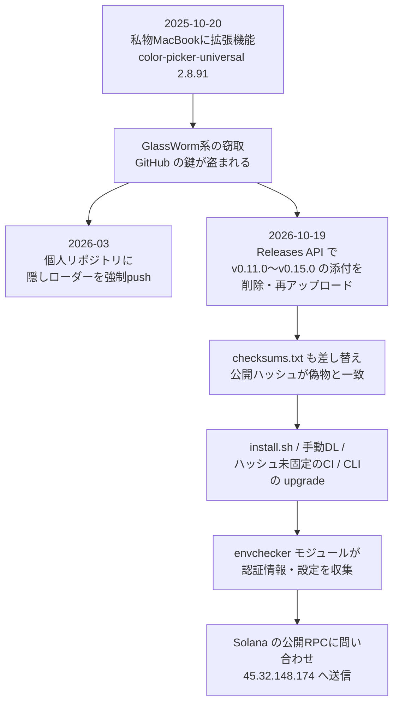

# OVHcloud CLI のリリース差し替え ― 1年前に拡張機能で盗まれた開発者の鍵で、公開済み5リリースのバイナリとチェックサムが93分間すり替わった

## 要点

### 影響バージョン

- **ovhcloud-cli v0.11.0〜v0.15.0** のリリースから、**2026年10月19日 14:47〜16:21（UTC+2、JST 21:47〜23:21）** にダウンロード・インストール・更新したもの（OVHcloud セキュリティアドバイザリ GHSA-862f-55f5-vmvw）。
- 差し替えられたのは macOS（x86_64／arm64）、Linux（x86_64／arm64）、Windows x86_64 の5種のアーカイブと `checksums.txt`。Linux i386、Windows i386／arm64、WebAssembly 版は手付かず（OpenSourceMalware、The Hacker News）。
- 影響なし：**v0.10.0 以前、v0.16.0 以降**、この時間帯より前に入れて更新していないもの、ソースからのビルド、`go install`（OVHcloud、The Hacker News）。
- OVHcloud が示したダウンロード数は**約250**（OVHcloud）。

### 今すぐやること

- 該当時間帯にインストール・更新した可能性があるなら、**実行せずに**手元のバイナリのMD5をアドバイザリの一覧と照合する。一時フォルダに `envchecker-数字` というフォルダがあれば実行された痕跡（OVHcloud）。
- 該当したら、**そのマシンから読めた秘密をすべて失効・再発行する**。クラウドの認証情報（AWS・GCP・Azure・DigitalOcean・OVHcloud）、SSH鍵、Kubernetes・Docker・npm・Terraform の設定、`.netrc`、AIコーディングツールのデータなど（OVHcloud）。OpenSourceMalware は別のマシンから作業するよう勧めている（The Hacker News）。
- バイナリを消し、**v0.16.0** を入れる。v0.16.0 は不変（immutable）リリースで、リリースの証明（attestation）が付く。`gh release verify-asset v0.16.0 <ファイル>` で照合できる（OVHcloud、The Hacker News）。
- 自分の組織の GitHub で **immutable releases** を有効にする。有効化より前に作ったリリースは保護されない点に注意する（GitHub、The Hacker News）。

## 概要

- 10月19日、OVHcloud の開発者の GitHub アカウントを使って、公開済みの5つのリリースのバイナリがマルウェア入りのものに差し替えられた。`checksums.txt` も差し替えられたので、公開されたハッシュは偽のバイナリと一致していた（OVHcloud、OpenSourceMalware）。
- 気づいたのは、Linux arm64 版の SHA-256 を自前で固定していた顧客のCIだった。顧客が公開Issueで報告し、OVHcloud は約30分後に偽のファイルを消した。ソースコード、タグ、ビルドの仕組みは改ざんされていない（OVHcloud、GitHub Issue #300）。
- OVHcloud は、鍵が盗まれたのは2025年10月20日、開発者が私物の MacBook に拡張機能 `color-picker-universal 2.8.91` を入れたときで、GlassWorm と結び付く Solana ウォレットが使われていたと説明した。根本原因はリリースの不変化を有効にしていなかったことだとしている（OVHcloud）。

> この記事では、ベンダー・公的機関・研究者・報道で確認できた内容を「事実」、筆者の推測や意見を「考察」として分けて書いています。

## 何が起きたか（時系列）

時刻は OVHcloud のアドバイザリにならい UTC+2（パリ時間）で書く。日本時間は7時間足す。

| 日時 | 出来事 |
| --- | --- |
| 2025-10-20 | 開発者が私物の MacBook に拡張機能 `color-picker-universal 2.8.91` を入れる。拡張機能は GlassWorm のものとして知られる Solana ウォレットを使って通信し、永続化した Node.js のサービスが `162.33.177[.]177` と通信していた（OVHcloud） |
| 2026-03-05〜06 | 同じアカウントの個人リポジトリ4つが、隠しローダー入りのコミットで書き換えられ強制 push される。同じウォレットが使われていた（OVHcloud、OpenSourceMalware） |
| 2026-10-19 14:47 | v0.15.0 の macOS 版が差し替えられる（OVHcloud） |
| 2026-10-19 14:57 | v0.15.0 の全バイナリが差し替えられる（OVHcloud） |
| 2026-10-19 15:30 | v0.15.0〜v0.11.0 のバイナリが差し替えられる（OVHcloud） |
| 2026-10-19 15:50 | 顧客が GitHub Issue #300 で報告（OVHcloud） |
| 2026-10-19 16:21 | 偽のバイナリをすべて削除。公開は約1時間33分（OVHcloud） |
| 2026-10-19 18:52 | OVHcloud が X で公表（OVHcloud） |
| 2026-10-19 19:16 | 署名付きタグで v0.16.0 を不変リリースとして公開（OVHcloud） |
| 2026-10-20 14:49 | OVHcloud がアドバイザリ GHSA-862f-55f5-vmvw で詳細を公表（GitHub） |

## 技術的な問題点（根本原因）

**事実（OVHcloud）**

- OVHcloud は根本原因を「GitHub リポジトリがリリースの不変性を確保するよう適切に設定されていなかった」ことだとし、すぐに修正し、全リポジトリに同じ設定をしたと書いている。
- 差し替えに使われたのは開発者の GitHub アカウントの盗まれた鍵で、私物の MacBook そのものから操作されたわけではない。OVHcloud 支給のノートPCは、現時点で侵害されていないとしている。
- 本番用のCI/CDは社内の非公開 Git で運用しており、侵害されていない。GitHub は顧客・コミュニティ向けに公開するプロジェクトに使い、組織の管理、2FAの必須化、アカウントの台帳管理はしていたが、開発者が**個人の GitHub アカウントを組織に登録できる**運用だった。

**事実（The Hacker News、OpenSourceMalware）**

- GitHub では、リポジトリへの書き込み権限を持つ人は、リリースに付いたファイルを消して同じ名前で上げ直せる。immutable releases を有効にしていない限り、ダウンロードURLも変わらない。この機能は2025年10月に一般提供になったが、有効化した後に作ったリリースしか守らない（The Hacker News、GitHub）。
- 差し替えは Releases API 経由で、リリース用のワークフローは動いていない。10月16日から v0.16.0 のタグ push まで、Actions の実行記録は1件もない（OpenSourceMalware）。
- 差し替えに使われたアカウントは、OVHcloud のドキュメントリポジトリなどに貢献している開発者のもので、組織の公開メンバーではなかった。CODEOWNERS で全体を任されたチームを通じて書き込み権限を持っていたとみられる（OpenSourceMalware）。

**考察**

GitHub のリリースは「タグとソースに対して不変」に見えるが、実際には添付ファイルは書き込み権限のある誰でも後から入れ替えられる「置き場」だった。しかも `checksums.txt` が同じ置き場にあるので、利用者がリリース画面のハッシュで照合しても、攻撃者が両方を差し替えれば意味がない。今回それをすり抜けたのは、**利用者が別の場所に固定していたハッシュ**（顧客のCI、Homebrew の cask）だけだった。

## 攻撃・侵入経路

**事実（OVHcloud）**

- 偽のバイナリは、本物の CLI に悪性の Go コードを組み込んで作り直し、シンボル情報を削った（stripped）もの。`envchecker` モジュールが窃取の機能を持つ。
- 集める対象は、VS Code／Cursor の状態DB、Continue・Sourcegraph Cody の履歴、OpenCode のDB、Hermes エージェントの履歴、`~/.claude`、AWS・GCP・Azure の認証情報と設定、Docker・Kubernetes・npm・doctl・Terraform の設定、`~/.ssh`、`.netrc`、`~/.gitconfig`。
- 実行するたびに一時ディレクトリに `envchecker-[0-9]{9,10}` を作り、集めたものをそこに置いてアーカイブにする。このフォルダは消されないので、感染の確認に使える。
- 送信の前に、Solana の公開RPCエンドポイント（`solana.drpc[.]org`、`api.mainnet-beta.solana[.]com` など）のどれかに、ウォレット `BHaDaVbdCYFNaKZGn7yLXFneWoJHZgLiBYkHxVrjyALF` を使って問い合わせる。アーカイブは `hxxps://45.32.148[.]174/upload` に送られる。OVHcloud は、このURLは攻撃者がいつでも変えられるとしている。

**事実（The Hacker News、OpenSourceMalware）**

- 偽物の見分け方として、`go version -m` の出力で、モジュールの版が `v0.15.1-0.20261013083505-5ead8ef9b43d+dirty` という疑似バージョンになっている、記録されたコミットが v0.15.0 のタグの `760fd72` ではなく `5ead8ef`、`-ldflags="-s -w"` の行がある、の3点が挙げられている。ただし `+dirty` や `vcs` の行は本物の v0.16.0 にもあるので、それだけで判断してはいけない（The Hacker News）。
- 公式の `install.sh` は最新リリースのアーカイブを落として入れるが、ハッシュを確かめたことがない。v0.12.0〜v0.14.0 の CLI 自身の `upgrade` コマンドも、スクリプトや手動で入れた macOS／Linux ではハッシュを確かめずに置き換える（The Hacker News）。
- Homebrew については報道が分かれる。OpenSourceMalware は `brew install --cask` も影響を受けたと書いた。The Hacker News は tap の履歴を確かめ、期間中の cask は元のアーカイブの SHA-256 を固定していたため、Homebrew は**インストールを失敗させた**はずだとしている。OVHcloud のアドバイザリは Homebrew に触れていない。
- OpenSourceMalware は、3月の個人リポジトリ書き換えの手口とウォレットが、GlassWorm の ForceMemo キャンペーンと一致すると指摘した。10月の差し替えを同じ攻撃者が行ったという点は「自分たちの推論」だとしている。

## なぜ防げなかったか・構造的要因の考察

1. **ビルドの仕組みを守っても、配布物の置き場が別の扉になっていた。** OVHcloud はCIもソースも無事だったと強調している。それでも利用者に届くのはリリースに添付されたファイルで、その書き換え権限は「リポジトリの書き込み権限」に含まれていた。ビルドの完全性と配布物の完全性は別に守る必要がある（OVHcloud、考察）。
2. **チェックサムが本体と同じ場所にあった。** `checksums.txt` を一緒に差し替えれば、リリース画面のハッシュで確認した人もだまされる。署名や証明（attestation）のように、書き込み権限とは別の鍵に結び付いた検証手段がなかった（OpenSourceMalware、考察）。
3. **公式のインストール手順がハッシュを見ない。** `curl ... | sh` の公式スクリプトと CLI 内蔵の upgrade はハッシュを確かめなかった。被害の入口は、ベンダーが勧めていた導入方法そのものだった（The Hacker News、考察）。
4. **個人アカウントと私物端末。** 組織に個人の GitHub アカウントを登録させる運用では、私物端末の拡張機能1つから組織の公開リポジトリの書き込み権限まで道がつながる。鍵が盗まれてから悪用まで約1年あり、その間に同じアカウントの個人リポジトリが3月に書き換えられていたが、組織側では気づけなかった（OVHcloud、OpenSourceMalware、考察）。
5. **対象を絞った差し替え。** 攻撃者は利用者の少ない i386 や WASM 版を残し、開発者・運用者の端末で使われる5種だけを差し替えた。OpenSourceMalware は、開発者・運用者の認証情報を狙ったものだと読んでいる。盗む対象に AI コーディングツールの履歴が入っているのも、開発者端末に秘密が集まる現状を反映している（OpenSourceMalware、OVHcloud、考察）。

## 運用者向けの具体的な対策と検知ポイント

**対策（事実に基づくもの）**

- 影響を受けた可能性があれば、OVHcloud の挙げた対象の秘密をすべて変更・無効化し、偽のバイナリを消して v0.16.0 を入れる（OVHcloud）。更新しても既にコピーされた鍵は失効しないので、**ローテーションが先**（The Hacker News）。
- GitHub でソフトウェアを配布する側は、immutable releases を有効にする。OVHcloud は組織全体で有効にし、コミットとマージへの署名の必須化、全リリース経路の見直し、組織に紐づく GitHub アカウントの見直し、リリース公開に関わる操作を社内のIAMに結び付けることを挙げている（OVHcloud）。
- 利用側は、`gh release verify-asset` でリリースの証明を確かめる（GitHub、The Hacker News）。CIでは外部から取得するアーカイブの SHA-256 を、リリース画面とは別の場所に固定する。今回それで発覚した（OVHcloud、OpenSourceMalware）。

**検知ポイント（事実に基づくもの）**

- 一時ディレクトリの `envchecker-` で始まるフォルダ（OVHcloud）。
- 偽のバイナリのMD5（OVHcloud）：Darwin_arm64 `6f2f086239f3d88eb2750e871901927d`、Darwin_x86_64 `347e65eb7f2d78d1c6872690272a6cc3`、Linux_arm64 `01f57206d37c28cf711677f612052913`、Linux_x86_64 `301bff0b51980b9e76c93633e7cfd3bd`、Windows x86_64 `6a3cf153338c416169cda2fe704c8848`。
- 通信：`45.32.148[.]174:443`、開発者端末から Solana の公開RPCエンドポイントへの通信（OVHcloud）。
- `go version -m` で、モジュールの版が `v0.15.1-0.20261013083505-5ead8ef9b43d+dirty`、`vcs.revision=5ead8ef...`（The Hacker News、OVHcloud）。
- 2025年10月に入れた拡張機能 `color-picker-universal 2.8.91`、`162.33.177[.]177` と通信する常駐の Node.js サービス（plist）（OVHcloud）。

**考察（運用上の工夫）**

- 自社が使うCLIやツールの導入手順に `curl | sh` があるなら、ハッシュかリリース証明の確認を挟む版に置き換える。ベンダーの公式手順だから安全とは限らない。
- 開発者端末のエディター拡張機能を、許可リストで管理することを検討する。今回、組織の配布物を書き換える鍵は、私物端末の拡張機能から抜けていた。
- GitHub 組織の監査ログで「リリースアセットの削除・アップロード」を監視対象に入れる。タグ push もワークフロー実行もない時間帯のアセット変更は、それだけで強い異常の兆しになる。

## 参考リンク

- [ovhcloud-cli security incident - October 19th, 2026（GHSA-862f-55f5-vmvw、OVHcloud）](https://github.com/ovh/ovhcloud-cli/security/advisories/GHSA-862f-55f5-vmvw)
- [ovh/ovhcloud-cli Issue #300（顧客による報告）](https://github.com/ovh/ovhcloud-cli/issues/300)
- [ovhcloud-cli v0.16.0 リリース](https://github.com/ovh/ovhcloud-cli/releases/tag/v0.16.0)
- [Glassworm Hacks OVH Clouds CLI tool（OpenSourceMalware）](https://opensourcemalware.com/blog/glassworm-hacks-ovh-clouds-cli-tool)
- [Hackers Hijack Five OVHcloud CLI Releases to Distribute Secret-Stealing Malware（The Hacker News）](https://thehackernews.com/2026/10/hackers-hijack-five-ovhcloud-cli.html)
- [OVHcloud CLI releases backdoored on GitHub to steal developer secrets（BleepingComputer）](https://www.bleepingcomputer.com/news/security/ovhcloud-cli-releases-backdoored-on-github-to-steal-developer-secrets/)
- [Immutable releases（GitHub Docs）](https://docs.github.com/en/code-security/concepts/supply-chain-security/immutable-releases)
