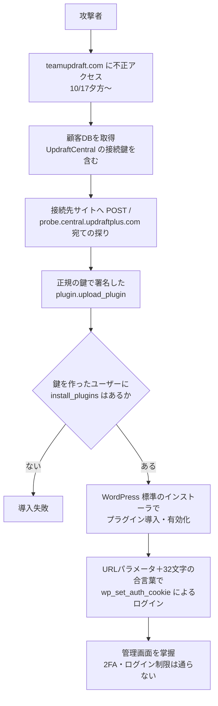

# UpdraftCentral の接続鍵流出 ― 開発元のサイトから盗まれた正規の署名鍵で、WordPressサイトに「正しく署名された」バックドア入りプラグインが送り込まれた

## 要点

### 影響バージョン

- **UpdraftPlus（無料版・Premium版）のすべての版**のうち、**UpdraftCentral（クラウド版）に接続している**サイトが対象。プラグインのコードの欠陥ではなく、署名鍵の流出（TeamUpdraft、Patchstack、Nethemba）。
- 修正は **UpdraftPlus 1.26.13（無料版）／2.26.13（Premium版）**。10月18日以前のクラウド接続を自動で切る。先に出た **1.26.12／2.26.12 は不具合で鍵を1つも消さない**（Nethemba）。
- Nethemba によれば、1.26.13 が自動で消すのは**10月18日 12:07 UTC より前に作られた鍵だけ**。12:07〜21:00 UTC（ベンダーの言う 22:00 BST まで）に作られた鍵は手で消す必要がある。
- 自前ホストの UpdraftCentral は対象外（TeamUpdraft）。UpdraftPlus 1.26.4／2.26.4 以前は、6月の CVE-2026-10795（鍵なしでコマンドを偽造できる）の影響も受ける（Patchstack、Nethemba）。

### 今すぐやること

- UpdraftCentral 経由ではなく、**各サイトの管理画面に直接ログイン**して作業する（TeamUpdraft）。
- UpdraftPlus を **1.26.13／2.26.13 以降**にする。そのうえで「設定 → UpdraftPlus バックアップ → 高度なツール → UpdraftCentral → 既存の鍵の管理」で**鍵をすべて削除**する。WP-CLI なら `wp option delete updraft_central_localkeys`。ダッシュボード側からサイトを外すだけでは不十分（Nethemba、Patchstack）。
- UpdraftCentral を使った覚えがなくても確かめる。teamupdraft.com のアカウントをプラグインにつなぐ画面で「このサイトを UpdraftCentral に追加」のチェックが**最初から入っている**ため、知らないうちに鍵ができていることがある（Patchstack、Nethemba）。
- 見覚えのないプラグイン（Must-Use を含む）、見覚えのない管理者、**`manage_options`／`install_plugins` を持つ「編集者」**を探す（TeamUpdraft、Patchstack）。痕跡があれば10月17日より前のバックアップから戻す。
- teamupdraft.com のパスワードと二要素認証を設定し直す。UpdraftCentral 経由で触られたサイトは、リモートストレージの認証も設定し直す（TeamUpdraft）。

## 概要

- TeamUpdraft は、10月17〜18日の週末に teamupdraft.com が不正アクセスを受け、顧客データベース（氏名・メール・請求先住所・注文履歴・ハッシュ化パスワード・二要素認証の設定、UpdraftCentral／UpdraftVault／UpdraftClone の接続鍵）が見られたとみられると発表した（TeamUpdraft）。
- 攻撃者は、盗んだ UpdraftCentral の正規の秘密鍵で署名した `plugin.upload_plugin` コマンドを接続先のサイトへ送り、バックドア入りのプラグインを入れさせた。Patchstack は10月18〜19日の約18時間で99種類の名前を観測した（Patchstack、Nethemba）。
- サイトから見れば正規の命令なので、プラグインのすべての検査を通り、Wordfence・Patchstack・Cloudflare を入れていたサイトでも止まらなかった例がある（Nethemba、Patchstack）。

> この記事では、ベンダー・公的機関・研究者・報道で確認できた内容を「事実」、筆者の推測や意見を「考察」として分けて書いています。出典の時刻はUTC・BST（英国夏時間、UTC+1）・CEST（中欧夏時間、UTC+2）が混在するため、出典どおりの表記に日本時間（JST）を添えます。

## 何が起きたか（時系列）

| 日時 | 出来事 |
| --- | --- |
| 2026-06 | 同じ UpdraftCentral の経路で、古い無署名の形式から鍵なしにコマンドを偽造できる CVE-2026-10795（CVSS 8.1）が UpdraftPlus 1.26.5／2.26.5 で修正される（Patchstack） |
| 2026-09-23 | 後に攻撃に使われるIP `43.250.53.42` が、別の管理者の2サイトにREST APIの照会とパストラバーサルの試行をしていた（Nethemba） |
| 2026-10-17 夕方 | 攻撃者が teamupdraft.com にアクセスし始める（TeamUpdraft が Nethemba に回答） |
| 2026-10-18 15:32 | Patchstack のテレメトリで最初のバックドア導入を観測（BleepingComputer は UTC としている）（Patchstack） |
| 2026-10-18 夕方〜20:00 BST ごろ | TeamUpdraft が不審な動きに気づき、侵害を確認。アクセス経路を閉じ、全アカウントをサインアウトさせ、鍵と認証情報の入れ替えを始める（TeamUpdraft） |
| 2026-10-19 未明（CEST） | Nethemba の3サイトに `probe.central.updraftplus.com` 宛ての探りと `plugin.upload_plugin` が届き、2サイトでバックドアが入る（Nethemba） |
| 2026-10-19 09:23 | Patchstack が観測した最後の導入（Patchstack） |
| 2026-10-19 | Nethemba が分析を公開しベンダーに報告。TeamUpdraft が事故を公表。Patchstack・Wordfence が分析と遮断ルールを公開（Nethemba、Patchstack、TeamUpdraft） |
| 2026-10-19 | UpdraftPlus 1.26.12／2.26.12 公開。鍵を消すはずが不具合で消さない。同日夜（22:00 BST 過ぎ、JST 20日6時過ぎ）に 1.26.13／2.26.13 で修正（Nethemba、TeamUpdraft） |
| 2026-10-20 11:30〜12:00 UTC | 攻撃者が、削除済みのバックドアの合言葉を少なくとも3サイトで直接試す（Nethemba） |
| 2026-10-20 | TeamUpdraft が「不正アクセスは解消し、1.26.13／2.26.13 で鍵を失効させた」と追記（TeamUpdraft） |

## 技術的な問題点（根本原因）

**事実（Patchstack、Nethemba）**

- UpdraftCentral の受け手（クライアント）は、無料版を含む**すべての UpdraftPlus に入っている**。サイトに鍵ができるまでは眠っている（Patchstack）。
- 接続するとサイト側でRSA鍵ペアが作られ、ダッシュボードの公開鍵が保存される。以後サイトは、**ダッシュボードの秘密鍵で署名されたコマンドを、接続を作ったユーザーの権限で実行する**。コマンドごとの確認はない（Patchstack、Nethemba）。
- ダッシュボードの秘密鍵は接続先のサイトには置かれず、UpdraftCentral Cloud 側にある。接続している全サイトの安全は「その鍵が漏れない」ことだけにかかっていた（Patchstack、Nethemba）。
- サイト側の鍵に期限はなく、2025年11月の鍵が2026年10月にも使えた。別の管理者からは2022年の鍵が悪用されたという報告もある（Nethemba、Patchstack）。
- teamupdraft.com のアカウントを UpdraftPlus につなぐ画面の「Add this website to UpdraftCentral」のチェックボックスは、`admin.php` で `checked="checked"` 固定。チェックを外さずにログインすると UpdraftCentral の鍵が作られる（Patchstack、Nethemba）。

**事実（Nethemba によるサイト側の切り分け）**

Nethemba は、攻撃を受けたサイトで次の可能性を順に否定した。CVE-2026-10795（2.26.11 で修正済み、悪用の試行はすべて復号失敗）。プラグインの改ざん（関連ファイルが公式の配布物とバイト単位で同一）。古い無署名形式（UpdraftCentral の鍵には使えない）。ダッシュボード鍵のすり替え（指紋は10月15〜18日のバックアップと同じ）。暗号の弱さ（2048ビットRSA、署名検証の既知の欠陥を修正済みの phpseclib 2.0.55）。管理画面の侵害（形跡なし）。残るのは、攻撃者が**ダッシュボードの正規の秘密鍵を持っていた**ことだけだった。

**事実（TeamUpdraft）**

TeamUpdraft は不正アクセスの入口を明らかにしていない。発表では「アクセス経路を閉じ、根本の弱点を修正した」と書いている（TeamUpdraft）。TeamUpdraft は Nethemba に対し、TOTP の秘密情報はハッシュにできないので、データベースの流出にはそれも含まれると考えるべきだと答えている（Nethemba）。

**考察**

署名と暗号化は「通信路の途中で命令を作られない」ことを保証するが、「鍵を持つ側が正しい」ことは保証しない。UpdraftCentral の設計では、ダッシュボードの秘密鍵が、接続した全サイトに対する**プラグイン導入権限そのもの**になっている。その鍵が、顧客データベースと同じWebサイトの侵害で取れる場所にあったことが根本の問題に見える。サイト側の防御製品が止められなかったのは、止めるべき「異常」がプロトコル上どこにもなかったからである。

## 攻撃・侵入経路

**事実（Nethemba、Patchstack）**

- 攻撃は、存在しない鍵宛て（`probe.central.updraftplus.com`）の探りから始まる。サイトが「わからない」と返すと、UpdraftCentral のコマンドを受け付けることがわかる。次に実在の鍵 `0.central.updraftplus.com` 宛てに `plugin.upload_plugin` を送る（Nethemba）。
- 攻撃側の User-Agent は `WordPress/6.4; class-udrpc.php`。本物のダッシュボードは `WordPress/6.8.5; class-udrpc.php/2.0; https://teamupdraft.com` のようにライブラリの版とURLを付ける（Nethemba）。送信元は `43.250.53.42` と `2a09:bac5:4e21:2e3c::49b:9`（Nethemba、Patchstack）。
- 送り込まれたプラグインは少なくとも3系統あった（Nethemba）。
  1. **第1系統**：URLパラメータ（`_` ＋16進6文字）と32文字の合言葉で、`manage_options` と `install_plugins` を足した「編集者」アカウント（表示名「Site Tools」、メール `@example.org`）を作り、ログインさせる。説明文はすべて「Small maintenance toolkit: keeps option storage tidy.」。`define()` で作った定数を `self::FIELD` と読む誤りがあり、PHP 8 で全リクエストがエラー500になって発覚した例が多い。
  2. **第2系統**：誤りのない動く版。合言葉だけなら既存の管理者としてログインさせ、`m=setup` で管理者を新規作成する。アカウントを一覧から隠すコードはあるが、正しく動かない。
  3. **第3系統**：673バイトの最小版。既存の管理者としてログインさせるだけ。一覧から自分を隠す「Site Health Cache」版もある。
- ログインは `wp_set_auth_cookie` でクッキーを直接発行するので、ログインフォームを通らない。二要素認証・ログイン回数制限・ログイン保護のプラグインは動かない（Patchstack、Nethemba）。
- 攻撃者は壊れた版を `plugin.delete_plugin` で消し、2秒後に別の版を入れ直した例がある。1サイトに数種類を入れた例もある（Nethemba）。
- 鍵を作ったユーザーが `install_plugins` を持っていなかったサイトや、`wp-content/plugins` に PHP が書き込めなかったサイトでは、導入が失敗した（Nethemba）。

## なぜ防げなかったか・構造的要因の考察

1. **「正規の管理経路」はサイト側からは異常に見えない。** 命令は正しく暗号化・署名され、プラグインのすべての検査を通った。WAFや改ざん検知は「脆弱性を突く要求」を止める設計で、正規の鍵による正規の命令は止められない。Rank Math PRO の配布物改ざんと同じく、信頼された配信路が攻撃面になっている（Patchstack、Nethemba、考察）。
2. **鍵が「1か所」に集まり、期限もなかった。** 全サイトのダッシュボード鍵がベンダーのクラウドにあり、サイト側の鍵は何年も有効なままだった。ベンダーのWebサイトの侵害が、そのまま数十万規模の遠隔コード実行権限になった。Nethemba は、UpdraftCentral か Migrator の鍵を持つ利用者は1割未満（最大約40万サイト）とするベンダーの6月の推計を引いている（Nethemba、考察）。
3. **既定でオンの同意。** チェック済みのチェックボックスで、利用者が意識しないまま遠隔管理の鍵ができていた。Nethemba には「UpdraftCentral を使ったことがない」という被害者が複数連絡している。自分が「接続している」と知らない人は、鍵を消す対象にも入らない（Patchstack、Nethemba、考察）。
4. **緊急版の不具合と、時刻の食い違い。** 鍵を消すはずの 1.26.12 は何も消さず、1.26.13 も境目の時刻がベンダーの説明とずれていると Nethemba は指摘している。Wordfence の遮断ルールは 1.26.12／2.26.12 を対象外にしていた。急いで出した対処の検証不足が、さらに穴を残した（Nethemba）。
5. **ベンダーの侵害を止めても、盗まれた鍵は動き続ける。** Nethemba のサイトへの攻撃は、ベンダーが侵害を確認してアクセスを閉じた**後**に始まった。鍵の失効がサイト側の更新に依存する以上、「ベンダー側の封じ込め」と「利用者側の安全」は別物になる（Nethemba、考察）。

## 運用者向けの具体的な対策と検知ポイント

**対策（事実に基づくもの）**

- UpdraftPlus 1.26.13／2.26.13 以降に更新し、鍵が残っていないかを `wp option get updraft_central_localkeys` で確かめる。出力があれば接続が生きている（Patchstack）。UpdraftPlus Migrator の鍵（`updraft_migrator_localkeys`）も、移行中でなければ消す（Nethemba）。
- 原因の説明があるまで再接続しない。どうしても遠隔管理が要るなら、`install_plugins` を持たないアカウントで鍵を作る（Patchstack）。
- 一時的に UpdraftCentral の命令を全部止めたいなら、`udrpc_message` を含む POST を 403 で返す小さな mu-plugin を置く方法を Nethemba が示している。Migrator も止まる（Nethemba）。
- バックドアを見つけたら、**先に鍵を消す**（消さないと直した版を送り直される）。プラグインは管理画面から削除せず、無効化してWebルートの外へ移す。`uninstall.php` が自分の痕跡を消すため（Patchstack、Nethemba）。
- 侵入の形跡があれば、10月17日より前のバックアップから戻し、全ユーザーの権限を見直し、管理者と teamupdraft.com のパスワードを変え、全セッションを切る（TeamUpdraft、Nethemba）。Premium 版は teamupdraft.com のパスワードをデータベースにそのまま保存していることがあるので、DB に触れられていたら漏れたものとして扱う（Nethemba）。

**検知ポイント（事実に基づくもの）**

- アクセスログ：User-Agent が `class-udrpc.php"` で終わる（版番号のない）POST（`grep 'class-udrpc\.php"' access.log`）（Patchstack、Nethemba）。
- アクセスログ：バックドアの合言葉。第1系統は `_` ＋16進6文字、第2系統は16進12文字のパラメータに32文字の値。302 なら管理画面へのリダイレクト（ログイン成功の可能性が高い）、500 なら壊れた版が残っている（Nethemba）。
- UpdraftCentral のログ（直近50件しか残らない）：`probe.central.updraftplus.com` の後に `Command received: plugin.upload_plugin`／`plugin.delete_plugin`（Patchstack、Nethemba）。
- ファイル：説明文「Small maintenance toolkit: keeps option storage tidy.」。偽の作者名 PixelBinder、Harbor Stack Labs、CommonGantry、CopperForge WP、MetaLayer、WPBridge など。`wp-content/upgrade/` にも展開済みのプラグインが残ることがある（Patchstack、Nethemba）。
- データベース：`_sync_token`／`_uid`／`_installed`／`_ver` で終わるオプション、`@example.org`／`@example.com` のアカウント、`manage_options` を持つ編集者（Patchstack、Nethemba）。
- 一覧から自分を隠すプラグインがあるため、管理画面の一覧だけでなく、ディスク上のファイルを直接調べる。Nethemba が読み取り専用の確認スクリプトを公開している（Nethemba）。

**考察（運用上の工夫）**

- WordPress を多数運用する組織は、「SaaS型の遠隔管理（UpdraftCentral、ManageWP、MainWP など）」の鍵の棚卸しをしておく。どのサイトがどのサービスに、どのユーザー権限でつながっているかを把握していないと、今回のような事故で消すべき鍵を探せない。
- 本番サイトでは `wp-content/plugins` をWebサーバーの実行ユーザーから書き込めないようにし、プラグイン更新はデプロイの手順で行う。今回それだけで導入が失敗したサイトがある。
- 遠隔管理の鍵に有効期限や定期的な作り直しの運用を設け、使っていない接続は切る。

## 参考リンク

- [TeamUpdraft security incident: What customers need to know（TeamUpdraft、2026年10月20日更新）](https://teamupdraft.com/blog/security-incident-october-2026/)
- [Critical security problem in UpdraftCentral: an attacker holding the service's keys planted a backdoor on our websites（Nethemba、2026年10月19日、21日更新）](https://nethemba.com/updraftcentral-backdoor-analysis/)
- [Stolen UpdraftCentral Keys Are Backdooring WordPress Sites（Patchstack）](https://patchstack.com/articles/updraftcentral-key-compromise-wordpress-backdoors/)
- [Stolen UpdraftCentral keys used to backdoor WordPress sites（BleepingComputer）](https://www.bleepingcomputer.com/news/security/stolen-updraftcentral-keys-used-to-backdoor-wordpress-sites/)
