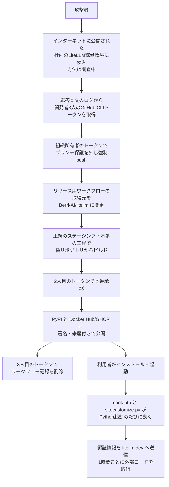

# LiteLLM 1.107.0 ― リリース工程を乗っ取りバックドア混入

## 要点

### 影響バージョン

- **PyPI の `litellm==1.107.0`**（7種類のwheelすべて）。公開は 2026-10-21 11:39:51〜13:23 UTC（日本時間 20:39〜22:23）（LiteLLM）。
- **Docker Hub と GHCR のタグ `v1.107.0`・`latest`・`main-latest`・`main-stable`**。11:46:56 UTC から、GHCR は 13:51 UTC まで、Docker Hub は 14:20 UTC（日本時間 23:20）まで汚染されたイメージを指していた。`litellm-database`・`litellm-non_root` のイメージも含む（LiteLLM）。
- 汚染されたイメージの索引：`sha256:1bbcb1443bc962e45f5aad53fe3d2c30600e0379715fb6c664cdd3ac126c339e`（`ghcr.io/berriai/litellm`）（LiteLLM、Datadog）。
- それ以前の版はすべて安全。GitHub の公式 `v1.107.0` タグのソースにも悪性ファイルはない。エンタープライズ向けの非公開レジストリも対象外（LiteLLM）。CVE は付いていない（Kodem）。

### 今すぐやること

- 期間中に、版を固定せずに `pip install` した環境、上のタグのイメージを起動した環境は、**侵害されたものとして扱う**（LiteLLM）。`pip show litellm`、ロックファイル、実際に動いたイメージのダイジェストを確かめる。
- 当たっていたら、**先に `pip` や `python` を動かさない**。Pythonを起動するたびに悪性ファイルが動く。シェルから `site-packages` の `cook.pth`・`cook.py`・`sitecustomize.py` と対応する `__pycache__` を消し、`/tmp/remote_code_loader.lock` を持つ常駐プロセスを止める（LiteLLM）。
- `litellm==1.106.2` に固定して入れ直す。仮想環境やイメージは作り直すほうがよい（LiteLLM）。
- **別の安全な端末から**、その環境が触れられた認証情報をすべて入れ替える。LiteLLMのプロキシDBに保存したLLM各社のAPIキー、マスターキーと仮想キー、`DATABASE_URL` のパスワード、インスタンスやタスクのIAMロール、環境変数にあった秘密情報（LiteLLM、Datadog）。

## 概要

- AI各社のAPIをまとめて呼ぶためのPythonライブラリ兼プロキシ LiteLLM の 1.107.0 に、認証情報を盗むプログラムと、1時間ごとに外部のコードを取ってきて動かす仕組みが入っていた（LiteLLM、Datadog）。
- 攻撃者は、盗んだ開発者3人の GitHub CLI のOAuthトークンで、ブランチ保護を外してリリース用ワークフローを書き換え、本物の `BerriAI/litellm` ではなく**ハイフン1つ違いの `Berri-AI/litellm`** からビルドさせた。成果物は正規の経路で、正規の来歴情報付きで公開された（LiteLLM、Datadog）。
- LiteLLM は、トークンはインターネットに公開していた**社内のLiteLLMの稼働環境のログ**から盗まれたとみている（LiteLLM）。

> この記事では、ベンダー・公的機関・研究者・報道で確認できた内容を「事実」、筆者の推測や意見を「考察」として分けて書いています。時刻はすべて2026年10月21日のUTCで、必要に応じて日本時間（JST、UTC+9）を添えます。

## 何が起きたか（時系列）

| 時刻（UTC） | 出来事 |
| --- | --- |
| 10月19日（月） | LiteLLM が、顧客向けの日次の修正版を出すため、社内の技術者2人にリリース権限を一時的に広げる（LiteLLM） |
| 10:08:29 | 非公開のリリース用ワークフローへの無許可の変更を、ブランチ保護が拒否する（プルリクエストと必須チェックを通っていない）（LiteLLM） |
| 10:08:34 | 特権を持つ開発者アカウントの認証情報で保護が外され、ワークフローのコミット `9cf97e93…` が適用される（LiteLLM） |
| 10:46:39 | 書き換えられたワークフローが正規のステージング実行を始める。取得元は攻撃者の `Berri-AI/litellm`（LiteLLM） |
| 11:11:18 | 2人目の開発者アカウントの認証情報で、本番リリースの承認が通される（LiteLLM） |
| 11:39:51〜11:40:13 | 悪性の `litellm==1.107.0` のwheel 7つが PyPI に上がる（LiteLLM） |
| 11:46:56 | 同じリリースのコンテナ公開が走り、悪性のイメージが公開される（LiteLLM） |
| 11:53:49〜11:54:01 | 3人目の開発者アカウントの認証情報で、本番とステージングのワークフロー実行記録が削除される（LiteLLM） |
| 12:09〜12:24 | 無許可のワークフローの変更が取り除かれ、元に戻される（LiteLLM） |
| 13:20〜13:23 | PyPI が 1.107.0 を隔離・削除する（Datadog、LiteLLM） |
| 13:51 | GHCR のタグが使えなくなったことを確認。Docker Hub はまだ汚染されたイメージを指していた（LiteLLM） |
| 14:20 | Docker Hub の該当タグをすべて削除または安全なイメージへ付け替え（LiteLLM） |
| 20:30 | LiteLLM が攻撃の経路を特定したとみて、事故報告を更新（LiteLLM） |

## 技術的な問題点（根本原因）

**事実（LiteLLM による通常のリリースの流れ）**

LiteLLM は、2026年3月の前回の事故（1.82.7／1.82.8、Datadog は TeamPCP の活動と関連づけている）の後、リリースの仕組みを強化していた（LiteLLM、Datadog）。

1. 金曜にリリース候補のブランチとタグを作り、以後は変えない。
2. 公開と非公開の2つのCIで結合試験をする。
3. 非公開のリポジトリにあるGitHubワークフローで、試験済みのコミットから成果物を作る。書き込み権限を持つ技術者だけが実行できる。
4. 成果物を試験環境に置き、もう一度試験する。
5. PyPI の Trusted Publishing（信頼された発行元）を使うワークフローで公開する。公開できるのは、**社内に常に置かれた特定のノートPCに紐づいたアカウント**だけ。公開時にDockerイメージは作り直さない。Dockerのリリースタグは書き換え不可にし、イメージに署名している。

**事実（どう崩されたか）**

- 攻撃者は3人分の GitHub CLI の認証情報を持っていた。1つはワークフローを実行でき、1つは**GitHub組織の2人いる所有者の1人**のものだった（LiteLLM）。
- 取得元のリポジトリを差し替えられるようにする変更は、保護で一度止まった。攻撃者は所有者のトークンで**ブランチ保護を外し、強制pushで変更を入れた**（LiteLLM）。
- 書き換えたワークフローに偽のリポジトリを指させて実行し、その成果物が署名され、正規の経路で公開された。来歴情報は、ソースが偽のリポジトリだったことを**正しく記録していた**（LiteLLM、Datadog）。
- 承認も、記録の削除も、それぞれ別の盗まれたアカウントで行われた。LiteLLMは「攻撃者は独立した複数の対策を突破する必要があった」としている（LiteLLM）。

**事実（トークンはどこから漏れたか。LiteLLM の調査中の見解）**

- LiteLLM は、Claude Code が特定の状況で利用者の GitHub CLI のOAuthトークンを**応答の本文に埋め込む**ことを確認した。応答の本文を記録する設定だと、トークンが LiteLLM のログに残りうる（LiteLLM）。
- 社内の LiteLLM の稼働環境は**インターネットに公開されていて**、目立たない名前の見覚えのない利用者アカウントが見つかった。攻撃者はこの環境に入り、ログからトークンを取ったとみている。入った方法は未確認で、「最近修正された脆弱性」を疑っている（LiteLLM）。

**考察**

鍵となる「最後の公開」は特定の端末に縛られていたが、その手前の「何をビルドするか」を決めるワークフローの定義は、組織所有者のトークン1本で書き換えられた。署名や来歴は「この工程で作られた」ことは示すが、「正しいソースから作られた」ことまでは保証しない。今回、来歴は偽のリポジトリを正直に記録していたので、**来歴を作るだけでなく、公開前に取得元を機械的に照合していれば**止められた可能性がある。もう1つの根は、AIのプロキシという「通る内容をすべて記録しうる」場所に、開発者の強い権限のトークンが流れ込んでいたことだと考える。

## 攻撃・侵入経路

**事実（悪性ファイルの動き。Datadog、LiteLLM）**

- wheel は `site-packages` に `cook.pth`・`cook.py`・`sitecustomize.py` を置く。Python は `.pth` と `sitecustomize.py` を**起動のたびに自動で実行する**ので、LiteLLM を import しないプロセスでも、`pip` を動かしただけでも実行される。`litellm` のディレクトリを消してもこれらは残る（Datadog、LiteLLM）。
- `cook.py` は認証情報を集め、AES-256 と RSA-4096 で暗号化して、よく似たドメイン `www.litellm[.]dev/healthcheck` に送る（Datadog）。
- 狙う情報：AWS・GCP・Azure の認証情報（インスタンスメタデータを含む）、Kubernetes・Docker・Vault・Terraform の秘密情報、SSH・GPG・TLS の鍵、Git・npm・PyPI のトークン、`.env`、シェル履歴、LLM各社のAPIキー、Claude・Codex・Gemini・Cursor・Copilot などAIコーディングツールのセッション、ブラウザーの保存パスワードとクッキー。プロキシのDBが設定されていれば、上流のAPIキーを保存した表も読みにいく（Datadog）。
- `sitecustomize.py` は1時間ごとに、GitHub上の固定のファイル（`letters9813/pythonclient-test/main/domain.txt`、削除済み）からドメインを読み、そこからPythonコードを取ってきて動かす。Datadog によれば、このファイルには試験用の値しかなく、第2段階の実行は観測されていない（Datadog）。

## なぜ防げなかったか・構造的要因の考察

1. **開発者のCLIトークンが「署名鍵と同じ重さ」になっていた。** リリースの最後の一歩は物理的な端末に縛られていたが、ワークフローの定義、承認、記録の削除は、いずれも開発者のトークンで行えた。組織所有者のトークンがあればブランチ保護も外せる。Datadog も「開発者のCLIトークンを高価値の秘密情報として扱うべきだ」としている（LiteLLM、Datadog）。
2. **一時的な権限の拡大。** 事故の2日前に、日次の修正版のためにリリース権限を広げていた。攻撃者が権限の広がった時期を狙ったのかは明らかでないが、「一時的な例外」は監視の目が届きにくい（LiteLLM、考察）。
3. **AIプロキシのログが秘密情報のたまり場になった。** LiteLLM はAPIの要求と応答を中継し、設定によっては本文を記録する。AIコーディングツールが応答にトークンを入れてしまえば、それがそのままログに残る。そのログを持つ環境がインターネットに公開され、見覚えのないアカウントがあった（LiteLLM、考察）。
4. **見た目でしか区別できない名前。** `BerriAI` と `Berri-AI` の違いはハイフン1つで、Datadog は人の目による確認をかわす狙いとみている。来歴の検証が「署名があるか」で止まり、「ソースがどこか」を照合していなければ、正しい来歴付きの悪性パッケージは通ってしまう（Datadog、考察）。
5. **`.pth` と `sitecustomize.py` は「入れただけで動く」。** パッケージを import しなくても、`pip` を動かしただけでも実行される。利用者が「入れたが使っていない」と考えても安全ではない（Datadog、LiteLLM）。
6. **浮動タグを本番で使う習慣。** Docker の `latest`・`main-stable` を追っていた環境は、何もしなくても約2時間半、悪性のイメージを引きうる状態だった（LiteLLM、考察）。

## 運用者向けの具体的な対策と検知ポイント

**対策（事実に基づくもの）**

- 上の「今すぐやること」の手順で掃除し、`1.106.2` に固定する（LiteLLM）。
- AWS では、インストールした時刻の前後に、インスタンスロールからの `GetCallerIdentity` が CloudTrail にないか、そのロールの認証情報が自社の外から使われていないかを確かめる（LiteLLM）。
- 痕跡ファイルがなくても安全とは言えない。コンテナや `/tmp` の掃除で消えるため、外部に通信できたホストでは送信が成功したものとみなす（LiteLLM）。
- 今後は、版をハッシュ付きで固定し、本番では浮動タグを使わない。古い GitHub CLI のトークンを取り消す（LiteLLM、Carthage Electronics の手順の要約）。
- パッケージを公開する側は、リリース用ワークフローが取得できるリポジトリを承認済みのものに固定する（Datadog）。

**検知ポイント（事実に基づくもの。IOCはDatadog、LiteLLM）**

- ファイル：`site-packages` 直下の `cook.pth`・`cook.py`・`sitecustomize.py`、`litellm-1.107.0.dist-info`。
- ファイル：`/tmp/.pc_once_72129118c59f5636c0bb`（情報窃取の実行に成功した印）、`/tmp/remote_code_loader.lock`（常駐プロセスのロック）。
- 通信：`litellm[.]dev` への送信、HTTPヘッダー `X-Token: XWiA8gZNa7NcX2XRoAEb`、`raw.githubusercontent[.]com/letters9813/pythonclient-test/main/domain.txt` への定期的な取得。
- イメージ：`sha256:1bbcb1443bc9…`（`litellm`）、`sha256:c00f9d92c427…`（`litellm-database`）、`sha256:7b00e91cd2fe…`（`litellm-non_root`）。wheel のハッシュは Datadog の一覧を参照。

**考察（運用上の工夫）**

- AIプロキシやゲートウェイの要求・応答の本文ログは、既定で切るか、トークンの形をした文字列を伏せる。残すなら、ログの置き場所を秘密情報と同じ扱いで守る。
- GitHub では、組織所有者の数を最小にし、日常の作業には所有者権限のない別アカウントを使う。ブランチ保護の変更やワークフロー実行記録の削除は監査ログで通知されるようにしておく。
- 来歴（provenance）を検証するときは、署名の有無だけでなく、ソースのリポジトリ名と、そのリポジトリの所有者IDが期待どおりかを照合する。

## 参考リンク

- [Contained: Oct 21, 2026 LiteLLM release v1.107.0 Compromised（LiteLLM、2026年10月21日 20:30 UTC 更新）](https://docs.litellm.ai/blog/security-incident-oct-21-2026)
- [LiteLLM supply chain compromise: What you need to know（Datadog Security Labs）](https://securitylabs.datadoghq.com/articles/litellm-compromised-pypi-docker/)
- [litellm 1.107.0 Compromised on PyPI: Backdoored Wheels Drop a Credential Stealer and an Hourly Remote Code Loader（StepSecurity）](https://www.stepsecurity.io/blog/litellm-1-107-0-compromised-pypi-backdoored-wheels-credential-stealer)
- [LiteLLM Supply Chain Attack: IOCs and Runbook（Kodem）](https://www.kodemsecurity.com/resources/litellm-supply-chain-attack-litellm-1-107-0-affected-versions-iocs-and-first-hour-response-runbook)
- [October 21, 2026 CVE Threat Brief（Carthage Electronics）](https://carthageelectronics.com/october-21-2026-cve-threat-brief/)
