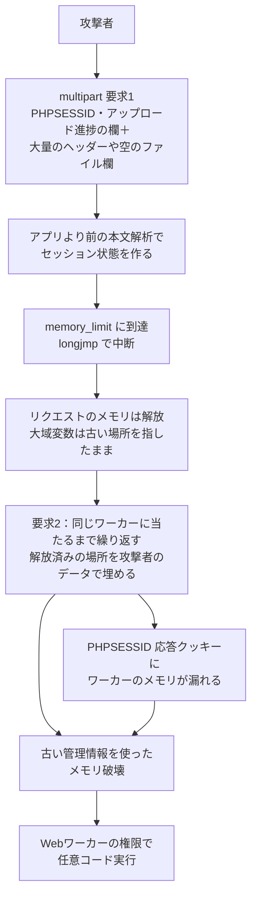

# PHP2Shell ― PHP本体の認証なしRCE

## 要点

### 影響バージョン

- **PHP 8.2.35／8.3.36／8.4.27／8.5.12 より前**のすべて。Wiz は「PHP 5.4 以降、過去10年のほぼすべての版が少なくとも1件の影響を受ける」としている（PHP、Wiz）。
- Webリクエストを処理するすべての形態が対象：PHP-FPM、Apache の mod_php、php-cgi、FrankenPHP、LiteSpeed。リスクが最も高いのは **mod_php**（アプリのコードが動く前に認証なしで攻撃が成立する実証あり）（PHP）。
- PHP 8.1 以前は公式の修正版が出ない。7.4／8.0／8.1 向けには最小限のソース修正だけが提供された。ディストリビューションやLTSベンダーの修正済みパッケージは、版番号が古いままのことがある（PHP）。
- WordPress・Drupal・Joomla などのアプリやプラグインを更新しても直らない。直すのは**サーバー上のPHP本体**（PHP、BleepingComputer）。

### 今すぐやること

- PHP を修正版（またはベンダーの修正済みパッケージ）へ更新し、**Apache・PHP-FPM・LiteSpeed などPHPを動かすプロセスをすべて再起動**する。コンテナは修正済みのベースイメージから作り直す（PHP、CISA）。
- 自分で管理していないPHPも洗い出す。CISA は「PHPは他のソフトの部品になっていることが多く、見えにくい」として、組織内のPHPの棚卸しを求めている（CISA）。
- すぐ更新できない場合は、PHP の暫定設定（`session.upload_progress.enabled=0`、`memory_limit=-1`、`post_max_size` を小さく、PHP 8.5 では `fatal_error_backtraces=0`）を **php.ini やFPMプール・サーバー設定**で入れ、全ワーカーを再起動する。PHP自身は「被害を減らすだけで安全にはならない」としている（PHP）。CISA と英NCSCは、直せないならシステムをオフラインにするよう勧めている（CISA、BBC）。
- Amazon は**10月17日**から悪用の試みを観測している。公開日ではなく、少なくとも10月17日以降を調査の起点にする（AWS）。

## 概要

- PHP は10月21日 14:00 UTC（日本時間 同日23:00）に予定していた緊急リリースを公開し、PHP本体のメモリ安全性の欠陥2件を修正した。発見したのは Wiz・Calif・OpenAI で、8月に報告されていた（PHP、Wiz、SecurityWeek）。
- 根は同じで、**メモリ不足（OOM）などの致命的エラーでリクエストが途中で打ち切られると、PHPの内部状態が壊れたまま残り、同じワーカーの次のリクエストがそれを使う**。これが解放済みメモリの使用（use-after-free）やメモリの読み出し、遠隔コード実行になる（PHP、Wiz）。
- 修正の前から、攻撃者による悪用の試みが観測された。CISA・英NCSC・オランダやフィンランドの政府機関などが「すぐ直す、無理ならサイトを止める」よう呼びかけ、各地で公的サイトが一時停止した（AWS、SecurityWeek、BBC、CISA）。

> この記事では、ベンダー・公的機関・研究者・報道で確認できた内容を「事実」、筆者の推測や意見を「考察」として分けて書いています。時刻は出典どおりのUTCに日本時間（JST）を添えます。

## 何が起きたか（時系列）

| 日時 | 出来事 |
| --- | --- |
| 2020年／2024年 | 元になったOOMの弱点は2020年に見つかり、2024年のPHP監査でも再発見されたが、悪用できることが示されず修正されなかった（Calif、SecurityWeek経由） |
| 2026-08-19〜21 | Wiz が最初の脆弱性を見つけ、Drupal と WordPress で認証なしRCEを確認（Wiz） |
| 2026-08-24 | Wiz が PHP セキュリティチームに報告。Calif と OpenAI も同じ時期に独立に報告（Wiz、SecurityWeek） |
| 2026-09-21 | PHP が報告を受け、協調した修正の開発を始める（Wiz） |
| 2026-10-17 | Amazon のハニーポット（MadPot）が、匿名化ネットワーク経由の PHP2Shell の悪用の試みを記録。公開の4日前（AWS） |
| 2026-10-20 | 詳細がSNSなどに漏れたと報じられ、PHP が「21日 14:00 UTC に緊急リリース、早まることもある」と予告（BBC、BleepingComputer、PHP） |
| 2026-10-21 02:00〜08:00 UTC | Amazon が複数の概念実証（PoC）を確認し、匿名化基盤からの悪用の試みが増える（AWS） |
| 2026-10-21 14:00 UTC（JST 23:00） | PHP 8.5.12／8.4.27／8.3.36／8.2.35 を公開。CISA が即時の修正を求める注意喚起を出す（PHP、CISA） |
| 2026-10-21 | watchTowr・Cloudflare・Hadrian・Patchstack・Vega などが悪用の試みを報告。watchTowr は「成功例はまだない」とした。Amazon は「広く悪用されている」とした（SecurityWeek、AWS） |
| 2026-10-21〜22 | フィンランド政府の公開Webサービス、オランダの国立公衆衛生環境研究所などが予防的にサイトを停止。Wikimedia も一部システムを止めた（BBC） |

## 技術的な問題点（根本原因）

**事実（PHP のアドバイザリ）**

2件はどちらも「1つのリクエストが異常な形で終わったときに、PHPの状態が正しく片付かない」ことが根にある。

- **CVE-2026-109618（OOMによる破損、GHSA-w8hw-w9fx-j79w）**：PHPはメモリ不足のとき `longjmp()` で処理の途中から一気に抜ける。リクエスト用のメモリが「まだ初期化しきっていないのに参照できる」瞬間にどこかの確保が失敗すると、その不完全なメモリが残り、リクエストの終了処理がそれを読んだり分岐に使ったりする。失敗する確保は、壊れるメモリと無関係でもよい（PHP）。
- **CVE-2026-109619（古いグローバル状態、GHSA-6wmf-4rv5-p3rp）**：エラー・セッション・オブジェクト・拡張機能などの大域変数が、1つのリクエストのメモリを指したままワーカーに残る。本来はメモリを解放する前に戻すべきだが、致命的エラーで処理が放棄されたり、終了処理の後で警告が出て状態が書き戻されたりすると、戻されない。次のリクエストの一部の処理は、通常の初期化より前に動くので、その古い値を使ってしまう（PHP）。
- PHP は後者の成立条件を「**状態を残す側（producer）**」と「**それを読む側（consumer）**」の2つがそろい、両者が**同じワーカー**で処理されること、と整理している（PHP）。

**事実（OOMを起こす方法）**

PHP は、`post_max_size` などの見かけの上限の範囲内でメモリ不足に持ち込める方法を挙げている（PHP）。

- 使える長さの宣言がない multipart 要求が、最初の `post_max_size` の確認を通り、本文を送り続けられる。
- multipart の1つの部分に、ヘッダーをいくつでも付けられる。PHP内部で表すと、通信上の大きさよりずっと多くのメモリを使う。
- 空のファイル欄は `max_file_uploads` に数えられないのに、ファイル情報の配列は作られる。入れ子の名前でその処理が増える。

**事実（Wiz が示した4つの具体的な欠陥）**

| CVE | 欠陥 | Wiz が実証したこと |
| --- | --- | --- |
| CVE-2026-109618 | アップロード進捗の復元処理（unserializer）の解放後使用 | WordPress・Drupal・Joomla で認証前RCE |
| CVE-2026-109618 | プロセスメモリの遠隔読み出し | アプリに依存しないメモリの読み出し |
| CVE-2026-109619 | 致命的エラー時のバックトレースの解放後使用 | Drupal で認証前RCE |
| CVE-2026-109619 | OPcache の型の取り違え | WordPress で認証前RCE |

- **メモリの読み出し**：PHPは multipart 要求を、通常のモジュール初期化が終わる前に解析する。このときセッションの「アップロード進捗」機能がセッションIDを `PS(id)` に置く。ここでOOMが起きるとリクエスト用メモリは捨てられるが、`PS(id)` は解放済みの場所を指したまま残る。同じワーカーの次の multipart 要求で、PHPはその古いポインタと長さを正しい文字列とみなし、**再利用されたメモリの中身を `PHPSESSID` の応答クッキーに入れて返す**。アプリが `session_start()` を呼ばなくても成立する（Wiz）。
- **RCE**：同じ早い段階で、セッションの復元処理が管理情報を `BG(unserialize)` に置く。OOMで中断されると、これも解放済みメモリを指したまま残る。次のリクエストで、攻撃者が埋め直したメモリを本物の管理情報として使わせ、メモリの読み出しでアドレスの不確かさを消して、認証なしのRCEにつないだ（Wiz）。
- アップロード進捗（`session.upload_progress.enabled`）は**既定で有効**（PHP、JFrog）。

**事実（実行形態による違い）**

- **Apache mod_php** は、リクエストの開始に失敗しても終了処理を必ず呼ぶ。本文の自動解析でメモリ上限に達すると、不正な状態のまま終了処理が動く。これは**アプリのコードが動く前**に起きる（PHP）。
- **PHP-FPM** は、開始に失敗した子プロセスを終わらせるので、その形では残らない。ただし、正常に開始した後のOOMやアプリの処理経由の経路は残り、セッションの経路では FPM でもRCEが確認された（PHP）。
- FrankenPHP は mod_php と同じく終了処理を必ず呼ぶので、アプリに依存しない攻撃を受ける可能性が高い。LSAPI は FPM に近い（PHP）。

**事実（修正の内容）**

PHP は OOM 時の `longjmp()` をやめた。上限に達したら次の安全な地点で穏やかに止め、さらに高い第2の上限に達したら `_exit()` で即座にプロセスを終える。終了処理が不正な状態を見ることはなくなる（PHP）。Wiz によれば、報告した4件のほかにも同じ型の変種があり、修正はそれらも根本から消す（Wiz）。

**考察**

C言語で `longjmp()` による「大域脱出」を使うと、途中で確保したものの後始末がすべて抜け落ちる。PHPはリクエストごとにメモリを丸ごと捨てる設計なので、普段はそれで困らない。しかし「ワーカーは生き続け、大域変数も残る」という前提と組み合わさると、捨てたはずのメモリへの参照がリクエストの境目を越えて残る。どれか1か所のバグではなく、**エラー処理の仕組みと、プロセスを使い回す実行モデルの組み合わせ**が根本原因に見える。修正が「`longjmp()` をやめる」という設計の変更になったのはそのためだろう。

## 攻撃・侵入経路

**事実**

- 確認済みの影響は、**Webワーカーのアカウント権限での認証なし遠隔コード実行**。mod_php の既定の入力・メモリ制限、通常の prefork 構成で、HTTPだけで成立することが確認された。ワーカーが多いと試行回数は増えるが、条件は消えない（PHP）。
- 2つの要求は同じワーカーに当たる必要がある。ワーカーの使い回しやワーカー数は成功率を下げるだけ（PHP）。
- 実行コードに届かなくても、ワーカーのメモリに残った他の利用者の要求のパスワード・トークン・APIキー・証明書を読める可能性がある（Wiz）。
- Amazon は、10月17日の試みは「禁輸期間中に、匿名化されたIPからハニーポットを狙った」ので攻撃者によるものとみられるが、どう情報を得たかはわからないとしている。21日の試みは送り込む中身や匿名化基盤がばらばらで、複数の攻撃者とみられる（AWS）。
- Hadrian は「観測した攻撃の大半はアップロード進捗の経路を使う」と報告した（SecurityWeek）。

## なぜ防げなかったか・構造的要因の考察

1. **アプリより下で起きる。** 攻撃はアプリのコードが動く前の本文解析で成立するので、アプリの入力検査、CMSのセキュリティプラグイン、アプリのログはほとんど役に立たない。Wiz も「アプリのログには手がかりがほとんど残らない」としている（Wiz、考察）。
2. **「悪用できない」と判断された弱点が6年残った。** OOMの弱点は2020年と2024年に見つかっていたが、悪用の道筋が示されず直されなかった。Wiz は、メモリの配置に合わせて攻撃を何度も調整する作業をAIが肩代わりしたことで実証できたと説明している。「悪用が難しいから後回し」という優先順位の付け方が、もう成り立たなくなっている（SecurityWeek、Wiz、考察）。
3. **禁輸期間が守り手を守り切れなかった。** 公開前に情報が漏れ、Amazon は公開の4日前に悪用の試みを記録した。AWS は「禁輸は、他の誰かが同じバグを見つけるまでしか守ってくれない」と書いている（AWS、BBC）。
4. **どこにPHPがあるか分からない。** PHPは他の製品や機器、管理画面、ホスティング基盤の中に組み込まれていることが多い。Sophos の専門家は、パッチを当てることより、動いている場所をすべて見つけることが難しいと述べた（BBC、CISA）。
5. **更新しても「プロセスの再起動」と「ベンダーの版番号」が落とし穴になる。** パッケージを入れ替えても古いワーカーが動き続ければ直らない。ディストリビューションの修正版は古い版番号のままのことがあり、`php -v` の表示だけでは判断できない（PHP、考察）。

## 運用者向けの具体的な対策と検知ポイント

**対策（事実に基づくもの）**

- 修正版へ更新し、すべてのワーカーを再起動する。PHP 8.1 以前は、修正済みのベンダーパッケージを入れるか、サポートされている版へ移る（PHP）。
- 暫定設定は、**要求の解析より前に効く場所**（`php.ini`、FPMプール、Apache の `php_admin_value` など）で入れる。`ini_set()` や FPM の `.user.ini` では効かない（PHP）。
  - `session.upload_progress.enabled=0`：確認されたセッションの経路を塞ぐ。PHP は、修正後もこの機能が要らないなら切っておくよう勧めている。
  - `memory_limit=-1`：攻撃者が狙って起こせるメモリ上限の失敗をなくす。ただしメモリの保護もなくなるので、コンテナやcgroupの上限を別に設ける。`RLIMIT_AS`／`RLIMIT_DATA` は使わない（かえって脆弱な経路を通る）。
  - `post_max_size` を小さく（アップロード不要なら 8M、必要でも 32M）し、Webサーバーやプロキシで本文の大きさ・入力欄の数・multipart の部分数・ヘッダー数・入れ子の深さを制限する。長さの宣言がない要求にも効かせる。multipart を使わないアプリなら手前で拒否する。
  - PHP 8.5 では `fatal_error_backtraces=0`。
  - `.htaccess` や要求ごとの設定で、古い・不正なINI設定を使わない。警告を `@` や `display_errors` で隠しても防げない。
  - 性能が許すなら `pm.max_requests=1`（ワーカーを1回ごとに作り直す）で、同じワーカーを使う条件を崩せる（PHP、JFrog）。
- WAFで時間を稼ぐ。Cloudflare は既知の手口を止めるルールを入れたが、一時的な対策だとしている（BleepingComputer、CISA）。
- 外部に公開していた修正前のサーバーは、メモリが漏れたものとして扱い、データベースのパスワード・APIキー・セッション鍵などを入れ替える（Wiz、考察）。

**検知ポイント（事実に基づくもの）**

- 普段と違う multipart 要求の直後に、メモリ上限のエラーや HTTP 500 が続く（Wiz）。
- 異常に大きい、または形の崩れた `PHPSESSID` 応答クッキー（Wiz）。
- 説明のつかないPHPワーカーの再起動や入れ替わり（Wiz）。
- PHPのワーカープロセスがシェルを起動したり、ツールをダウンロードしたりする（CISA）。
- 調査は10月17日から始める。最初の悪用は、個別のCVE向けの検知が用意される前に起きることが多いので、振る舞いで見る（AWS）。

**考察（運用上の工夫）**

- 「PHPを使っているか」を製品ごとに聞いて回るより、サーバー上で `php`・`php-fpm`・`lsphp`・`frankenphp`・`httpd`（mod_php を読み込むもの）のプロセスを探すほうが早い。コンテナのイメージも、ベースイメージのPHPの版で棚卸しする。
- レンタルサーバーやマネージドホスティングでは、自分ではPHPを更新できない。事業者が修正版を入れたかを確認し、それまでは暫定設定やWAFが使えるかを問い合わせる。

## 参考リンク

- [Security advisory: Critical remote code execution vulnerabilities, update now（PHP、2026年10月21日）](https://www.php.net/)
- [RCE via OOM corruption, CVE-2026-109618（GHSA-w8hw-w9fx-j79w、php-src）](https://github.com/php/php-src/security/advisories/GHSA-w8hw-w9fx-j79w)
- [RCE via stale global state, CVE-2026-109619（GHSA-6wmf-4rv5-p3rp、php-src）](https://github.com/php/php-src/security/advisories/GHSA-6wmf-4rv5-p3rp)
- [PHP2Shell: AI uncovers critical RCE vulnerabilities affecting 70% of the Internet（Wiz Research）](https://www.wiz.io/blog/php2shell-php-rce)
- [Amazon Threat Intelligence identifies PHP2Shell exploitation prior to public disclosure in MadPot（AWS Security Blog）](https://aws.amazon.com/blogs/security/amazon-threat-intelligence-identifies-php2shell-exploitation-prior-to-public-disclosure-in-madpot/)
- [Critical Vulnerabilities in PHP Require Immediate Patching（CISA、2026年10月21日）](https://www.cisa.gov/news-events/alerts/2026/10/21/critical-vulnerabilities-php-require-immediate-patching)
- [PHP2Shell: All You Need to Know About CVE-2026-109618 and CVE-2026-109619（JFrog Security Research）](https://research.jfrog.com/post/php2shell-all-you-need-to-know-about-cve-2026-109618-and-cve-2026-109619/)
- [PHP2Shell Patches Land as First Exploitation Attempts Hit Sensors（SecurityWeek）](https://www.securityweek.com/php2shell-patches-land-as-first-exploitation-attempts-hit-sensors/)
- [PHP ships emergency patches for critical PHP2Shell flaws（BleepingComputer）](https://www.bleepingcomputer.com/news/security/php-ships-emergency-patches-for-critical-php2shell-flaws/)
- [Websites taken down worldwide as critical PHP cyber-security update issued（BBC）](https://www.bbc.com/news/articles/cmly0lg3w5x2o)
