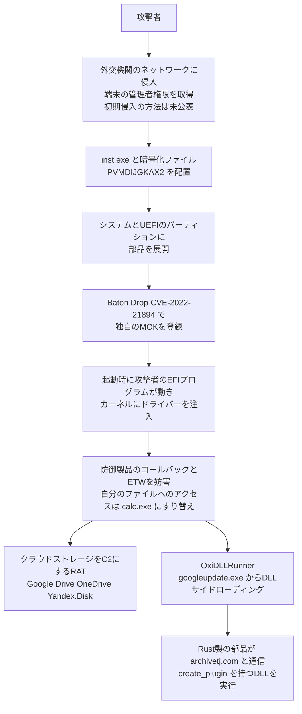

# APT41「BlackX」 ― パッチ済みでもSecure Bootを破るブートキット

## 要点

### 影響バージョン

- **Secure Bootを有効にしたWindows端末のうち、Microsoftの失効処理（「Windows Production PCA 2011」証明書をDBXに追加）をまだ有効にしていないもの**。月例更新を当てただけでは失効は行われない（Microsoft KB5025885、Kaspersky）。
- 攻撃に使われた欠陥は Baton Drop（CVE-2022-21894）。BlackXの導入には、攻撃者がすでに**端末の管理者権限を持っている**ことが前提（Kaspersky、Microsoft）。
- 「Windows Production PCA 2011」は2026年10月19日に有効期限を迎えたが、**期限切れだけでは古いブートマネージャーの読み込みは止まらない**。DBXで拒否する必要がある（Kaspersky）。

### 今すぐやること

- Microsoft KB5025885 の手順（DBの2023年証明書の追加 → 新しいブートマネージャーの確認 → PCA 2011 をDBXに追加 → SVNの更新）を、**まず機種ごとに1台で試し**、計画的に広げる。失効は一度適用すると元に戻せない（Microsoft）。
- 適用前に、BitLockerの回復キーを控え、回復用USB・PXE／WDSなどの起動イメージを新しい署名のものに作り直す（Microsoft）。
- 適用できたかを、イベントID 1036（DB更新）・1799（ブートマネージャー更新）・1037（DBX更新）・1042（SVN）で確かめる（Microsoft）。
- 外交・政府・防衛関連など狙われやすい組織は、EFIシステムパーティション（ESP）の不審なファイル、MOKの登録、失効済み証明書で署名されたドライバーを点検する（Kaspersky、考察）。

## 概要

- Kaspersky GReAT は2026年10月22日、タジキスタン・ウズベキスタン・トルクメニスタンの外交機関を狙った2026年初めの攻撃で、UEFIブートキット「BlackX」を見つけたと公表した。APT41 によるものと中程度の確度でみている（Kaspersky）。
- BlackX は、2022年に犯罪者向けフォーラムで売られた BlackLotus とよく似た方法で Baton Drop を悪用し、**独自のMachine Owner Key（MOK）を登録して任意のEFIプログラムを起動時に動かす**（Kaspersky）。
- 狙われた端末は**更新済み**だった。原因は、Microsoft の対策が古い署名証明書の失効を**利用者の手動の操作で有効にする**作りで、多くの組織がその操作をしていなかったことだと Kaspersky は分析している（Kaspersky）。

> この記事では、ベンダー・公的機関・研究者・報道で確認できた内容を「事実」、筆者の推測や意見を「考察」として分けて書いています。

## 何が起きたか（時系列）

| 時期 | 出来事 |
| --- | --- |
| 2022年10月 | 犯罪者向けフォーラムで、Secure Bootを破るUEFIブートキット BlackLotus が5,000ドルで売りに出される（Kaspersky） |
| 2023年3月 | ESET が BlackLotus の実物を確認。Baton Drop（CVE-2022-21894）でSecure Bootを破ることを示す（Kaspersky） |
| 2023年5月9日 | Microsoft が BlackLotus 関連のSecure Boot回避への対策を、手動で有効にする形で出し始める（KB5025885） |
| 2024年4月〜7月 | Microsoft が、個々のブートマネージャーを拒否する方式から「Windows Production PCA 2011」証明書ごとDBXに入れる方式に切り替え、展開段階を始める。**既定では有効にならない**（KB5025885） |
| 2026年初め | 中央アジアの外交機関で BlackX を使った攻撃。Kaspersky の製品が防御製品の無効化を止め、攻撃は失敗（Kaspersky） |
| 2026年6月 | ESET が FishMonger（APT41と関係があるとされる）の活動を報告。カーネルの埋め込みプログラムと、UEFIブートキットの部品の可能性に触れる（Kaspersky による紹介） |
| 2026年10月19日 | 「Windows Production PCA 2011」証明書の有効期限（Kaspersky） |
| 2026年10月21〜22日 | Kaspersky が Security Analyst Summit 2026 で発表し、Securelist に詳細を公開（Kaspersky） |

自動で失効させる「強制段階」について Microsoft は、2026年1月より前には始めず、始める6か月以上前に告知するとしている。Kaspersky によれば、記事の公開時点でこの段階はまだ始まっていない（KB5025885、Kaspersky）。

## 技術的な問題点（根本原因）

**事実（Baton Drop と失効の仕組み）**

- Baton Drop（CVE-2022-21894）は古いWindowsのブートマネージャーにある欠陥で、BlackLotus はこれを使ってSecure Bootの方針を外した（Kaspersky、NSA の勧告を報じた BleepingComputer）。
- 欠陥のある古いブートマネージャーも「Windows Production PCA 2011」で署名されているため、**修正版を入れても、攻撃者が古い版に差し戻せば起動してしまう**。これを止めるには、この証明書をUEFIの拒否リスト（DBX）に入れる必要がある（Microsoft、NSA の勧告を報じた BleepingComputer）。
- Microsoft はこの失効を既定では有効にしていない。レジストリ `HKLM\SYSTEM\CurrentControlSet\Control\Secureboot` の `AvailableUpdates` に値を設定し、スケジュールタスク `\Microsoft\Windows\PI\Secure-Boot-Update` を動かす手順を、段階ごとに管理者が行う（Microsoft、Kaspersky）。
- 自動にしない理由として Kaspersky は、PCA 2011 を信頼して起動する他のOSとの併用環境（デュアルブート）を壊しうることを挙げている。Microsoft も、失効後は古い回復メディアで起動できなくなる、ファームウェアによっては更新に失敗する、BitLockerの回復画面に入ることがある、と注意している（Kaspersky、Microsoft）。

**事実（BlackX がしたこと）**

- 攻撃者は、すでに侵入して管理者権限を得た端末に、`C:\ProgramData\Intel\inst.exe` と、RC4で暗号化した拡張子のないファイル `PVMDIJGKAX2` を置いた。`inst.exe PVMDIJGKAX2 Q46F6MDLI3RX2KV1` の形で起動し、最後の引数が復号の鍵だった（Kaspersky）。
- `inst.exe` 自体には悪性の文字列も埋め込みデータもなく、必要な部品はすべて暗号化ファイルの中にある。対応する側が部品を取り出しにくくする作りだと Kaspersky は指摘する（Kaspersky）。
- インストーラーはシステム側とUEFI側の両方のパーティションにファイルを置き、Baton Drop を悪用して**独自のMOKを登録**する。これでSecure Bootの下でも任意のEFIファイルを読み込める（Kaspersky）。
- 悪用の実装は BlackLotus に「驚くほど似ている」が違いもある。BlackLotus のソースコードは公開されたことがないため、解析して作り直したか、犯罪者からソースを買った可能性がある（Kaspersky）。

**考察**

修正は「入っている」のに、効き目は「スイッチを入れたときだけ」という形だった。パッチ管理の多くは「更新が適用されたか」を数えるので、この種の対策は数字の上では済んで見える。BlackX はその見かけの差を狙ったものと考える。Kaspersky も、攻撃者は手動の有効化をしている組織が少ないことを見越して BlackLotus をまねる手間をかけた、とみている。

## 攻撃・侵入経路

**事実（起動後の部品。Kaspersky）**

- UEFIの部品はWindowsのカーネルに悪性ドライバーを注入する。このドライバーは「温江区明宇网络技术服务工作室」名義の証明書（シリアル `0bcdf5e0da32d68900b8b7638459d072`、発行元により失効済み）で署名されている。
- ドライバーは、防御製品に関係するプロセス・スレッド・レジストリのコールバックを無効にし、ETWの提供元を改ざんして防御製品が記録を受け取れないようにする。KasperskyやAvastが入っているときだけ動く処理もあるが、Kaspersky の解析ではKaspersky製品には効かなかった。
- ブートキットのファイルを開こうとする要求には、悪性ファイルの代わりに `calc.exe` のハンドルを返して隠す。
- 利用者側の部品は2種類。1つは、Google Drive・OneDrive・Yandex.Disk をC2に使うRATで、ファイル名の末尾（`0X01`〜`0X06`、`SSSR`）で命令の種類を分け、.NETの部品の実行やファイルの送受信をする。
- もう1つの OxiDLLRunner は OLLVM で難読化したDLLで、正規の `googleupdate.exe`（元の名前は `jcef_helper.exe`）に読み込ませ、`v8_context_snapshot.bin` を復号して実行する。中身はシェルコードとRust製のプログラムで、`www[.]archivetj[.]com` と通信し、`create_plugin` という関数を持つDLLを受け取って動かす。

**事実（帰属の根拠。Kaspersky）**

- ESET が2026年6月に報告した FishMonger の埋め込みプログラムのPDBパスが `C:\Users\xdd\Desktop` で始まり、BlackX の部品にも「xdd」という識別子が何度も出てくる。
- 正規の実行ファイルと暗号化ファイルを使うDLLサイドローディング、OLLVMによる難読化は、中国語を使う攻撃者によく見られる。
- これらから APT41 と中程度の確度で関連づけている。

## なぜ防げなかったか・構造的要因の考察

1. **「更新済み」と「守られている」がずれていた。** 月例更新は対策の部品を届けるだけで、失効を有効にするのは管理者の別作業だった。Kaspersky は、更新の後に追加の操作をするのは管理者にとって非常に珍しく、手順もMicrosoftのサイトの奥にあって気づきにくいと指摘する（Kaspersky）。
2. **失効は「戻せない」ので、慎重になるほど先送りされる。** 一度DBXに入れると、ディスクを初期化しても元に戻らない。古い回復メディアや一部のファームウェア・仮想環境で起動できなくなるおそれもある（Microsoft）。壊すリスクが目に見え、守る効果が見えにくいため、後回しにされやすい構造だと考える（考察）。
3. **証明書の期限切れは防御にならない。** PCA 2011 は10月19日に期限を迎えたが、UEFIの起動時の検証では期限切れだけで読み込みは止まらない（Kaspersky）。「期限が来たから自然に片付く」と考えるのは危ない（考察）。
4. **管理者権限を取られた後の「最後の砦」が狙われた。** BlackX は初期侵入の道具ではなく、侵入後に居座るための部品だった（Kaspersky）。OSを入れ直しても残りうる場所に置かれるため、見つけにくく、消しにくい（考察）。
5. **犯罪者の道具を国家系の攻撃者が取り込んだ。** Kaspersky は、APT が犯罪者からアイデアやコードを借りるのは珍しいとしている。闇市場で一度売られた手口は、売り手が消えた後も別の攻撃者に引き継がれうる（Kaspersky、考察）。

## 運用者向けの具体的な対策と検知ポイント

**対策（事実に基づくもの。Microsoft KB5025885）**

- 手順の順番：
  1. 2023年の証明書をDBに入れる：`AvailableUpdates` に `0x5944` を設定し、`Secure-Boot-Update` タスクを実行。
  2. `HKLM:\SYSTEM\CurrentControlSet\Control\SecureBoot\Servicing` の `UEFICA2023Status` が `Updated` になったか確かめる。
  3. 失効を有効にする：`AvailableUpdates` に `0x80` を設定してタスクを実行。DBXに「Microsoft Windows Production PCA 2011」が入ったかを確かめる。
  4. SVNを更新する：`AvailableUpdates` に `0x200` を設定してタスクを実行。
- 適用前に `manage-bde -protectors -get %systemdrive%` でBitLockerの回復キーを控える。回復ドライブは、DB更新を済ませた端末で作り直す。
- 既知の問題として、VMware上のSecure Boot有効なx86の仮想マシンが起動しなくなる、Symantec Endpoint Encryption を入れた端末には適用できない、HPのSure Start搭載機は最新ファームウェアが必要、などが挙げられている。機種ごとに試してから広げる。
- 失効はあくまで予防で、すでに侵害された端末を治すものではない（Microsoft）。

**検知ポイント（事実に基づくもの。Kaspersky）**

- ファイル：`C:\ProgramData\Intel\inst.exe`、拡張子のない `PVMDIJGKAX2`、`googleupdate.exe` と同じフォルダーの `v8_context_snapshot.bin`。
- ハッシュ：`googleupdate.exe`（元 `jcef_helper.exe`）の MD5 `AF8A983B9ADA07EAE1259BF2953ABD40`。正規のファイルなので、置き場所との組み合わせで見る。
- 署名：シリアル `0bcdf5e0da32d68900b8b7638459d072` の証明書で署名されたドライバー。
- 通信：`www[.]archivetj[.]com`。業務で使わない端末からの Google Drive・OneDrive・Yandex.Disk への定期的なアクセス。

**考察（運用上の工夫）**

- 端末管理の画面で、更新の適用率とは別に「DBXにPCA 2011が入っている端末の割合」を数える。イベントID 1037 の有無を集めれば把握できる。
- ESPの中身とMOKの登録状況を、定期的に基準と比べる。Linuxとの併用がない端末でMOKが登録されていれば、それ自体が強い異常のしるしになる。
- ブートキットが確認された端末は、掃除ではなく、OSの入れ直しとESP・Secure Bootの変数の作り直しを前提にする。
- 管理者権限の利用を絞ることが、結局いちばん効く。BlackX は管理者権限を取られた後の道具だからだ。

## 参考リンク

- [How APT41 revived the BlackLotus bootkit to attack diplomatic organizations in Central Asia（Kaspersky Securelist、2026年10月22日）](https://securelist.com/uefi-bootkit-blackx/121539/)
- [Beneath the operating system: Kaspersky discovers BlackX bootkit targeting diplomatic organizations in Central Asia（Kaspersky、2026年10月21日）](https://www.kaspersky.com/about/press-releases/beneath-the-operating-system-kaspersky-discovers-blackx-bootkit-targeting-diplomatic-organizations-in-central-asia)
- [How to manage the Windows Boot Manager revocations for Secure Boot changes associated with CVE-2023-24932（Microsoft KB5025885）](https://support.microsoft.com/en-us/topic/how-to-manage-the-windows-boot-manager-revocations-for-secure-boot-changes-associated-with-cve-2023-24932-41a975df-beb2-40c1-99a3-b3ff139f832d)
- [NSA shares tips on blocking BlackLotus UEFI malware attacks（BleepingComputer）](https://www.bleepingcomputer.com/news/security/nsa-shares-tips-on-blocking-blacklotus-uefi-malware-attacks/)
- [October 22, 2026 CVE Threat Brief（Carthage Electronics）](https://carthageelectronics.com/october-22-2026-cve-threat-brief/)
