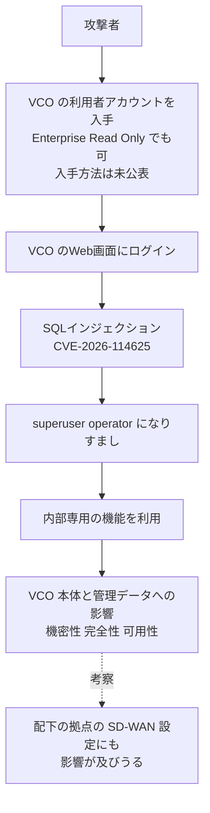

# VeloCloud Orchestrator ― SQLインジェクションで権限昇格、悪用続く

## 要点

### 影響バージョン

- VeloCloud Orchestrator（VCO）On-Prem の **5.2.x は 5.2.3.18 未満、6.1.x は 6.1.3.10 未満、6.4.x は 6.4.2.12 未満**（Arista）。
- サポートが終わった版は評価されていない（Arista）。
- Arista が運用するホスト型（Dedicated を含む）は修正済み。VeloCloud Gateway・VeloCloud Edge・EOS製品は対象外（Arista）。
- 9月の CVE-2026-93952 の修正版（5.2.3.16、6.4.2.8）も、今回の修正版より古いので対象に入る（Arista の版番号から）。

### 今すぐやること

- 5.2.3.18／6.1.3.10／6.4.2.12 以降へ更新する。サポート外の系列は Arista TAC に相談する（Arista）。
- 更新までは、VCO のWeb画面に届く範囲を信頼できる管理用ネットワークに絞る。設定で露出をなくす方法はない（Arista）。
- `74.82.197.86` と `38.54.50.151` を遮断し、過去のログにないか探す（Arista）。
- 侵害が疑われるときは、更新の前に、Webアクセス・アプリ・システム・データベースのログとファイルの時刻を保全する（Arista）。

## 概要

- Arista は2026年10月22日、自前運用版の VCO にある SQLインジェクション CVE-2026-114625（CVSS 3.1 で 9.9）を公表した。Arista 自身が見つけ、すでに悪用されている（Arista）。
- ログインできる利用者なら誰でも、内部専用で外から使う想定のない機能を持つ「superuser operator」になりすませる。必要な役割は、既定の中で最も弱い Enterprise Read Only でよい（Arista）。
- VCO の自前運用版では、7月の CVE-2026-16812、9月の CVE-2026-93952 に続いて、悪用中の欠陥が見つかった（Arista、SecurityOnline）。BleepingComputer は、今年の Arista のゼロデイとして4件目と数えている。

> この記事では、ベンダー・公的機関・研究者・報道で確認できた内容を「事実」、筆者の推測や意見を「考察」として分けて書いています。日付は各発表の表記どおりです。

## 何が起きたか（時系列）

| 日付 | 出来事 |
| --- | --- |
| 2026年7月 | VCO の OS コマンドインジェクション CVE-2026-16812 が悪用され、CISA の KEV に入る（SecurityOnline） |
| 2026年9月22日 | Arista が CVE-2026-93952（入力検証の不備、CVSS 3.1 で 10.0）を公表。外部の発見で、悪用中。修正は 5.2.3.16、6.4.2.8（Arista Security Advisory 0183） |
| 2026年9月 | CVE-2026-93952 が KEV に入る（SecurityOnline） |
| 2026年10月22日 | Arista が CVE-2026-114625 を公表（Security Advisory 0199）。悪用中、ホスト型は修正済み（Arista） |

## 技術的な問題点（根本原因）

**事実（Arista Security Advisory 0199）**

- 弱点の種類は CWE-89（SQLインジェクション）。CVSS 3.1 のベクターは `AV:N/AC:L/PR:L/UI:N/S:C/C:H/I:H/A:H`。「ログインは要る（PR:L）が、影響は VCO の外にも及ぶ（S:C）」という評価になっている。
- 影響を受ける VCO では、認証済みの利用者が operator の権限を得て、ローカルの「superuser operator」になりすませる。これには、内部専用で、外から使う想定のない機能が含まれる。
- 成功すると、VCO 本体と、VCO が管理するデータの機密性・完全性・可用性が損なわれうる。
- VCO は既定で露出しており、攻撃に必要なのは VCO のWeb画面へのネットワーク到達と、有効なログインだけ。露出を防ぐ設定はない。
- SQL文のどこに外からの値が入るのか、どの機能が「内部専用」なのかは公表されていない。

**考察**

閲覧専用の役割に絞っても、その役割のリクエストがSQLの組み立てに入り込めば、データベースに保存された「誰がどの権限か」の情報に手が届いてしまう。権限の分け方がアプリの層でどれだけ丁寧でも、その下のデータの扱いに穴があれば役割の境界は意味を失う、という型の欠陥だと考える。

## 攻撃・侵入経路

**事実（Arista）**

- 攻撃元として `74.82.197.86` と `38.54.50.151` が観測されている。
- Webアクセスログでは、URLのような形のパス要素、エンコードされた文字、ローカルや内部のサービスへの参照、多数のリクエストを含むものを調べるよう案内している。
- 9月の CVE-2026-93952 の勧告では、VCO が侵害されると VeloCloud Edge にも手が届きうるとして、認証情報の入れ替え、管理下の機器の状態の確認、信頼できる元からの VCO の作り直しなどを挙げている（Arista Security Advisory 0183）。

**考察**

今回の IoC の説明（URLのようなパス、内部サービスへの参照）は9月の勧告とほぼ同じ文言だ。superuser operator になりすました後の動きが、9月と同じく内部向けの機能を経由する可能性はあるが、公表された情報からは確かめられない。

## なぜ防げなかったか・構造的要因の考察

1. **「ログインが必要」は低い壁だった。** 必要なのは最も弱い既定の役割で、テナント（顧客企業）側の閲覧用アカウントでよい（Arista）。SD-WAN の管理サーバーは、顧客企業や運用委託先など多くの人にアカウントを配るので、どれか1つが盗まれれば足りる（考察）。
2. **管理画面がネットに出ている前提の製品だった。** Arista は「VCO は既定で露出している」「露出を防ぐ設定はない」としている（Arista）。拠点のEdge機器がつながるために外から届く必要があり、管理画面だけを隠しにくい作りだと考える（考察）。
3. **緊急修正が続き、毎回「最新版」が変わる。** 7月・9月・10月と、悪用中の欠陥のたびに修正版が上がっている。9月の修正版を当てた運用者も今回は対象になる。更新の手間が積み重なるほど、追いつけない運用者が増える（考察）。
4. **見つけたのは Arista 自身だった。** 今回は外部報告ではなく Arista が検知した（Arista）。ホスト型を自社で運用しているからこそ気づけた可能性があり、自前運用の利用者は同じ検知の目を持っていないかもしれない（考察）。

## 運用者向けの具体的な対策と検知ポイント

**対策（事実に基づくもの。Arista）**

- 修正版（5.2.3.18／6.1.3.10／6.4.2.12 以降）へ更新する。
- 更新までは、VCO のWeb画面への到達を信頼できる管理用ネットワークに絞り、通常の業務で要らない外向きのポートを塞ぐことを検討する。
- 攻撃元のIPからのアクセスを監視・遮断する。
- VCO ホストからの想定外の外向き通信、裏口になる常駐プロセスやWebシェル、最近の管理者の操作の想定外の変更を確認する。

**検知ポイント（事実に基づくもの。Arista）**

- 通信：`74.82.197.86`、`38.54.50.151`。
- Webアクセスログ：URLのようなパス要素、エンコードされた文字、ローカル・内部サービスへの参照、多数のリクエスト。
- 9月の CVE-2026-93952 の勧告にある痕跡（`/usr/local/sbin/.vcnode.js`、`/usr/local/sbin/vc-sysmond`、`/etc/systemd/system/vc-sysmon.service`、nginx ログの `x-vc-opt` ヘッダー、`142.93.149.77`・`104.248.126.159`）も、あわせて確かめておくと、過去の侵害の見落としを減らせる（Arista Security Advisory 0183。今回の欠陥との関係は公表されていない）。

**考察（運用上の工夫）**

- VCO のアカウントを棚卸しし、使われていない閲覧用アカウントや、外部の委託先に配ったアカウントを止める。今回の欠陥では「閲覧だけだから安全」という前提が成り立たない。
- 閲覧用の役割のアカウントが、普段と違う時間・場所からログインしていないか、ログイン履歴を見る。
- 侵害の痕跡が見つかったら、VCO の更新だけで終わらせず、VCO が保持する認証情報や証明書を入れ替え、配下の Edge 機器の設定を確かめる。

## 参考リンク

- [Security Advisory 0199（Arista、2026年10月22日）](https://www.arista.com/en/support/advisories-notices/security-advisory/24838-security-advisory-0199)
- [Security Advisory 0183（Arista、2026年9月22日）](https://www.arista.com/en/support/advisories-notices/security-advisory/24765-security-advisory-0183)
- [Arista Warns VeloCloud Orchestrator Flaw CVE-2026-114625 Is Exploited in the Wild（SecurityOnline、2026年10月22日）](https://securityonline.info/velocloud-orchestrator-cve-2026-114625-exploited/)
- [Arista patches new VeloCloud Orchestrator zero-day exploited in attacks（BleepingComputer）](https://www.bleepingcomputer.com/news/security/arista-patches-new-velocloud-orchestrator-zero-day-exploited-in-attacks/)
