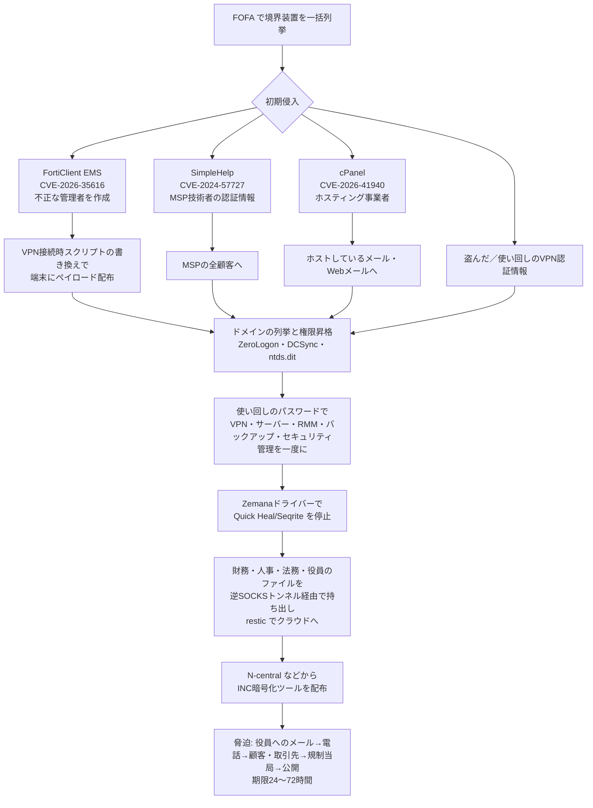

# INC・The Gentlemen系 ― 「AIが実行し人が承認する」侵入

## 要点

### 影響バージョン

攻撃者の記録で、実際に悪用したとされる製品（数はすべて攻撃者自身の記録で、SOCRadarは独自に確かめていない）。

- **FortiClient EMS 7.4.5〜7.4.6**（CVE-2026-35616、認証なしでコードやコマンドを実行できる。7.4.7以降、または緊急ホットフィックスで修正。7.2と8.0は影響なし）（Fortinet）。攻撃者の記録では2,236台を標的にし、108件の管理者アカウントを作った（SOCRadar）。
- **SimpleHelp 5.5.7以前**（CVE-2024-57727、パストラバーサル。5.5.8・5.4.10・5.3.9で修正）（SimpleHelp）。4,922台を走査して427件の管理者パスワードを得た（SOCRadar）。
- **cPanel & WHM**（CVE-2026-41940、認証回避。2026年4月28日の更新で修正）（cPanel）。小規模ホスティング事業者への49件以上の侵入を主張（SOCRadar）。
- そのほか Roundcube（CVE-2025-49113）を侵入後に使い、ZeroLogon、PrintNightmare、noPac、PAN-OS User-ID、FortiGate の SAML SSO 回避を試した（SOCRadar）。

### 今すぐやること

- FortiClient EMS、SimpleHelp、cPanel、VPN装置を最新にし、**管理画面をインターネットから見えないようにする**（SOCRadar）。
- 更新済みでも、**EMSに見覚えのない管理者**（`sysadmin`、`fct_svc_*`、`ems_monitor_*` など）や、**VPN接続時スクリプト（on_connect）の書き換え**がないか確かめる。攻撃者はここから端末にペイロードを配っていた（SOCRadar）。
- VPN・RMM・バックアップ・セキュリティ製品の管理画面で**同じパスワードを使い回していないか**確かめ、MFAとIP制限をかける（SOCRadar）。
- MSPに運用を任せている場合は、MSP側のRMMにも同じ対策を求める（SOCRadar）。

## 概要

- SOCRadar の脅威調査チーム STRU は2026年10月20日、INC Ransomware と The Gentlemen Ransomware の両方とかかわるアフィリエイト（実働部隊）の基盤を見つけたと公表した。The Hacker News が10月23日に報じた（SOCRadar、The Hacker News）。
- きっかけは、**外から中身が読めたC2サーバー1台**（45.227.254[.]43）。AIとの対話の記録、案件ごとの「ナレッジベース」、独自の攻撃フレームワーク「Phantom」のソースコードが置かれていた。その中の設定・ログ・認証情報から、さらに6台が見つかった（SOCRadar）。
- 侵入は「**AIが実行し、人が承認する**」形で進められていた。OpenCode を操作画面にして、OpenRouter 経由で市販のLLM（`anthropic/claude-opus-4.6`、`moonshotai/kimi-k3`）を使い、133セッション・8,257件のメッセージが残っていた（SOCRadar）。

> この記事では、ベンダー・公的機関・研究者・報道で確認できた内容を「事実」、筆者の推測や意見を「考察」として分けて書いています。SOCRadar が攻撃者の記録から読み取った数字は、SOCRadar 自身が「独自に確かめていない」としているものを含みます。

## 何が起きたか（時系列）

| 時期 | 出来事 |
| --- | --- |
| 2026年7月中旬 | Ghost C2 の活動が始まる（SOCRadar） |
| 2026年9月下旬 | 攻撃者の運用上の失敗で、ソースコード・認証情報・AIの対話記録が外から読める状態になり、STRU が発見（SOCRadar） |
| 2026年9月30日 | 被害者3組織向けのパッケージが10月1日の一斉展開に向けて固められる。同日の SimpleHelp の画面写真に、被害者の端末で暗号化ツールが動いている様子が写っていた（SOCRadar） |
| 2026年10月1日 | 一斉展開の予定日。仲間内のチャットに「明日モスクワ時間6時だよね？」とある。実際に展開されたかは確認されていない（SOCRadar） |
| 2026年10月5日 | STRU の確認で、OpenRouter の有料アカウント2つが有効で、1つは23,920ドルを使ってほぼ使い切っていた（SOCRadar） |
| 2026年10月20日 | SOCRadar がブログで公表（SOCRadar） |
| 2026年10月23日 | The Hacker News が報道（The Hacker News） |

## 技術的な問題点（根本原因）

**事実（SOCRadar）**

- **AIの使い方**: 案件ごとに被害組織向けの指示文（マスタープロンプト）で始まり、AIは「すべての行動を私と調整すること」という指示のもと、毎回オペレーターの承認を待ってから次に進んだ。AIは偵察の計画、手法の選択、コマンドの作成、盗んだデータの仕分け、報告書や脅迫文の下書きを担った。
- **モデルは市販のもの**: 「WormGPT」は人格を与える指示文の名前にすぎず、実体は市販のLLMだった。モデルに断られると、オペレーターは依頼を「**Authorized Red Team Assessment Request（許可されたレッドチーム評価の依頼）**」のひな形に書き換えて、モデルは替えずに続けた。
- **独自のツール**:
  - **Phantom**: 「Autonomous Red Team Kill Chain Framework」と名乗る、18のスキルモジュール・自動操縦の仕組み・Python と Go のエージェントからなる攻撃フレームワーク。OpenCode と連携し、AIが手法を選んでエージェントに作業を割り当てる。エージェントは Windows Update の部品を装い、`api.iquickline[.]com` に接続する。
  - **WormGPT-MCP**: 偵察から脅迫までのツールをAIにつなぐ32のMCPサーバー。身代金の交渉や価格決めのツールもあった。
  - **Ghost C2**（3世代。Cloudflare・Telegram・DNS経由のHTTPSで通信）、**RevSocks**（逆向きのSOCKS5トンネル）、**QuickLine**（Cloudflare を前に置いた Mythic のエージェント）、**Zemana のドライバーを悪用して Quick Heal・Seqrite を止めるツール**（BYOVD）、持ち出し用の **rks3**・**BackupAgent**。
- **ナレッジベース**: 被害組織、盗んだ認証情報、作戦の進み具合をAIに管理させていた。
- **仲間への提供**: 45.227.254[.]45 にあった `README_PARTNER.md` には、Phantom・OpenCode・ナレッジベース・WormGPT-MCP を外部のオペレーターに渡す手順が書かれ、「35 MCP servers」「55+ tools」「9K+ CVE PoC」とうたっていた。

**考察**

手口そのものは、境界装置の既知の脆弱性を突き、ドメイン管理者を取り、データを持ち出してから暗号化する、という従来どおりの流れだ。違うのは、**手順を考えてコマンドを打つ作業の多くをAIに任せ、人は承認するだけ**になっている点で、1人のオペレーターが同時に扱える案件の数が増える。2026年10月11日の記事で扱った、韓国の金融機関への連続侵入で使われたAI自動ペネトレーションツール「ARTEX」の件と同じく、**攻撃側でAIエージェントを使う運用が実際の侵入で確認された**例になる。

一方で、市販モデルの安全対策は「レッドチームの依頼です」と言い換えるだけで越えられていた。攻撃者が自前の「脱獄済みモデル」を用意しなくても、正規のモデルと正規の中継サービスで足りたことになる。

## 攻撃・侵入経路

**事実（SOCRadar）**

- 侵入後は、ドメインの列挙、可能ならドメイン管理者への昇格、情報窃取ツールでの認証情報の収集、財務・人事・法務・役員のファイルの優先的な収集、逆SOCKSトンネルでの持ち出し、という流れを繰り返した。
- **使い回されたパスワードが被害を広げた最大の要因**で、ある事例では1つのパスワードで VPN、サーバー、RMM、バックアップ、セキュリティ管理の各画面に一度に入れた。
- 暗号化ツールは46本で、被害者6組織向けに鍵と識別子を個別に埋め込み、Windows と Linux の両方を用意していた。Windows 版はバックアップとDBのプロセス・サービスを止め、**vssadmin ではなくドライバーへの直接の呼び出し（IOCTL 0x53C028）でシャドウコピーを消し**、拡張子 `.INC` と `INC-README.txt` を残す。
- 脅迫は、盗んだ財務資料から支払える額を見積もり、まず役員に金額を書かないメールを送る。その後、台本つきの電話、顧客・取引先、規制当局、公開と圧力を強め、期限は24〜72時間。支払いは Monero を予定していたが、ウォレットや支払いの記録は見つかっていない。被害者の顧客に侵害を知らせる偽のサイト（`trulitesupport[.]com`）を作り、INC のリークサイトへ誘導した例もある。
- 62組織が記録に名前を挙げられ、うち36が米国。業種は産業・製造・エネルギー（16.1%）、医療・製薬（14.5%）が多い。リークサイトに載ったのが4、暗号化・脅迫の段階が4、ドメイン全体を取られたのが14、足がかりを得たのが28、偵察だけが12。

**事実（帰属。SOCRadar）**

- INC との結びつきは、暗号化ツールが INC の身代金メモを復号すること、INC のリークサイトの被害者3組織（Aidon、Trulite、テキサス州プリンストン市）が内部の案件ファイルと一致すること、INC の管理パネルと Rocket.Chat のチャットに10月1日の展開予定が載っていたことによる。The Gentlemen とは、Leo Schachter Diamonds の件にグループ名を入れた脅迫文一式があった。
- 両グループの正式な同盟については確度「低」。両グループのオペレーターが同じ作業環境を使っていたことは「中〜高」。STRU は、**複数のランサムウェアのパートナーを支える、ツールと基盤の専門の提供者**がいるという形が最もありそうだとみている。
- オペレーターはロシア語を使い、主に 06:00〜14:00（UTC）に活動していた。

## なぜ防げなかったか・構造的要因の考察

1. **既知の脆弱性が長く残っていた。** SimpleHelp の CVE-2024-57727 は2025年1月に修正済み、FortiClient EMS の CVE-2026-35616 も2026年4月に修正と悪用の公表が出ている（SimpleHelp、Fortinet）。それでも攻撃者の記録には大量の標的が並んでいた（SOCRadar）。境界装置やリモート管理ツールは「止められない機器」になりやすく、更新が遅れがちだ（考察）。
2. **更新しても、仕込まれたものは残る。** EMSに作られた管理者や書き換えられたVPN接続時スクリプトは、パッチを当てても消えない（SOCRadarの推奨からの考察）。脆弱性の公表から更新までの間に入られていれば、更新後も侵害は続く。
3. **MSPとホスティング事業者が「まとめて入れる入口」になった。** SimpleHelp で盗んだMSP技術者の認証情報からはその技術者が担当する全顧客に、cPanel を破ったホスティング事業者からはそこでホストしているメールに届いた（SOCRadar）。中小企業は自社で直接狙われなくても、委託先経由で被害に遭う（考察）。
4. **パスワードの使い回しと管理画面の集中。** VPN・RMM・バックアップ・セキュリティ製品の管理を同じ資格情報で扱っていたため、1つ漏れると防御と復旧の手段が同時に奪われた（SOCRadar）。
5. **AIで「人手」の制約が減った。** 8,257件のやり取りからわかるように、偵察から脅迫文の作成までをAIが下ごしらえし、人は承認に集中できた（SOCRadar）。攻撃の数を増やすときの人手の制約が小さくなり、パッチ未適用の機器が見つかってから侵入されるまでの時間はさらに短くなると考えられる（考察）。
6. **市販モデルの安全対策は言い換えで越えられた。** 拒否されたら「許可されたレッドチーム評価」と言い換えるだけで済んでいた（SOCRadar）。AI事業者側の対策だけに頼ることはできない（考察）。

なお今回の発見は、攻撃者がAIの記録を全部残し、それを外から読める場所に置いた**運用上の失敗**による（SOCRadar）。AIに記憶させた運用は、見つかれば完全な証拠になる。

## 運用者向けの具体的な対策と検知ポイント

**対策（SOCRadar の推奨）**

- FortiClient EMS、Fortinet・SonicWall のゲートウェイを更新し、管理画面をインターネットから外す。EMSの不正な管理者と、VPN接続時スクリプトの書き換えを点検する。
- MSP・RMMの環境にMFA、IPの許可リスト、専用の管理者アカウントを入れ、委託先のMSPにも同じことを求める。
- SimpleHelp・MeshCentral・N-central などのリモートアクセスツールを棚卸しし、更新し、使ってよいものを制限する。
- ZeroLogon を修正し、Windows Server 2008 R2 のドメインコントローラーを廃止する。LAPS と gMSA を入れ、管理者の階層分けと、複製の権限・AAD Connect のアカウントを監査する。
- バックアップを変更できない形かネットワークから切り離した形で持ち、Veeam のコンソールを分離して更新する。
- EDRの改ざん防止を有効にし、脆弱なドライバーのブロックリストを使う。セキュリティサービスの削除・停止で警告を出す。
- restic・rclone のような持ち出しに使えるツールを、許可した端末に限る。
- Office のリモートテンプレート読み込みと HTML スマグリングを止め、電話による脅し（ビッシング）への対応を社員に教える。
- ハイパーバイザー・ESXi・中央のファイルサーバーを利用者のネットワークから分ける。

**検知ポイント（SOCRadar）**

- EMS・ゲートウェイ: 新しい特権アカウント（`sysadmin`、`fct_svc_*`、`ems_monitor_*`）、VPNプロファイルの変更、監査ログの欠け、偽造されたクライアント証明書のヘッダー。
- 初期侵入: Office がリモートの `.dotm` テンプレートを取りにいく、Office やブラウザーから `curl`・`certutil` が起動する、`RealtekAudioSvc` という名前のスケジュールタスク。
- C2・トンネル: RevSocks・Chisel・Ligolo の通信、TLS検証を切った Python のビーコン、`api.iquickline[.]com` などへのDNS問い合わせ。
- AD: ドメインコントローラー以外からの複製要求（DCSync）、シャドウコピーからの `ntds.dit` の読み出し、RC4 の Kerberos サービスチケットの急増、Netlogon のセキュアチャネルの異常。
- 横展開: 変更作業の時間外のRMMエージェントやリモートセッション、RDPを有効にする直前の Remote Registry の起動。
- 防御の無効化: Zemana ドライバーの読み込みと同時の Quick Heal・Seqrite のサービス停止やファイル削除。
- 暗号化: インストーラー以外のプロセスによる Restart Manager のセッション、`\\.\X:` のボリュームを開いた直後の IOCTL 0x53C028、`.INC` への大量のリネームと `INC-README.txt`。

**IOC（一部。SOCRadar）**

- サーバー: 45.227.254[.]43、45.227.254[.]45、45.227.254[.]84（多くは AS267784 Flyservers S.A.）
- ドメイン: `api.iquickline[.]com`（Phantom のエージェントの接続先）、`trulitesupport[.]com`（脅迫用の偽サイト）
- そのほかのサーバー・ハッシュ・onionアドレスは SOCRadar のブログとホワイトペーパーにある。

**考察**

- 「パッチを当てたか」だけでなく、「パッチを当てる前に入られていないか」を確かめる手順を、境界装置とリモート管理ツールの更新作業に組み込む。管理者アカウントの一覧と設定スクリプトを、更新の前後で比べるとよい。
- 管理画面ごとに資格情報を分け、特にバックアップとセキュリティ製品の管理は、ドメインやVPNとは別の認証にする。
- AIを使う攻撃者は、作業を細かく分けて人が承認しながら進めるため、1つ1つの操作は普通の管理作業に見えやすい。単発のアラートより、「EMSの管理者追加 → VPN スクリプト変更 → 新しいRMM」のような**一連の流れ**で見る相関ルールが効くと考えられる。

## 参考リンク

- [INC and The Gentlemen Ransomware: Exposed AI Infrastructure（SOCRadar、2026年10月20日）](https://socradar.io/blog/inc-gentlemen-ransomware-ai-infrastructure/)
- [Exposed Infrastructure Reveals How Ransomware Affiliates Used AI Agents to Execute Intrusions（The Hacker News、2026年10月23日）](https://thehackernews.com/2026/10/exposed-infrastructure-reveals-how.html)
- [FG-IR-26-099: FortiClient EMS の不適切なアクセス制御（Fortinet、2026年4月4日）](https://fortiguard.fortinet.com/psirt/FG-IR-26-099)
- [Security Vulnerabilities in SimpleHelp 5.5.7 and Earlier（SimpleHelp）](https://simple-help.com/blogs/security-vulnerabilities-in-simplehelp-5-5-7-and-earlier-what-you-need-to-know)
- [Security: CVE-2026-41940 - cPanel & WHM / WP2 Security Update 04/28/2026（cPanel）](https://support.cpanel.net/hc/en-us/articles/40073787579671-Security-CVE-2026-41940-cPanel-WHM-WP2-Security-Update-04-28-2026)
