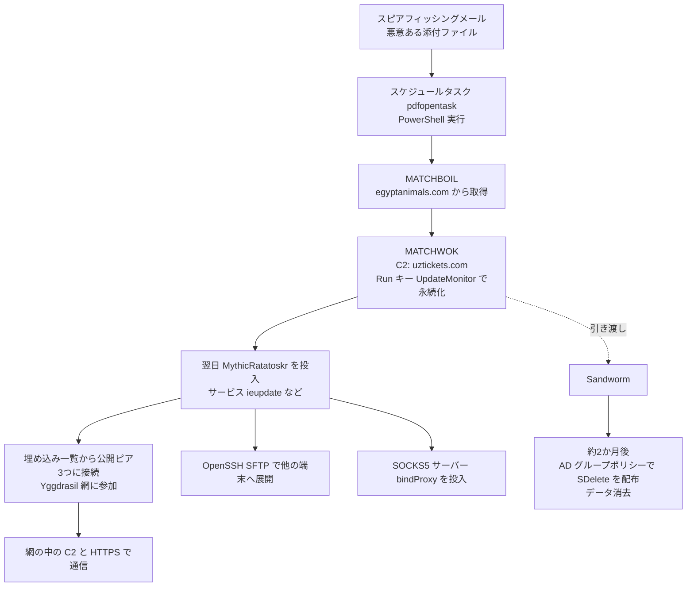

# MythicRatatoskr ― C2をYggdrasil網に隠すバックドアとデータ消去

## 要点

### 影響バージョン

- **Windows 端末**が対象。設定ファイルのパスなどから、**Linux 版もあるとみられる**（ESET）。
- 脆弱性の悪用ではなく、**添付ファイル付きのスピアフィッシングメール**から入った（ESET、CERT-UA）。
- 確認された被害はウクライナの穀物物流企業1社。ESET はこのバックドアをほかでは見ていない（ESET）。

### 今すぐやること

- ウクライナやその取引先・物流・農業関連と関係がある組織は、ESET が公開したIOC（ファイル名、ハッシュ、Yggdrasil のピアの一覧）で端末とログを調べる（ESET）。
- 業務で使っていない場合は、**Yggdrasil の公開ピアへの接続を止める**。ESET は、C2が網の中にあっても、公開ピアのアドレスを止めれば対策になるとしている（ESET）。
- `ieupdate`・`updater.exe`・`WindowsDefenderSvc.exe` のような**正規の名前を装ったサービス**、`.updatecache` や `.crond` のような**ドットで始まる設定ファイル**を探す（ESET）。
- Active Directory のグループポリシーで `SDelete` のような消去ツールが配られていないか、GPOの変更を監視する（ESET の観測した手口からの考察）。

## 概要

- ESET は2026年10月22日、ウクライナの穀物物流企業への攻撃で、これまで知られていなかった Go 製のバックドア「**MythicRatatoskr**」が使われたと公表した（ESET）。
- このバックドアは、C2サーバーと**分散型のメッシュ網「Yggdrasil」の中で**通信する。Yggdrasil は中央のサーバーを持たず、ネットの上に暗号化されたIPv6のネットワークを重ねる実験的な仕組み。ESET は、**国家系の攻撃者がこのように悪用した例として、知る限り初めて**の記録だとしている（ESET）。
- 2025年7月16日に **UAC-0099** がスピアフィッシングで侵入し、同年9月17日に **Sandworm**（ロシア軍参謀本部情報総局 GRU の74455部隊とされる）がデータを消した。ESET は、UAC-0099 が侵入の足がかりを Sandworm に**引き渡した**と高い確度でみている（ESET）。
- ESET は2026年9月18日の LABScon と10月16日の Virus Bulletin でこの内容を発表していた（ESET）。

> この記事では、ベンダー・公的機関・研究者・報道で確認できた内容を「事実」、筆者の推測や意見を「考察」として分けて書いています。日時は ESET の発表の表記どおりです。

## 何が起きたか（時系列）

| 日時 | 出来事 |
| --- | --- |
| 2024年12月〜2025年2月ごろ | MythicRatatoskr の開発が始まったとみられる（バイナリ内の痕跡から。ESET） |
| 2025年7月16日 06:59 | 標的組織の1台で、スケジュールタスク `pdfopentask` が `%temp%\temporarydoc.txt` の PowerShell を実行（ESET） |
| 同日、約1分後 | ダウンローダー MATCHBOIL が動き、`egyptanimals[.]com` からバックドア MATCHWOK を取得。MATCHWOK の C2 は `uztickets[.]com`（ESET） |
| 2025年7月17日 09:28 | 同じ端末に MythicRatatoskr が届く。その後、OpenSSH の SFTP サーバーを使ってほかの端末にも配られる（ESET） |
| 2025年8月 | 一部の端末で SOCKS5 サーバー（内部名 bindProxy）が見つかる。MythicRatatoskr で配られたとみられる（ESET） |
| 2025年9月17日 | Active Directory のグループポリシーで `SDelete` を配ってデータを消去（ESET） |
| 2025年10月11日 | ESET が独自に Yggdrasil 網の地図を作り、C2サーバーの位置を確認（ESET） |
| 2026年9月18日・10月16日 | LABScon、Virus Bulletin で発表（ESET） |
| 2026年10月22日 | ESET が公表（ESET） |

## 技術的な問題点（根本原因）

**事実（ESET）**

- **Yggdrasil とは**: 各ノードが自分で Ed25519 の鍵ペアを作り、公開鍵から `200::/7` の範囲のIPv6アドレスが決まる。ノード同士の通信はエンドツーエンドで守られる。中央のサーバーがないので止めにくい。一方、**匿名性は目標にしていない**（Yggdrasil のFAQ）。
- **ユーザー空間で動く**: MythicRatatoskr は `yggstack` をもとに作られ、トンネル用のネットワークインターフェースを作らずにアプリの中だけで Yggdrasil の通信を行う。管理者権限がなくても動き、移植しやすい。
- **網への参加**: バイナリに埋め込んだ32の公開ピアの一覧（base64）から3つをランダムに選んで接続し、公開の Yggdrasil 網に参加する。起動のたびに新しい鍵を作るので、感染端末の Yggdrasil 上のアドレスは毎回変わる。NodeInfo を空にし、他のノードから OS やバージョンを見られないようにしている。
- **C2との通信**: 網の中の C2 `201:b479:2771:8df4:b5eb:d007:63b0:2838` に、ポート443のHTTPSでJSONをPOSTする。種類は `checkin`（ユーザー名・ホスト名・ローカルIPの送信）、`tasking`（命令の取得）、`result`（結果の送信）、`getfile`（ファイルの取得）の4つ。
- **機能**: コマンド実行（`cmd.exe`）、ファイルの一覧・送受信、全画面のスクリーンショット、ローカルのTCPポートを Yggdrasil 網に公開する `expose`、同じC2の8080番ポートへの逆向きのSOCKS5プロキシ（revsocks のコードを流用）。
- **検知を避ける工夫**: 一部の検体は起動から10分待ってから網に接続する。設定は AES-256-CFB で暗号化したJSONで、鍵はバイナリに埋め込まれている。
- **Linux 版の可能性**: 設定ファイルのパスに `%LocalAppData%/Temp/.crond`（スラッシュの向きと `.crond` はUnix系の書き方）や、使われていない `/tmp/.test_config` が残っていた。
- **永続化**: Windows のサービス（名前 `ieupdate` など）として動く。

**考察**

C2が通常のインターネット上にあれば、IPアドレスやドメインの評判、ホスティング事業者への削除要請で対処できる。Yggdrasil 網の中のC2は、防御側から見ると「公開ピアへのTLS接続」しか見えず、その先にあるC2のIPv6アドレスはネットワーク機器のログには現れない。ESET でさえ、C2の物理的な場所を調べるのは特に難しかったとしている。ただし、網に入るには必ず公開ピアに接続する必要がある。**「入口のピアへの接続」が、この手口のいちばん見えやすい痕跡**になる。

## 攻撃・侵入経路

**事実（ESET）**

- UAC-0099 は2022年から活動し、2023年6月に CERT-UA が初めて報告した。ウクライナの政府機関・金融機関・メディアを狙う。ESET は中程度の確度でロシアの利益に沿うとみている。
- 侵入後の MATCHBOIL・MATCHWOK は UAC-0099 の既知のツールで、この段階は高い確度で UAC-0099 による。データ消去は、グループポリシーで SDelete を配るという Sandworm の典型的な手口から、高い確度で Sandworm による。
- MythicRatatoskr を主に操作したのが UAC-0099 か Sandworm かはまだわかっていない。
- ロシア系グループ同士の協力は今回だけではない。ESET は2025年に、FSB に結びつく Gamaredon と Turla の協力も報告している。

## なぜ防げなかったか・構造的要因の考察

1. **役割の分かれた攻撃者の間で足がかりが受け渡された。** 入口を作る側（UAC-0099）と、破壊する側（Sandworm）が別で、侵入から破壊まで約2か月あった（ESET）。入口の段階のスパイ活動に見える痕跡を「よくある侵入」と扱うと、その後の破壊の準備を見落としうる（考察）。
2. **C2を止める手段が限られた。** 通常のC2のようにドメインやIPを止めたり、事業者に削除を頼んだりしにくい（ESET）。防御側の通信の監視は「どこの国の、評判の悪いIPか」で判断しがちだが、ここでは接続先がボランティアの公開ピアになる（考察）。
3. **ユーザー空間で完結する通信。** トンネル用のインターフェースを作らないため、端末にVPNソフトが入ったようには見えない（ESET の説明からの考察）。
4. **正規のツールと仕組みでの横展開と破壊。** 端末間の展開には OpenSSH の SFTP、消去には Microsoft の SDelete とグループポリシーが使われた（ESET）。どれも管理作業で使うものなので、それだけでは不審と判断しにくい（考察）。
5. **ドメインの管理権限が奪われた時点で、破壊は一斉に起きる。** グループポリシーで配ると、ドメインに参加する端末すべてに同時に届く（考察）。

## 運用者向けの具体的な対策と検知ポイント

**事実に基づく検知ポイント（ESET）**

- **ファイル**: `C:\Windows\system32\updater.exe`、`C:\Windows\system32\krbtman.exe`、`C:\Windows\system32\windowsdefendersvc.exe`、`%localappdata%\Microsoft\OneDrive\OneDriveLiveUpdater.exe`、`%userprofile%\Downloads\ieupdate.exe`、`%userprofile%\AppData\Local\ieupdate.exe` など。`krbtman.exe` は端末によって MythicRatatoskr のことも SOCKS5 サーバーのこともある。
- **設定ファイル**: `C:\Windows\Temp\.updatecache`、`C:\Windows\system32\.updatecache`、`%LocalAppData%/Temp/.crond`。
- **サービス**: `ieupdate`。`updater.exe` と `WindowsDefenderSvc.exe` もサービスとして起動していた（イベントログ）。
- **SOCKS5 サーバー**: `%localappdata%\SMBCache\nbtresolver.exe` など。`127.0.0.1:33690` で待ち受ける。
- **先行する UAC-0099 の痕跡**: スケジュールタスク `pdfopentask`、`%temp%\temporarydoc.txt`、`HKCU\Software\Microsoft\Windows\CurrentVersion\Run\UpdateMonitor`、`egyptanimals[.]com`、`uztickets[.]com`。
- **ネットワーク**: 埋め込まれた公開ピア（例: `tls://37.205.14[.]171:993`、`tls://51.15.204[.]214:54321`、`tls://95.217.35[.]92:1337` など32件）への接続。完全な一覧とハッシュは ESET のブログと GitHub にある。

**対策（ESET の指摘と考察）**

- 業務で Yggdrasil を使っていなければ、公開ピアのアドレスへの通信を止める（ESET）。一覧は攻撃者が変えられるので、IOCの一覧に頼るだけでなく、TLSの接続先に普段使わない高番ポート（993、1337、54321 など）や QUIC が並ぶ端末を探すとよい（考察）。
- 端末から外部への通信を、プロキシ経由の決まった宛先に限る。直接の外部接続ができなければ、公開ピアにもつながらない（考察）。
- サービスの新規作成（イベントID 7045）のうち、`system32` 直下の見慣れない実行ファイルや、ユーザーの Downloads に置かれた実行ファイルを登録するものを調べる（ESET のIOCからの考察）。
- グループポリシーの変更（新しいスケジュールタスクやスクリプトの配布）を監視し、変更の承認なしに入ったものを警告にする。SDelete のような消去ツールが GPO で配られたら、その場で止められる体制にする（考察）。
- 消去に備えて、ドメインから切り離したバックアップと、AD を作り直す手順を用意する（考察）。
- 業務で必要のない端末間の SSH・SFTP を止める（考察）。

## 参考リンク

- [MythicRatatoskr: An Yggdrasil-enabled backdoor deployed in a UAC-0099-Sandworm collaboration（ESET WeLiveSecurity、2026年10月）](https://www.welivesecurity.com/en/eset-research/mythicratatoskr-yggdrasil-enabled-backdoor-deployed-uac0099-sandworm-collaboration/)
- [Russia-Linked Hackers Used New Mesh Network Backdoor in Destructive Ukraine Attack（The Hacker News、2026年10月23日）](https://thehackernews.com/2026/10/russian-linked-hackers-used-new-mesh.html)
- [Yggdrasil Network FAQ](https://yggdrasil-network.github.io/faq.html)
