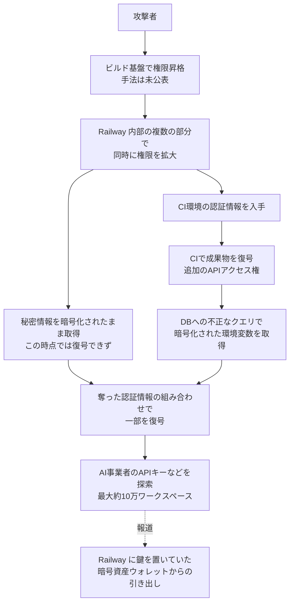

# Railway の環境変数流出 ― ビルド基盤の権限昇格からCIの認証情報へ、約10万ワークスペースの秘密情報が復号されたおそれ、狙いはAIのAPIキー

## 要点

### 影響バージョン

- **2026年10月21日より前に Railway に登録した環境変数・秘密情報**。Railway は、10月21日より前に登録した全利用者に入れ替えを勧めている（Railway）。
- 復号されたおそれがあるのは**最大で全ワークスペースの1.85%、約10万ワークスペース**。どの変数が復号されたかは特定できていない（Railway）。
- 稼働中のアプリは止まっていない。Railway の利用者アカウントへのログインはなかったとしている。**ソースコードへのアクセスは否定されていない**（Railway）。

### 今すぐやること

- Railway に置いていた **APIキー・データベースの認証情報・プライベートレジストリの認証情報をすべて発行し直し**、古いものを無効にする（Railway）。
- Railway に預けていたキーの発行元（AI事業者、GitHub、Stripe など）の利用履歴・監査ログで、10月20日以降の見覚えのない利用を確かめる。Railway はツールごとの確認・入れ替え手順のガイドを公開している（Railway）。
- データベースを公開ネットワークから外す。GitHub の監査ログと連携アプリ、Docker Hub などのレジストリの監査ログを確かめる（Railway）。
- 10月21日の停止中にpushしたコミットは反映されていない。最新のコミットを再デプロイし、GitHub連携とCLI・CIの認証情報を作り直す（Railway）。

## 概要

- 開発者向けPaaSの Railway は2026年10月21日（UTC）、顧客の環境変数を保存するシステムで異常を検知し、第三者が暗号化された環境変数を取得し、一部は復号した可能性があると公表した（Railway）。
- 10月22日（UTC）の予備報告によると、攻撃者は**ビルド基盤での権限昇格**から入り、**CI環境の認証情報**を手に入れ、そこで復号した成果物の中のAPIアクセス権を使って、暗号化された環境変数をデータベースから引き出して一部を復号した（Railway）。
- 攻撃者が探していたのは AI事業者のAPIキーで、Railway は「モデルの蒸留（distillation）攻撃」が目的とみている。攻撃手法の詳細と規模は、調査中を理由にまだ公表していない（Railway）。

> この記事では、ベンダー・公的機関・研究者・報道で確認できた内容を「事実」、筆者の推測や意見を「考察」として分けて書いています。時刻は Railway の発表どおりUTCで書き、必要なものに日本時間（JST）を添えています。

## 何が起きたか（時系列）

予備報告（2026年10月22日 23:31 UTC 公開）の時系列から主なものを抜き出した（Railway）。

| 日時（UTC） | 出来事 |
| --- | --- |
| 10月20日 13:58（JST 22:58） | 監視システムが遅延の増加という異常を検知し、当番のエンジニアを呼び出す |
| 10月20日 14:03〜16:51 | 外部の敵対者による権限昇格の試みと判断。ビルド基盤での権限昇格の可能性を確認し、ビルドの処理を止める |
| 10月20日 17:03 | status.railway.com でインシデントを宣言 |
| 10月20日 18:05〜19:53 | 悪用された欠陥を塞ぎ、再現できないことを確認 |
| 10月20日 19:53 | 攻撃者が、より大きな規模で、Railway の複数の部分で同時に権限を広げられた証拠が見つかる |
| 10月21日 00:22〜03:08 | 別の侵入経路が見つかり、念のため再びビルドを停止 |
| 10月21日 04:24〜05:23 | 攻撃者が秘密情報を**暗号化された形で**引き出していたことが判明。この時点では復号できていなかった |
| 10月21日 05:27〜07:25 | 攻撃者が**CI環境に入る認証情報**を手に入れ、CI環境で、追加のAPIアクセス権を含む成果物を復号する |
| 10月21日 07:25〜09:18 | 暗号化された環境変数への不正なクエリの証拠をデータベースで見つける。その一部は、奪われた認証情報の組み合わせで復号されていた |
| 10月21日 09:18〜09:25 | 攻撃者のペイロードのログから、探していたAPIキーの名前が分かる |
| 10月21日 09:25（JST 18:25） | 事業者各社に、全キーの失効を依頼。一部の事業者には、Railway に登録されていた全キーを渡す |
| 10月21日 20:19〜22:10 | 利用者のセッションを無効化し、セキュリティ告知と利用者向けの案内を公開 |
| 10月22日 03:32（JST 12:32） | 攻撃者がもう内部システムに入れないことを確認（攻撃期間の終わり）。内部システムを新しい認証情報で作り直し始め、Pro・Enterprise のビルドを再開 |
| 10月22日 17:00〜22:49 | APIを全面復旧し、全プランのデプロイが通常に戻る |

## 技術的な問題点（根本原因）

**事実（Railway の予備報告）**

- 最初の足がかりは**ビルド基盤での権限昇格**。どの欠陥を使ったのか、ビルドを依頼する利用者として入ったのかは公表されていない。
- 攻撃者はその後、Railway の複数の部分で同時に権限を広げ、秘密情報を暗号化されたまま引き出した。次に**CI環境の認証情報**を手に入れ、CIで成果物を復号して、追加のAPIアクセス権を得た。
- 環境変数は**エンベロープ暗号化**（データを鍵で暗号化し、その鍵をさらに別の鍵で暗号化する方式）で保存されていた。データベースへの不正なクエリで暗号化された値が取られ、その一部が、奪われた複数の認証情報を組み合わせて復号された。
- Railway は「1組の鍵が破られてもシステム全体が破られない作り」だったため、復号されたおそれを全ワークスペースの1.85%に絞れたとしている。一方で、どの変数が復号されたかはこのクエリだけでは特定できない。
- Railway は対策として、ビルド基盤を**第3世代の「分離されたマルチテナント」から第4世代の「シングルテナント」**に切り替えた。翌週に予定していた移行を前倒しした。
- 攻撃者について Railway は、安全対策を外したモデル（abliterated models）と大きな計算資源を持ち、高度な攻撃ができたとみている。根拠は示していない。

**考察**

公表された流れは「ビルド基盤 → 内部の権限 → CIの認証情報 → 復号に使える権限」で、暗号化の仕組みそのものが破られたのではなく、**復号に使える権限を持つ内部の仕組みが順に奪われた**と読める。エンベロープ暗号化は、保存されたデータだけが盗まれる場合には強いが、復号できる立場のシステムや資格情報を取られると守れない。今回は暗号化が「被害の範囲を絞る」働きはしたが、「復号そのものを防ぐ」ことはできなかった。

ビルド基盤は、利用者から受け取ったコードをそのまま実行する場所だ。マルチテナントのビルド基盤では、ある利用者のビルドが他の利用者や基盤の内部に手を伸ばせないことが前提になる。Railway が対策の筆頭にシングルテナント化を挙げたことから、最初の権限昇格がこの境界にかかわっていた可能性はあるが、公表された情報では確かめられない。

## 攻撃・侵入経路

**事実**

- 攻撃者のペイロードのログには、探していたAPIキーの名前が残っていた。Railway は名前を公表していない（Railway）。
- 狙われやすいのは「環境変数が非常に多いワークスペース」と「AI事業者のキーが多い環境」だと Railway はみている（Railway）。
- The Hacker News は、研究者 Taylor Monahan 氏の分析として、Railway に秘密鍵を置いていた暗号資産ウォレットから資金が抜かれ、最初の窃取の取引は公式の告知より少なくとも2時間前だったと報じている（The Hacker News）。Railway の予備報告はこの点に触れていない。
- Railway は、GitHub、GitLab、Anthropic、OpenAI、OpenRouter、SpaceXSI、Stripe などと連携して、10月21日 09:25（UTC）以降にキーを失効させた。GitHub や SpaceXSI などには、影響の有無にかかわらず Railway 上の全APIキーを渡した。事業者から失効の連絡が来ても、そのキーが流出したとは限らない（Railway）。

**考察**

AI事業者のキーは、使えばすぐ利用料に変わり、事業者の利用規約による停止を他人の名義で避けられる。Railway の初回告知が「AI推論事業者を狙った一連の攻撃の一部」としている点と合わせると、PaaS を「キーがまとまって置いてある場所」として狙ったと考えられる。

## なぜ防げなかったか・構造的要因の考察

1. **PaaS は他人の秘密情報の集積地になる。** 利用者は、APIキーやDBのパスワードを環境変数としてPaaSに預け、PaaS はそれを実行時に渡すために復号できる立場にある（考察）。復号できる経路が1つでも奪われれば、多数の利用者の秘密情報に届く。
2. **利用者のコードを動かすビルド基盤が入口になった。** ビルドは利用者が持ち込むコードを動かすので、テナント間・基盤との分離が破られると、内部の権限につながる（考察。最初の欠陥の詳細は未公表）。
3. **CIの認証情報が、本番の秘密情報の復号に使えた。** CIで復号した成果物にAPIアクセス権が含まれ、それが顧客データの復号に組み合わされた（Railway）。開発・配布の仕組みと本番データの権限が十分に分かれていなかった可能性がある（考察）。
4. **初動では「どの変数が漏れたか」を言えなかった。** エンベロープ暗号化のため、クエリの記録だけでは対象の変数を特定できず、全利用者への入れ替えの呼びかけと、事業者への一括失効の依頼という広い対応になった（Railway）。結果として、影響のない利用者のキーも止まり、デプロイの停止と合わせて利用者側の負担が大きくなった（考察）。
5. **攻撃者は塞いでも別の経路で戻ってきた。** 最初の欠陥を塞いだ後も別の侵入経路が見つかり、検知から攻撃者の締め出しの確認まで約37時間半かかった（Railway の時系列）。Railway は、攻撃者が安全対策を外したモデルと大きな計算資源を持っていたとみているが、根拠は示していない（Railway）。

## 運用者向けの具体的な対策と検知ポイント

**対策（事実に基づくもの。Railway）**

- 10月21日より前に Railway に登録した機密性のある環境変数・キーを、発行し直してから登録し直す。
- データベースへの公開ネットワークからのアクセスをなくす。
- GitHub の組織の監査ログと、インストール済みのアプリを確かめる。Railway は自社の GitHub App のインストールを全件入れ替え、Railway のアクセストークンもすべて失効させたので、ログインや連携のやり直しが必要な場合がある。
- Docker Hub などのレジストリの監査ログを確かめる。
- 停止中にpushしたコミットを再デプロイする。CLI と CI の認証情報を作り直す。

**検知ポイント（考察）**

- Railway がキーの失効を依頼した事業者（GitHub、GitLab、Anthropic、OpenAI、OpenRouter、SpaceXSI、Google、Stripe など。Railway）の管理画面で、10月20日以降の利用量や操作に見覚えのないものがないか。
- GitHub・GitLab のトークンによる、想定外のクローン、リポジトリ操作、アプリの追加がないか。
- Railway で使っていたクラウドやストレージの認証情報による、見覚えのないAPI呼び出しがないか。Railway は自社上に作られたストレージバケットの認証情報をすべて入れ替えたとしている（Railway）。
- 事業者から失効の通知が来ても、それだけで流出したとは限らない（Railway）。逆に、通知が来ていないキーも入れ替えの対象から外さない（考察）。

**考察（運用上の工夫）**

- 入れ替えるときは「新しいキーを発行 → Railway に登録 → 再デプロイ → 古いキーを無効化」の順にする。古いキーを先に止めると、稼働中のアプリが止まる。
- AIのAPIキーには、事業者側で使用額の上限やアラートを設定し、用途ごとにキーを分ける。今回のように「預けた先」から漏れたときに、被害の上限と調べる範囲を小さくできる。
- 暗号資産の秘密鍵のように、漏れたら取り返せない秘密は、PaaS の環境変数に置かない。署名を専用の鍵管理サービスやHSMに任せ、アプリには署名の権限だけを渡す。
- 自社でビルド基盤やCIを運用している場合も、CIの認証情報で本番の秘密情報を復号できないか、権限の分け方を見直す。

## 参考リンク

- [Preliminary Report: Oct 21st Security Incident（Railway、2026年10月22日）](https://blog.railway.com/p/preliminary-report-october-security-incident)
- [Security Disclosure: Wednesday, October 21st（Railway、2026年10月21日）](https://blog.railway.com/p/security-disclosure-wednesday-october-21st)
- [Railway Says Intruder May Have Accessed Customer Secrets, Urges Credential Rotation（The Hacker News、2026年10月22日）](https://thehackernews.com/2026/10/railway-says-intruder-may-have-accessed.html)
