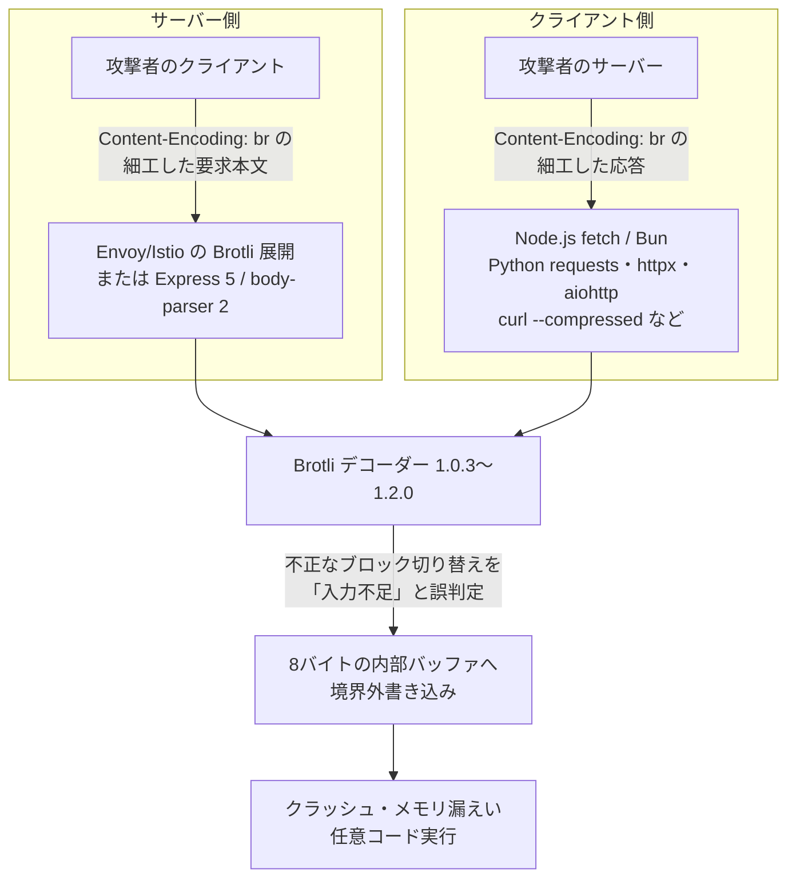

# Brotli CVE-2026-111497（Node2Shell） ― 圧縮処理の欠陥でRCE

## 要点

### 影響バージョン

- **Google Brotli**（C実装）1.0.3〜1.2.0。修正版は 1.0.10・1.1.1・1.2.1（CVE レコード、Google Brotli）。
- **Node.js** 22.x・24.x・26.x。修正版は 22.23.4・24.22.1・26.12.1（Node.js）。20.x 以前はサポート終了で修正なし（The Hacker News）。
- **Bun** 1.4.3 以前。修正版は 1.4.4（Patch the Planet、The Hacker News）。
- **Envoy** 1.39.2・1.38.5・1.37.7・1.36.11（Brotli 展開フィルターを設定している場合）。修正版は 1.40.0・1.39.3・1.38.6・1.37.8・1.36.12（Envoy）。
- **Istio** 1.31.0〜1.31.1、1.30.0〜1.30.5、1.29.0〜1.29.8（EnvoyFilter などで Brotli 展開を有効にしている場合）。修正版は 1.31.2・1.30.6・1.29.9（Istio）。
- **Python** の `Brotli` 1.2.0 以前は 1.2.1、`brotlicffi` 1.2.0.x は 1.2.1.0 で修正（Aikido、The Hacker News）。requests・urllib3・httpx・aiohttp は、これらが入っていると Brotli の応答を自動で展開する（Aikido）。
- CVSS は CNA（Google）が v4.0 で 9.2、Red Hat は 8.1（Important）、Node.js は High と評価が分かれる（The Hacker News、Red Hat）。

### 今すぐやること

- 上の修正版へ更新し、**プロセスを再起動し、コンテナイメージや単一実行ファイルを作り直す**。動いているプロセスは再起動まで古いデコーダーを使い続ける（The Hacker News、Patch the Planet）。
- すぐ更新できない経路では、信頼できない Brotli データの展開を止める。要求は `Content-Encoding: br` を展開前に拒否し、HTTPクライアントでは Brotli の自動展開を切る。`Accept-Encoding` から `br` を外すだけでは、サーバーが Brotli を送ってくるので防げない（Patch the Planet）。
- Python では Brotli／brotlicffi のバージョンを手作業でも確かめる。10月23日時点では、依存関係スキャナーが Python パッケージを検出できない可能性があった（The Hacker News、Aikido）。

## 概要

- Brotli のデコーダーは、ストリームの構造上ありえない**ブロック切り替えを「形式エラー」ではなく「入力がまだ足りない」と扱い、8バイトの内部バッファに入力を書き足し続けた**。その結果、デコーダーの状態を壊す境界外書き込みが起きる（Node.js、Red Hat、Imperva）。
- 根本原因の修正は2月27日に Brotli のソースに入っていたが、当時は脆弱性と認識されず、**修正を含むリリースは10月21日まで出なかった**（The Hacker News が引用した OpenAI の説明）。Brotli を同梱する各プロジェクトが、それぞれ更新を出す必要がある。
- Imperva は公式の Node.js 24.22.0（Linux arm64）で、**`fetch()` で受けた応答と Express の要求本文の両方から任意コード実行を再現した**（「Node2Shell」）。攻撃コードは公開されておらず、実際の悪用も報告されていない（Imperva、The Hacker News）。

> この記事では、ベンダー・公的機関・研究者・報道で確認できた内容を「事実」、筆者の推測や意見を「考察」として分けて書いています。

## 何が起きたか（時系列）

| 日付 | 出来事 |
| --- | --- |
| 2026年2月 | OpenAI がこの欠陥を見つける。根本原因は2月27日に Brotli のソースで修正されたが、脆弱性とは認識されず、修正を含むリリースも出なかった（The Hacker News、Aikido） |
| 10月21日 | Google が Brotli 1.0.10・1.1.1・1.2.1 を公開（GitHub のリリースノートは「CVE-2026-111497: out-of-bounds write permits remote code execution」）。Node.js が 22.23.4・24.22.1・26.12.1 を含むセキュリティリリースを公表（Google Brotli、Node.js） |
| 10月21日 | Vercel が同日中に WAF ルールを全プロジェクトに適用（Vercel） |
| 10月22日 | Imperva が Express 5.3.0／body-parser 2.3.0 などで試験（Imperva） |
| 10月23日 | Python パッケージ向けの PYSEC-2026-4322（Brotli）・PYSEC-2026-4323（brotlicffi）が追加される。Debian 13 が brotli 1.1.0-2+deb13u1 で修正。CISA の評価では悪用は「なし」（The Hacker News） |
| 10月23日 | Patch the Planet（OpenAI の公表ページ）が更新され、Node.js・Bun・Envoy・Istio・Brotli 本体の修正版を一覧にする（Patch the Planet） |

## 技術的な問題点（根本原因）

**事実（Node.js、Red Hat、Imperva）**

- 欠陥は Brotli の `c/dec/decode.c` にある、ブロックの種類を切り替える処理（block-type switch）にある（Red Hat）。
- 不正なブロック切り替えが、「恒久的な形式エラー」ではなく「一時的にもっと入力が必要」として呼び出し元に返されていた。そのためストリーミングのデコーダーは、**8バイトの内部バッファに入力バイトを書き足し続けた**（Node.js）。
- 細工したデータを `node:zlib` で展開させられる攻撃者は、プロセスのメモリを壊せる。結果はクラッシュ、メモリ内容の漏えい、またはリモートでのコード実行になりうる（Node.js）。
- Brotli 側の修正は、この不正な切り替えを形式エラーとして返し、呼び出し元に伝えるようにした。修正版の Node.js は、同じ入力を拒否してコード実行に至らなかった（Imperva）。
- この経路に届くのは、通常のエンコーダーが出す正しい形のデータではなく、壊れたストリームである（Red Hat）。

**考察**

本質は「エラーの分類ミス」である。ストリーミングのデコーダーは、データが途中で切れているのか（続きを待つべき）、壊れているのか（打ち切るべき）を区別しなければならない。前者と判定すると、デコーダーは「次の入力が来れば正しく続けられる」前提で状態を保つ。その前提が崩れたまま固定長のバッファに書き足すと、境界外書き込みになる。数バイトのバッファでも、隣接するデコーダーの状態（ポインターや長さ）を壊せれば、コード実行につながりうることを Imperva の再現が示した。

## 攻撃・侵入経路

**事実**

- OpenAI は、この欠陥は**両方向に働く**としている。圧縮された入力を受け付ける未修正のサーバーは悪意あるクライアントに、圧縮された応答を受け付ける未修正のクライアント（例として `curl --compressed`）は悪意あるサーバーに乗っ取られうる（The Hacker News が引用した OpenAI の説明）。
- Imperva の再現（Node2Shell）は、公式の Node.js 24.22.0 Linux arm64 イメージを新しいコンテナで動かし、デバッガーや計測用のバイナリなしで行った。経路は2つ（Imperva）。
  - Node.js 組み込みの `fetch()` で、外部サーバーの Brotli 応答を受け取る。
  - Express 5.0.0〜5.3.0、body-parser 2.0.0〜2.3.0 の `raw()` と `json()` で、Brotli の要求本文を受け取る。
- 再現は毎回成功したわけではなく、複数回の試行が必要だった。ほかのビルドやアプリは試していない（Imperva）。
- 素の Node.js HTTP サーバーは、要求を受けただけでは Brotli の本文を展開しない（Imperva）。Express 5 と body-parser 2 は欠陥の場所ではなく、Node.js のデコーダーへの「入口」である（Imperva）。
- Envoy・Istio が影響を受けるのは、Brotli の展開フィルターを設定している場合（Envoy、Istio）。Apache の標準 mod_brotli は Brotli を展開しない（Aikido）。
- HTTP だけでなく、Brotli を使うフォントのデコーダーやデータファイルの読み込みも対象になりうる。Electron 製のデスクトップアプリは Chromium と Node.js の両方に Brotli を持つことがある（Patch the Planet）。

## なぜ防げなかったか・構造的要因の考察

1. **「バグ修正」と「脆弱性修正」の間の8か月。** 根本原因は2月に直っていたが、脆弱性と認識されなかったため、リリースもCVEもなかった（The Hacker News）。下流のプロジェクトは「最新リリース」を取り込んでいても、ソースの先頭にしかない修正は届かない（考察）。メモリ安全でない言語のパーサーで「入力の扱い」を変える修正は、セキュリティへの影響を前提に評価する価値がある（考察）。
2. **同梱（vendoring）された部品は、OSの更新では直らない。** Node.js・Bun・Envoy はそれぞれ Brotli を内部に持ち、Python の wheel や静的リンクしたバイナリも同様である（Patch the Planet）。OSの `brotli` パッケージを更新しても、それらは直らない（考察）。実際、Debian は10月23日に修正したが、Amazon Linux 2023 は10月22日時点で brotli と Node.js 24 のパッケージを「修正待ち」としていた（The Hacker News）。
3. **依存関係スキャナーが見つけられない期間があった。** CVE レコードは Google の Brotli リポジトリを対象にしており、PyPI のパッケージ名を含まない。GitHub のアドバイザリーには影響パッケージの記載がなく、Dependabot などは検出できなかった（The Hacker News、Aikido）。
4. **「受け取ったら自動で展開する」という便利な既定値。** Python の主要な HTTP クライアントは、Brotli パッケージが入っているだけで Brotli 応答を展開する（Aikido）。開発者が Brotli を使うと決めたわけではなくても、依存関係の追加（`httpx[brotli]` など）で攻撃面が広がる（考察）。
5. **WAF で守れるのは「入ってくる」通信だけ。** Vercel と Imperva は WAF ルールを入れたが、Vercel は自社 WAF がアプリから外へ取りに行った応答はカバーしないと明記している（Vercel、Imperva）。クライアント側の経路は、ランタイムの更新でしか塞げない（考察）。

## 運用者向けの具体的な対策と検知ポイント

**対策（事実に基づくもの）**

- ランタイム・ライブラリを修正版へ更新し、ロックファイルを更新し、コンテナイメージと単一実行ファイル（`bun build --compile` で作ったものなど）を作り直してから、全レプリカ・ワーカー・定期ジョブを再起動する（Patch the Planet、Aikido）。
- Node.js には公開された回避策がなく、更新が唯一の修正とされる（The Hacker News）。更新までの間、Express では body-parser より前に、`Content-Encoding` が `identity`・`gzip`・`deflate` 以外の要求を HTTP 415 で拒否するミドルウェアを置く。置けない場合は全ての body-parser に `inflate: false` を設定する（gzip も拒否される）（Patch the Planet）。
- Next.js で Node.js をすぐ更新できない場合、`images.unoptimized: true` で組み込みの画像最適化（外部画像の取得と展開）を止める。ほかのサーバー側の取得処理は守れない（Patch the Planet）。
- Envoy・Istio では Brotli の展開フィルターだけを外すか、要求・応答の両方向で `enabled.default_value: false` にし、`runtime_key` を消す。gzip・zstd のフィルターも同じ名前（`envoy.filters.http.decompressor`）を使うことがあるので、名前だけで全部を消さない。フィルターを外すと圧縮データがそのまま後段に流れるため、後段のデコーダーも守る（Patch the Planet）。
- Python では、Brotli が任意の機能なら Brotli と brotlicffi をアンインストールする（`httpx[brotli]` などの extras も外す）。ただし、サーバーが Brotli を送ってきた場合は読めない応答やエラーになりうる（Aikido）。

**検知ポイント**

- 展開処理の最中の予期しないプロセス終了やデコーダーのエラーは、調査の優先度付けに使える。ただし単独では悪用の確かな証拠にならず、実行中のランタイムの版、アプリのログ、圧縮データの送り元と突き合わせる（Imperva）。
- 要求側では、`Content-Encoding: br` を付けた要求が普段来ないエンドポイントに届いていないかをログで見る（考察）。
- 棚卸しでは、パッケージの一覧ではなく**実際に動いているコンテナ・ホスト内の Node.js の版**を確かめる。パッケージの一覧はコンテナに同梱された古いランタイムを見落とす（Imperva）。

**考察（運用上の工夫）**

- 「どこで Brotli を展開しているか」の地図を作っておくと、次に圧縮ライブラリの欠陥が出たときに速い。入ってくる要求（リバースプロキシ、API ゲートウェイ、ボディパーサー）、出ていく取得（サーバー側の fetch、Webhook の取得、画像最適化、クローラー）、ファイル処理（フォント、アーカイブ）の3つに分けて洗い出す。
- PHP2Shell（10月22日の記事）に続き、言語ランタイムの下にある C のコードが Web アプリ全体の攻撃面になった。Imperva も、AI が脆弱性の発見と悪用の両方を速めており、公表から修正までの猶予が短くなっていると指摘している（Imperva）。ランタイムの更新を、アプリの依存関係の更新と同じ速さで回せる仕組み（ベースイメージの自動更新と再デプロイ）を用意しておきたい。

## 参考リンク

- [CVE-2026-111497（CVE.org）](https://www.cve.org/CVERecord?id=CVE-2026-111497)
- [Brotli decoder vulnerability (CVE-2026-111497)（Patch the Planet、2026年10月23日更新）](https://patchtheplanet.org/brotli)
- [google/brotli Releases（GitHub）](https://github.com/google/brotli/releases)
- [Wednesday, October 21, 2026 Security Releases（Node.js）](https://nodejs.org/en/blog/vulnerability/october-2026-security-releases)
- [Bun v1.4.4（GitHub）](https://github.com/oven-sh/bun/releases/tag/bun-v1.4.4)
- [Out-of-Bounds Write in Brotli Decompressor（Envoy、GHSA-3wvj-j6qm-62mr）](https://github.com/envoyproxy/envoy/security/advisories/GHSA-3wvj-j6qm-62mr)
- [ISTIO-SECURITY-2026-007（Istio）](https://istio.io/latest/news/security/istio-security-2026-007/)
- [Node2Shell: From Brotli Data to Remote Code Execution（Imperva）](https://www.imperva.com/blog/node2shell-from-brotli-data-to-remote-code-execution/)
- [Node2Shell evolves to HTTP2Shell. Brotli flaw (CVE-2026-111497) blast radius affects many libraries & apps using HTTPs（Aikido、2026年10月23日）](https://www.aikido.dev/blog/python-packages-vulnerable-node2shell-brotli-cve-2026-111497)
- [Node.js security advisory（Vercel）](https://vercel.com/kb/bulletin/node-js-security-advisory)
- [CVE-2026-111497（Red Hat）](https://access.redhat.com/security/cve/CVE-2026-111497)
- [PYSEC-2026-4322（brotli）](https://github.com/pypa/advisory-database/blob/main/vulns/brotli/PYSEC-2026-4322.yaml) / [PYSEC-2026-4323（brotlicffi）](https://github.com/pypa/advisory-database/blob/main/vulns/brotlicffi/PYSEC-2026-4323.yaml)
- [Debian Security Announce: brotli（Debian、2026年10月23日）](https://lists.debian.org/debian-security-announce/2026/msg00498.html)
- [Brotli Decoder Flaw Behind Node.js RCE Also Affects Bun, Python and Other Widely Used Software（The Hacker News、2026年10月24日）](https://thehackernews.com/2026/10/brotli-decoder-flaw-behind-nodejs-rce.html)
