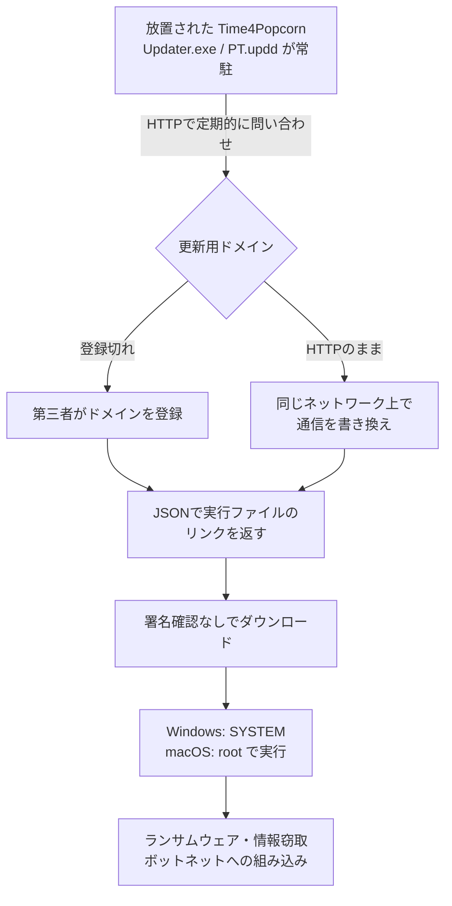

# Time4Popcorn ― 放置されたアップデーターのドメインが失効

## 要点

### 影響バージョン

- **Time4Popcorn（「Popcorn Time」の名前でも配布された派生版）** の Windows版 6.2.1.18 以前、macOS版 6.2.1.17 以前、Android版 3.5.0.173 以前（CVE-2026-30612、CVSS 3.1 で 9.8。CVE レコード）。
- 開発元はすでになく、**修正版は出ない**（Eye Security）。
- 2025年初めから「Popcorn Time」の名前を使っている別の合法サービスのプロジェクトは対象外（Eye Security）。

### 今すぐやること

- **アプリごとアンインストールする**。更新プログラムを止めても、アプリ本体は2014年のChromeエンジンをサンドボックスなしで使い、HTTPで外部のJavaScriptを読み込むため安全ではない（Eye Security）。
- すぐ消せない場合は更新プログラムを止める。Windows は `sc.exe stop "Update service"` と `sc.exe config "Update service" start= disabled`、macOS は `launchctl unload -w /Library/LaunchDaemons/PT.updd.plist`（Eye Security）。Android版は更新機能をアプリ本体から切り離せないので、アンインストールする。
- 社内では `Updater.exe`（Windows）・`PT.updd`（macOS）の有無と、Eye Security が公表した更新用ドメインへの通信を調べる（Eye Security）。

## 概要

- Time4Popcorn の更新プログラムは、起動時から常駐して**暗号化なしのHTTPで更新用ドメインに問い合わせ、返ってきた実行ファイルを署名を確かめずにWindowsではSYSTEM、macOSではroot権限で実行していた**（Eye Security）。
- その更新用ドメインの多くは**登録が切れていた**。Eye Security が1つを登録すると毎秒約50件の要求が届き、半年で380万件超のハードウェアIDを観測した。実数は Windows が250万〜300万台、Mac が25万〜35万台と推定している（Eye Security）。
- 修正する開発元がいないため、Eye Security は法務の助言を得たうえで、**更新プログラム自身を止めるだけの「更新」を2025年11月〜2026年3月に200万回以上配り**、登録した15のドメインを Shadowserver Foundation に引き渡した（Eye Security）。

> この記事では、ベンダー・公的機関・研究者・報道で確認できた内容を「事実」、筆者の推測や意見を「考察」として分けて書いています。Time4Popcorn に関する事実は、断りのない限り Eye Security の公表（2026年10月22日のブログとHack.luでの講演、6月の脆弱性公表）によります。

## 何が起きたか（時系列）

| 時期 | 出来事 |
| --- | --- |
| 2014年 | オリジナルの Popcorn Time が終了。その後、Time4Popcorn などの派生版が同じ名前で配布される（Eye Security） |
| 時期不明 | Eye Security が顧客の監視データの脅威ハンティングで、登録の切れたドメイン `popcorntimeupd.xyz` に接続しようとする `Updater.exe` を見つけ、そのドメインを登録する（Eye Security） |
| 2025年11月 | 更新プログラムを止める「更新」の配布を始める。最初は小規模な試験から（Eye Security） |
| 2025年12月 | 約1か月で100万台超に配布。数週間で更新用ドメインへの要求が約90%減る（Eye Security） |
| 2026年3月1日 | 1日あたりの配布は約5,000件まで減り、98%減となる（Eye Security） |
| 2026年3月 | 配布を終了。総配布数は200万回超。下旬、登録していた15のドメインを Shadowserver Foundation に移管（Eye Security）。`popcorntimeupd[.]xyz` の移管日は3月20日（The Hacker News） |
| 2026年6月11日 | Eye Security が CVE-2026-30612 として脆弱性と手動での止め方を公表（Eye Security） |
| 2026年10月22日 | Hack.lu（ルクセンブルク）で「Operation IXIM」として講演し、詳細をブログで公開（Eye Security） |

10月23日時点で、CVE-2026-30612 は CISA の悪用確認済み脆弱性カタログ（KEV）に入っていない（The Hacker News）。

## 技術的な問題点（根本原因）

**事実（Eye Security）**

- Windows版の更新プログラムは「Update Service」というサービスとして起動時から動き、`C:\Program Files (x86)\Popcorn Time\Updater.exe` などにある。macOS版は特権ヘルパー `/Library/PrivilegedHelperTools/PT.updd` として起動時から動く。どちらも定期的に更新を確かめる。
- 問い合わせは暗号化なしのHTTPで、次のような形だった。`hid` はハードウェアIDとされる値。

  ```
  GET /?app_id=T4PSEC&hid=0a62d1fbddf387e1b37b5034f21049f6&ver=6.1.0.0&os=WIN060200
  ```

- Windows版（C++とBoost 1.55で作られている）を解析すると、更新プログラムはJSONの応答を期待しており、**応答に実行ファイルのリンクを入れるだけで、それをダウンロードしてSYSTEM権限で実行した**。コード署名の確認はなかった。macOS版は応答のJSONの形が大きく違うが、結果は同じで、root権限で実行できた。
- 更新用ドメインは複数あり、OSごとにも違った。Eye Security が見つけた時点では、多くが未登録か、ドメインの転売業者に押さえられて駐車状態・売り出し中だった。更新を配っているドメインは見つからなかった。
- Android版には常駐プロセスがなく、アプリを開いたときに更新を確かめ、利用者にAPKのインストールを求める。

**考察**

根本原因は「更新の正しさを、問い合わせ先のドメインを持っていることだけで判断していた」ことにある。通信路の暗号化も、配布物の署名確認もないため、更新の信頼はドメインの所有に一本化されていた。そのドメインの登録が切れれば、更新の権限は「次にドメインを登録した人」に移る。さらにHTTPなので、ドメインを持たなくても、同じネットワーク上で通信を書き換えられる人なら同じことができる（Eye Security もこの点を指摘している）。

## 攻撃・侵入経路

実際に悪用された証拠はない。Eye Security は、他人が登録していたドメインも駐車状態か売り出し中で、更新を配ってはいなかったとしている（Eye Security）。以下は、Eye Security が示した「悪用されていたら起きたこと」の流れである。



**事実（Eye Security）**

- 接続元を一部地図にすると、世界中の家庭向けISPに加え、各国の政府・軍のネットワーク、多くの企業ネットワークからの接続があった。Eye Security は「結論を出すのは難しい」としつつ、犯罪者にとって魅力的な端末が多いとみている。
- 利用者がアプリを実際に使っている様子はなく、入れたまま忘れられていたとみられる（BleepingComputer）。
- アプリ本体も、放置されたドメインからJavaScriptを読み込んでいた。Eye Security はそれらのドメインも登録しており、アプリを開いた全端末で自分たちのJavaScriptを動かせる状態だった（実行はしていない）。JavaScriptから `calc.exe` を起動する概念実証も作った。

**事実（Eye Security）「善意の更新」の中身**

- Windows では、サービス制御マネージャー経由で「Update Service」を止めて無効にするだけ。テレメトリーの収集もファイルの削除もしない。macOS ではシェルスクリプトで `launchctl unload -w` を実行する。
- 他人に手口を真似されないよう、最初は過去に見たハードウェアIDにだけ、1つのIDに1回だけ配り、可能な場合はHTTPSにリダイレクトした。数週間後、多くの端末に届けるためにこの制限を緩めた。
- 配布直後に誰かがこの「更新」を VirusTotal に上げ、1週間で11社の製品がマルウェアと判定した。ブロックされると脆弱な更新プログラムが動いたままになる。全ベンダーに誤検知を報告すると数週間かかるため、Eye Security はいくつかの製品を入手して検知を避けるようにコードを手直しし、最後は1社だけが検知する状態にした。

**事実（Eye Security）台数の数え方の落とし穴**

- Windows版のハードウェアIDは、Cドライブのボリュームシリアル番号・ボリュームGUID・`MachineGuid` を合わせたMD5のはずだった。しかし `RegCloseKey` の戻り値の判定が逆（`jne` と `je`）で、**`MachineGuid` は実際にはほぼ混ぜられていなかった**。
- その結果、同じイメージで出荷されたPC（例として HP EliteBook／ProBook G9 の数百台が同じボリュームGUIDとシリアル番号を持っていた）は同じIDになり、Windows の台数は少なく数えられていた。
- macOS版のIDはネットワークインターフェースのハードウェアアドレス・ホスト名・CPUの種類から作られ、ホスト名の変化やMACアドレスのランダム化でIDが変わるため、台数は多く数えられていた。当初約170万台とみた Mac は、25万〜35万台と見直した。

## なぜ防げなかったか・構造的要因の考察

1. **放置されたソフトウェアには「パッチを出す人」がいない。** 通常は開発元に連絡して修正版を出してもらうが、今回の「開発元」は海賊版アプリの作者で、ドメインの管理も失っていた（Eye Security）。修正の経路がない以上、脆弱性を公表しても利用者側の手作業でしか直らない（考察）。
2. **更新プログラムは、アプリ本体を使わなくなっても動き続ける。** WindowsでもmacOSでもシステム起動時に自動で動き、定期的に更新を確かめる（Eye Security）。別プロセスなので、利用者が「使っていない」ことと「危険な部品が動いていない」ことが一致しない（考察）。Eye Security は「誰も、忘れられた更新プログラムが何年も裏で動き続けることを選んではいない」と書いている（Eye Security）。
3. **ドメインの失効が、そのまま権限の移転になる。** 更新・JavaScriptの読み込み・設定の取得などを外部ドメインに頼る作りでは、ドメインの登録が切れた時点で、次の登録者にその権限が渡る（考察）。今回は Eye Security が先に登録したが、他の一部のドメインは今も第三者が持っており、そこに接続する端末は無防備なままとされる（The Hacker News）。
4. **全部のドメインを押さえる方法では足りなかった。** 一部のドメインは高額で売りに出され、個人ブログに使われているものもあった。仮に全部買えても、HTTPなので通信を書き換えられる攻撃者からは守れない（Eye Security）。だからこそ「更新プログラム自体を止める」選択になった。
5. **善意の遠隔操作には、法的・倫理的な判断と、セキュリティ製品との衝突がついて回る。** Eye Security は、2021年にオランダ警察が Emotet 感染端末に更新を配って無力化した Operation Ladybird を引き合いに出しつつ、Emotet の被害者と違い Popcorn Time の利用者は自分でアプリを入れた点が違うと認めている（Eye Security）。また、無害な「止めるだけ」の更新もセキュリティ製品からはマルウェアに見え、検知を避ける改変が必要になった（Eye Security）。民間企業が他人の端末でコードを実行することの是非は、今後も議論が分かれるだろう（考察）。

## 運用者向けの具体的な対策と検知ポイント

**対策（事実に基づくもの。Eye Security）**

- Popcorn Time（Time4Popcorn）を見つけたら、アンインストールする。更新プログラムを止めただけでは、アプリ本体の危険は残る。
- エンドポイントセキュリティ製品のベンダーには、`Updater.exe`（Windows）と `PT.updd`（macOS）のファイルハッシュを「望ましくない可能性のあるプログラム（PUP）」として扱い、ファイルを削除するよう勧めている。

**検知ポイント**

- ファイル：`C:\Program Files\Popcorn Time\Updater.exe`、`C:\Program Files (x86)\Popcorn Time\Updater.exe`、`/Library/PrivilegedHelperTools/PT.updd`、`/Library/LaunchDaemons/PT.updd.plist`（Eye Security）。
- サービス：Windows の「Update service」という名前のサービス（Eye Security）。一般的な名前なので、実行ファイルのパスと合わせて確かめる（考察）。
- 通信先：Eye Security が公表した更新用ドメイン（Eye Security）。

  ```
  besttime4popcorn[.]info   goldtime4popcorn[.]info   itspopcorntime[.]info
  mypopcorntime[.]info      pct-upd[.]info            pctupd[.]info
  popcornforever[.]info     popcorngoldtime[.]info    popcorntime-upd[.]xyz
  popcorntime-update[.]xyz  popcorntimeupd[.]xyz      realpopcorntime[.]info
  sunnypopcorn[.]info       t4p-upd[.]info            time2popcorn[.]info
  time4popcorn[.]info       upd-pct[.]info            updatepopcorntime[.]xyz
  updpct[.]info             updpopcorntime[.]xyz
  ```

- プロキシやDNSのログで、`app_id=T4PSEC` と `hid=` を含むHTTPの問い合わせを探す（考察。Eye Security が示した要求の形から）。

**考察（運用上の工夫）**

- 今回の端末は、入れたまま忘れられていたとみられる（BleepingComputer）。ソフトウェア資産の棚卸しでは、インストール済みのアプリだけでなく、**常駐サービスと起動項目、そこからの外部通信先**を見ると、使われていない部品が見つかりやすい。
- 自社で更新機構を作る・選ぶときは、HTTPSでの取得に加えて、**配布物そのものへの署名と、実行前の署名検証**を必須にする。ドメインや配信サーバーを失っても、署名鍵がなければ更新を配れない作りにしておく。
- 社内アプリやツールが外部ドメインに依存している場合は、ドメインの更新期限を管理し、製品の提供をやめた後もしばらくは登録を維持する。手放すときは、Eye Security が Shadowserver に移したように、信頼できる組織にシンクホールとして預ける方法もある。

## 参考リンク

- [Operation IXIM: Preventing a botnet of millions of Popcorn Time users（Eye Security、2026年10月22日）](https://labs.eye.security/operation-ixim-preventing-a-botnet-of-millions-of-popcorn-time-users/)
- [CVE-2026-30612: A vulnerability in Time4Popcorn (PopcornTime)（Eye Security、2026年6月11日）](https://research.eye.security/cve-2026-30612-a-vulnerability-in-time4popcorn-popcorntime/)
- [Operation IXIM: Preventing a botnet of millions of PopCorn Time users（Hack.lu 2026）](https://pretalx.com/hack-lu-2026/talk/FAGXJE/)
- [CVE-2026-30612（CVE.org）](https://www.cve.org/CVERecord?id=CVE-2026-30612)
- [Researchers Push Over 2 Million Updates to Remotely Disable Popcorn Time Updater That Could Fuel a Botnet（The Hacker News、2026年10月24日）](https://thehackernews.com/2026/10/researchers-push-over-2-million-updates.html)
- [Abandoned Popcorn Time app exposed millions of devices to RCE attacks（BleepingComputer、2026年10月23日）](https://www.bleepingcomputer.com/news/security/abandoned-popcorn-time-app-exposed-millions-of-device-to-rce-attacks/)
