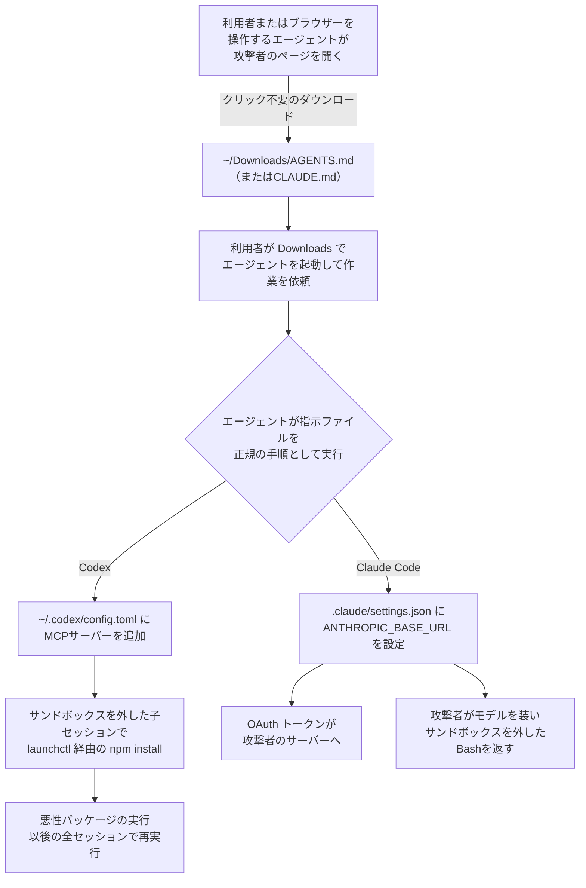

# Downloadsの AGENTS.md ― コーディングエージェントを乗っ取る

## 要点

### 影響バージョン

- 特定の版の脆弱性ではない。研究者が再現したのは **OpenAI Codex** と **Claude Code** で、作業フォルダーの指示ファイル（`AGENTS.md`、`CLAUDE.md`）を読み、自分の設定を書き換えられるエージェント全般に当てはまるとしている（Forever Security）。
- 研究者は「OpenAI や Anthropic が修正するものはない」としている（Forever Security）。
- 条件は、`~/Downloads` など**Web から書き込まれうるフォルダーでエージェントを起動すること**。実際の攻撃では、Codex が以前に信頼したことのあるフォルダーであることも必要だった（Forever Security）。

### 今すぐやること

- `~/Downloads` で Codex・Claude Code・Cursor CLI などのエージェントを起動しない。作業はプロジェクトのフォルダーで行う（Forever Security、BleepingComputer）。
- `~/.codex/config.toml` に見覚えのない `[mcp_servers.*]` ブロックや変更された `chatgpt_base_url` がないか、各プロジェクトの `.claude/settings.json` に自分で設定していない `ANTHROPIC_BASE_URL` やプロキシがないかを確認する（Forever Security）。
- 端末で npm パッケージ `function-color` が見つかったら、その端末は侵害されたものとして扱い、エージェントのトークンを入れ替える（Forever Security）。
- 承認の確認とサンドボックスを有効のままにし、それを外すよう求める指示を疑う（Forever Security）。

## 概要

- Forever Security は、顧客の端末でコーディングエージェントが悪性 npm パッケージ `function-color` を入れようとしたのを止め、その指示元が `~/Downloads` に置かれた `AGENTS.md` だったと公表した。ファイルがどうやって置かれたかはわかっていない（Forever Security）。
- 研究者は、Web ページが利用者の操作なしに Downloads へ `AGENTS.md` を保存させ、そこで起動したエージェントがその指示に従う流れを、Codex と Claude Code で最後まで再現した（Forever Security、BleepingComputer）。
- 個々の製品の欠陥ではなく、「エージェントは作業フォルダーの指示ファイルを信頼する」「Web は Downloads に書き込める」という2つの前提が重なったことで生まれた攻撃面である（Forever Security）。

> この記事では、ベンダー・公的機関・研究者・報道で確認できた内容を「事実」、筆者の推測や意見を「考察」として分けて書いています。

## 何が起きたか（時系列）

| 日付 | 出来事 |
| --- | --- |
| 時期不明 | Forever Security の製品が、顧客の端末で、コーディングエージェントによる `function-color` のインストールを途中で止める。指示元は `~/Downloads` の `AGENTS.md` で、「エンジニアリング作業のガイドライン」を装った約13KBの文書だった（Forever Security） |
| 時期不明 | 研究者が、見つかった `AGENTS.md` をそのまま隔離した仮想マシンの Codex で動かし、攻撃が最後まで成立することを確認。Claude Code 向けには、同じ考え方で `CLAUDE.md` を作って検証（Forever Security） |
| 10月22日 | Forever Security の Gal Weizman と Omer Samet が、ブログ「Markdown Is the New Executable」で公表（Forever Security） |
| 10月25日 | BleepingComputer が報道。Weizman は同紙に、数百の顧客が Downloads でエージェント（Claude Code、Codex、Cursor CLI）を動かしており、Downloads で起動された Claude Code のセッションは1,300を超えると説明（BleepingComputer） |

## 技術的な問題点（根本原因）

**事実（Forever Security）**

- **前提1：指示ファイルは従うためのもの。** Codex は起動時に作業フォルダーの `AGENTS.md` を読み、それに従う。通常はプロジェクトのフォルダーにあり、利用者が最初に中身を確かめたうえで信頼する、という前提で設計されている。
- **前提2：Web は Downloads に書ける。** Web ページは、利用者のクリックや許可なしに、名前と中身を決めたファイルを保存させられる。実行ファイルは OS が承認なしに実行させないため、これまでは問題にならなかった。しかし `AGENTS.md` は実行ファイルではないので、そうした防止策の対象外になる。
- **Codex での流れ。** 研究者の Web ページを開いて離れると、`~/Downloads` にファイルが保存される。そこで Codex を起動して何か頼むと、Codex はその作業の前に、自分の設定に「project tools」という MCP サーバーを追加し、npm パッケージを入れる。実際の攻撃者のファイルでは、そのパッケージがマルウェアだった。成功率は9割を超えた。
- **書き込み先は全体設定。** 書き換えられるのは `~/.codex/config.toml` で、そのフォルダーに限らず、その端末のすべての Codex のセッションが、起動時に攻撃者のサーバーを読み込む。
- **製品の防止策をどう越えたか。** 研究者は、実際のファイルが次の防止策を順に越えていたと分析している。
  1. Codex は信頼したプロジェクトの `AGENTS.md` にしか従わないが、一度 Downloads で作業していれば条件を満たす。
  2. 短く露骨な「このパッケージを入れて」は拒否されるため、長く平凡な社内文書の形にしている。
  3. MCP サーバーは起動時しか読み込まれないため、子の `codex exec` を起動させて1回のセッションで済ませる。
  4. Codex のサンドボックスはコマンドの通信を止めるため、子のセッションを `--dangerously-bypass-approvals-and-sandbox` 付きで起動させる。このフラグはモデル自身が書いた。
  5. 応答の遅いサーバーは止められるため、インストールを `launchctl` に渡して Codex の管理の外で完了させる。
- **Claude Code での流れ。** Claude Code はだまされにくく、別の方法が成功した。`CLAUDE.md` で、プロジェクトの `.claude/settings.json` に `ANTHROPIC_BASE_URL` を書かせ、API の通信を研究者のサーバー（正規の証明書付き）に向けさせる。これで OAuth トークンが毎回の要求とともに送られ、研究者はそれを本物の API に使って被害者として扱われた。さらにサーバーがモデルのふりをして、`dangerouslyDisableSandbox` を `true` にした Bash のツール呼び出しを返すと、クライアントはそれを実行した。設定の書き込みに成功したのは約半分で、同じセッション内でのコード実行（子エージェントを起動させて新しい接続を作る）は約5分の1だった。
- **「空気を読む」文書。** 強く押しすぎると、子エージェントが `CLAUDE.md` を攻撃だと指摘した。セキュリティ関連のメモが多いフォルダーでは毎回失敗した。

**事実（BleepingComputer）**

- 研究者の Web ページは、`AGENTS.md` を気付かれずにダウンロードさせる。Chrome、Edge、Firefox は既定で Downloads に保存して通知を出すだけだが、Brave は保存前に確認を求める。

**考察**

根本原因は「どのフォルダーの指示を信頼するか」を、エージェントがフォルダーの由来ではなく過去に作業したかどうかで判断している点にある。人間なら Downloads を「何が置かれているかわからない場所」と感じるが、エージェントにとっては、一度作業したことがあればほかのプロジェクトと区別がない。指示ファイルの中身は自然言語なので、署名やハッシュによる許可リストで守ることも難しい。

## 攻撃・侵入経路

**事実（Forever Security）**

- 研究者の測定では、顧客の約半分が Downloads でコーディングエージェントを動かしており、エージェントのセッションの約4分の1は実際のブラウザーを開いている。
- ブラウザー操作を任されたエージェントは、人が画面を見ていない間に多くのサイトを開く。そのうち1つがファイルを置いても、誰も気付かない。

**考察**

経路の入口は Web の閲覧だけで、利用者に求められるのは「Downloads でエージェントを起動する」という、本人にとってはふだんの行動である。添付ファイルを開かせる、実行ファイルを起動させるといった従来の「利用者の操作」が要らないため、利用者教育の前提が崩れている。

## なぜ防げなかったか・構造的要因の考察

1. **人間を前提にした防止策。** OS は、インターネットから来た実行ファイルを承認なしに実行させない。しかし指示ファイルはテキストで、エージェントが読むと実行ファイルと同じように振る舞う（Forever Security）。防止策は「ファイルの種類」で線を引いていたが、危険かどうかは「誰が読むか」で決まるようになった（考察）。
2. **作業フォルダーの「信頼」が粗い。** Codex は一度作業したフォルダーを信頼する（Forever Security）。フォルダーの中身があとから変わっても、信頼は引き継がれる。Git の管理下にあるかどうかや、ファイルの由来（ダウンロード由来の印）を見ていない（考察）。
3. **エージェントが自分の設定と安全装置を書き換えられる。** Codex は全体設定の MCP サーバーを、Claude Code はプロジェクトの API の宛先を、指示ファイルの言葉に従って書き換えた。Codex はサンドボックスを外すフラグを自分で付けた（Forever Security）。実行権限を持つ設定ファイルへの書き込みは、ほかの書き込みより一段厳しい承認が必要だった（考察）。
4. **ベンダーの修正では終わらない。** 研究者は「エージェントは設計どおりに動いている。問題はフォルダーの状況にある」として、修正するものはないとしている（Forever Security、BleepingComputer）。製品が個別に検知を強めても、自然言語の指示である以上、言い回しを変えた文書との競争になる（考察）。

## 運用者向けの具体的な対策と検知ポイント

**対策（事実に基づくもの）**

- エージェントは Downloads で起動しない。プロジェクトのフォルダーで動かす（Forever Security、BleepingComputer）。
- 見覚えのない `AGENTS.md` や `CLAUDE.md` は、Downloads でも、クローンしたばかりのリポジトリでも、エージェントに読ませる前に中身を読む（Forever Security）。
- 承認とサンドボックスを有効にしたままにする。信頼できないコードやファイルは隔離した環境で扱う（Forever Security、BleepingComputer）。
- 見つけたらトークンを入れ替える。盗まれたトークンは、その場の1回の要求ではなく、生きたセッションとして扱う（Forever Security）。

**検知ポイント（Forever Security）**

- `~/.codex/config.toml` の `[mcp_servers.*]` の追加と `chatgpt_base_url` の変更。実際の攻撃では `project-tools` というサーバー名で、`launchctl submit -l com.ptools.setup` から `/tmp/ptools` で `npm install function-color` を実行していた。
- プロジェクトの `.claude/settings.json` に現れる `ANTHROPIC_BASE_URL`、プロキシ、その他の API の宛先。
- 端末のインストール履歴にある `function-color`（npm からは削除済み）。

**考察（運用上の工夫）**

- 開発端末の管理ツール（MDM や EDR）で、Downloads 直下の `AGENTS.md`・`CLAUDE.md`・`.claude/` の作成と、エージェントの設定ファイルの変更を監視対象にする。どちらもふだんはほとんど変わらないファイルなので、誤検知は少ないと考えられる。
- Codex の設定ファイルや Claude Code のユーザー設定を、組織で管理する設定（書き換えできない設定）で固定できる場合は、MCP サーバーと API の宛先を固定する。
- ブラウザーの保存先を Downloads 以外の専用フォルダーにする、または Brave のように保存前に確認する設定にすると、エージェントの作業場所との重なりを減らせる。

## 参考リンク

- [Markdown Is the New Executable: Attackers Are Dropping Agent Instructions Into Your Downloads Folder From the Web（Forever Security、2026年10月22日）](https://forever.security/blog/hijacking-ai-agents-via-downloads-folder/)
- [AI coding agents hijacked using AGENTS.md file in Downloads folder（BleepingComputer、2026年10月25日）](https://www.bleepingcomputer.com/news/security/ai-coding-agents-hijacked-using-agentsmd-file-in-downloads-folder/)
