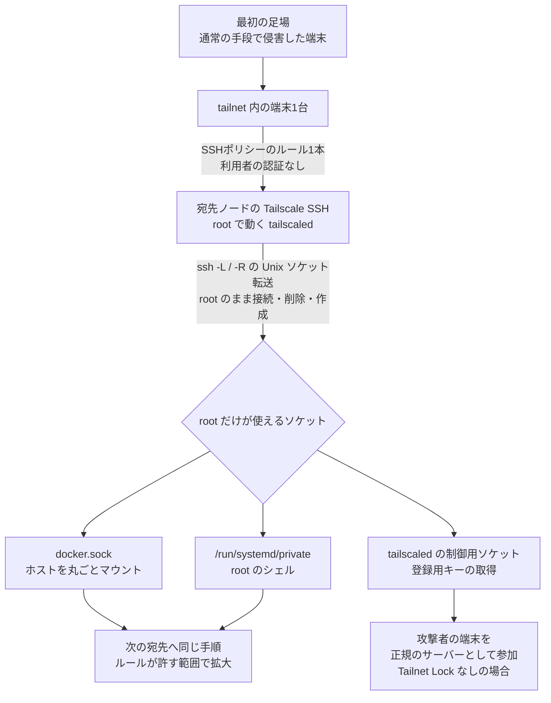

# Tailworm ― Tailscale SSHなどのソケット転送でroot、未修正

## 要点

### 影響バージョン

- 研究者が試したのは **Tailscale 1.104.2** と **headscale 0.29.5**（Tailworm 報告書）。ほかの版で再現するかは書かれていない。
- 中心の問題（Tailscale SSH の Unix ソケット転送）が関係するのは、**Tailscale SSH を有効にしたノード**で、SSH ポリシーで転送が許されている場合（The Hacker News、Tailworm 報告書）。headscale 0.29.5 では転送を止める設定がない（Tailworm 報告書）。
- そのほか、App Connector（conn25）、`tailscale serve`、DERP クライアント、headscale 本体に関する指摘がある（Tailworm 報告書）。
- **10月26日時点で、Tailscale のセキュリティ情報・CVE・修正版はない**（Tailscale のセキュリティ情報ページ、The Hacker News）。実際の悪用も報告されていない（The Hacker News）。

### 今すぐやること

- Tailscale SSH のルールを棚卸しし、**送信元1台と宛先1台を対にしたルール**に書き換える。ID やタグ全体に許可を出す広いルールは外す（The Hacker News、Tailworm 報告書）。
- Tailscale のホスト型サービスでは、**ルールごとにポート転送を禁止**する。headscale 0.29.5 では止められないため、**SSH の許可は宛先の root 権限を渡すのと同じ**とみなして絞る（The Hacker News、Tailworm 報告書）。
- 使っていない Tailscale SSH は止める（考察）。なお Tailscale は「全員に Tailscale SSH の無効化を勧めるわけではない」としている（The Hacker News）。
- App Connector の権限を不要な端末から外し、Unix ソケットへ向けた `tailscale serve` の転送を消す。ノード鍵の有効期限を有効にする（The Hacker News）。

## 概要

- Tailscale SSH は、接続してきた**利用者を認証せず端末で判断し**、ポリシーのルール1本で SSH を許すかを決める。SSH サーバーは root で動く `tailscaled` に組み込まれている（Tailworm 報告書、The Hacker News）。
- 研究者によると、Unix ソケットの転送（`ssh -L` / `ssh -R`）で、**パスの確認・ソケットの削除・接続を root のまま行う**。そのため一般アカウントのセッションから、root だけが使える `docker.sock` や `/run/systemd/private` に root として接続でき、root でのコマンド実行に至った（Tailworm 報告書）。
- 報告書は、1台の乗っ取りからルールが許す全端末へ自動で広がる「ワーム化」も実験室で測ったとする。報告は研究者1人のもので、ほかの研究者による再現や Tailscale による技術的な確認はまだない（The Hacker News）。

> この記事では、ベンダー・公的機関・研究者・報道で確認できた内容を「事実」、筆者の推測や意見を「考察」として分けて書いています。

## 何が起きたか（時系列）

| 日付 | 出来事 |
| --- | --- |
| 2026年（10月以前） | Tailscale が 1.98.9 で、Tailscale SSH の Unix ソケット転送がシンボリックリンクをたどって特権ソケットに届く問題（TS-2026-004）や、UID `0` 指定で root になれる問題（TS-2026-006）などを修正（Tailscale） |
| 10月22日〜24日 | Windisch が Tailscale 1.104.2 と headscale 0.29.5 を実験室で検証（Tailworm 報告書） |
| 10月24日〜25日 | 報告書「Tailworm」を tailworm.com で公開（swamp-club は24日、The Hacker News は25日公開としている）。Windisch は The Hacker News に、公開前の土曜日に報告書と攻撃コードを Tailscale のセキュリティ窓口へ送ったと説明（The Hacker News、swamp-club） |
| 10月25日 | Tailscale のエンジニアリング担当副社長 Mike Shaver が Reddit で、報告を受け取り、問題を確認して修正を進めていると説明（The Hacker News） |
| 10月26日 | Tailscale のセキュリティ情報ページの最新は TS-2026-013（eMudhra の中間 CA）で、Tailworm に関する項目はない（Tailscale） |

## 技術的な問題点（根本原因）

**事実（Tailworm 報告書）**

- **認証の省略。** Tailscale SSH では、SSH の認証段階が方式 `none` で終わる。WireGuard の層で端末が暗号的に特定されているため、パスワードや鍵ではなく**端末の ID** をポリシーが評価する。許可はルール1本（送信元の端末から宛先の端末へ、使えるアカウント名を含む）で決まる。
- **root のままの転送処理。** SSH サーバーは root で動く `tailscaled` に組み込まれ、gliderssh というライブラリの上に作られている。Unix ソケットの転送で、ソケットへの接続（`-L`）やソケットの作り直し（`-R`）を root のまま行う。
- **発見1（`ssh -L`）。** 一般アカウントのセッションから、root しか使えない Docker のソケットに `tailscaled` 経由で接続させ、ホストの `/` をマウントしたコンテナで `uid=0` と `/etc/shadow` の中身を得た。sudo も docker グループも要らなかった。
- **発見2（`ssh -R`）。** root 所有のソケットを `tailscaled` に削除させ、そのパスに攻撃者の転送用ソケットを置かせて（BindUnlink）、本物のサービスになりすますことができた。
- **発見3（TOCTOU）。** 転送できるパスはホーム、`/tmp`、`/run/user` に限られているが、確認するのは文字列としてのパスで、実際の削除・作成・接続はあとでカーネルがパスを解決し直すときに行う。セッション内で `rename` を毎秒約17万回繰り返すと、その間に別の場所へすり替えられ、許可リストは**境界として機能しなかった**。この方法で、
  - `/run/systemd/private` への root としての接続から root のリバースシェル（競合に勝てる確率は0〜4%）
  - `tailscaled` 自身の制御用ソケットをすり替え、`tailscale up` が送る**新しい端末の登録用キー（authkey）**の取得
  を実験室で示した。取得したキーで攻撃者の端末を正規のタグ付きサーバーとして参加させるところまでは、Tailnet Lock を有効にしていない構成で最後まで成功した。有効な構成では、必要な秘密情報は取れたが最後の段階は実行していない。
- **同種の前例。** Dropbear の CVE-2025-14282 は同じ型の問題で、早い段階でセッションの利用者へ権限を落とす（setuid する）ように直された。OpenSSH は認証後の子プロセスが利用者の権限に落ちてから転送を処理するため、この型の問題はない、と報告書は比べている。
- **他の発見。** App Connector（conn25）では宛先が検証されず、クラウドのメタデータサービス、社内 LAN、Kubernetes の API サーバーに届いた。`tailscale serve` の TCP 転送では、`tailscaled` 自身のソケット（`tailscaled.sock`）を転送先にできた。serve まわりの競合も複数挙げている。ほかに、メモリを使い切らせる問題や headscale のサービス停止（DoS）も挙げている。

**事実（Tailscale）**

- Tailscale は 1.98.9 で、Unix ソケット転送の確認が文字列の一致だけで、シンボリックリンクの行き先を確かめていなかった問題（TS-2026-004）を直している。修正では、パスとリンクの行き先を評価して、許可リストの外を拒否するようにした。

**考察**

TS-2026-004 の修正は「パスを確かめる処理」を強くするものだった。Tailworm の発見3は、その確認と実際の利用の間にずれがあるという指摘で、確認をどれだけ厳しくしても、root が利用者に代わってファイルシステムを操作する構造が残る限り同じ型の問題が残りうることを示している。報告書が挙げる Dropbear と OpenSSH の違いは「パスの確認が厳しいか」ではなく「誰の権限で操作するか」であり、根本的な対策は権限を落とすことだという主張は、前例と整合している。

## 攻撃・侵入経路

**事実（Tailworm 報告書、The Hacker News）**

- 前提は2つ。Tailscale SSH が転送を許す設定になっていること、そして攻撃者が、ルールで宛先への接続を許された端末を1台すでに支配していること。最初の足場は別の手段で得る必要があり、Tailscale の欠陥がそれを作るわけではない。
- 盗んだパスワードや鍵は要らない。Tailscale SSH は端末の ID で許可を判断するためである。
- 実験室では、1台から、ルールが許すすべての端末へ、パスワードも鍵も利用者の操作もなく、1段階1秒未満で広がった。広がりを止めたのは、**送信元と宛先を対にしたルール**と、**TPM や Secure Enclave に結び付いた端末の鍵**の2つだった。
- 「ワーム化できる」という表現には、報告を読んだ研究者から公に疑問も出ている。一方で root 取得の発見は深刻だとする声もある。実際の環境で広がったわけではない（The Hacker News）。

## なぜ防げなかったか・構造的要因の考察

1. **「ゼロトラスト」の SSH が、利用者の認証を省いている。** Tailscale SSH は、端末の ID で許可を決める設計で、利用者の認証段階はない（Tailworm 報告書）。端末が信頼できるという前提が崩れると、ルール1本でそのまま宛先に入れる（考察）。従来の SSH なら、端末を乗っ取っても宛先ごとの鍵やパスワードが別に必要だった。
2. **特権の分離をやめた。** OpenSSH は認証後に利用者の権限へ落ちてから転送を処理するが、gliderssh を使う Tailscale SSH は root のまま処理する（Tailworm 報告書）。報告書は OpenSSH の特権分離や Dropbear の修正を対比として挙げている（Tailworm 報告書）。便利な機能（転送）を、それを想定していない権限で動かすと、機能そのものが権限昇格の道具になる（考察）。
3. **同じ場所で直し続けている。** Tailscale は今年、SSH とソケットの扱いに関する問題を1.98.9 でまとめて直したばかりで、その中には Unix ソケット転送が特権ソケットに届く問題も含まれていた（Tailscale、The Hacker News）。症状ごとの修正では、型そのものは残る（考察）。
4. **「チェックモード」は転送を守らない。** 研究者は、接続前に再ログインを求める SSH のチェックモードは、確立したセッション内の転送には効かないとしている。Tailscale も対策としてチェックモードを挙げるが、権限昇格を直すものではなく、手前に障壁を1つ足すだけである（Tailworm 報告書、The Hacker News）。
5. **調整されない公開。** Windisch は「報告したが、調整はしていない」と書き、公開前に報告書を Tailscale に送ったと説明する。公開時点で修正版はなく、運用者は設定で守るしかない（The Hacker News）。公開の是非は議論が分かれているが、ネットワークの中の権限を広く持つ製品ほど、修正前に設定でどこまで守れるかを把握しておく必要がある（考察）。

## 運用者向けの具体的な対策と検知ポイント

**対策（事実に基づくもの）**

- **SSH ルールの棚卸し。** SSH を有効にしたノードと `ssh` ルールをすべて洗い出し、送信元1台と宛先1台を対にしたルールに書き換える。ID 全体・タグ全体の許可は外し、root を宛先のアカウントにしない（Tailworm 報告書、The Hacker News）。
- **転送の禁止。** ホスト型サービスでは、ルールごとの転送の項目を禁止にする。headscale 0.29.5 は転送を止められないので、SSH の許可は root 権限と同じとみなす（Tailworm 報告書）。発見1が一般アカウントのセッションから root に届いている以上、宛先を一般アカウントに限るだけでは足りない（考察）。
- **App Connector の制限。** 不要な端末から権限を外す。Kubernetes では App Connector の名前空間に、既定で外向き通信を拒否する NetworkPolicy を置く（Tailworm 報告書、The Hacker News）。
- **serve の確認。** `tailscale serve` の設定で、Unix ソケットへの TCP 転送、特に `tailscaled` 自身のソケットへの転送を消す（Tailworm 報告書、The Hacker News）。
- **端末の鍵に期限を付ける。** サーバー群でもノード鍵の有効期限を有効にし、可能なら TPM や Secure Enclave に鍵を結び付ける（Tailworm 報告書、The Hacker News）。
- **侵害時は管理画面から端末を削除する。** root を取られた端末では、鍵を含む状態ファイルが持ち出された可能性がある。再インストールしても盗まれた鍵は無効にならず、管理画面での削除（または鍵の期限切れ）で初めて無効になる。あわせて登録用キーなどを入れ替える（Tailworm 報告書、The Hacker News）。
- Tailscale は、SSH のチェックモードと自動更新の有効化も勧めている（The Hacker News）。修正版が出たらすぐ入るようにしておく意味でも、自動更新は有効にしておきたい（考察）。

**検知ポイント（Tailworm 報告書）**

- 転送が許されるディレクトリ（`/tmp`、ホーム、`/run/user`）と `tailscaled` 自身のソケットのパスで、Unix ソケットの `unlink`・`bind`・`chmod` を auditd で記録する。
- 同じディレクトリで `rename` が大量に続く動きを検知する。0600 であるべきパスにモード 0755 のソケットがあれば、競合に勝った痕跡の可能性がある。
- 変更作業の時間外に登録用キーが使われたり、新しいタグ付きの端末が参加したりしたら警告する。

**考察（運用上の工夫）**

- メッシュ型 VPN は「つながる範囲」を ACL で、「入れる範囲」を SSH ルールで決める。後者は宛先の権限そのものなので、ネットワークの ACL より厳しく、1対1で書く運用にしておくと、次の欠陥が出ても被害の広がりを抑えられる。
- 監視用のログの送り先は、侵害されたサーバーから届かない場所に置きたい。root を取られたサーバーのログは、消される前提で考えるべきである。

## 参考リンク

- [Tailworm（Cyberdione Labs、Erica Windisch）](https://tailworm.com/)
- [Unpatched Tailscale SSH Flaws Could Let a Hacked Device Reach Root on Other Servers（The Hacker News、2026年10月25日）](https://thehackernews.com/2026/10/unpatched-tailscale-ssh-flaws-could-let.html)
- [Security Bulletins（Tailscale）](https://tailscale.com/security-bulletins)
- [Tailworm（swamp-club）](https://swamp-club.com/cve/tailworm)
