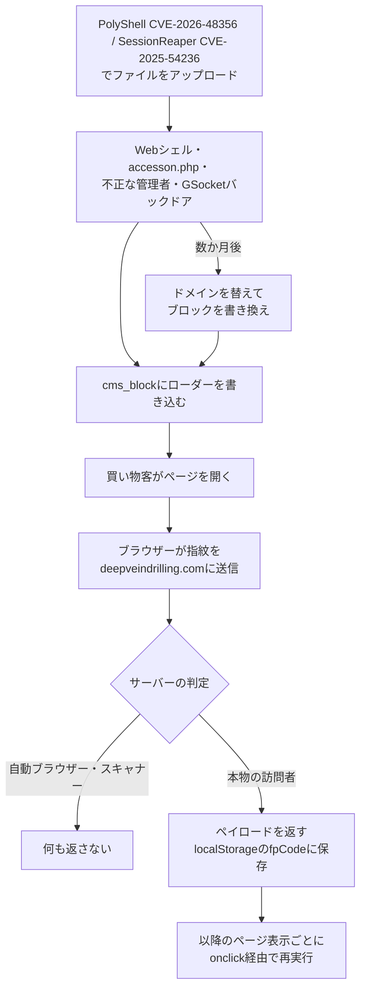

# Magento CMSブロックのローダー ― 953店舗に15か月で5つのドメインを渡り歩き、スキャナーには何も返さず、一度受け取った買い物客のブラウザーでは再実行され続ける

## 要点

### 影響バージョン

- 対象は主に **Magento 2 / Adobe Commerce** の EC サイト（Sansec）。
- 侵入口として Sansec が挙げるのは、ファイルアップロードの脆弱性 **PolyShell（CVE-2026-48356、修正は APSB26-73）** と **SessionReaper（CVE-2025-54236、修正は APSB25-88）**（Sansec）。
- ただし、**コアのパッチが全部当たった Magento 2.4.7-p10 の店舗**も、以前に作られた不正な管理者アカウントとバックドア経由で書き換えられた。パッチだけでは足りない（Sansec）。
- ローダーは `cms_block` テーブル（静的ブロック）に置かれ、テーマのファイルや `core_config_data` では一度も見つかっていない（Sansec）。

### 今すぐやること

- データベースの `cms_block` と `cms_page` で、`fpCode`・`se_referrer`・`localStorage.getItem` を含む行を探す。テーブルに接頭辞がある場合は付ける。`update_time` が攻撃者の最後の書き込み時刻になる（Sansec）。

  ```sql
  SELECT block_id, identifier, update_time FROM cms_block
  WHERE content LIKE '%fpCode%' OR content LIKE '%se_referrer%'
     OR content LIKE '%localStorage.getItem%';
  ```

- 見つけたら、**スクリプトを消すだけで終わりにしない**。攻撃者はデータベースに書き込める状態のまま残っている（Sansec）。
  - `pub/media/custom_options/` と `pub/media/customer_address/` に `.htaccess` 以外のファイルがないか、`accesson.php` がないかを調べる
  - `admin_user` に見覚えのないアカウントがないか、不審なプロセスがないかを調べる
  - データベース・管理画面・API 連携のパスワードを変える
- APSB26-73（PolyShell）と APSB25-88（SessionReaper）を当てる（Sansec）。

## 概要

- オランダの EC セキュリティ企業 Sansec は10月24日、2025年7月から続く攻撃で、**953店舗（ほとんどが Magento）**にローダーが埋め込まれたと公表した。攻撃者は数か月ごとにドメインを変え、15か月で5つのドメインを使った（Sansec、The Hacker News）。
- ローダーは訪問者のブラウザーに攻撃者のサーバーへ問い合わせさせ、サーバーは**本物の買い物客かセキュリティスキャナーかを見分け、スキャナーには何も返さない**。最新版は自動ブラウザーの痕跡や GPU 名などの指紋を送る（Sansec）。
- 最新ドメイン `deepveindrilling.com` は83店舗で見つかり、うち60店舗は以前の波からの被害店舗だった。Sansec はまだ最終的なコード（ペイロード）を取れていないが、過去には暗号資産ウォレット Ledger をまねたドメインのスクリプトが配られていた（Sansec）。

> この記事では、ベンダー・公的機関・研究者・報道で確認できた内容を「事実」、筆者の推測や意見を「考察」として分けて書いています。

## 何が起きたか（時系列）

日付は Sansec の表記（UTC）による。

| 日付 | 出来事 |
| --- | --- |
| 2025年7月9日 | `manulfie.click` のローダーを読み込む店舗を初めて確認（のべ863店舗）（Sansec） |
| 2025年12月12日 | `neswnsssn.click` に切り替え（のべ494店舗）。同日、感染店舗にログインした客に `manulfie.click` から `crypto-insider.top/ssl/`、5分後に `leqdger.click/ssl/` のスクリプトが配られた（Sansec） |
| 2025年12月15日〜16日 | `neswnsssn.click` が別の2店舗で同じ `leqdger.click` のスクリプトを差し込む（Sansec） |
| 2026年3月30日 | PolyShell の大規模な波で、`lanhd6549tdhse.top` のローダーが1時間で471店舗に入る（のべ355店舗で確認）（Sansec） |
| 2026年5月22日〜23日 | 期限切れの `neswnsssn.click` と `manulfie.click` が再登録され、ドメインの駐車サービスのネームサーバーに（Sansec） |
| 2026年6月8日 | `additionalver.com` に切り替え（のべ246店舗）（Sansec） |
| 10月6日 | `deepveindrilling.com` が登録される（Sansec） |
| 10月7日 | 21時54分（UTC）、Sansec のスキャナー eComscan が新しいローダーを初めて検出。8日中に74店舗で確認（Sansec） |
| 10月23日 | 攻撃者がブロックを書き換え、指紋を送る版に。さらに9店舗に広がる（Sansec） |
| 10月24日 | Sansec が公表。再確認できた71店舗はすべて新しい版だった（Sansec） |
| 10月26日 | The Hacker News が報道（The Hacker News） |

## 技術的な問題点（根本原因）

**事実（Sansec）**

- **置き場所。** ローダーは Magento の `cms_block` テーブルにある。ここはヘッダーやバナーなど、店頭のページに埋め込まれる静的ブロックの中身で、管理画面から編集できる。テーマのファイルを調べるだけでは見つからない。
- **10月7日の版（2つのスクリプト）。**
  - 1つ目は、訪問者の `localStorage` から `fpCode` を読み、値があれば見えない `div` の `onclick` 属性に入れてクリックし、すぐ消す。`eval()` を使わずに、保存されたコードをイベントハンドラーとして実行する。
  - 2つ目は `https://deepveindrilling.com/?s=d35c5031` の読み込み。ブロックの中には `fpCode` を書き込む処理がないため、このスクリプトが書き込んでいるとみられる。
  - 結果として、**一度ペイロードを受け取った訪問者は、ドメインが止まったりブロックされたりしても、以降のページ表示のたびに同じコードを実行する**。3月の版は1回実行したら保存したペイロードを消していた。
- **10月23日の版。** スクリプトタグの代わりにインラインのローダーを使い、`https://deepveindrilling.com/?s=49b7ca5f&fp=` に指紋を送る。指紋には次が入る。
  - 自動ブラウザーの判定（`navigator.webdriver`、Selenium のグローバル変数、ChromeDriver の `cdc_` プロパティ）
  - WebGL から取った GPU 名、CPU コア数、メモリ、画面サイズ、タイムゾーン、言語、クライアントヒント
- **サーバー側の振り分け。** urlscan.io が自動化した Chrome で感染店舗を開いたときは HTTP 200 が返り、ページに追加の中身はなかった。
- **以前は Keitaro。** 10月より前の2つ目のスクリプトは、市販の広告トラッカーで、トラフィック振り分け（TDS）にも使われる Keitaro の「Script (async)」連携だった。参照元・ページタイトル・クエリを base64 で隠した URL（例 `https://additionalver.com/Mb2z8J?&se_referrer=`）に送り、TDS が訪問者ごとにペイロード・転送・何もしない、を決める。10月24日に Windows のデスクトップとして `additionalver.com` を要求すると、何もしない `QWE=123;` が返り、24時間その訪問者を印付けする Cookie が設定された。`deepveindrilling.com` では Keitaro をやめ、判定をローダー自体に移した。
- **期限切れドメインの危険。** 再登録された `manulfie.click` と `neswnsssn.click` のローダーは、8月〜10月にもそれぞれ9店舗と6店舗に残っていた。こうした店舗の訪問者は、参照元とページタイトルを**新しいドメインの持ち主**に送り、返されたスクリプトを実行する。
- Sansec の CSP 監視サービスには、以前の4つのドメインを読み込んだという報告が届いており、`additionalver.com` だけで約5万2000件あった。

**考察**

- 問題の核心は「店頭に出す HTML を管理画面やデータベースから自由に変えられる」という CMS の性質そのものにある。ファイルの改ざん検知や、テーマのコードレビューでは見つからない場所を選んでいる。
- `localStorage` に保存して毎回実行する作りは、ドメインを止めても被害が続くという意味で厄介である。店舗側でブロックを消しても、すでにペイロードを持った客のブラウザーで動き続けるかどうかは、それを読む1つ目のスクリプトが残っているかで決まる（Sansec は、スクリプトを消せば `fpCode` を読むものはなくなるとしている）。

## 攻撃・侵入経路



**事実（Sansec）**

- 10月の書き換えでは新しい脆弱性は使われていない。83店舗のうち60店舗はすでに感染していた（34店舗は2025年10月から）。
- 3月には、PolyShell で Web シェルを置いたあと、1時間で471店舗にローダーを入れた。
- 期間全体で、コアのパッチが1つ以上欠けている Magento 2 の169件にローダーが見つかり、うち102件（60%）には PolyShell か SessionReaper でアップロードされたファイルもあった。別のスキマーに感染した比較対象3024件では、この割合は32%だった。
- Magento 2.4.7-p1 の店舗では、`pub/media/custom_options/quote/` に PNG 画像に見せかけた PolyShell の Web シェルがあり、CMS ブロックの `additionalver.com` のローダーが10月7日に `deepveindrilling.com` に切り替わった。この店舗は APSB26-73 をまだ当てていない。
- Magento 2.4.7-p10（欠けたコアパッチなし）の店舗では、10月23日16時46分（UTC）、問題なしのスキャンから1時間後にローダーが入った。この店舗では9月16日に不正な管理者アカウント、9月24日に GSocket のバックドアが見つかっていた。

**事実（The Hacker News）**

- Sansec は、攻撃者が既存の CMS ブロック（ヘッダー・フッター・バナーなど）を書き換えたのか、新しいブロックを作ったのかは明らかにしていない。

## なぜ防げなかったか・構造的要因の考察

**考察**

- **パッチを当てても出ていかない。** 一度入った攻撃者は、Web シェル・管理者アカウント・バックドアを残す。パッチは新しい侵入を止めるだけで、残った足場は消さない。60店舗が「元からの被害店舗」だったことがそれを示している。
- **スキャナーに見せない。** 外からの監視サービスは自動ブラウザーを使うことが多い。指紋で自動ブラウザーを見分けて何も返さない作りは、外部スキャンで「異常なし」と出ても安心できないことを意味する。
- **データベースは改ざん検知の対象外になりやすい。** ファイルの整合性監視は多くの現場で入っているが、CMS ブロックの中身を定期的に比較している店舗は少ないと考えられる。
- **期限切れドメインの再利用。** ローダーを消し忘れた店舗では、元の攻撃者がいなくなっても、ドメインを買い取った別の誰かが訪問者にスクリプトを返せる。被害は攻撃者の手を離れても続く。
- **中小の EC サイトの運用体制。** 953店舗という規模と、15か月同じ攻撃者が戻ってこられたことは、侵害後の調査と清掃が十分に行われていない店舗が多いことを示していると考えられる。

## 運用者向けの具体的な対策と検知ポイント

**事実（Sansec）**

- 侵害の指標
  - ローダー: `https://deepveindrilling.com/?s=d35c5031`、`https://deepveindrilling.com/?s=49b7ca5f&fp=`
  - Keitaro の URL: `https://additionalver.com/Mb2z8J`、`https://lanhd6549tdhse.top/KZtBscgb`、`https://neswnsssn.click/PKgJDPfF`、`https://manulfie.click/GKTD8cBz`、`https://hdfdsi84j3h.top/sFnnPFHm`、`https://c85grt98sd.com/1kYrdH`
  - ペイロードの URL: `https://leqdger.click/ssl/`、`https://crypto-insider.top/ssl/`
  - Keitaro のおとりの応答: `QWE=123;`
  - base64 の文字列: `aHR0cHM6Ly9hZGRpdGlvbmFsdmVyLmNvbS9NYjJ6OEo/JnNlX3JlZmVycmVyPQ==`
  - `localStorage` のキー: `fpCode`、`136c1e07507f4a97`、`136c1e07507f4a98`
  - データベースの場所: `cms_block.content`
- ドメインは base64 で隠されていることが多いので、ドメイン名ではなくコードのパターン（`fpCode`、`se_referrer`、`localStorage.getItem`）で探す。
- 侵入口の確認

  ```sh
  find pub/media/custom_options/ pub/media/customer_address/ -type f ! -name '.htaccess'
  find . -name 'accesson.php' -type f
  ```

- 清掃後に、データベース・管理画面・API 連携のパスワードを変え、APSB26-73 と APSB25-88 を当てる。

**考察（運用上の工夫）**

- `cms_block` と `cms_page` の中身のハッシュを毎日取り、変わったら通知する。正規の編集は担当者と時間帯が限られるので、`update_time` が営業時間外の変更は特に怪しい。
- `<script>` を含む CMS ブロックの一覧を作り、承認済み以外は置かせない運用にする。マーケティング用のタグはタグマネージャーにまとめ、CMS ブロックに直接書かない。
- CSP（Content Security Policy）でスクリプトの読み込み先を許可リストにし、違反レポートを受け取る。Sansec のケースでも、CSP のレポートで攻撃ドメインへの読み込みが見えていた。
- 管理画面は IP 制限と多要素認証をかけ、`admin_user` の作成を監視する。侵害が疑われる店舗は、パッチを当てる前に Web シェルと管理者アカウントの棚卸しを先にする。
- 自社のサイトを外から監視するときは、自動ブラウザーだけでなく、実ブラウザーに近い環境や CSP レポートも組み合わせる。

## 参考リンク

- [deepveindrilling.com: Magento CMS block loader hits 953 stores（Sansec、2026年10月24日）](https://sansec.io/research/magento-cms-block-loader-deepveindrilling)
- [Hackers Infect 953 Online Stores With Scanner-Evading JavaScript, Mostly on Magento（The Hacker News、2026年10月26日）](https://thehackernews.com/2026/10/hackers-infect-953-online-stores-with.html)
- [Mass PolyShell attack wave hits 471 stores in one hour（Sansec）](https://sansec.io/research/polyshell-mass-attack-wave)
- [Security update available for Adobe Commerce | APSB26-73（Adobe）](https://www.adobe.com/trust/security/products/commerce/apsb26-73.html)
