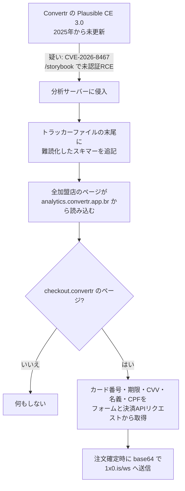

# Convertr ― 分析スクリプト改ざんで決済画面にスキマー

## 要点

### 影響バージョン

- 侵入口と疑われているのは **Plausible Community Edition（自前運用版）v3.0.0〜v3.2.0**（rc 版を含む）。`/storybook` エンドポイントが未認証で公開され、条件によってはサーバー上で任意のコマンドを実行できる（**CVE-2026-8467**、修正は **v3.2.1**、2026年5月15日公開）（Plausible、GitHub Advisory）。
- 原因は Plausible が組み込んでいた Elixir ライブラリ **phoenix_storybook 0.5.0〜1.1.0 未満** のテンプレートインジェクション（GHSA-55hg-8qxv-qj4p、CVSS v4 9.5）（GitHub Advisory）。
- 被害を受けたのは、Convertr の決済ページ（アドレスに `checkout.convertr` を含む）で **10月24日以降にカードで支払ったブラジルの買い物客**（Sansec）。
- Plausible の公式クラウド版（plausible.io）の利用者はこの脆弱性の対象として挙げられていない。対象は自分でサーバーを立てた CE の運用者。

### 今すぐやること

- **Plausible CE を自前で運用している場合**、v3.2.1 以降に上げる。すぐ上げられなければ、リバースプロキシで `/storybook` へのアクセスを遮断する（Plausible）。
- アクセスログで `/storybook` へのリクエストを探す。見つかったら、サーバーを作り直し、そのサーバーの秘密情報を入れ替え、`priv/tracker/js/` のファイルを公式リリースと比べる（Sansec）。
- 自社サイトに**第三者や自社の別サーバーから読み込むスクリプト**（分析・広告・チャットなど）があるなら、決済ページで読み込む必要があるかを見直す。
- Convertr 上の店舗は、トラッカーがきれいになったことを Convertr に確認し、決済代行会社に知らせる。ブラウザーのキャッシュに最大24時間残るため、清掃後もその間は買い物客に危険が残る（Sansec）。

## 概要

- Convertr はブラジルのファッションブランド数十社のオンラインストアと決済を動かすプラットフォームで、加盟店の売上は20億レアル超（Convertr の公表値、Sansec 経由）。全加盟店のページが、Convertr 自身の Plausible サーバー `analytics.convertr.app.br` からトラッカーを読み込んでいた（Sansec）。
- 攻撃者はこのトラッカーファイル1つの末尾にスキマーを追記した。その結果、**Convertr のすべての決済画面がスキマーを読み込んだ**（Sansec）。
- Sansec は、2024年7月から追っているブラジルの Magecart グループの仕業としている。このグループはこれまで店舗を1つずつ攻撃しており、**サプライチェーン攻撃は今回が初めて**（Sansec）。

> この記事では、ベンダー・公的機関・研究者・報道で確認できた内容を「事実」、筆者の推測や意見を「考察」として分けて書いています。

## 何が起きたか（時系列）

時刻は Sansec の表記（UTC）による。日本時間は9時間進める。

| 日時（UTC） | 出来事 |
| --- | --- |
| 2025年 | Convertr が Plausible CE 3.0 を導入し、以後更新しなかった（Sansec） |
| 2026年5月15日 | Plausible が CE v3.2.1 を公開し、`/storybook` エンドポイントを削除（Plausible） |
| 10月24日 05:03 | Convertr のトラッカーのきれいな版が最後に確認される（Sansec） |
| 10月24日 23:22 | Sansec がスキマーを検出（Sansec） |
| 10月26日 | スキマーが Convertr の決済 API のフィールド名を狙う版に更新される。Sansec が分析を公表（Sansec） |
| 10月26日 15:34 | Convertr はまだスキマーを配信していた。Sansec は通知したが、公表までに返答はなかった（Sansec） |
| 10月27日 12:54 | Convertr がスキマーを削除し Plausible を修正版に上げたと報告（Sansec） |
| 10月27日 13:08 | Sansec がトラッカーがきれいになったことを確認（Sansec） |

## 技術的な問題点（根本原因）

**事実**

- **CVE-2026-8467 の中身（GitHub Advisory）。** phoenix_storybook の playground は、WebSocket で届く属性の値を認証なしで受け取り、エスケープせずに HEEx テンプレートの文字列に埋め込む。`foo" injected={EXPR} bar="` のような値で属性の外に出て、任意の Elixir 式を差し込める。そのテンプレートは `EEx.compile_string/2` でコンパイルされ、`Code.eval_quoted_with_env/3` で `Kernel` を使える状態のまま評価されるため、`System.cmd/2` などで OS コマンドが動く。
- **Plausible での露出（Plausible）。** 影響を受ける CE のバージョンは HTTP の `/storybook` を公開していた。v3.2.1 はこのエンドポイントを丸ごと取り除いた。
- **改ざんしやすい配信形態（Sansec）。** Plausible はトラッカーをディスク上のファイルからそのまま配信する。ファイルを書き換えれば、それを埋め込むすべてのサイトに届く。
- **スキマーの作り（Sansec）。** 感染したトラッカーは、正規の Plausible スクリプトのあとに文字コードの配列を置き、`String.fromCharCode` で文字列に戻して `(0,eval)` で実行する。
  - `checkout.convertr` のページでだけ動く。
  - 支払いフォームと、決済画面が決済 API に送るリクエストの両方から、カード番号・有効期限・CVV・名義・CPF を読む。
  - 注文確定時に `番号|月|年|CVV|CPF|名義|ctr` の形でつなぎ、base64 にして `https://1x0.is/ws` に POST する。末尾の `ctr` は被害先（Convertr）を示す短いタグ。
  - 10月24日の版は一般的なフィールド名のパターンで探していたが、26日の版は Convertr の決済 API の正確なフィールド名を狙った。
- **侵入口は未確定（Sansec）。** Sansec は Convertr のサーバーログを見ておらず、CVE-2026-8467 が入口だったとは確認できていない。Convertr の古い CE 3.0 がこの脆弱性の対象だったことから疑っている。

**考察**

- 根本は「決済ページで、決済に関係のないスクリプトを読み込んでいた」ことにある。分析用トラッカーは全ページに入れるのが普通だが、そのせいで分析サーバーの侵害がそのまま決済情報の漏えいにつながった。
- 自社ドメインの、自社が運用するサーバーからの読み込みだったことも見落としやすい点だと考えられる。外部ドメインのスクリプトなら CSP や監視で目立つが、自社のサブドメインは「信頼できる読み込み先」として許可されていることが多い。
- 「開発用の部品（コンポーネントカタログ）が本番に公開されたまま」という形は、Plausible に限らず起きやすい。Storybook のような開発補助の画面は、本番ビルドで外すか、認証の内側に置く必要がある。

## 攻撃・侵入経路

**事実（Sansec）**

- 攻撃者が変えたのは Convertr の分析サーバー上のファイル1つ。
- 同じ送信先 `1x0.is/ws` は、ブラジルの別の店舗のスキマーでも見つかっている。
- 同じグループの手口の特徴は2024年から変わっていない。
  - 縦棒区切りのカード情報と、末尾の短い被害先タグ
  - `cartao.php`（カード）や `pagamento.php`（支払い）のようなポルトガル語の送信先
  - `snf.is`、`anl.is`、`1x0.is` のような3文字の `.is` ドメインを数か月ごとに替える。Discord の Webhook や、別の被害店舗に置いたスクリプトに送る版もある
  - e.Rede、PagSeguro、Pagar.me、Mercado Pago 向けのスキマーと、PIX の支払い QR コードを攻撃者のものにすり替える版
- このグループは Magento・OpenCart・WooCommerce の店舗数十件に感染させ、ほとんどがブラジルで、2年近くスキマーが残った店舗もある。

## なぜ防げなかったか・構造的要因の考察

**考察**

- **1か所の改ざんで全加盟店に届く構造。** マルチテナントの EC プラットフォームは、共通のスクリプトを1か所から配ることで運用を楽にしている。その利点が、侵害時には被害を全加盟店に広げる。加盟店側からは自分で防ぐ手段がほとんどない。
- **「本体ではない」サーバーの更新漏れ。** Plausible の修正は5月に出ていたが、Convertr のサーバーは2025年の導入から一度も更新されなかったと Sansec は書いている。分析・監視などの補助的なサーバーは、本番の決済系ほど更新や脆弱性管理の対象として意識されにくい。
- **外からの検知が頼り。** Sansec が検出してから Convertr が削除するまで約1日半かかり、その間に攻撃者はスキマーを改良している。Convertr が自分でファイルの変化に気づいた形跡は、公開情報からは読み取れない。
- **CPF も一緒に取られる。** ブラジルではカード払いのときに CPF の入力を求められ、銀行も CPF で顧客を識別する（Sansec）。カードの再発行で済まず、なりすましに使われる情報も一緒に漏れる点は、地域の決済習慣に合わせてスキマーが作られていることを示している。

## 運用者向けの具体的な対策と検知ポイント

**事実（Sansec・Plausible）**

- 侵害の指標
  - 送信先: `https://1x0.is/ws`、`https://1x0.is/ws/<base64>`
  - 感染したファイル: `https://analytics.convertr.app.br/js/script.pageview-props.tagged-events.js`（10月26日の SHA-256 `ee4618d24737eff785e5a267b55903d5ef6ff7ecbeb099347a67fee77734d7f7`）
  - 難読化の痕跡: `_s+=String.fromCharCode(_a[_i]);(0,eval)(_s)`
  - 同じグループが以前使った送信先として `snf.is`、`kk.land` などと、Discord の Webhook ID が Sansec の IOC 一覧に載っている
- Plausible CE: v3.2.1 以降に更新する。すぐできない場合は `/storybook` をリバースプロキシで遮断する。
- ログに `/storybook` へのアクセスがあれば、サーバーを作り直し、秘密情報を入れ替え、`priv/tracker/js/` を公式リリースと比較する。

**考察（運用上の工夫）**

- **決済ページで読み込むスクリプトを最小にする。** 分析・広告のタグは決済の手順から外すか、決済フォームを決済代行会社のホスト型ページや iframe に任せて、自社ページのスクリプトがカード番号に触れない構成にする。
- **CSP と SRI。** 決済ページの `script-src` を許可リストにし、違反レポートを集める。変更されないはずの自社配信スクリプトには SRI（`integrity` 属性）を付けると、ファイルが書き換えられたときにブラウザーが読み込みを拒む。ただし、配信側でファイルが頻繁に変わる場合は運用が難しい。
- **配信ファイルの改ざん検知。** トラッカーのような静的ファイルは、リリース時のハッシュと定期的に比べる。サーバー内だけでなく、外から実際に配信されている中身も取得して比べる。
- **補助サーバーの台帳を作る。** 分析・監視・ステータスページなど、決済とは別でも全ページに何かを配っているサーバーを洗い出し、脆弱性管理と更新の対象に入れる。
- **開発用エンドポイントを本番で探す。** `/storybook`、`/docs`、`/debug` のような開発用の画面が外から開けないかを、外部からのスキャンで定期的に確かめる。

## 参考リンク

- [Notorious Brazilian Magecart group hijacks Convertr checkouts via Plausible analytics（Sansec、2026年10月26日、27日更新）](https://sansec.io/research/convertr-plausible-supply-chain-attack)
- [Plausible Community Edition v3.2.1 リリースノート（Plausible、2026年5月15日）](https://github.com/plausible/analytics/releases/tag/v3.2.1)
- [GHSA-55hg-8qxv-qj4p / CVE-2026-8467: PhoenixStorybook unauthenticated RCE via HEEx template injection（GitHub Advisory）](https://github.com/advisories/GHSA-55hg-8qxv-qj4p)
- [Hackers hijack Convertr analytics script to steal payment card data（BleepingComputer、2026年10月27日）](https://www.bleepingcomputer.com/news/security/hackers-hijack-convertr-analytics-script-to-steal-payment-card-data/)
