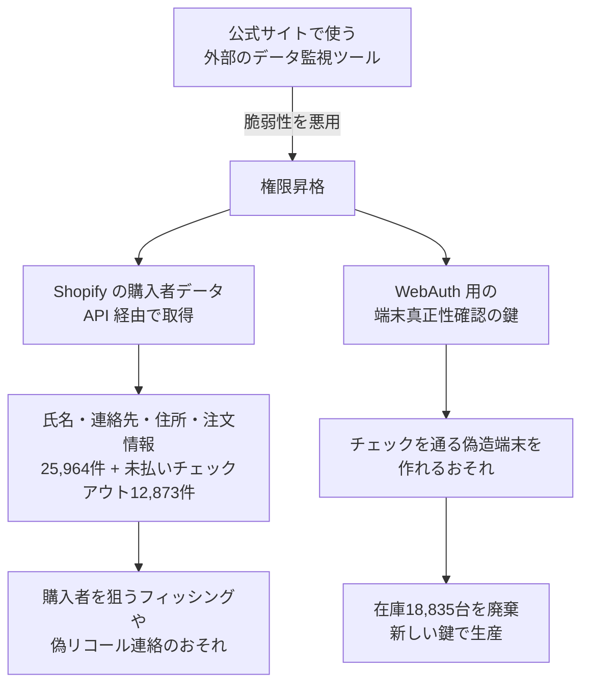

# Keystone ― 公式サイト侵害で端末の真正性確認鍵が流出

## 要点

### 影響を受ける人と端末

- **公式サイト（Shopify）で購入した人。** 対象の購入者記録は51,083件。そのうち25,119件はすでに消去または匿名化済みで、**25,964件に2024〜2026年の氏名・連絡先・住所・注文情報が残っていた**。念のため、未払いのまま残ったチェックアウト記録12,873件も対象に含めている（Keystone）。
- 支払い情報・銀行情報・身分証明書の情報、**リカバリーフレーズや秘密鍵は含まれない**。Amazon など公式サイト以外の販売経路は影響を受けていない（Keystone）。
- **10月20日より後に受け取った端末。** 古い WebAuth 鍵を持つ端末は、真正性チェックを通っても偽造品の可能性を完全には否定できない（Keystone）。
- 10月20日より前に届き、チェックを通った端末は本物と考えてよい（Keystone）。

### 今すぐやること

- 10月20日より後に Keystone の端末を受け取った場合は、使う前に `support@keyst.one` に連絡する（Keystone）。
- Keystone は端末の返品・回収を求めない。「リコール」をうたう連絡は詐欺として扱う。資産を移す必要もない（Keystone）。
- 住所や注文履歴を知った相手からのフィッシングや、自宅を狙った物理的な脅しに注意する。公式サイトで買った人は、Keystone を名乗るメール・SMS・郵便物のリンクや差出人を確かめる。
- ハードウェアウォレットを作る・売る立場なら、端末に書き込む秘密鍵が Web サイトや EC の環境から届く場所に置かれていないかを確かめる。

## 概要

- Keystone（Keystone 3 Pro などを販売するハードウェアウォレットの会社）は10月24日に第一報を、26日に詳しい声明を X に出した（Keystone）。
- 攻撃者は、公式サイトで使っていた**外部のデータ監視ツールの脆弱性**を悪用して権限を上げ、顧客情報と **WebAuth 用の端末真正性確認の鍵**を手に入れた（Keystone）。
- この鍵は製造時に端末に書き込まれ、消すことも書き換えることもできない。鍵を持つ者は、真正性チェックを通る偽造端末を作れる可能性がある。そのため Keystone は、古い鍵を持つ在庫18,835台を廃棄する（Keystone）。

> この記事では、ベンダー・公的機関・研究者・報道で確認できた内容を「事実」、筆者の推測や意見を「考察」として分けて書いています。

## 何が起きたか（時系列）

| 日付 | 出来事 |
| --- | --- |
| 10月20日 | 監視の仕組みが公式サイトへの異常なアクセスを検知。同日中に重要な機能を止め、アクセスを遮断し、脆弱性を直し、調査を始めた（Keystone） |
| 10月23日 | Shopify と API の利用状況を照らし合わせ、配送情報が取られたことを確認（Keystone、10月24日の投稿） |
| 10月24日 | 第一報を公表。Shopify に購入者データの消去を依頼（Keystone） |
| 10月26日 | 詳しい声明を公表。WebAuth 鍵の流出と、在庫18,835台の廃棄、公式サイト注文の出荷停止を発表（Keystone） |
| 11月3日（予定） | Shopify の10日間の待機期間を経て消去が終わる見込み（Keystone） |

Keystone は、攻撃者が最初に入り込んだ時期を明らかにしていない（The Hacker News）。

## 技術的な問題点（根本原因）

### データが残っていた理由

**事実（Keystone）**

- 社内の決まりでは、購入者データは180日で消すことになっていた。しかし、そのための社内の一括消去ツールがうまく動かないことがあり、失敗に気づけていなかった。
- 対策として保存期間を90日に縮め、30日を超えたチェックアウト記録も消去を依頼した。
- The Hacker News によると、10月27日時点で Keystone のプライバシーポリシーにはまだ180日と書かれていた。

### WebAuth 鍵の仕組み

**事実（Keystone、ファームウェアのソースコード）**

- Keystone は、この鍵は WebAuth（公式ページで端末が本物かを確かめる機能）にだけ使い、リカバリーフレーズの生成・鍵の導出・取引の署名には使わないと説明している。
- 公開されている Keystone 3 のファームウェアでは、真正性確認は次の流れで動く。
  - 公式ページが示す QR コードには、RSA-OAEP（SHA-1）で暗号化したデータと、64バイトの secp256k1 署名が入っている。
  - 端末は、ファームウェアに埋め込まれた公開鍵で署名を確かめてから、端末の OTP（一度だけ書き込める記憶領域）から読み出した RSA 鍵で暗号文を復号し、その結果を認証コードとして表示する（`web_auth.rs` の `calculate_auth_code`）。
  - OTP への書き込み関数 `SetWebAuthRsaKey` は、すでに鍵があると `ERR_WEB_AUTH_KEY_ALREADY_EXIST` を返して書き込まない（`presetting.c`）。鍵が一度しか書けない作りになっている。
- Keystone は、盗まれた鍵がどこに保管されていたか、手元の端末がどちらの鍵を持つかを利用者が見分ける方法を明らかにしていない（The Hacker News）。

**考察**

- 上の流れでは、端末は RSA の**秘密鍵**で復号し、正しいコードを出せることで本物だと示す。偽造端末を作るのに必要なのはこの秘密鍵で、Keystone が「偽造端末がチェックを通りうる」と言っていることとも合う。
- 一方、確認ページの側が行うのは暗号化とコードの照合なので、仕組みとしては公開鍵だけで足りるはずだ。それでも秘密鍵が公式サイトの侵害で取られたことは、端末に書き込むための鍵が Web サイトの環境から届く場所にあったことを示していると考えられる。どこにあったかは公表されていないため、断定はできない。
- 18,835台を一度に廃棄することから、多くの端末が同じ鍵を共有している可能性が高い。端末ごとに別の鍵を持たせていれば、1つの鍵の流出で偽造できるのは1台分に限られたはずだ。

## 攻撃・侵入経路

**事実（Keystone、The Hacker News）**

- 図の侵入口と取られたものは Keystone の声明による。脆弱性があった監視ツールの名前と、脆弱性の内容は公表されていない。
- The Hacker News によると、偽造品や盗難の報告はまだない。

## なぜ防げなかったか・構造的要因の考察

**考察**

- **販売サイトと製品の信頼の根が同じ場所にあった。** ハードウェアウォレットの価値は「端末が本物で改ざんされていない」ことにある。その確認に使う鍵が、外部ツールを組み込んだ販売サイトの侵害で取られたことは、製造・製品のセキュリティと、マーケティングや EC の環境の境目が十分でなかったことを示している。
- **書き換えられない鍵の弱点。** OTP に一度だけ書く作りは、端末の中で鍵を差し替えられないようにするには有効だが、鍵が漏れたときに直す手段がない。今回、在庫の廃棄しか選択肢がなかったのはそのためだ。漏えいを前提に、鍵を世代ごとに分け、確認ページで世代を見分けられるようにしておく必要がある。
- **消したつもりのデータ。** 決まりはあっても、消去ツールの失敗を誰も検知していなかった。保存期間の決まりは、実際に消えたかを確かめる仕組みとセットでないと機能しない。
- **ウォレット利用者の住所の重み。** 暗号資産の保有者の住所は、フィッシングだけでなく物理的な脅しにも使われうる。今回も購入者を狙った連絡が来ると考えて備えたほうがよい。

## 運用者向けの具体的な対策と検知ポイント

**事実（Keystone）**

- 古い鍵は生産に使わず、新しい端末には新しい鍵を入れる。古い鍵を持つ在庫18,835台は廃棄する。
- 公式サイト注文の出荷を止め、販売を予約受付に切り替えた。The Hacker News によると、Keystone 3 Pro の予約分は4〜6週間で出荷される。
- EU・英国などの当局に届け出た。購入者が自分の情報が含まれるかを調べるページと、消去状況を確かめるページを用意する予定。

**考察（同じような製品を作る側の工夫）**

- **端末ごとの鍵と証明書。** 端末ごとに鍵ペアを作り、メーカーの CA で署名した証明書を持たせる。確認側は公開鍵や証明書だけを持てばよく、1台分の流出が全体に広がらない。
- **秘密鍵を Web 環境に置かない。** 端末に書き込む鍵は、工場の HSM（鍵を外に出さない専用装置）の中で作って書き込み、確認ページ側には公開鍵だけを渡す。
- **EC に組み込む外部ツールの権限を絞る。** 分析・監視などのツールに、顧客データの API や管理者の権限を与えない。Shopify のアプリや API トークンは、必要な範囲と有効期間を見直す。
- **API の異常な読み出しを監視する。** 購入者データを大量に取り出す API 呼び出しを、通常の量と比べて検知する。Keystone が流出を確かめたのも、Shopify の API の利用状況の確認だった。
- **消去が本当に行われたかを確かめる。** 保存期間を過ぎたデータが残っていないかを定期的に数え、消去ツールの失敗を通知する。

## 参考リンク

- [Keystone の声明（X、2026年10月26日）](https://x.com/KeystoneWallet/article/2114719318722404578)
- [Keystone の第一報（X、2026年10月24日）](https://x.com/KeystoneWallet/status/2114054080754770137)
- [Keystone to Destroy 18,835 Hardware Wallets After Website Breach Exposes Device Authentication Key（The Hacker News）](https://thehackernews.com/2026/10/keystone-to-destroy-18835-hardware.html)
- [keystone3-firmware: rust/rust_c/src/common/web_auth.rs（GitHub）](https://github.com/KeystoneHQ/keystone3-firmware/blob/3690bf1f36cb9e817f9a2412a9fc7560c08953f0/rust/rust_c/src/common/web_auth.rs)
- [keystone3-firmware: src/presetting.c（GitHub）](https://github.com/KeystoneHQ/keystone3-firmware/blob/3690bf1f36cb9e817f9a2412a9fc7560c08953f0/src/presetting.c)
- [Keystone 端末の真正性確認ページ](https://keyst.one/authentication/)
