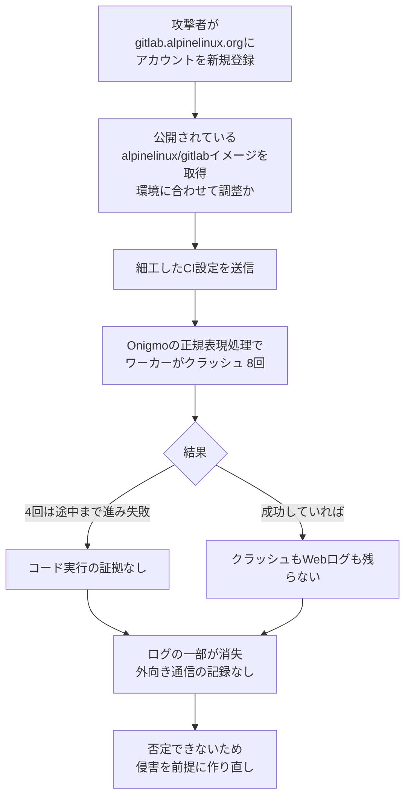

# Alpine Linux ― 自前GitLabにRCE攻撃、侵害を前提に再構築

## 要点

### 影響バージョン

- 脆弱性は GitLab の CI 設定の正規表現処理にある **CVE-2026-97229**（CVSS 10.0、認証なしで RCE）。修正版は 2026年10月12日の **19.2.8／19.3.5／19.4.2**（GitLab、本サイト10月13日の記事）。
- 根本のバグは Ruby 組み込みの正規表現エンジン **Onigmo** にある。GitLab の修正は、**GitLab が公式パッケージとコンテナイメージに同梱する Ruby へのパッチ**として入っている（Alpine Linux）。
- そのため、**ソースから入れた GitLab や、自前の Ruby で作ったコンテナイメージでは、GitLab を上げても直らない**。Ruby 本体の修正は10月23日の **3.3.13／3.4.12／4.0.9** で入った（Alpine Linux、Ruby）。
- Alpine が配布する `alpinelinux/gitlab` イメージは、**10月27日に公開し直した 19.3.6**（Ruby 3.3.13 入り）より前に取得したものと、それより古いタグはすべて脆弱（Alpine Linux）。

### 今すぐやること

- 自前の GitLab は、**GitLab のバージョンに加えて、実際に動いている Ruby のバージョン**を確かめる。公式パッケージ以外で動かしている場合は Ruby 3.3.13／3.4.12／4.0.9 以上にする（Alpine Linux）。
- `alpinelinux/gitlab` を使っている場合は、`alpinelinux/gitlab:19.3.6` を**取得し直す**（Alpine Linux）。
- Alpine の `ruby` パッケージを使っている場合は `apk upgrade` する。3.22・3.23・3.24・edge は Ruby 3.4.12、3.21 は 3.3.13 で修正済み（Alpine Linux）。
- gitlab.alpinelinux.org と同じパスワードをほかで使っていたら、そちらを変える。Alpine の GitLab には、他サイトから漏れたパスワードによる自動ログインの試みが来ている（Alpine Linux）。

## 概要

- Alpine Linux は10月28日、自前の GitLab（gitlab.alpinelinux.org）が10月20〜21日に CVE-2026-97229 の悪用を試みられたと公表した。修正の公開から約1週間後で、「攻撃はあと少しで成功するところだった」としている（Alpine Linux）。
- 成功した証拠は見つからなかったが、成功しても痕跡が残らない種類の攻撃で、必要なログも一部失われていたため否定できず、**侵害されたものとして作り直した**（Alpine Linux）。
- 途中で GitLab を更新したのに直っていなかった。修正が GitLab のコードではなく、公式パッケージに同梱された Ruby へのパッチだったためである（Alpine Linux）。

> この記事では、ベンダー・公的機関・研究者・報道で確認できた内容を「事実」、筆者の推測や意見を「考察」として分けて書いています。

## 何が起きたか（時系列）

| 日付 | 出来事 |
| --- | --- |
| 10月12日 | GitLab が修正版を公開（Alpine Linux） |
| 10月13日 | CVE-2026-97229 公開。Alpine は修正入りの 19.3.5 ではなく、**誤って 19.3.4 に更新**（Alpine Linux） |
| 10月20日 | 攻撃者がアカウントを登録し、探りを開始（Alpine Linux） |
| 10月21日 | 本格的な攻撃。GitLab が落ち、502 エラーや CI ジョブの失敗が出る（Alpine Linux） |
| 10月22日 | GitLab 19.3.6 に更新（Alpine Linux） |
| 10月23日 | 攻撃者のアカウントを停止。Ruby が修正版を公開（Alpine Linux、Ruby） |
| 10月24日 | aports（パッケージのレシピ）・パッケージ・10月21日のリリースを、GitLab の外の記録と照合（Alpine Linux） |
| 10月25〜26日 | 攻撃者が戻ってきて再び侵入を試みるが失敗（Alpine Linux） |
| 10月26日 | 更新後も脆弱なままだったことに気づく（Alpine Linux） |
| 10月27日 | 開発者とビルドサーバー以外に GitLab を閉じ、作り直しを開始。Ruby 3.3.13 入りのイメージを公開（Alpine Linux） |
| 10月28日 | 作り直しが完了。全パスワードを初期化し、GitLab の秘密鍵を入れ替え。公表（Alpine Linux） |

## 技術的な問題点（根本原因）

**事実（Alpine Linux）**

- 攻撃者は新しく登録したアカウントから、細工した CI 設定を送った。これで GitLab のワーカーが**8回**クラッシュし、そのうち**4回は攻撃が途中まで進み、次の段階で失敗**していた。
- 攻撃者は Alpine が公開している GitLab のコンテナイメージをダウンロードしていた。Alpine は「自分たちのビルドに合わせて攻撃を調整していた」とみている。
- Alpine の GitLab は標準の Ruby で作った自前イメージだった。GitLab 本体を 19.3.6 に上げても、修正は GitLab が公式パッケージにだけ当てる Ruby のパッチなので、**Alpine の環境には入らなかった**。
- 攻撃のあった時点では、そもそも修正前の 19.3.4 だった（10月13日に更新先を取り違えた）。

**事実（Ruby）**

- 10月23日の Ruby 3.3.13／3.4.12／4.0.9 は、GitLab の CVE-2026-89078・CVE-2026-93577・CVE-2026-97229・CVE-2026-110264 が利用する正規表現のコンパイル処理のバグを直した。保守フェーズの 3.3 系にも例外として入れた。

**考察**

- 根本原因は2段ある。1つは更新先の取り違えという単純な運用ミス、もう1つは「アプリの修正が実は同梱ランタイムへのパッチだった」という依存関係の見えにくさである。後者は、GitLab のリリースノートを読んでバージョンを上げるだけの運用では気づけない。
- Onigmo のバグは GitLab 固有ではない。信頼できない入力から正規表現を組み立てる Ruby のプログラムなら同じ問題を抱える、と Alpine も書いている。

## 攻撃・侵入経路

**事実（Alpine Linux）**

- 攻撃が成功していた場合に読まれた可能性があるもの：全利用者のメールアドレス・名前・IP アドレス、パスワードハッシュ、2要素認証の秘密情報、CI/CD 変数とランナーのトークン、Webhook・連携・プッシュミラーの認証情報、個人用アクセストークン（ハッシュで保存）、非公開リポジトリ、非公開の Issue とマージリクエスト。
- 確認できたこと：コードが動いた形跡はない（タイミングを使った確認で遅延がなく、想定外のファイル・鍵・フック・プロセスもない）。Web や API の応答で非公開データが返された記録もない。
- 確認できないこと：成功した攻撃はクラッシュも Web ログも残さない。攻撃当日のバックグラウンドジョブのログと古いコンテナのファイルシステムが失われた。ホストからの外向き通信は記録しておらず、ホスティング事業者にも記録がない。

## なぜ防げなかったか・構造的要因の考察

**事実（Alpine Linux）**

- パッケージと署名鍵は守られていた。**パッケージとリリースの署名鍵は、これまで一度も GitLab サーバーに置いたことがない**。
- 10月20〜22日の aports のコミットはすべて既知の開発者の記録された push で、開発者の手元のクローンと **45台のビルダー**という、攻撃者が触れない記録と照合した。10月20〜24日に作ったパッケージ（全アーキテクチャ）と10月21日の安定版リリース（3.21.9・3.22.7・3.23.7・3.24.3、ISO と公式 Docker イメージの元になる minirootfs を含む）は、検証済みのコミットから作られていた。GitLab は27日まで脆弱だったため、照合の範囲を27日まで広げている。

**考察**

- **署名鍵を開発基盤の外に置く設計が効いた。** ディストリビューションにとって最悪のシナリオはパッケージの改ざんだが、GitLab を完全に取られても署名はできない構成だったため、被害の上限が「GitLab 上のデータ」に限られた。外部の記録と突き合わせて「改ざんなし」を言えたのも、GitLab だけに真実を持たせていなかったからである。
- **誰でも登録できる CI は攻撃面そのもの。** オープンソースの GitLab は誰でもアカウントを作れ、CI 設定を送れる。CVE-2026-97229 のような「CI 設定を解釈するだけで RCE」の脆弱性では、登録できること自体が入口になる。
- **公開イメージが攻撃者の練習台になった。** 自前ビルドのイメージを公開していると、攻撃者は同じ環境を手元で再現してから本番に打てる。これは公開をやめる理由にはならないが、修正が遅れたときの危険を大きくする。
- **ログが足りないと「白」を証明できない。** 外向き通信の記録がなく、ログの保存期間も14日だったため、作り直すしかなかった。逆に言えば、作り直しの判断を早く下したのは妥当である。

## 運用者向けの具体的な対策と検知ポイント

**事実（Alpine Linux の再発防止策）**

- 修正済みの Ruby（3.3.13 以上）で動かす。
- GitLab の緊急の修正版は1日以内に当て、毎回 Ruby などの部品に自前で当てるべきパッチがないか確認する。
- GitLab ホストからの外向き通信とデータベース接続を記録し、ログを14日より長く保存する。
- リリースタグに署名し、GitLab に頼らずにリリースを検証できるようにする。

**考察（運用上の工夫）**

- 自前ビルドの GitLab では、更新後に `ruby -v` や GitLab の管理画面で実際の Ruby のバージョンを確認する手順をチェックリストに入れる。「GitLab のバージョンが上がった＝直った」ではない。
- 誰でも登録できるインスタンスでは、新規アカウントの CI 実行を承認制にする、登録直後のアカウントがパイプラインを作ったら通知する、といった制限で、未修正期間の露出を減らせる。
- ワーカーの異常終了（今回は8回）は、悪用の試みの数少ない手がかりになる。Puma や Sidekiq の異常終了を監視の対象にし、登録直後のアカウントの CI 設定と突き合わせる。
- 署名鍵・ビルダー・配布ミラーを GitLab から切り離し、ソースの記録を複数持っておくと、開発基盤が侵害されても配布物の完全性を説明できる。

## 参考リンク

- [GitLab security incident: attempted exploitation of CVE-2026-97229（Alpine Linux、2026年10月28日）](https://alpinelinux.org/posts/GitLab-security-incident-CVE-2026-97229.html)
- [Ruby 3.3.13 Released（Ruby、2026年10月23日）](https://www.ruby-lang.org/en/news/2026/10/23/ruby-3-3-13-released/)
- [GitLab CVE-2026-97229 ― CI/CDの正規表現処理で認証なしRCE（本サイト、2026年10月13日）](/security-notes/notes/2026-10-13-gitlab-cve-2026-97229-cicd-regex-compiler-unauth-rce/)
- [GitLab CVE-2026-110264 ― .orgファイル表示で認証なしRCE（本サイト、2026年10月23日）](/security-notes/notes/2026-10-23-gitlab-cve-2026-110264-org-mode-onigmo-rce/)
