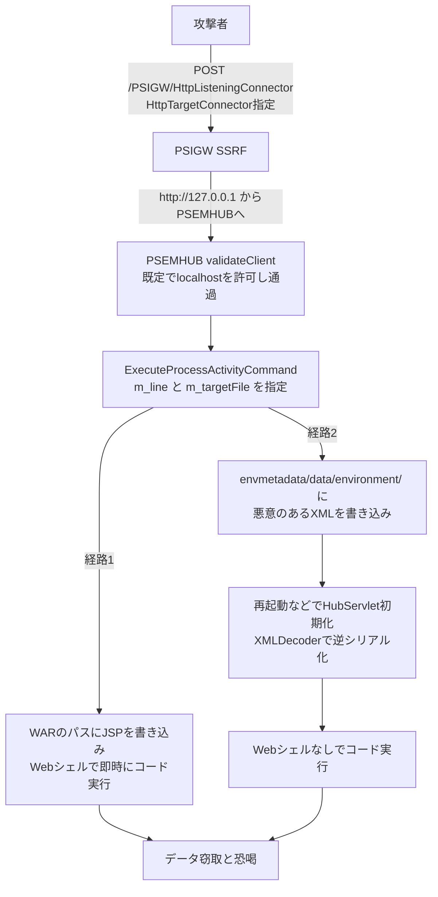

# Oracle PeopleSoft ― 悪用中のRCEは3つの脆弱性の連鎖と判明

## 要点

### 影響バージョン

- **PeopleSoft Enterprise PeopleTools 8.61、8.62**。CVSS 9.8、ネットワーク経由で認証なしに悪用でき、成功するとサーバーを乗っ取られる。PeopleSoft Enterprise の各アプリケーションも影響を受けうる（Oracle）。
- Oracle は6月10日の臨時のセキュリティアラートで修正を出した。CISA の悪用確認済み脆弱性カタログ（KEV）に載っている（The Hacker News）。ZDI によると、修正は1つの CVE にまとめられているが、中身は**別々の3つの脆弱性**で、個別の CVE 番号を付けるよう Oracle と調整中（Oracle、ZDI）。

### 今すぐやること

- Oracle のアラートの修正を当て、サポート中の PeopleTools にとどまる（Oracle）。
- すぐ当てられない場合は、**複数サーバー構成では Environment Management Hub（PSEMHUB）のサービスを無効化**し、**単一サーバー構成では PSEMHUB アプリケーションを削除**する。通常の利用者のセッションには影響しない（Oracle のアラート、The Hacker News 経由）。
- WAF のパス一致によるブロックだけに頼らない。実際に `/%50SEMHUB/` と1文字だけ URL エンコードした回避が使われている（Mandiant、The Hacker News 経由）。
- 侵害の可能性がある場合は、Webシェルが見つかったホストを侵害済みとして扱い、証拠を保全し、PeopleSoft 層から届く**すべての認証情報を変更**する。ShinyHunters はデータを盗んでから金銭を要求するので、恐喝への備えも要る（Mandiant、The Hacker News 経由）。

## 概要

- ShinyHunters が悪用している Oracle PeopleSoft の CVE-2026-35273 は、1つの欠陥ではなく、3つの脆弱性の連鎖だった。報告者の TrendAI の Zero Day Initiative（ZDI）がブログで中身を公開し、The Hacker News が10月28日に報じた（ZDI、The Hacker News）。
- 外部連携用の PSIGW の SSRF で、内部管理用の PSEMHUB に「サーバー自身から」リクエストを送る。PSEMHUB の接続元チェックは**出荷時から localhost を信頼している**ため素通りになる（ZDI）。
- そこから、ログ書き込み機能で Webシェルを置くか、再起動時に読み込まれる XML で Java の逆シリアル化を起こすかの2通りでコードを実行できる。後者は Webシェルを残さない（ZDI）。

> この記事では、ベンダー・公的機関・研究者・報道で確認できた内容を「事実」、筆者の推測や意見を「考察」として分けて書いています。

## 何が起きたか（時系列）

| 日付 | 出来事 |
| --- | --- |
| 2026年5月27日〜6月9日 | ShinyHunters（Mandiant／GTIG の呼称 UNC6240）が主に大学を狙って悪用。Oracle の公表前でゼロデイだった（Mandiant、The Hacker News 経由） |
| 2026年6月10日 | ZDI が Oracle に報告。同日付で Oracle が臨時のセキュリティアラートを公開（ZDI、The Hacker News） |
| 2026年9月25日 | Mandiant が、教育機関以外（テクノロジー、IT サービス、医療、農業、運輸、政府）に広がった大規模な悪用の続報を公開。世界で数十のシステムに影響（ZDI、The Hacker News） |
| 2026年10月下旬 | ZDI の Bobby Gould が3つの脆弱性の詳細をブログで公開（ZDI） |
| 2026年10月28日 | The Hacker News が報道（The Hacker News） |

## 技術的な問題点（根本原因）

**事実（ZDI）**

関係するのは、別々の Web アプリケーションとして動く2つの部品である。PSIGW（Integration Gateway）は外部システムとメッセージをやり取りする。PSEMHUB（Environment Management Hub）は内部の管理用インターフェースで、`validateClient` メソッドで信頼できる接続元だけを受け付けることになっている。

| 番号 | 内容 |
| --- | --- |
| ZDI-CAN-31816（SSRF） | `/PSIGW/HttpListeningConnector` への POST で `HttpTargetConnector` を指定すると、送信先 URL（例 `http://127.0.0.1:8000`）と中身を攻撃者が自由に決められる。送信先が正当かどうかの確認がない |
| ZDI-CAN-31818（ファイルパスの外部制御） | PSEMHUB の `ExecuteProcessActivityCommand` は本来ログを書くための機能だが、`m_line` で書く内容、`m_targetFile` で絶対パスを指定でき、パスがログ用のディレクトリかどうかを確かめない。PSEMHUB の WAR のパスに JSP を書けば、PeopleSoft のサービスアカウント権限ですぐにコードが動く |
| ZDI-CAN-31817（信頼できないデータの逆シリアル化） | 任意のファイル書き込みで `[docroot]/envmetadata/data/environment/` に悪意のある XML を置くと、次に `HubServlet` が初期化されたとき（再起動など）に `startServerPeer` から各ファイルが Java の `XMLDecoder` で読み込まれる。XMLDecoder は解析中にオブジェクトを生成するため、`Environment` 型への変換で例外が出る前に攻撃者のコードが動く |

- `validateClient` は、接続元のホスト名と IP を `/envmetadata/config/allowedhosts.properties` の一覧と照合する。この一覧には**出荷時から localhost が入っている**。SSRF で 127.0.0.1 から PSEMHUB にリクエストを送ると、サーバー自身からの通信に見えるので照合を通る。ZDI は「強力な SSRF と、ループバックからの PSEMHUB へのアクセスを既定で許す判断の組み合わせが、`validateClient` の保護を無効にしている」と書いている。

**考察**

- 1つ1つは「内部向けだから大丈夫」という前提で書かれた機能である。ログ書き込みが任意パスを受け付けるのも、XMLDecoder で設定を読むのも、PSEMHUB に外から届かなければ問題にならない。その前提を、別アプリの SSRF と「localhost は信頼する」既定値が同時に崩した。
- 修正が1つの CVE にまとめられているため、どの部分が直ったのかを利用者が把握しにくい。ZDI が個別の CVE 化を求めているのは、この見えにくさを解消するためと読める。

## 攻撃・侵入経路

**事実（Mandiant、The Hacker News 経由）**

- 9月の攻撃では、`/PSEMHUB/` のパスをブロックする WAF のルールを、1文字を URL エンコードした `/%50SEMHUB/` で回避していた。多くの WAF ルールはパスを文字列のまま照合するが、PeopleSoft のサーバーはデコードしてページを返す。

## なぜ防げなかったか・構造的要因の考察

**考察**

- **公表前に悪用が始まっていた。** 最初の悪用（5月27日〜6月9日）は Oracle のアラートより前で、修正を当てる機会がなかった。大学の PeopleSoft は学生・教職員の個人情報や成績をまとめて持っており、データを盗んで恐喝する ShinyHunters にとって価値が高い。
- **「ループバックは安全」という既定値。** 同じサーバーからの通信を信頼する設計は多いが、そのサーバー上に外部の入力で任意の宛先に通信できる機能（SSRF）が1つでもあれば、信頼は外部に開いてしまう。今回は別の Web アプリ同士だったため、設計の段階で組み合わせが見落とされたと考えられる。
- **WAF だけの暫定対策は破られる。** 9月の波で使われた `%50` の回避は単純だが、パスの正規化をしない WAF ルールには十分だった。修正までのつなぎを WAF に任せていた組織は、守れていると思い込んだまま侵入された可能性がある。
- **2つ目の経路は痕跡が少ない。** XMLDecoder の経路は Webシェルを残さず、コードが動くのも次の再起動時なので、Webシェルの探索だけでは見逃す。

## 運用者向けの具体的な対策と検知ポイント

**事実（Oracle、Mandiant、ZDI）**

- 修正を適用する。すぐにできなければ PSEMHUB を無効化・削除する（Oracle）。
- Webシェルが見つかったホストは侵害済みとして扱い、証拠を保全し、PeopleSoft 層から届く認証情報をすべて変更する（Mandiant）。

**考察（検知の工夫）**

- Web サーバーのアクセスログで、`/PSIGW/HttpListeningConnector` への外部からの POST と、`/PSEMHUB/` や URL エンコードされた `/%50SEMHUB/` などへのアクセスを探す。WAF・ログの照合はデコード後のパスで行う。
- PSEMHUB の WAR のディレクトリに、見覚えのない JSP ファイルがないかを確認する。
- `[docroot]/envmetadata/data/environment/` に、正規の環境情報以外の XML がないかを確認する。再起動の前に確認しておくと、2つ目の経路の実行を防げる。
- `allowedhosts.properties` の内容を見直し、PSEMHUB を使っていなければ止める。修正を当てても、すでに置かれた Webシェルや XML は残る可能性があるので、修正前に侵入されていなかったかを別に確かめる。

## 参考リンク

- [CVE-2026-35273: SSRF to RCE in Oracle PeopleSoft（Zero Day Initiative）](https://www.zerodayinitiative.com/blog/2026/10/20/cve-2026-35273-ssrf-to-rce-in-oracle-peoplesoft)
- [Oracle Security Alert Advisory - CVE-2026-35273（Oracle）](https://www.oracle.com/security-alerts/alert-cve-2026-35273.html)
- [ShinyHunters-Exploited Oracle PeopleSoft Zero-Day Turns Out to Be Three Chained Flaws（The Hacker News、2026年10月28日）](https://thehackernews.com/2026/10/shinyhunters-exploited-oracle.html)
