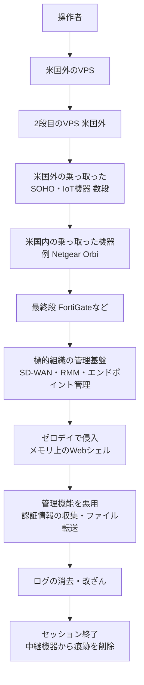

# Volt Typhoon ― 使い捨て中継網で管理基盤のゼロデイを悪用

## 要点

### 狙われた製品と脆弱性

Lumen Black Lotus Labs によると、「Silent Train」経由で次のゼロデイが悪用された（確認4件・可能性1件）。期間は「ゼロデイだった時期」で、悪用はその後も続いたものがある（Lumen）。

| 製品 | 脆弱性 | 確度・補足 |
| --- | --- | --- |
| Versa Director（SD-WAN 管理） | CVE-2024-39717 | 確認。2024年半ば。メモリ上の JAR Webシェル「VersaMem」 |
| N-able N-central（RMM） | CVE-2025-8875、CVE-2025-8876 | 確認。未公表の脆弱性の連鎖 |
| Cisco Catalyst SD-WAN | CVE-2026-20127（CVSS 10.0） | 確認。2025年後半から。2026年2月の Cisco の公表後も悪用が続いた |
| VeloCloud Orchestrator（SD-WAN 管理） | CVE-2026-16812 | 確認 |
| Quest KACE（エンドポイント管理） | 特定できず | 可能性（中程度の確度）。被害30組織超、2025年10月の Quest の更新後に減少 |

### 今すぐやること

- 上の製品を使っている組織は、修正版の適用状況を確認する。公表前から悪用されていたため、**修正済みでも侵入済みの可能性**を前提に、管理画面のログイン・API・設定変更の記録を見直す（考察。Lumen の推奨を元にした）。
- SD-WAN の管理基盤、RMM、エンドポイント管理などの**管理画面をインターネットに直接出さない**。VPN、踏み台サーバー、専用の管理ネットワーク経由に限る（Lumen）。
- 家庭・小規模オフィスのルーターや IoT 機器、FortiGate などの境界機器は、管理画面を外に出さず、ファームウェアを更新する。サポートが切れた機器は入れ替える。中継に使われた機器の中には既知の脆弱性がない機種もある（Lumen）。

## 概要

- Lumen の脅威調査チーム Black Lotus Labs は、中国の国家支援とされる攻撃グループ Volt Typhoon が使う中継網を「Silent Train」と名付け、3年間の追跡結果を公表した。The Hacker News が10月28日に報じた（Lumen、The Hacker News）。
- Silent Train は常設のボットネットではなく、**使うたびに乗っ取った機器で中継の鎖を組み、終わったら片付ける**方式である。この網で追跡できたことが、数百件の被害通知と、ゼロデイ4件の発見につながった（Lumen）。
- 狙いは SD-WAN の管理基盤やエンドポイント管理など、多数の機器を一度に操作できる「管理面」で、ハワイ・カリフォルニア・テキサスに集中していた（Lumen）。

> この記事では、ベンダー・公的機関・研究者・報道で確認できた内容を「事実」、筆者の推測や意見を「考察」として分けて書いています。

## 何が起きたか（時系列）

| 時期 | 出来事 |
| --- | --- |
| 2023年11月 | Silent Train の継続的な活動を初めて観測。前身の KV-botnet の最初のテイクダウンの直前（Lumen） |
| 2023年末〜2024年1月下旬 | KV-botnet を米当局などが2度にわたり妨害。2度目の後、Silent Train の活動が増える（Lumen） |
| 2023〜2024年 | 中継に使う機器の種類を約1か月に1種類のペースで追加（通常は四半期に1種類）（Lumen） |
| 2024年半ば | Versa Director のゼロデイ悪用を Black Lotus Labs が公表（Lumen） |
| 2025年初め | 企業向け機器を1〜3か月使い続ける「混成型」に移行（Lumen） |
| 2025年後半 | Cisco Catalyst SD-WAN の CVE-2026-20127 を悪用（Lumen） |
| 2026年2月 | Cisco が CVE-2026-20127 を公表。その後も悪用が続く（Lumen） |
| 2023年11月〜2026年7月 | 標的の地理的な集中を集計した期間（Lumen） |
| 2026年10月28日 | The Hacker News が報道。中継網は「妨害済み」とされる（The Hacker News） |

## 技術的な問題点（根本原因）

**事実（Lumen）**

- 中継の鎖は、米国外の VPS から始まり、米国外の乗っ取った機器を数段たどってから、**米国内の乗っ取った機器**を出口にして標的に届く。典型的には4〜6段。米国内の機器を最後に置くことで、国別のアクセス制限や IP の評判による判定をすり抜ける。
- 中継に使われた機器は27種類を超える。TP-Link のルーター、Intelbras のモデム、Netgear Orbi、Ruckus、SATO、Zyxel、Cambium など SOHO・IoT 機器から、Fortinet の機器、CyberPanel サーバー、PRTG、Mirth Connect などの企業向け製品まで含む。**既知の脆弱性がない機種もあり**、中継を1段作るためだけに未公表の脆弱性を使った可能性がある。
- 機器ごとに役割が固定されていた。Intelbras は米国外の中継だけ、Netgear Orbi は米国内で標的と通信する段だけ、最後の段は FortiGate、といった具合で、役割が変わることはなかった。
- 各機器では、外に出ている Web の管理画面を攻撃し、**一時的な SSH サービス、鍵、設定、OS 標準のツールだけ**を置く。セッションが終わると全部消す。鎖は2分未満で組めることもあり、半自動化された仕組みがあるとみられる。セッションは平均約4時間、数分で終わるものもあった。
- 後に、SSH を順につなぐ方式に加えて、Chisel や FRP といったオープンソースのプロキシで逆向きのトンネルを張る方式も使われた。古い方式は廃止されず、並行して使われた。

**考察**

- 守る側から見ると、標的に届く通信は「米国内の家庭用ルーターや自社と同じ業種の FortiGate」から来る。国や評判でブロックする対策は、この設計の前では効かない。
- 痕跡を残さない片付けと、2分で組み直せる速さの組み合わせで、中継機器を1台ずつ見つけて止めても全体は止まらない。KV-botnet のような常設の網を潰された経験から、潰されても困らない形に作り替えたと読める。

## 攻撃・侵入経路

**事実（Lumen）**

- 1回のセッションで狙うのは1〜5組織で、1組織だけのことが多い。Silent Train は侵入、認証情報の取得、持ち出し、アクセスの維持に使われ、偵察には別の中継網（ORB ネットワーク）が使われていた。
- 侵入後の調査では、メモリ上の Webシェル、認証情報の収集、エンドポイント操作やリモートのファイル転送といった**製品の正規機能の悪用**、ログや証拠の消去・改ざんが見つかった。
- Quest KACE の事例では、KACE サーバーにとどまったまま管理機能で認証情報を取って持ち出し、社内ネットワークの横移動はしなかった。
- 狙われたベンダーには Fortinet、Cisco、ManageEngine、Ivanti、F5、Check Point、Palo Alto Networks、ServiceNow、ArcGIS が含まれる。
- 被害分野は通信、政府、防衛関連企業、衛星・重要通信、ROTC（予備役将校訓練課程）のある大学、MSP と IT 企業、水道、エネルギー、運輸、海運、鉄道、航空、緊急サービス。
- 活動は月〜金曜の中国標準時9〜22時に集中し、週末と夜間は少なく、春節の時期には数週間にわたって減った。Lumen は人が交代で操作している形とみている。

## なぜ防げなかったか・構造的要因の考察

**考察**

- **管理基盤は「1台取れば数百台」の場所。** SD-WAN の管理基盤や RMM は、配下の機器や顧客環境をまとめて操作できる。Lumen が KACE の事例で示したように、そこにとどまるだけで目的を果たせるので、横移動を監視する対策にもかかりにくい。
- **公表前の脆弱性には修正が間に合わない。** 4件はいずれもゼロデイで、守る側に残されたのは「管理画面を外に出さない」「普段と違うログインや操作に気づく」の2つだけだった。Cisco の脆弱性では公表後も悪用が続いており、公表から適用までの遅れも狙われた。
- **ログが短く、消される。** 攻撃者はログを消し、中継機器からは痕跡を片付ける。KACE ではログが足りず脆弱性を特定できなかった。管理基盤のログを外部に送って長く残していないと、後から何が起きたかを確かめられない。
- **家庭用機器の放置が他人の攻撃を支える。** 中継の多くは世界中の家庭・小規模オフィスの機器で、持ち主は加害に使われたことに気づかない。メーカーの更新が止まった機器は、利用者が個別に対応するしかない。

## 運用者向けの具体的な対策と検知ポイント

**事実（Lumen の推奨）**

- ネットワーク・エンドポイントの管理基盤、SD-WAN の管理基盤、帯域外管理の仕組みなど、まとめて管理できる製品に一段強いセキュリティ対策を当てる。これらを通じて与えている権限・信頼関係・配下へのアクセスを定期的に見直す。
- インターネットに出ているシステム、管理サービス、ポータルを棚卸しして減らす。管理画面への直接のアクセスは VPN、アクセス制御、踏み台サーバー、専用の管理ネットワークに限る。
- 管理基盤の脆弱性の修正を最優先にし、インターネットに出ている管理基盤は速く更新できる体制を保つ。
- ログを集約し、保存期間を延ばし、外部に送る。高い権限を持つ機器のログを優先する。
- 普段と違う管理者ログイン、管理操作、API の使い方、リモートのファイル転送、設定変更を監視する。通常の作業時間や手順から外れた、OS 標準ツールを使った操作を探す。
- CISA と英国 NCSC の Volt Typhoon 対策の指針を実施する。

**考察（検知の工夫）**

- 管理基盤へのログイン元を、国内の家庭用回線や小規模オフィスの IP も含めて「許可した場所かどうか」で判定する。国別ブロックだけでは、米国内の機器を出口にするこの網は止められない（日本の組織でも、国内の機器を出口にされれば同じことが起きうる）。
- 日本時間では、中国標準時9〜22時は10〜23時にあたる。業務時間内に紛れるので、時間帯だけで判定せず、操作の内容（普段使わない API、まとめての設定変更、大量のファイル転送）を見る。
- 自社のルーターや FortiGate が中継に使われていないかは、見慣れない SSH の待ち受けポートや、外部への逆向きトンネル（Chisel・FRP の通信）が手がかりになる。

## 参考リンク

- [Silent Train: uncovering Volt Typhoon's operational framework for zero-day exploitation and strategic access（Lumen Black Lotus Labs）](https://www.lumen.com/blog/en-us/silent-train-volt-typhoon-operational-framework)
- [Volt Typhoon Used Covert Silent Train Network in Four Zero-Day Exploitation Campaigns（The Hacker News、2026年10月28日）](https://thehackernews.com/2026/10/volt-typhoon-used-covert-silent-train.html)
