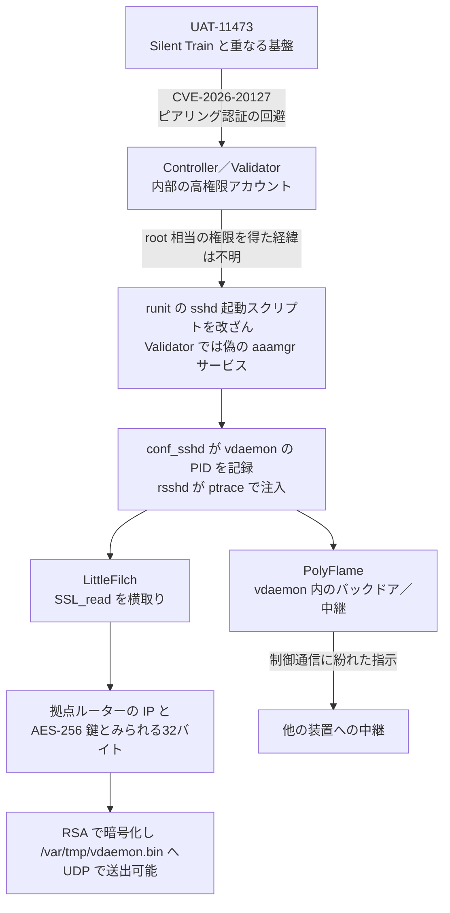

# KeyDrift ― Cisco SD-WANの制御装置に鍵収集マルウェアが潜伏

## 要点

### 影響バージョン（侵入に使われた CVE-2026-20127）

- **Cisco Catalyst SD-WAN Controller（旧 vSmart）、Manager（旧 vManage）、Validator（旧 vBond）**。設定にかかわらず影響し、オンプレミスのほか Cisco がホストするクラウド（Cisco Managed、FedRAMP 環境を含む）も対象。CVSS 10.0、認証なしで内部の高権限アカウント（root ではない）としてログインでき、NETCONF 経由で SD-WAN 全体の設定を変えられる（Cisco）。
- 最初の修正版は 20.9.8.2、20.12.5.3／20.12.6.1、20.15.4.2、20.18.2.1。20.9 より前と 20.11・20.13・20.14・20.16 はサポートが終わっており、修正版の系列へ移る必要がある。回避策はない（Cisco）。
- Cisco は2月25日にこの脆弱性を公表し、6月16日に Validator を対象に追加した。アドバイザリは10月28日にも更新されている（Cisco、The Hacker News）。

### 今すぐやること

- 修正版に上げる。すぐに上げられないオンプレミス環境では、ポート22と830への接続を既知の制御装置などの IP に絞る。ただしこれは侵入を防ぐだけで、**すでに置かれたマルウェアは消えない**（Cisco、The Hacker News 経由）。
- `/var/log/auth.log` で、管理画面に登録した System IP 以外からの `Accepted publickey for vmanage-admin` を探す。制御接続のピアリングは、特に vManage 種別のものを1件ずつ正当か確かめる（Cisco）。
- 下の「検知ポイント」のファイルが Controller・Validator にないかを確かめ、見つかったらインシデント対応を始めて Cisco TAC に相談する。TAC に連絡する前に、各制御装置で `request admin-tech` を取っておく（Talos、Cisco、The Hacker News 経由）。
- Snort を使っているなら、KeyDrift の通信を見るルール（Snort 2 は 67387〜67416、Snort 3 は 7:44〜7:73）を有効にする。Snort 2 のルールは既定で無効になっている（Talos、The Hacker News）。

## 概要

- Cisco Talos は10月28日、Cisco Catalyst SD-WAN の制御装置の中で動くマルウェア群「KeyDrift」の分析を公開した。攻撃者は CVE-2026-20127 で認証を回避して入り込み、KeyDrift を置いた（Talos）。
- KeyDrift は、SD-WAN の制御通信を処理する正規のプロセス `vdaemon` の中に入り込み、復号された後の制御メッセージから、拠点のルーター同士の通信を暗号化する鍵とみられるデータを抜き出す（Talos）。
- Talos はこの攻撃を「過去の活動（historical）」としているが、いつ起きたのか、鍵が実際に外へ送られたのかは明らかにしていない（The Hacker News）。

> この記事では、ベンダー・公的機関・研究者・報道で確認できた内容を「事実」、筆者の推測や意見を「考察」として分けて書いています。

## 何が起きたか（時系列）

| 日付 | 出来事 |
| --- | --- |
| 2023年以降 | Talos が2月の時点で、CVE-2026-20127 の悪用を UAT-8616 として追跡し、その活動は少なくとも2023年までさかのぼるとした（The Hacker News） |
| 2025年後半 | Lumen によると、Volt Typhoon がこの脆弱性を悪用していた（Lumen、The Hacker News 経由） |
| 2026年2月25日 | Cisco がアドバイザリを公開。CISA が連邦民間機関向けの緊急指令を出す（Cisco、The Hacker News） |
| 2026年6月16日 | Cisco が Validator を影響製品に追加（The Hacker News） |
| 2026年10月28日 | Talos が UAT-11473 と KeyDrift の分析と Snort ルールを公開。同じ日に Lumen も、Volt Typhoon が Cisco の公表後も悪用を続けたと公表（Talos、The Hacker News） |

Talos は、KeyDrift の UAT-11473 と2月の UAT-8616 がどういう関係にあるかは書いていない。Lumen の報告も Volt Typhoon の悪用と KeyDrift を結び付けてはいない（The Hacker News）。Lumen の中継網についてはこのサイトの[Volt Typhoon「Silent Train」の記事](/security-notes/notes/2026-10-29-volt-typhoon-silent-train-ephemeral-relay-zero-days/)を参照。

## 技術的な問題点（根本原因）

**事実（Cisco）**

- CVE-2026-20127 は、制御装置同士が互いを確かめる「ピアリング認証」が正しく働かないことによる。細工したリクエストを送ると、Controller に内部の高権限アカウント（root ではない）としてログインでき、NETCONF で SD-WAN 全体の設定を操作できる。

**事実（Talos）：KeyDrift の部品**

| 部品 | 役割 |
| --- | --- |
| 改ざんされた runit の起動スクリプト | `etc/sv/sshd/` の `run` に2行を足し、`/rootfs.rw` を実行可能で再マウントして `conf_sshd` をバックグラウンドで動かしてから、正規の sshd を起動する |
| `conf_sshd` | 動いている vdaemon のプロセスIDを `/tmp/system-vdaemon` に書き出し、`rsshd` を呼ぶ |
| `rsshd` | ptrace で `libdssl.so`（PolyFlame）を各 vdaemon に注入する |
| PolyFlame（`libdssl.so`） | vdaemon の中でメモリ上だけで動く。`recvfrom` などのソケット関数、DTLS、動的リンカの関数を横取りする。TinyShell に似たバックドア（コマンド実行、ファイルの読み書き）と、1つの C2 と複数の相手の間でコマンドを中継する役のどちらにもなれる |
| `aaamgrd` | Validator で見つかった別の形。`/etc/sv/aaamgr/` に偽のサービスを作り、RC4 で暗号化して埋め込んだ PolyFlame を復号して動かす。直接のシステムコールと TracerPid の確認でデバッグを妨げる。正規の aaamgr は Python のパッケージで、コンパイル済みのサービスとしては動かない |
| LittleFilch（`libcommon.so`） | vdaemon の中で `SSL_read` を横取りし、**復号された後の**制御メッセージを読む。決めておいた拠点ルーターについて、公開IP、System IP、32バイトのデータを抜き出す。Talos はこの32バイトを、Controller が配る AES-256 の IPsec 鍵と評価している |

- Cisco の従来の鍵交換では、各ルーターが自分の通信用の AES 鍵を定期的に作って Controller に送り、Controller がそれをほかのルーターに配る。この制御接続を担うのが vdaemon である（The Hacker News）。
- LittleFilch は集めたデータを RSA で暗号化して `/var/tmp/vdaemon.bin` に書き、DTLS 1.2 のアプリケーションデータに似せた形で UDP で送れる。送り先は `/var/tmp/vdaemon.conf` から読み、読んだら消す。Talos はこの設定ファイルを回収できていない（Talos）。
- PolyFlame の検体には、IP アドレスやドメインなどの接続先が1つも埋め込まれていなかった。SD-WAN の制御通信に紛れて指示を受け取る作りである。C2 から届いた日付の MD5 と、装置の日付（`%Y-%m-%d`）の MD5 が一致しないと動かない（Talos）。
- 攻撃者は、既存のファイルの日時と権限を自分のファイルに写す `touch --reference=`、`chmod --reference=` で痕跡をごまかしていた。部品の書き方に違いがあり、開発が続いているとみられる（Talos）。

**考察**

- CVE-2026-20127 で得られるのは root ではないアカウントだが、KeyDrift は runit のスクリプトを書き換え、ptrace で vdaemon に注入している。どうやって root 相当の権限を得たのかは Talos の報告に書かれていない。別の権限昇格を組み合わせた可能性があるが、確認できていない。
- 制御装置は「鍵を配る場所」なので、そこを押さえれば各拠点のルーターを1台ずつ攻めなくても、まとめて鍵が手に入る。暗号化そのものは破られていないが、鍵が復号される場所の内側に入られている。

## 攻撃・侵入経路

**事実（Talos）**

- 狙われたのは、宇宙・衛星サービス、防衛・航空宇宙技術、政策研究の分野。UAT-11473 の基盤は、Lumen が Volt Typhoon の中継網とする Silent Train と「大きく重なる」と高い確度で評価しているが、両者が同じグループだとは言っていない（Talos、The Hacker News）。

## なぜ防げなかったか・構造的要因の考察

**考察**

- **制御装置が外から届く場所にあった。** Cisco は、インターネットに出ている Controller が危ないと明記している。SD-WAN の制御装置は拠点のルーターから届く必要があるため外向きに置かれやすく、そこに CVSS 10.0 の認証回避があった。
- **アプライアンスの中は見えにくい。** KeyDrift は正規の vdaemon の中に入り、正規の sshd を起動したうえで動く。外への接続先も持たず、制御通信に紛れる。一般的なサーバーのように EDR を入れられない装置では、ファイルの改ざんを人が確かめる以外に見つける手がかりが少ない。
- **修正版に上げても片付かない。** Cisco の2月の手順書は、更新前から残っている攻撃の仕掛けがありうると警告している。一方、今回の Talos の助言は、更新で KeyDrift が消えるのか、鍵を作り直すべきかには触れていない（The Hacker News）。「パッチは当てた」で終わった組織では、制御装置にマルウェアが残っている可能性がある。
- **鍵を守る仕組みの外側で鍵が取られる。** IPsec の鍵は通信路の上では暗号化されているが、Controller の中では平文で扱われる。鍵を配る役の装置に入られると、暗号の強さは関係なくなる。

## 運用者向けの具体的な対策と検知ポイント

**事実（Cisco、Talos）**

- 修正版に上げ、Cisco の Catalyst SD-WAN 強化ガイドに従い、侵入後の活動の兆候を監視する（Talos）。
- `request admin-tech` で集めたファイルを、Bug Search Tool の CSCws52722 のページにある Check Bug Applicability で再確認する（Cisco の手順書、The Hacker News 経由）。
- 米国の連邦民間機関は、root アカウントの侵害を見つけた場合、CISA に報告し、修正済みのイメージから Manager・Controller・Validator を新しく作り、拠点ルーターをそちらへ移すよう求められている（CISA の緊急指令、The Hacker News 経由）。

**事実（Talos）：探すべきファイル**

- `etc/sv/sshd/` の `run` に、`/rootfs.rw` の再マウントや `conf_sshd` の起動が足されていないか
- `/etc/sv/aaamgr/` の偽サービスと `aaamgrd`
- `conf_sshd`、`rsshd`、`libdssl.so`、`libcommon.so`
- `/tmp/system-vdaemon`、`/var/tmp/vdaemon.bin`、`/var/tmp/vdaemon.conf`

Talos はファイルのハッシュや IP アドレス、ドメインの一覧を出していない（The Hacker News）。

**考察（検知の工夫）**

- vdaemon のメモリに `libdssl.so` や `libcommon.so` が読み込まれていないかを、`/proc/<pid>/maps` で確かめる。ファイルの日時は偽装されているので、日時だけで「古いから正規」と判断しない。
- KeyDrift が見つかった環境では、Controller が配っていた拠点間の鍵が漏れた前提で考える。CISA の指令と同じく、制御装置を修正済みのイメージから作り直し、鍵の作り直しも Cisco TAC と相談する。
- ポート22・830への接続元の制限は、修正後も外さずに続ける。制御装置への管理接続が、決まった装置以外から来ていないかを継続して見る。

## 参考リンク

- [Inside KeyDrift: Analyzing historical UAT-11473 activity on Cisco SD-WAN（Cisco Talos、2026年10月28日）](https://blog.talosintelligence.com/uat-11473-keydrift/)
- [Cisco Catalyst SD-WAN Controller Authentication Bypass Vulnerability（Cisco）](https://sec.cloudapps.cisco.com/security/center/content/CiscoSecurityAdvisory/cisco-sa-sdwan-rpa-EHchtZk)
- [Active exploitation of Cisco Catalyst SD-WAN by UAT-8616（Cisco Talos）](https://blog.talosintelligence.com/uat-8616-sd-wan/)
- [Hackers Exploited Cisco SD-WAN Flaw to Plant Malware Built to Steal Encryption Keys（The Hacker News、2026年10月29日）](https://thehackernews.com/2026/10/hackers-exploited-cisco-sd-wan-flaw-to.html)
